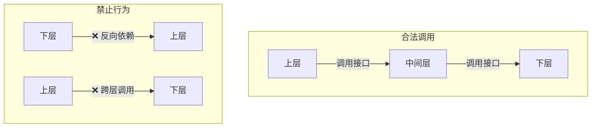
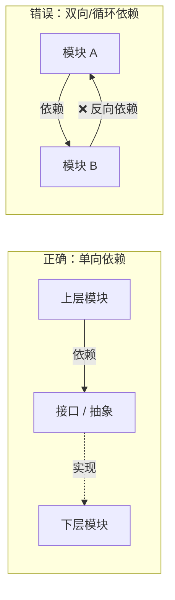
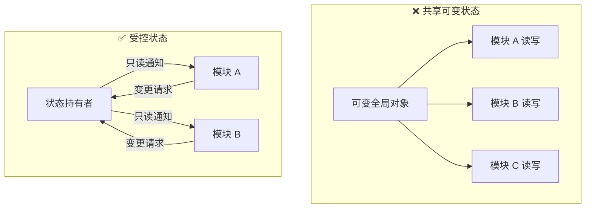
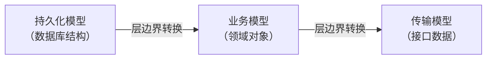
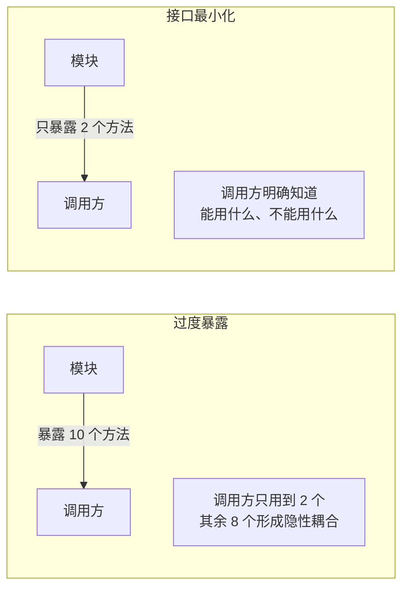

# 2.7 代码开发规范

## 总则

本规范定义代码在**架构层次、职责边界、依赖方向、状态管理、命名、数据模型与接口设计**上的通用原则。规范不绑定具体编程语言，也不要求特定架构模式，但要求所有项目在开始前明确分层结构，并在整个生命周期内严格遵守层间边界。

---

## 分层架构原则

### 明确分层，禁止跨层调用

每个项目必须在设计阶段定义清晰的分层结构。层数和命名可因项目性质而异，但以下约束对所有项目适用：

- 每一层只与相邻层通信，**禁止跨层调用**
- 依赖方向必须单向、自顶向下（或自外向内），**禁止下层依赖上层**
- 不同层之间通过明确定义的接口交互，而非直接持有对方的内部实现

### 层间通信规范

- 上层通过调用下层**接口**获取能力，不感知下层实现细节
- 下层通过**回调、事件、观察者等机制**将结果返回给上层，不主动持有上层引用
- 禁止任何层直接操作不属于自己职责范围的数据或状态

---

## 单一职责原则

### 模块职责

每个模块（文件、包、组件）应只承担**一个明确的职责**：

- 职责边界在设计时确定，修改时不得随意扩展
- 当一个模块同时承担了"数据获取"和"业务计算"两种职责时，必须拆分
- 衡量标准：**这个模块因为什么原因需要改变？** 如果答案超过一个，说明职责不单一

### 类与方法职责

- 一个类只描述一个概念，一个方法只完成一件事
- 方法长度超过 30 行时，应检查是否包含了多个逻辑步骤——若有，拆分为独立方法
- 类的公开方法数量应尽量少；公开方法越多，职责边界越模糊

---

## 依赖方向

- 高层模块依赖抽象（接口、协议、抽象类），不依赖具体实现
- 具体实现依赖抽象，抽象不依赖具体实现
- **禁止循环依赖**：模块 A 依赖模块 B，则 B 不得以任何方式依赖 A
- 当发现需要反向依赖时，通常说明分层设计有误，应调整架构而非绕过约束

---

## 状态管理原则

### 单一数据源

- 每一份数据在系统中只有**一个权威来源**，其他模块只读取或订阅，不独立持有副本
- 当同一状态在多处被独立维护时，必须合并为单一来源
- 状态变更只能通过权威来源发起，禁止外部直接修改

### 禁止共享可变状态

- 禁止多个模块对同一可变对象进行并发读写
- 状态对象对外暴露只读视图，变更通过明确的方法发起
- 全局状态是架构腐化的温床，应尽量缩小状态的可见范围

---

## 命名规则

### 核心原则

- 名称表达**意图**，而非实现方式
- 名称应能在不看注释的情况下，让读者明白"这是什么"和"它做什么"
- 不使用缩写（除非是领域内无歧义的通用缩写）

### 命名规范

| 对象      | 命名要求                    | 反例                     | 正例                                        |
| ------- | ----------------------- | ---------------------- | ----------------------------------------- |
| 类 / 模块  | 名词，描述它**是什么**           | `DataManager`、`Helper` | `UserRepository`、`OrderValidator`         |
| 方法 / 函数 | 动词短语，描述它**做什么**         | `process()`、`handle()` | `calculateTotalPrice()`、`fetchUserById()` |
| 布尔变量    | `is` / `has` / `can` 开头 | `loaded`、`flag`        | `isLoaded`、`hasPermission`                |
| 集合      | 复数形式                    | `userList`、`itemData`  | `users`、`items`                           |
| 常量      | 全大写，下划线分隔               | `maxRetry`、`Timeout`   | `MAX_RETRY_COUNT`、`DEFAULT_TIMEOUT`       |

### 禁止的命名习惯

- 禁止无意义的通用名：`data`、`info`、`temp`、`obj`、`result`（无法表达含义时）
- 禁止用编号区分同类事物：`handler1`、`handler2`——应用语义区分
- 禁止在名称中体现层级或技术实现：`UserServiceImpl`、`AbstractBaseHandler`——名称只描述业务概念

---

## 数据模型设计原则

### 模型的职责边界

- 数据模型只描述数据结构，**不包含业务逻辑**
- 持久化模型（数据库实体）与业务模型（领域对象）与传输模型（接口数据）应**分别定义**，在层边界处转换，不共用同一个结构

### 字段设计原则

- 每个字段必须有明确来源和使用方：**字段存在的原因必须说得清楚**
- 禁止为"将来可能用到"而预留字段
- 禁止在同一字段中通过不同取值表达不同语义（如用 `type` 字段控制其他字段的含义结构）
- 可选字段应明确标注，并在使用前统一处理缺省情况

---

## 接口最小化原则

- 模块对外暴露的接口应**尽可能小**，只暴露调用方需要的能力
- 内部实现方法默认不对外暴露；需要暴露时，必须有明确理由
- 接口一旦对外发布，修改成本极高——设计时应保守，使用时可扩展
- 当调用方需要的能力超出当前接口范围时，**先评估设计是否合理**，而非直接扩大接口

---

## 禁止事项汇总

| 禁止行为       | 违规本质          | 正确方向          |
| ---------- | ------------- | ------------- |
| 跨层直接调用     | 破坏层间边界，制造隐性耦合 | 通过相邻层接口逐层传递   |
| 下层依赖上层     | 违反依赖方向，导致循环依赖 | 下层通过回调/事件返回结果 |
| 多模块共享可变状态  | 状态变更来源不可追踪    | 统一状态持有者，外部只读  |
| 同一数据多处独立维护 | 数据一致性无法保证     | 单一数据源，其余订阅    |
| 模型跨层直接复用   | 各层耦合，无法独立演化   | 层边界处显式转换模型    |
| 接口暴露内部实现   | 增加调用方的非必要依赖   | 按需暴露，默认内部私有   |
| 模块承担多个职责   | 修改一处，牵连其余     | 拆分为职责单一的独立模块  |

---

## 原则总结

- 分层是契约，层间边界一旦确立，不得随意穿越
- 依赖只能向下，下层对上层一无所知
- 状态只有一个权威来源，变更只能通过它发起
- 名称是给人看的，写名称前先想清楚这个东西是什么
- 接口越小越稳定，暴露越少耦合越少
- 数据模型跟随它所在的层，不在层间共用

