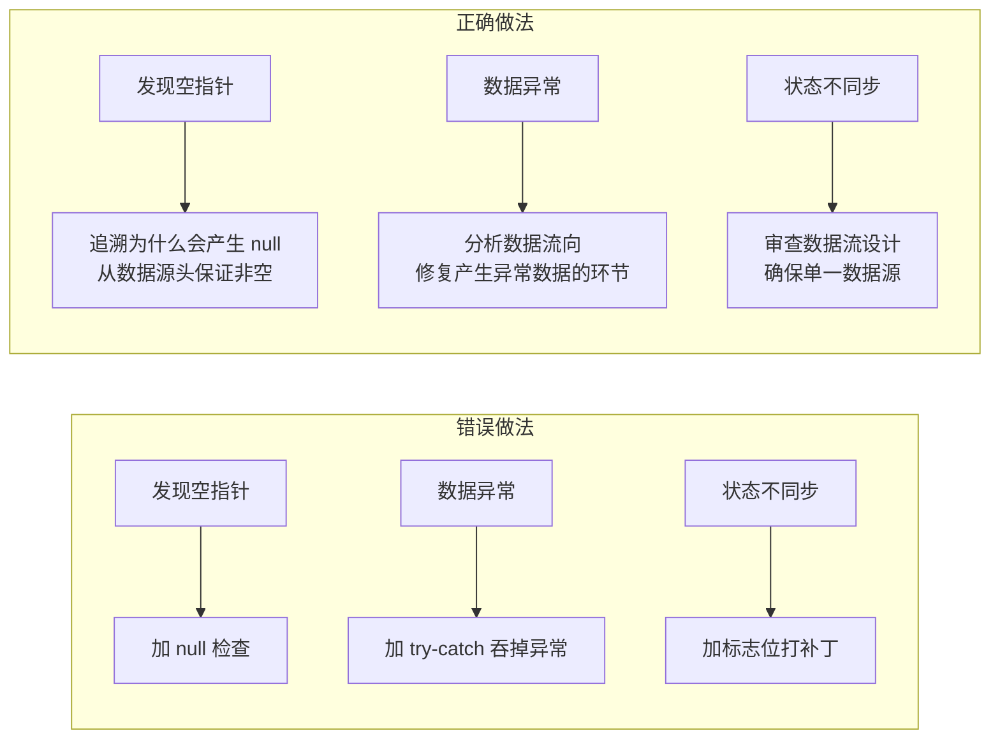
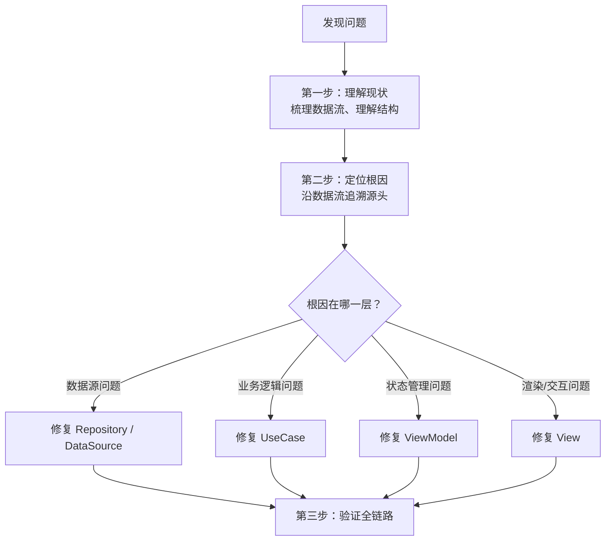
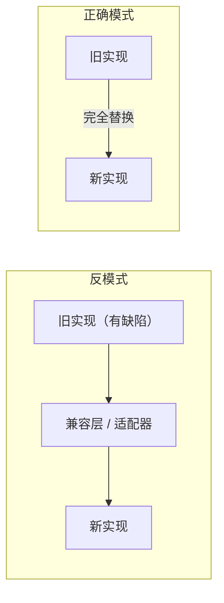
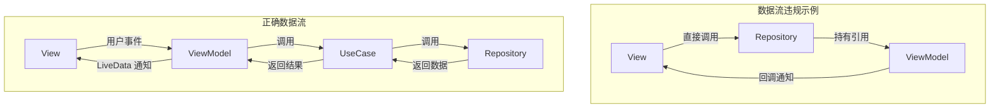

# 2.8 代码问题解决规范

## 总则

当代码出现 bug、崩溃、逻辑错误或架构腐化时，解决问题的方式与写代码同等重要。本规范要求**系统性地定位根因并从源头修复**，禁止一切绕过问题本质的防御性修补。

---

## 核心理念

---

## 问题解决流程

### 第一步：理解现状

在修改任何代码之前，必须先完整理解相关模块的设计：

- 梳理该功能涉及的**完整数据流向**（从用户操作到数据持久化的全链路）
- 理解每一层（View → ViewModel → UseCase → Repository）各自承担的职责
- 明确数据结构的设计意图——每个字段为什么存在、从哪里来、到哪里去

### 第二步：定位根因

- 沿数据流**逆向追溯**，从表象向源头定位
- 不在表象层修复——如果 UI 显示了错误数据，问题往往不在 UI 层
- 区分**直接原因**和**根本原因**：直接原因是"这个变量为 null"，根本原因是"为什么它会是 null"

### 第三步：从根源修复

- 在根因所在的层级进行修复
- 修复后沿数据流**正向验证**，确认每一层的输入输出都符合预期
- 如果发现原有设计本身有缺陷，则重新设计该部分，而非在缺陷上打补丁

---

## 重构原则

### 彻底重构，禁止兼容旧代码

- 当判定某段代码需要重构时，**完全替换**，不保留旧代码的任何残留
- 禁止"先加新逻辑，再逐步废弃旧逻辑"的渐进式兼容——这会制造两套并存的架构
- 所有调用方同步更新，确保重构是一次性完成的干净切换
- 版本控制保留了所有历史，旧代码不需要以注释形式留存

### 高内聚、低耦合的维护

每次修复或重构时，检查以下清单：

| 检查项 | 合格标准 |
|--------|----------|
| 职责单一 | 这个类/方法是否只做一件事？修复后是否引入了第二个职责？ |
| 依赖方向 | 依赖是否始终从上层指向下层？是否引入了反向依赖？ |
| 接口隔离 | 模块对外暴露的接口是否最小化？是否暴露了不必要的内部细节？ |
| 数据流单向 | 数据是否仍然沿 View ← ViewModel ← UseCase ← Repository 单向流动？ |

---

## 禁止的修复方式

### 防御性代码

| 防御性做法 | 为什么禁止 | 正确做法 |
|-----------|-----------|----------|
| 对不应为 null 的值加 null 检查 | 掩盖了上游没有正确赋值的 bug | 追溯上游，保证数据源头不产生 null |
| 用 try-catch 包裹整块逻辑 | 吞掉异常导致问题隐藏，后续更难排查 | 让异常暴露，在产生异常的位置修复 |
| 添加标志位控制新旧逻辑分支 | 制造条件迷宫，增加认知负担 | 彻底替换旧逻辑，移除分支 |
| 重复校验同一数据的有效性 | 说明数据的生产者和消费者之间缺乏契约 | 在数据产生的唯一位置做一次校验 |

### 表象修复

- 禁止仅修改 UI 来"隐藏"后端/逻辑层的错误
- 禁止通过增加延时（`postDelayed`、`sleep`）来规避时序问题
- 禁止通过增加重试逻辑来掩盖不稳定的根因

---

## 单一数据流的维护

修复问题时最容易破坏的就是数据流的单向性。以下是常见的破坏模式：

- 修复过程中如果发现需要"从下层通知上层"，说明设计有问题——应使用 LiveData 观察模式而非主动回调
- 如果发现需要"跨层调用"，说明中间层缺少了应有的职责——补全中间层逻辑

---

## 问题复盘

每次解决重大问题后，回答以下三个问题：

1. **根因是什么？** —— 问题出在哪一层、哪个环节
2. **为什么之前没发现？** —— 是设计时遗漏、还是后续变更引入
3. **如何预防同类问题？** —— 是否需要调整架构约束或补充规范

---

## 原则总结

- 修 bug 的第一步不是改代码，而是理解代码
- 追到根因才动手，表象修复等于制造新的隐患
- 重构就要彻底，兼容旧代码是技术债的温床
- 每次修复都是加固架构的机会，而非削弱架构的借口
