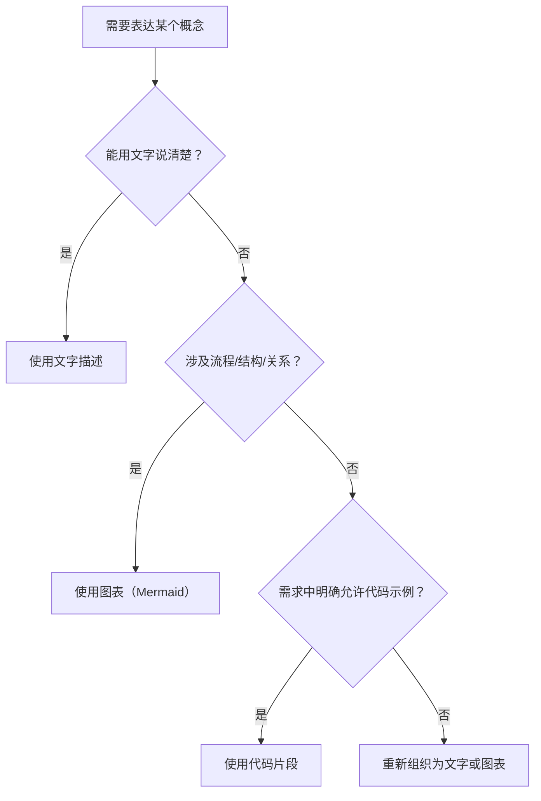

# 2.9 文档规范

## 总则

项目文档的目标是**清晰传达意图**，而非展示实现细节。文档应让读者快速理解"是什么"和"为什么"，而非"怎么写代码"。

---

## 格式规范

### 默认格式

所有项目文档统一使用 **Markdown** 格式（`.md`）。

### 内容表达优先级

- 优先使用**文字**描述概念、原则、规则
- 流程、结构、依赖关系使用 **Mermaid 图表**表达
- 代码片段仅在需求文档中明确允许时才使用

---

## 图表使用规范

### 适用场景

| 图表类型 | 适用场景 |
|----------|----------|
| `flowchart` | 流程、决策逻辑、数据流向 |
| `classDiagram` | 类结构、模块关系、接口设计 |
| `sequenceDiagram` | 组件间交互时序 |
| `erDiagram` | 数据模型、实体关系 |

### 图表原则

- 图表应有明确的标题或上下文说明
- 节点命名使用中文，保持与文档语言一致
- 图表复杂度适中，单张图表节点不超过 **10 个**；超出时拆分为多张

---

## 内容规范

### 文档结构

每份文档应包含：

1. 标题（与文件名对应）
2. 总则（一段话说明本文档的目标和适用范围）
3. 正文章节
4. 禁止事项（如有）

### 描述项目或功能时

- 描述**是什么**（功能定义、边界）
- 描述**为什么**（设计动机、取舍依据）
- 描述**怎么组织**（模块划分、职责分配）

### 禁止出现的内容

以下内容不得出现在项目文档中：

| 禁止类型 | 示例 |
|----------|------|
| 测试类型描述 | 单元测试、集成测试、UI 测试计划 |
| 计划时间 | "预计 3 天完成"、"第二周实现" |
| 任务安排 | "由 A 负责"、"Sprint 1 完成" |
| 进度跟踪 | "已完成 60%"、"待开发" |

这些内容属于项目管理范畴，不属于技术文档的职责。

---

## 禁止事项

- 禁止在无明确需求的情况下在文档中插入代码块
- 禁止用代码替代文字或图表来描述架构和设计
- 禁止在技术文档中混入排期、人员分工、测试计划等项目管理内容
- 禁止文档内容与实际实现严重脱节而不更新
