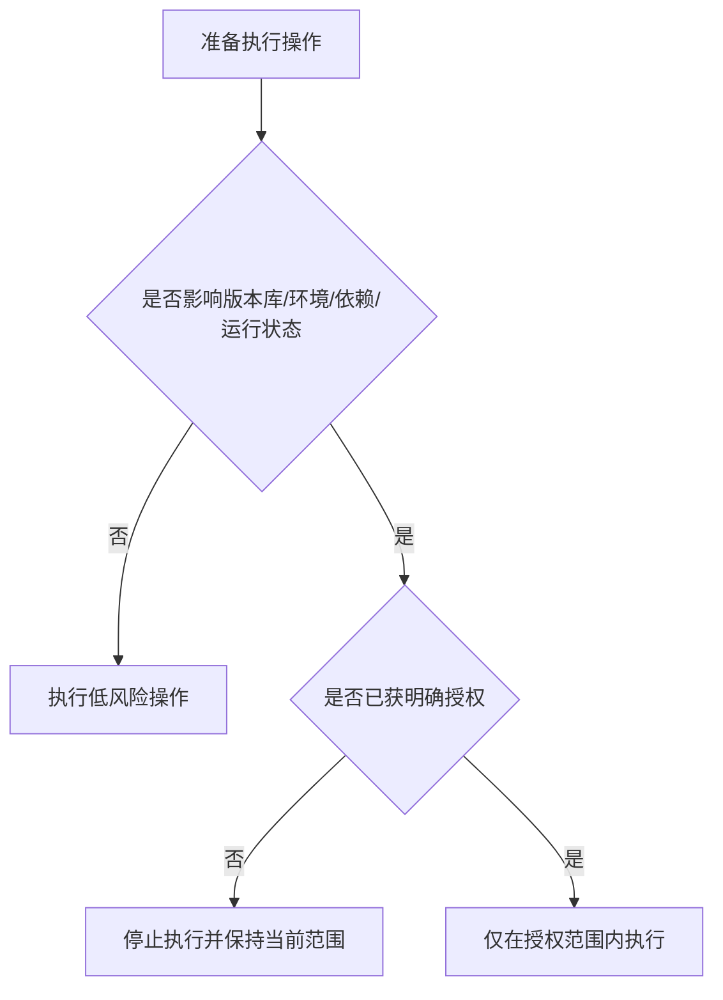

# AI操作边界与高风险命令规范

## 总则

本规范用于界定 AI 在项目中的默认操作边界。  
原则上，AI 默认只执行 **阅读、分析、整理、局部修改** 这类低风险操作；凡是可能影响代码库状态、构建环境、依赖状态、敏感资产或外部系统的操作，均视为高风险操作。

---

## 默认禁止事项

在 **未经用户明确允许** 的情况下，AI 不得执行以下操作：

| 类别 | 默认禁止内容 |
|------|--------------|
| 编译 / 构建 / 打包 / 运行 | 编译项目、构建产物、启动应用、运行开发服务器、执行打包命令、运行完整测试任务 |
| Git | 任何 Git 命令，包括但不限于 status、diff、log、add、commit、checkout、reset、stash、pull、push、merge、rebase、clean |
| 依赖管理 | 安装、升级、降级、删除依赖；改动锁文件；执行包管理器同步命令 |
| 破坏性文件操作 | 批量删除、批量重命名、覆盖生成、移动大量目录、清空缓存目录、替换整批资源 |
| 敏感资产操作 | 修改密钥、证书、签名、环境变量、配置中心、数据库、远程服务配置 |
| 外部副作用操作 | 向外部系统发请求并写入数据、触发发布、触发部署、写入真实业务数据 |

---

## 默认允许事项

在不触发高风险边界的前提下，AI 默认可以执行：

| 类别 | 默认允许内容 |
|------|--------------|
| 阅读 | 阅读项目文件、文档、配置、目录结构 |
| 搜索 | 搜索关键字、引用关系、调用路径、目录位置 |
| 分析 | 分析代码结构、数据流、问题根因、影响范围 |
| 局部修改 | 在目标范围内修改代码、文档、规范文件 |
| 新增小规模文件 | 为完成当前任务新增必要的局部文件，如规范文档、说明文档、少量实现文件 |
| 结果整理 | 输出修改摘要、风险说明、后续建议 |

---

## 高风险判断原则

只要某个操作满足以下任一条件，即视为高风险：

- 会改变项目当前运行或构建状态
- 会改变版本库状态
- 会改变依赖图或锁文件
- 会触碰敏感资产或真实环境
- 会产生大规模、难以人工逐项审查的差异
- 会造成不可逆或高恢复成本后果

---

## 授权规则

### 可执行前提

高风险操作只有在以下条件同时满足时才允许执行：

1. 用户明确表达允许
2. 允许的范围足够具体
3. 操作目的与当前任务直接相关

### 授权不足时的默认策略

若用户只表达“你看着处理”，但未明确允许高风险操作，则默认：

- 可以继续阅读、分析、修改文件
- 不得主动编译、运行、使用 Git、安装依赖

---

## 推荐决策流程

---

## 禁止事项

- 禁止把“只是看看”作为执行 Git 命令的理由
- 禁止把“为了验证一下”作为默认编译、运行项目的理由
- 禁止把“顺手升级一下依赖”作为局部任务中的附带操作
- 禁止在未获授权时触碰锁文件、证书、环境变量、签名配置
- 禁止在没有明确恢复方案的情况下执行高破坏性命令
