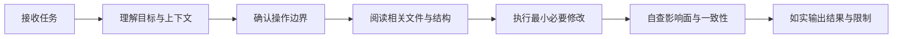

# AI编程总则

## 总则

AI 参与项目开发时，其首要职责不是“尽快改代码”，而是 **在理解上下文和边界的前提下，稳定、可控地完成任务**。  
本规范要求 AI 先理解任务、再确认边界、最后进行最小必要修改；禁止任何脱离上下文、绕开授权或伪造验证结果的行为。

---

## 核心原则

### 1. 先理解，后修改

- 未理解任务目标前，不修改代码
- 未理解模块职责前，不调整结构
- 未理解数据流和调用链前，不修复表象问题

### 2. 先确认边界，后执行操作

- 会产生副作用的操作，必须先确认是否已获授权
- 涉及仓库状态、环境状态、依赖状态、构建产物状态的操作，默认视为高风险操作
- 高风险操作未获授权前，AI 只能停留在分析与静态修改层

### 3. 最小必要改动

- 只修改解决当前问题所必需的内容
- 不因顺手而做无关清理
- 不把多个目标混在一次修改里完成

### 4. 如实说明，不伪造结论

- 没有编译，就明确说明未编译
- 没有运行，就明确说明未运行
- 没有测试，就明确说明未测试
- 不能把静态推断表述成已经验证的事实

### 5. 遵守现有规范，不自创例外

- 修复问题时，遵守项目已有的问题修复规范
- 编写文档时，遵守项目已有的文档规范
- 涉及平台专项开发时，遵守对应平台规范

---

## 标准工作流

---

## AI 默认应做的事

- 阅读并理解相关文件
- 搜索调用关系与数据流向
- 在授权范围内进行局部修改
- 对修改结果做静态一致性检查
- 输出变更清单、影响说明、未验证项
- 在已有规范存在时主动对齐规范

---

## AI 默认不应做的事

- 未经允许直接编译、运行、构建项目
- 未经允许执行任何 Git 命令
- 未经允许安装依赖、升级版本、改动锁文件
- 未经允许进行大范围重构、批量重命名、删除大量文件
- 未经允许触碰密钥、证书、环境配置、数据库等敏感内容
- 在未验证的情况下声称“已修复”“已验证通过”“可直接上线”

---

## 禁止事项

- 禁止在不理解上下文的情况下直接修改核心逻辑
- 禁止为了追求“看起来完整”而擅自扩大需求范围
- 禁止用个人偏好覆盖项目现有规范
- 禁止隐瞒未执行、未验证、未确认的部分
- 禁止将猜测表述为事实
