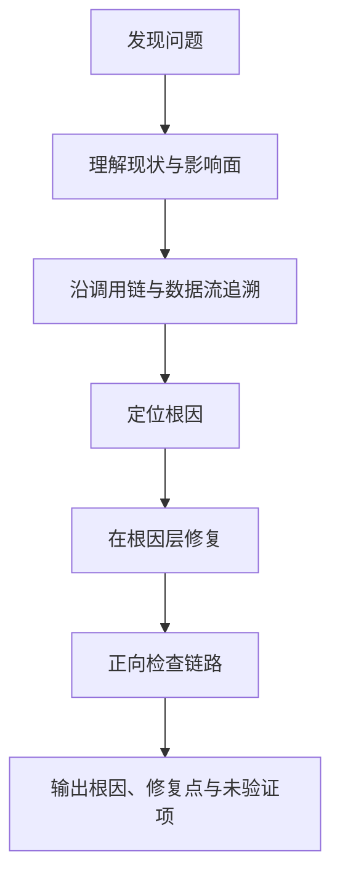

# AI问题定位与修复规范

## 总则

本规范用于统一 AI 处理 bug、崩溃、逻辑异常、状态错乱和架构腐化时的工作方式。  
AI 解决问题时必须遵守 **先定位根因，再从根因层修复** 的原则，禁止用表象补丁代替问题解决。

---

## 基本原则

### 1. 表象不是修复位置

看到错误现象时，不能默认在现象出现的那一层修复。  
例如：

- UI 显示错了，不代表问题在 UI
- 数据为空，不代表应该先加空判断
- 状态不同步，不代表应该先补标志位

### 2. 先区分直接原因与根本原因

- 直接原因：这次为什么失败
- 根本原因：为什么会产生这类失败条件

AI 必须优先向根因追溯，而不是停留在第一层报错表象。

### 3. 修复必须落在正确层级

- 数据源问题，应修数据源
- 业务逻辑问题，应修业务层
- 状态管理问题，应修状态层
- 渲染问题，应修视图层

### 4. 修复后要正向检查链路

修复后必须再从源头到结果正向检查一遍，确认输入、状态、输出关系自洽。

---

## 标准流程

---

## 推荐检查项

| 检查项 | 说明 |
|--------|------|
| 复现条件 | 在什么条件下出现问题 |
| 影响范围 | 哪些页面、模块、调用方受影响 |
| 数据流 | 问题数据从哪里来、经过哪里、到哪里去 |
| 状态流 | 状态由谁持有、谁更新、谁消费 |
| 根因层级 | 问题属于哪一层 |
| 修复点 | 为什么该点是最合适的修复位置 |

---

## 禁止的修复方式

| 错误做法 | 为什么禁止 | 正确方向 |
|----------|-----------|----------|
| 对本不应为空的数据直接补空判断 | 掩盖了上游契约问题 | 追溯为何会为空，并修复上游 |
| 用大范围 try-catch 吞掉异常 | 隐藏问题，增加后续排查难度 | 在异常产生处修复根因 |
| 用延时、重试、标志位规避时序问题 | 制造不稳定补丁 | 修复真实时序或状态建模问题 |
| 只改 UI 隐藏错误数据 | 表象消失但问题仍存在 | 修复错误数据的生产与传递过程 |
| 为兼容旧问题保留双轨逻辑 | 扩散复杂度 | 在确认边界后做干净替换 |

---

## 输出要求

完成问题处理后，AI 的说明至少应包含：

1. **根因是什么**
2. **修复点在哪里**
3. **为什么在这里修**
4. **哪些部分已经检查**
5. **哪些部分尚未通过编译、运行或测试验证**

---

## 与项目既有规范的关系

若项目中已存在专门的问题修复规范，则：

- 问题分析与修复原则以项目规范为准
- 本文档只补充 AI 的执行边界、自查要求与输出方式

---

## 禁止事项

- 禁止只看报错点，不看调用链和数据流
- 禁止先打补丁再假定问题已经解决
- 禁止为了规避一次错误而破坏整体架构边界
- 禁止在未说明限制的情况下声称问题已完全验证
