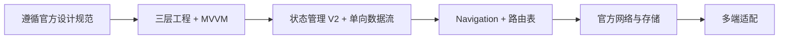

# 1.1 项目开发总则

## 总则

本规范用于统一 HarmonyOS APP 项目的开发基线。  
项目必须以**华为开发者联盟最新官方文档与官方 API**为最高依据，在此基础上统一采用官方当前主路径组织项目，并以 **MVVM** 作为默认应用架构。

---

## 官方依据

- HarmonyOS 文档中心  
  https://developer.huawei.com/consumer/cn/doc/
- ArkUI 概述  
  https://developer.huawei.com/consumer/cn/doc/harmonyos-guides/arkui-overview
- 架构概览（最佳实践）  
  https://developer.huawei.com/consumer/cn/doc/best-practices/bpta-app-architecture-overview
- 分层架构设计（最佳实践）  
  https://developer.huawei.com/consumer/cn/doc/best-practices/bpta-layered-architecture-design
- 模块化设计（最佳实践）  
  https://developer.huawei.com/consumer/cn/doc/best-practices/bpta-modular-design
- 多设备工程部署与发布（最佳实践）  
  https://developer.huawei.com/consumer/cn/doc/best-practices/bpta-multi-device-ide
- 状态管理概述  
  https://developer.huawei.com/consumer/cn/doc/harmonyos-guides/arkts-state-management-overview
- UIAbility 组件生命周期  
  https://developer.huawei.com/consumer/cn/doc/harmonyos-guides/uiability-lifecycle
- HarmonyOS 设计规范与指南  
  https://developer.huawei.com/consumer/cn/design

---

## 官方主路径

HarmonyOS APP 项目默认采用以下官方主路径：

- 使用 **ArkTS 声明式开发范式** 构建 UI
- 使用 **ArkUI** 作为 UI 框架
- 使用 **Stage 模型** 组织应用模型
- 使用 **UIAbility + WindowStage** 承接界面能力与系统生命周期
- 使用 **状态管理 V2** 管理页面与组件状态
- 使用 **Navigation + NavPathStack + NavDestination** 组织页面路由
- 使用 **官方 HTTP、Preferences、relationalStore** 处理数据访问
- 使用 **common / features / products 三层工程** 组织模块

> ArkUI 官方同时提供 ArkTS 声明式开发范式与兼容 JS 的类 Web 开发范式；本团队在 APP 项目中统一采用 ArkTS 声明式主路径。

---

## 项目默认原则

### 1. MVVM 是 APP 项目的默认架构

所有页面默认采用 **MVVM**：

- View：界面描述与事件上抛
- ViewModel：页面状态与交互编排（`@ObservedV2` 类 + `@Trace`）
- Model：业务逻辑与数据访问（工程化细分为 Domain / Data）

具体分层、目录与模块细则见 `1.2` ~ `1.7`。

### 2. 官方 API 优先于自定义封装

- 能直接使用官方能力时，优先使用官方能力
- 需要封装时，封装应服务于项目边界，而不是替代官方能力
- 不允许以第三方或自定义框架掩盖官方生命周期、路由和状态边界

### 3. 多端一致性优先

HarmonyOS 支持「一次开发，多端部署」。  
项目必须从设计到实现都考虑不同设备类型、屏幕尺寸、窗口形态与交互方式，不得只以手机单端思维设计结构。

### 4. 状态与数据必须单向流动

事件从界面进入，状态从 ViewModel 输出。  
页面不允许在多个位置各自维护同一份核心业务状态。

### 5. 生命周期逻辑保持轻量

UIAbility 和页面装配层只承接：

- 系统生命周期接入（含 `onWindowStageCreate` 中的 UI 加载）
- 页面初始化装配
- 根导航与上下文绑定

不承接重业务逻辑、重数据访问逻辑或大量耗时工作。

> 官方明确：UIAbility 生命周期回调在主线程执行，耗时任务应异步处理或交由子线程，避免阻塞主线程。

---

## 标准开发流

---

## 官方能力与团队约定边界

| 项目内容 | 归属 |
|---------|------|
| ArkUI / ArkTS / Stage / UIAbility / WindowStage | 官方能力 |
| 产品定制层 / 基础特性层 / 公共能力层 | 官方最佳实践 |
| `common / features / products` 工程目录 | 官方 IDE 模板 |
| HAP / HAR / HSP（module.json5 type: entry/feature/har/shared） | 官方能力 |
| 状态管理 V1 / V2 体系 | 官方能力 |
| Navigation / NavPathStack / 系统路由表 | 官方能力 |
| HTTP / Preferences / relationalStore | 官方能力 |
| HarmonyOS Design System / UI Design Kit | 官方能力 |
| APP 默认采用 MVVM | 团队约定 |
| Feature 内 `ui / viewmodel / domain / data` | 团队约定 |
| `usecase / repository / datasource / mapper` | 团队约定 |
| 页面装配层、导航适配层、ViewModel 生命周期协议 | 团队约定 |

---

## 基本要求

### 技术选型要求

- 新项目默认使用 **Stage 模型**
- 新项目默认使用 **ArkTS 声明式开发范式**
- 新项目默认使用 **MVVM + 状态管理 V2**
- 新项目默认使用 **Navigation + NavPathStack + 系统路由表**
- 新项目默认使用 **common / features / products 三层工程**

### 设计要求

- 界面设计必须遵循 HarmonyOS 官方设计规范与 UX 体验建议
- 多端适配必须在方案设计阶段纳入，而不是开发末尾补救
- 组件优先复用官方组件与官方设计套件能力

### 工程要求

- 工程结构必须可分层、可定位、可扩展
- 模块依赖必须单向
- 页面、状态、数据访问、模块边界必须清晰可识别

---

## 禁止事项

- 禁止在 APP 项目中继续扩散非主路径的旧式组织方式（如 `@ohos.router` 作为主路由）
- 禁止绕开 ViewModel 直接在页面中实现复杂业务逻辑
- 禁止页面直接调用网络、数据库、首选项与文件接口
- 禁止在 UIAbility 中堆积业务代码
- 禁止以自建全局单例替代官方状态管理和模块边界
- 禁止使用未经评审的非官方基础框架替代核心官方能力
- 禁止用「先兼容旧逻辑」作为破坏架构一致性的长期理由
