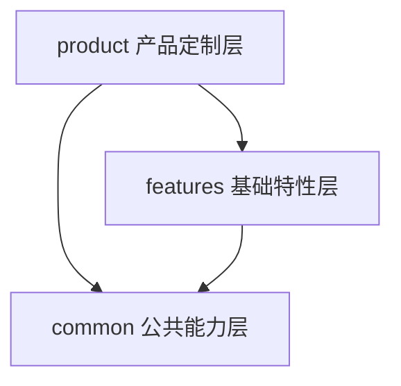
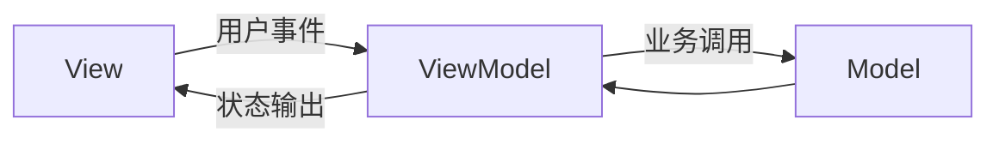

# 1.2 架构与 MVVM 规范

## 总则

本规范定义 HarmonyOS APP 的默认架构模式。  
项目采用官方**三层架构工程**组织模块，在模块内部采用官方 **MVVM（V2）** 模式组织页面与业务逻辑，并将 Model 层工程化细分为 **Domain / Data**。

---

## 官方依据

- 架构概览（最佳实践）  
  https://developer.huawei.com/consumer/cn/doc/best-practices/bpta-app-architecture-overview
- 分层架构设计（最佳实践）  
  https://developer.huawei.com/consumer/cn/doc/best-practices/bpta-layered-architecture-design
- MVVM 模式（V2）  
  https://developer.huawei.com/consumer/cn/doc/harmonyos-guides/arkts-mvvm-v2
- 状态管理概述  
  https://developer.huawei.com/consumer/cn/doc/harmonyos-guides/arkts-state-management-overview

---

## 官方三层架构

华为官方将应用分为三个逻辑层，对应工程目录 `common / features / products`：

| 官方逻辑层 | 工程目录 | 典型包类型 | 职责 |
|-----------|---------|-----------|------|
| 产品定制层 | `product/`（官方亦称 `products/`） | Entry 类型 HAP | 应用入口、根导航、**Page 薄壳**、设备差异布局与资源 |
| 基础特性层 | `features/` | HAR / Feature HAP / HSP | **ViewModel** + 可复用业务 View/Component |
| 公共能力层 | `common/` | HAR | `youi_kit`、core/platform/storage、**debug_core**、协议引擎（如 `yobluetooth`）；禁止反向依赖 |

依赖规则：

- `product` 依赖 `features` 与 `common`
- `features` 依赖 `common`
- `common` 不得反向依赖上层（含不得依赖 `features`）

分层落地约定（官方折中）：

- `product`：持有 `XxxPage` 装配壳（创建 VM、绑路由/生命周期、按断点选布局）；禁止 UseCase / Repository / Kit DataSource
- `features`：持有 ViewModel 与业务 View；可被多个 product HAP 复用
- `common`：可含协议引擎 HAR（`yo_*`）与调试底座 `debug_core`

---

## MVVM 架构

官方 MVVM 将应用分为 Model、View、ViewModel 三部分：

| 层 | 职责 |
|----|------|
| Model | 数据存储与业务逻辑，不直接与 UI 交互 |
| View | UI 展示与用户交互，通过绑定 ViewModel 状态驱动刷新 |
| ViewModel | 管理 UI 状态与交互逻辑，连接 Model 与 View |

### 官方 MVVM V2 实现要点

官方 MVVM V2 通过状态管理 V2 装饰器实现 ViewModel：

- 页面与组件入口：`@ComponentV2`
- ViewModel 类：`@ObservedV2`，状态字段：`@Trace`，嵌套类型：`@Type`
- 页面绑定 ViewModel：`@Local vm: XxxViewModel`
- 子组件输入：`@Param`；对外事件：`@Event`
- 全局 UI 状态：`AppStorageV2`；持久化 UI 状态：`PersistenceV2`

### 团队 Model 层工程化扩展

官方 MVVM 入门示例的 Model 层较简（`model/` 单目录）。  
本团队在中大型项目中将其细化为：

| 团队目录 | 职责 |
|---------|------|
| `domain/model` | 领域模型 |
| `domain/usecase` | 业务用例 |
| `domain/repository` | Repository 接口 |
| `data/repository` | Repository 实现 |
| `data/datasource` | Remote / Local / Memory 数据来源 |
| `data/entity` | DTO / 本地实体 |
| `data/mapper` | 层间转换 |

> UseCase / Repository / DataSource 细分属于**团队约定**，用于在官方 MVVM 之上获得更清晰的工程边界。

### 团队 View 层工程化扩展

官方示例使用 `view/` + `pages/`。本团队按模块归属：

| 团队目录 | 所属模块 | 职责 |
|---------|---------|------|
| `pages/` | `product/*` | 页面装配壳（`@Entry` / `NavDestination`）；创建 VM、转发生命周期、组合 Feature View |
| `ui/component` | `features/*` | Feature 内复用 UI 组件 |
| `ui/view` | `features/*` | 纯展示子组件（对齐官方 `view/` 思路） |
| `ui/menu` / `ui/util` | `features/*` | 菜单与展示工具 |
| `viewmodel` | `features/*` | ViewModel 与 UiState 定义 |
| `domain/` + `data/` | `common/yo_*` 或 Feature 引擎 HAR | UseCase / Repository / DataSource（无 ArkUI） |

---

## 架构目标

### 1. 页面轻量化

页面只负责 UI 描述、状态绑定、事件转发与生命周期装配，不负责业务流程编排与数据访问。

### 2. 状态出口唯一化

页面展示状态统一由 ViewModel 输出，不允许从多个来源并行拉取同一份业务状态。

### 3. 数据访问抽象化

View 与 ViewModel 不感知 HTTP、Preferences、relationalStore 等底层细节；Repository 对上返回领域语义。

---

## 禁止事项

- 禁止将页面写成 View + 业务逻辑 + 数据访问的混合体
- 禁止 ViewModel 直接访问 HTTP、Preferences、relationalStore
- 禁止 Repository 直接向页面暴露 Response、Entity 或表结构
- 禁止用全局变量或单例绕过 ViewModel 成为状态出口
- 禁止在产品层直接引用 Feature 内部实现目录
