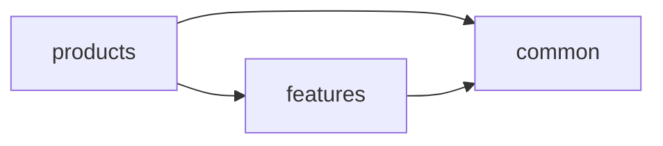

# 1.3 工程目录与模块规范

## 总则

本规范统一 HarmonyOS APP 的**工程目录、模块类型、包依赖与 Feature 内目录结构**。  
工程顶层必须采用官方 **common / features / products 三层架构**，模块类型遵循官方 HAP / HAR / HSP 体系。

---

## 官方依据

- 多设备工程部署与发布（最佳实践）  
  https://developer.huawei.com/consumer/cn/doc/best-practices/bpta-multi-device-ide
- 分层架构设计（最佳实践）  
  https://developer.huawei.com/consumer/cn/doc/best-practices/bpta-layered-architecture-design
- 模块化设计（最佳实践）  
  https://developer.huawei.com/consumer/cn/doc/best-practices/bpta-modular-design
- Stage 模型应用程序包结构  
  https://developer.huawei.com/consumer/cn/doc/harmonyos-guides/application-package-structure-stage
- module.json5 配置文件  
  https://developer.huawei.com/consumer/cn/doc/harmonyos-guides/module-configuration-file
- HAP / HAR / HSP  
  https://developer.huawei.com/consumer/cn/doc/harmonyos-guides/hap-package  
  https://developer.huawei.com/consumer/cn/doc/harmonyos-guides/har-package  
  https://developer.huawei.com/consumer/cn/doc/harmonyos-guides/in-app-hsp

---

## 项目级目录结构

建议使用 DevEco Studio **Flexible Layout Ability** 模板创建三层工程：

```text
application/
├── common/                  # 公共能力层（HAR）
│   ├── base/
│   ├── network/
│   ├── storage/
│   └── ui/
├── features/                # 基础特性层
│   ├── home/
│   ├── account/
│   └── ...
└── products/                # 产品定制层（Entry HAP）
    ├── default/
    ├── tv/                  # 按需：设备差异化产品
    └── wearable/
```

| 目录 | 官方定位 | 默认包类型 |
|------|---------|-----------|
| `common/` | 公共能力层 | HAR |
| `features/` | 基础特性层 | HAR（默认）；需 Ability 时用 Feature HAP；按需加载时用 HSP |
| `products/` | 产品定制层 | Entry 类型 HAP |

---

## 官方包类型与 module.json5

| type 取值 | 包类型 | 说明 |
|----------|--------|------|
| `entry` | Entry HAP | 应用主模块，有且仅有一个（同设备类型） |
| `feature` | Feature HAP | 动态特性模块，可独立按需安装 |
| `har` | HAR | 静态共享包，编译时合入宿主 |
| `shared` | HSP | 动态共享包，运行时按需加载 |

### HAR 关键约束（官方）

- 不支持在设备上单独安装
- **不支持**在 module.json5 声明 `pages`；可含 pages 文件，须通过 **Navigation + 路由表** 跳转
- **不支持**引用 AppScope 资源
- 不支持循环依赖、不支持依赖传递
- 多 HAP/HSP 引用同一 HAR 会导致代码与资源重复拷贝

### HSP 关键约束（官方）

- 与宿主同进程、同 bundleName、同生命周期
- 运行时按需加载，有助于减小包体与提升性能
- module.json5 中 type 为 **`shared`**
- 应用间共享的 HAR **原则上不允许依赖 HSP**

### HAR / HSP 选型原则

| 场景 | 推荐 |
|------|------|
| 共享 UI 组件、工具、编译期稳定复用 | HAR |
| 按需加载、减少重复打包 | HSP（`shared`） |
| 需要独立 Ability 入口的特性 | Feature HAP |
| 多 HAP/HSP 共享同一 HAR 影响冷启动 | 评估改用 HAR 替代 HSP 或集成态 HSP |

> 官方模块化设计文档对 App Size 优先与性能优先给出了不同的 HAR/HSP 组合策略，选型须结合业务与性能实测。

---

## 模块依赖方向



规则：

- 依赖在 `oh-package.json5` 的 `dependencies` 中声明
- `products` 之间不得横向依赖
- `features` 之间不得直接深度耦合；复用须上提到 `common` 或稳定导出 API
- `common` 不得反向依赖 `features` 或 `products`

---

## Feature 内标准目录

```text
feature-xxx/
├── src/main/
│   ├── ets/
│   │   ├── ability/           # Feature 内 Ability（如有）
│   │   ├── ui/
│   │   │   ├── page/          # 页面装配
│   │   │   ├── view/          # 纯展示组件
│   │   │   ├── component/     # Feature 内复用组件
│   │   │   ├── dialog/
│   │   │   └── navigation/    # 路由与导航适配
│   │   ├── viewmodel/
│   │   ├── domain/
│   │   │   ├── model/
│   │   │   ├── usecase/
│   │   │   └── repository/
│   │   └── data/
│   │       ├── repository/
│   │       ├── datasource/
│   │       │   ├── local/
│   │       │   ├── remote/
│   │       │   └── memory/
│   │       ├── entity/
│   │       └── mapper/
│   ├── resources/
│   │   └── base/profile/
│   │       └── router_map.json   # 系统路由表（跨包跳转）
│   └── module.json5
```

---

## Product 层约束

`product/*`（官方目录名亦可为 `products/`）负责产品装配与页面壳：

- 根 EntryAbility
- 根 Navigation / Tab 装配
- **Page 薄壳**（创建 ViewModel、解析路由参数、按断点切换布局、组合 Feature View）
- 设备差异化入口与产品级资源 / 权限声明

禁止在 product 层放置业务 UseCase、Repository、Kit DataSource 实现。

---

## Features 层约束

`features/*` 提供可复用业务 UI 能力：

- ViewModel（`@ObservedV2`）
- 业务 `ui/view` / `ui/component` / 菜单
- 可被多个 product HAP 引用

禁止在 Feature 内实现跨模块协议引擎（协议引擎下沉 `common/yo_*`）。禁止 Feature 相互引用对方内部目录。

---

## Common 层约束

`common/*` 提供共享能力与协议引擎，不持有页面级业务状态：

- 基础常量、公共异常、工具
- 公共 UI（`youi_kit`）、断点与窗口工具
- 统一存储封装
- 调试底座（`debug_core`：会话 / Transport / 日志 / 命令）
- 协议引擎（如 `yobluetooth`：domain + data）

禁止成为「脏代码回收站」，禁止依赖 `features` / `product`。

---

## 命名规范

| 类型 | 命名 |
|------|------|
| 页面 | `XxxPage` |
| 纯展示组件 | `XxxView` |
| 复用组件 | `XxxComponent` |
| ViewModel | `XxxViewModel` |
| UI 状态 | `XxxUiState` |
| UseCase | `VerbXxxUseCase` |
| Repository 接口 | `XxxRepository` |
| Repository 实现 | `XxxRepositoryImpl` |
| DataSource | `XxxRemoteDataSource` / `XxxLocalDataSource` |
| 领域模型 | 业务名词 |
| DTO / Entity | `XxxDto` / `XxxEntity` |

---

## 禁止事项

- 禁止使用 `commons` 等非官方目录名替代 `common`
- 禁止把页面、ViewModel、Repository 混放在同一目录
- 禁止在 `ui/` 下编写网络和数据库代码
- 禁止在 `product/` 下堆放 UseCase / Repository / Kit DataSource
- 禁止 Feature 之间相互引用对方 `ui/`、`viewmodel/`、`data/` 等内部目录
- 禁止 `common` 依赖 `features` 或 `product`
- 禁止未经评审自行发明新的大类目录
