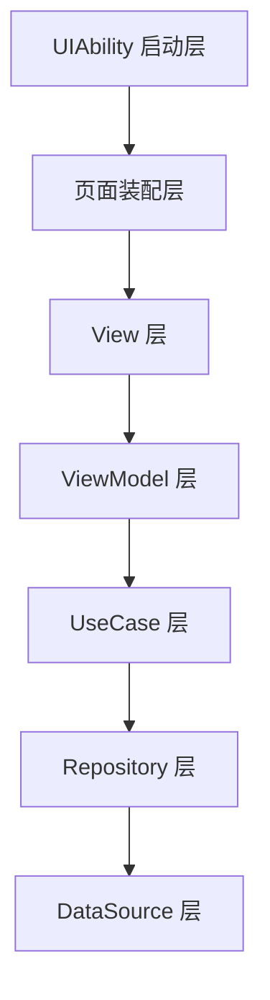
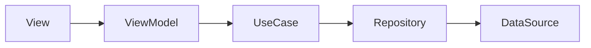

# 1.4 分层职责规范

## 总则

本规范明确 HarmonyOS MVVM 架构中各层的职责、输入输出、依赖方向与禁止事项。  
所有实现必须满足：**职责可识别、依赖单向、状态集中、边界清晰。**

---

## 官方依据

- MVVM 模式（V2）  
  https://developer.huawei.com/consumer/cn/doc/harmonyos-guides/arkts-mvvm-v2
- UIAbility 组件生命周期  
  https://developer.huawei.com/consumer/cn/doc/harmonyos-guides/uiability-lifecycle

---

## 标准分层

---

## 各层职责

### 1. UIAbility 启动层

**职责：**

- 承接系统生命周期（`onCreate`、`onForeground`、`onBackground`、`onDestroy`）
- 在 `onWindowStageCreate` 中加载根 UI、订阅 WindowStage 事件
- 创建根导航容器、完成轻量全局初始化

**禁止：**

- 在生命周期回调中执行大量耗时业务
- 直接实现页面业务流程或操作页面内部状态

> 官方还包括 `onWindowStageWillDestroy`、`onWindowStageDestroy`、`onNewWant` 等回调，页面级资源回收应配合 WindowStage 生命周期处理。

---

### 2. 页面装配层

页面装配层连接 View 与 ViewModel，可以是 `@Entry` 页面、`NavDestination` 容器或 Feature 级页面壳层。

**职责：**

- 创建并持有 ViewModel（`@Local vm`）
- 解析路由参数并注入 ViewModel
- 绑定 NavPathStack 等导航上下文
- 将页面生命周期事件转发给 ViewModel（团队约定方法如 `onPageEnter` / `onPageExit`）
- 组合页面 UI 组件

**禁止：**

- 写业务规则、直接请求网络或访问数据库
- 保存可长期漂移的业务状态

---

### 3. View 层

**职责：**

- 用 `@ComponentV2` 描述 UI，渲染 ViewModel 输出状态
- 通过 `@Event` 将用户事件上抛
- 用 `@Local` 持有局部、短生命周期、纯展示 UI 状态

**禁止：**

- 网络请求、数据库读写、Preferences 读写
- 业务流程编排、跨模块协调
- 直接管理 NavPathStack

---

### 4. ViewModel 层

**职责：**

- 作为 `@ObservedV2` 类，用 `@Trace` 管理页面状态
- 接收 View 事件，编排页面交互与异步任务
- 调用 UseCase，将领域结果转换为 UiState
- 收敛加载态、空态、错误态、刷新态

**禁止：**

- 直接写 HTTP、SQL、relationalStore、Preferences 细节
- 直接依赖具体 UI 组件实现
- 成为跨页面共享的杂物容器

---

### 5. UseCase 层

**职责：**

- 表达一个完整业务动作
- 聚合 Repository 调用，承担业务规则与流程组合
- 返回领域结果给 ViewModel

**禁止：**

- 依赖页面组件或 UI 样式
- 存在无边界的「万能用例类」

---

### 6. Repository 层

**职责：**

- 提供领域数据访问抽象（接口在 `domain/repository/`，实现在 `data/repository/`）
- 屏蔽本地、远端、内存来源差异
- 决定缓存策略与数据来源优先级

**禁止：**

- 暴露底层表结构或 HTTP Response 给上层
- 将 ViewModel、Page、UIContext 作为依赖输入
- 直接拼 UI 展示文案

---

### 7. DataSource 层

**职责：**

- 与具体实现交互：HTTP、Preferences、relationalStore、文件、内存缓存
- 按技术细节完成读写

**禁止：**

- 承担业务规则
- 直接向 View 返回 UI 状态
- 绕过 Repository 暴露给 ViewModel

---

## 对象职责

| 对象 | 定位 |
|------|------|
| Domain Model | 领域模型，表达业务语义 |
| DTO / Entity | 网络返回结构或本地表结构 |
| Mapper | 层间结构转换 |
| UiState / ViewData | 页面渲染数据结构，归属 ViewModel |

---

## 依赖方向

- 上层只依赖下一层，禁止跨层调用
- 下层不得反向依赖上层
- View 不得直接调用 Repository 或 DataSource

---

## Context 使用边界

- 系统 Context 由 UIAbility 或页面装配层获取
- 底层能力确需 Context 时，通过受控方式下传
- Context 不得在 View 层随意扩散，不得长期缓存到全局单例

---

## 禁止事项

- 禁止将页面逻辑、业务逻辑和数据访问写在同一文件
- 禁止 ViewModel 直接依赖具体 HTTP 客户端或数据库实例
- 禁止 Repository 直接返回页面专用对象
- 禁止跨层直接调用绕过中间层
