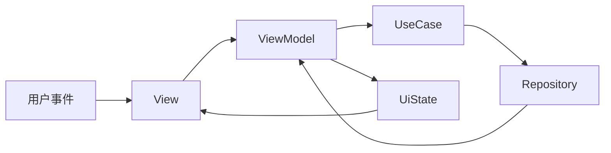

# 1.5 状态管理与数据流规范

## 总则

本规范统一 HarmonyOS APP 的状态归属、更新方式、共享方式与单向数据流。  
新项目必须优先采用官方**状态管理 V2**主路径，ViewModel 作为**页面状态唯一主出口**。

---

## 官方依据

- 状态管理概述  
  https://developer.huawei.com/consumer/cn/doc/harmonyos-guides/arkts-state-management-overview
- MVVM 模式（V2）  
  https://developer.huawei.com/consumer/cn/doc/harmonyos-guides/arkts-mvvm-v2
- @ComponentV2  
  https://developer.huawei.com/consumer/cn/doc/harmonyos-guides/arkts-create-custom-components#componentv2
- @ObservedV2 与 @Trace  
  https://developer.huawei.com/consumer/cn/doc/harmonyos-guides/arkts-new-observedv2-and-trace
- @Local / @Param / @Event  
  https://developer.huawei.com/consumer/cn/doc/harmonyos-guides/arkts-new-local  
  https://developer.huawei.com/consumer/cn/doc/harmonyos-guides/arkts-new-param  
  https://developer.huawei.com/consumer/cn/doc/harmonyos-guides/arkts-new-event
- AppStorageV2 / PersistenceV2  
  https://developer.huawei.com/consumer/cn/doc/harmonyos-guides/arkts-new-appstoragev2  
  https://developer.huawei.com/consumer/cn/doc/harmonyos-guides/arkts-new-persistencev2
- V1-V2 迁移概述  
  https://developer.huawei.com/consumer/cn/doc/harmonyos-guides/arkts-v1-v2-migration

---

## 默认策略：状态管理 V2 优先

官方建议新开发应用直接使用 V2。新项目默认采用：

| 用途 | V2 能力 |
|------|---------|
| 组件入口 | `@ComponentV2` |
| ViewModel 类 | `@ObservedV2` |
| ViewModel 状态字段 | `@Trace` |
| 嵌套 ViewModel 类型 | `@Type` |
| 页面绑定 ViewModel | `@Local` |
| 子组件输入 | `@Param`（配合 `@Once` 可本地更新一次） |
| 子组件对外事件 | `@Event` |
| 跨层级双向同步 | `@Provider` / `@Consumer` |
| 状态变更监听 | `@Monitor` |
| 应用级 UI 状态 | `AppStorageV2` |
| 持久化 UI 状态 | `PersistenceV2` |

如因存量兼容无法使用 V2，须写明原因、限定范围、保留迁移计划，且禁止在新模块扩散 V1。

> 官方明确：状态管理仅支持 UI 主线程，不能在子线程、Worker、TaskPool 中使用。

---

## ViewModel 实现规范

官方 MVVM V2 要求 ViewModel 为 **`@ObservedV2` 类**，而非普通 class 或组件内散落状态：

- 每个页面 ViewModel 输出稳定的 `XxxUiState` 或等价 `@Trace` 字段集合
- 页面通过 `@Local vm: XxxViewModel` 绑定
- 子组件通过 `@Param` 接收 ViewModel 中的子状态或值
- 需要深度观测嵌套对象、对象数组时，必须使用 `@ObservedV2` + `@Trace` + `@Type`

### V1 与 V2 对照（节选）

| V1 | V2 |
|----|-----|
| `@Component` | `@ComponentV2` |
| `@State` | `@Local` / `@Param`+`@Once` |
| `@Prop` | `@Param` |
| `@Link` | `@Param` + `@Event` |
| `@Observed` / `@ObjectLink` | `@ObservedV2` + `@Trace` |
| AppStorage | AppStorageV2 |
| PersistentStorage | PersistenceV2 |

---

## 单向数据流

---

## 状态分层

| 状态类型 | 推荐归属 | 说明 |
|---------|---------|------|
| 局部 UI 状态 | View / Component（`@Local`） | 展开/收起、输入临时值、纯展示态 |
| 页面渲染状态 | ViewModel（`@ObservedV2` / `@Trace`） | 列表、详情、加载/空/错态 |
| 应用全局 UI 状态 | AppStorageV2 | 主题、全局筛选、全局显示开关 |
| 持久化 UI 状态 | PersistenceV2 | 冷启动后需恢复的 UI 配置 |
| 业务数据 | Data 层 | Preferences / relationalStore 等，不属于 UI 状态框架 |

---

## AppStorageV2 / PersistenceV2 边界

**AppStorageV2** 仅用于应用级 UI 状态共享（主题、字体级别、全局筛选等）。

**PersistenceV2** 仅用于应用重启后需恢复的 UI 相关状态（上次展示方式、筛选条件等）。

禁止用二者存放：页面私有状态、复杂业务对象、网络缓存实体、数据库表实体、大体量列表。

---

## ViewModel 状态设计要求

### 状态必须可判定

页面状态须能稳定判断：首次加载、加载中、空、错误、可重试、已完成、局部刷新。  
禁止用多个分散布尔值拼出无法判断优先级的状态迷宫。

### 事件与命令

View 只把用户动作转为事件交给 ViewModel。  
ViewModel 可表达导航、提示、刷新等命令，但须通过页面装配层或导航适配层执行，不得直接操作 UI 控件实例。

---

## 存量迁移

- 存量 V1 页面可在范围内维持可运行
- 新页面和新模块优先 V2
- 迁移以页面为单位完整进行
- 同一新页面内禁止无边界混用两套状态设计
- API 19 前后 V1/V2 混用规则不同，混用时须参考官方混用指导

---

## 禁止事项

- 禁止新项目默认使用 V1 风格（`@Component` + `@State`）实现页面状态
- 禁止 View 与 ViewModel 同时维护同一份核心业务状态
- 禁止把 AppStorageV2 / PersistenceV2 当业务数据库
- 禁止把网络返回对象直接暴露给页面作为状态对象
- 禁止把深度观测失败归因于框架而不审查装饰器使用
