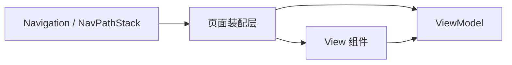

# 1.6 页面装配与路由规范

## 总则

本规范统一 HarmonyOS APP 的**页面装配、路由组织、页面参数、导航执行与生命周期协作**。  
路由必须以官方 **Navigation + NavPathStack + NavDestination** 为主路径，配合**系统路由表**实现本包与跨包跳转。

---

## 官方依据

- Navigation 基础架构介绍  
  https://developer.huawei.com/consumer/cn/doc/harmonyos-guides/arkts-navigation-architecture
- Navigation 页面路由  
  https://developer.huawei.com/consumer/cn/doc/harmonyos-guides/arkts-navigation-jump
- Navigation 跨包路由  
  https://developer.huawei.com/consumer/cn/doc/harmonyos-guides/arkts-navigation-cross-package
- 组件导航和页面路由概述  
  https://developer.huawei.com/consumer/cn/doc/harmonyos-guides/arkts-routing-overview
- UIAbility 组件生命周期  
  https://developer.huawei.com/consumer/cn/doc/harmonyos-guides/uiability-lifecycle

---

## 路由主路径

项目必须遵循：

- 根路由容器：`Navigation`
- 路由栈：`NavPathStack`（API 10+ 推荐，与 Navigation 一一对应，不可跨 Navigation 共享）
- 子页面容器：`NavDestination`
- 跨模块跳转：**系统路由表**（API 12+；API 23+ 支持跳转按需加载的 HSP 页面）
- 禁止以 `@ohos.router` 作为主路由方案（官方明确不推荐）

> 官方同时提供自定义路由表（`navDestination` + Builder），可扩展性更强但需自行维护；默认优先系统路由表。

---

## Navigation 架构要点

| 概念 | 说明 |
|------|------|
| Navigation | 导航根容器，支持 Stack / Split / Auto 三种模式 |
| NavBar | 导航栏（Navigation 直接子节点），不在页面栈中；单栏应用推荐 `hideNavBar` |
| NavDestination | 子页面根容器，由 NavPathStack 管理 |
| NavPathStack | 导航控制器，提供 push / pop / replace 等栈操作 |

### 多端布局模式

- **Stack（单栏）**：容器宽度 &lt; 600vp 时推荐；路由跳转时整页替换
- **Split（分栏）**：容器宽度 ≥ 600vp 时推荐；左侧 NavBar，右侧 NavDestination
- **Auto**：根据 Navigation 容器宽度在 Stack 与 Split 间自动切换

根导航的模式切换由产品层或根装配层统一控制，禁止各业务页面自行拼接第二套路由栈。

---

## 系统路由表（跨包跳转）

各业务模块（HAP / HSP / HAR）独立配置：

1. `resources/base/profile/router_map.json` — 路由页面配置（name、pageSourceFile、buildFunction）
2. `module.json5` — 声明 `"routerMap": "$profile:router_map"`
3. 目标页面提供与 buildFunction 同名的 `@Builder` 入口函数
4. 通过 `NavPathStack.pushPathByName` 等接口跳转

HAR **不支持**在 module.json5 声明 pages，跨 HAR 页面跳转必须走路由表。

路由命名、参数类型、适配逻辑集中维护在 Feature 的 `ui/navigation/` 目录。

---

## 页面装配层职责

1. 创建 ViewModel（`@Local vm`）
2. 解析路由参数，注入 ViewModel
3. 绑定 NavPathStack
4. 连接 UIAbility / NavDestination 生命周期与 ViewModel 协议方法
5. 挂载纯展示 View 组件

---

## UIAbility 与页面边界

| 层级 | 负责 | 不负责 |
|------|------|--------|
| UIAbility | 系统生命周期、WindowStage 创建与 UI 加载、根导航初始化 | 页面业务逻辑 |
| 页面装配层 | ViewModel 创建、参数解析、生命周期转发 | 业务规则、数据访问 |
| View | UI 渲染、事件上抛 | 路由栈操作、业务编排 |

### UIAbility 生命周期（官方）

核心回调：`onCreate` → `onWindowStageCreate`（UI 加载）→ `onForeground` → `onBackground` → `onDestroy`  
补充回调：`onWindowStageWillDestroy`、`onWindowStageDestroy`、`onNewWant`（再次启动已有 Ability）

---

## 路由参数规范

- 每个页面定义稳定的路由参数类型（如 `XxxRouteParam`），放在 `ui/navigation/`
- 参数类型明确，必填与可选清晰
- 禁止传递大对象、数据库实体或临时 UI 状态

---

## 导航执行规范

ViewModel 只表达「要去哪里」，不直接操作 NavPathStack。  
具体栈操作由页面装配层、Feature 导航适配器或抽象导航接口完成。

---

## 页面退出与资源回收

页面离开时必须回收：订阅、定时器、页面级异步任务、临时缓存引用。  
禁止依赖全局单例持有页面级资源。

---

## 禁止事项

- 禁止新项目以旧路由方案绕开 Navigation
- 禁止 View 直接持有并操作 NavPathStack
- 禁止在组件树中散落跳转路径字符串
- 禁止把路由参数解析逻辑写到 Repository 或 DataSource
- 禁止 ViewModel 依赖具体页面实例
- 禁止各业务页面自行实现多端分栏逻辑
