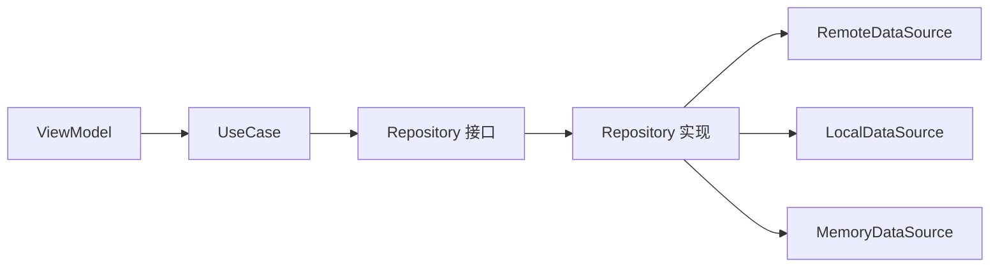

# 1.7 数据层设计规范

## 总则

本规范统一 HarmonyOS APP 数据层设计，包括 Repository 与 DataSource 职责划分、官方网络与存储能力的使用边界，以及领域模型与数据实体的转换关系。

数据层目标：**屏蔽来源差异，稳定向上提供领域语义，而不是向上暴露技术细节。**

---

## 官方依据

- 使用 HTTP 访问网络  
  https://developer.huawei.com/consumer/cn/doc/harmonyos-guides/http-request
- 通过用户首选项实现数据持久化  
  https://developer.huawei.com/consumer/cn/doc/harmonyos-guides/data-persistence-by-preferences
- 通过关系型数据库实现数据持久化  
  https://developer.huawei.com/consumer/cn/doc/harmonyos-guides/data-persistence-by-rdb-store
- AppStorageV2 / PersistenceV2  
  https://developer.huawei.com/consumer/cn/doc/harmonyos-guides/arkts-new-appstoragev2  
  https://developer.huawei.com/consumer/cn/doc/harmonyos-guides/arkts-new-persistencev2

---

## 数据层结构

---

## Repository 设计规范

**职责：**

- 屏蔽远端、本地、内存来源差异
- 对上返回统一领域结果
- 决定读取优先级、缓存策略、回写策略
- 统一错误语义

**不负责：** 页面展示文案、UI 状态构造、暴露 HTTP Response 或表结构。

**目录：**

- 接口：`domain/repository/`
- 实现：`data/repository/`
- 上层只依赖接口

---

## DataSource 设计规范

| 类型 | 职责 | 官方能力 |
|------|------|---------|
| RemoteDataSource | HTTP 请求、响应解析、网络异常 | `@kit.NetworkKit` 的 `http.createHttp()` |
| LocalDataSource | 本地持久化 | Preferences、`relationalStore`、文件 |
| MemoryDataSource | 进程内缓存、会话级数据 | 内存结构 |

**禁止：** 在 DataSource 中写业务规则、生成 UiState、绕过 Repository 暴露给 ViewModel。

---

## 官方网络能力

- 模块：`@kit.NetworkKit`
- 每个 `HttpRequest` 不可复用，用完须 `destroy()`
- 默认超时 60000ms，默认响应体上限 5MB（API 11+ 可配置至 100MB）
- 大文件上传下载使用流式能力 `requestInStream`
- API 22+ 支持 HTTP 拦截器
- HTTP 细节只允许出现在 RemoteDataSource 或 `common/network`

---

## 官方本地存储选型

### Preferences（用户首选项）

- 模块：`@kit.ArkData` 的 `preferences`
- 定位：轻量 Key-Value（设置项、个性化偏好）
- 建议总量 ≤ 50MB；Key ≤ 1024 字节；string Value ≤ 16MB
- 不支持内建加密；不支持多进程（XML 模式）
- API 18+ 可选 GSKV 模式（多进程并发）

### relationalStore（关系型数据库）

- 模块：`@kit.ArkData` 的 `relationalStore`
- 基于 SQLite；实例类型为 **`RdbStore`**（通过 `relationalStore.getRdbStore()` 获取）
- 适用于结构化数据、复杂查询、实体关系
- 单条数据建议 ≤ 2MB；单次查询建议 ≤ 5000 条，大数据量宜在 TaskPool 中查询
- 旧 API `ohos.data.rdb` 已停止维护

### 术语对照

| 概念层说法 | 官方 API |
|-----------|---------|
| 关系型数据库 / RelationalStore | 模块 `relationalStore` |
| 数据库实例 | `RdbStore` |
| 获取实例 | `relationalStore.getRdbStore(context, config)` |

### AppStorageV2 / PersistenceV2

属于 **UI 状态框架**，不是正式业务数据库，禁止替代 Preferences 或 relationalStore 承担业务持久化。

---

## 数据对象分类

| 对象类型 | 归属 | 说明 |
|---------|------|------|
| DTO / Response | `data/entity` | 网络返回结构 |
| Entity | `data/entity` | 本地表结构 |
| Domain Model | `domain/model` | 业务语义对象 |
| UiState | `viewmodel` | 页面渲染对象 |

---

## Mapper 规范

- DTO / Entity → Domain Model 的转换放在 `data/mapper/`
- 页面专属 UiState 拼装优先由 ViewModel 从 Domain Model 转换
- 禁止不同层共用同一份脆弱对象结构

---

## 缓存与错误处理

**缓存：** 策略由 Repository 集中决定（先内存后本地后远端等），View 不得自行决定。

**错误：**

- DataSource 抛出技术错误
- Repository 统一为领域错误
- ViewModel 转为页面错误状态或提示命令
- View 只负责展示

---

## 禁止事项

- 禁止 ViewModel 直接访问 HTTP、Preferences、relationalStore
- 禁止 Repository 把 Response / Entity 原样暴露给页面
- 禁止把 Preferences 当成万能数据库
- 禁止把 RdbStore 表结构向上扩散到 ViewModel
- 禁止 DataSource 中「网络成功就顺手改页面状态」
