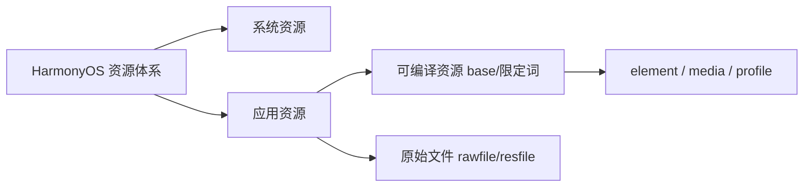
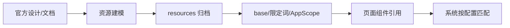

# 1.8 资源管理规范

## 总则

本规范统一 HarmonyOS APP 在文本、颜色、尺寸、图标、图片、配置文件、原始文件与设计资源上的管理方式。  
项目必须以华为官方资源体系为最高依据，并明确以下原则：

- **resources 是应用资源的唯一正式入口**
- **APP 层禁止硬编码可治理的界面资源**
- **优先使用官方资源分类、目录结构与访问方式**
- **优先保障多设备、多配置、多语言下的一致性与可维护性**

---

## 官方依据

- 资源分类与访问  
  https://developer.huawei.com/consumer/cn/doc/harmonyos-guides/resource-categories-and-access
- Rawfile 开发指导  
  https://developer.huawei.com/consumer/cn/doc/harmonyos-guides/rawfile-guidelines
- 应用国际化  
  https://developer.huawei.com/consumer/cn/doc/harmonyos-guides/i18n-l10n
- Stage 模型开发概述  
  https://developer.huawei.com/consumer/cn/doc/harmonyos-guides/stage-model-development-overview
- UI Design Kit 简介  
  https://developer.huawei.com/consumer/cn/doc/harmonyos-guides/ui-design-introduction
- HarmonyOS 设计资源  
  https://developer.huawei.com/consumer/cn/design/resource/
- HarmonyOS 主题图标库  
  https://developer.huawei.com/consumer/cn/design/harmonyos-icon/

---

## 官方主路径

- 使用 **resources** 目录作为应用资源统一入口
- 使用 **base 目录 + 限定词目录** 管理可编译资源
- 使用 **element / media / profile** 作为资源组目录
- 使用 **$r('app.type.name')** 访问可编译资源
- 使用 **$rawfile('filename')** 访问 rawfile 原始文件
- 使用 **rawfile / resfile** 管理不编译、无资源 ID 的原始文件
- Stage 多工程下，公共资源沉淀到 **AppScope/resources**
- 设计层优先参考 HarmonyOS Design System、UI Design Kit、SymbolGlyph

> base 与限定词目录下的资源会被编译并分配资源 ID；rawfile / resfile 不编译、不分配 ID。resfile 安装后解压到沙箱，通过 `Context.resourceDir` 只读访问。

---

## 官方资源分类

华为官方将资源分为**系统资源**与**应用资源**：

- **系统资源**：系统图标、色彩、字体等，可通过主题图标库、SymbolGlyph 等使用
- **应用资源**：开发者定义，通过 resources 目录管理

---

## 资源目录职责

### resources 是唯一正式入口

所有需长期维护、跨页面复用、跨设备适配的资源必须进入 `resources`。  
代码文件（页面、ViewModel、业务逻辑）只是资源消费者，不是定义位置。

### base 与限定词

- `base`：默认资源目录，无差异化时使用
- 限定词目录：表达语言、深浅色、横竖屏、设备类型、屏幕密度等差异
- 组合顺序（官方）：`移动国家码_移动网络码-语言_文字_国家或地区-横竖屏-设备类型-颜色模式-屏幕密度`
- 禁止用业务 if/else 替代限定词目录的匹配机制

### rawfile 与 resfile

| 目录 | 特征 | 适用 |
|------|------|------|
| rawfile | 不编译；无 ID；按路径访问 | 原始模板、第三方资源包、大型静态数据 |
| resfile | 不编译；无 ID；沙箱只读 | 明确需要安装后文件路径访问的场景 |

二者不能替代 element / media / profile。

---

## 资源组目录

| 资源组 | 类型 | 标准文件 |
|--------|------|---------|
| element | boolean、color、float、integer、intarray、plural、strarray、string | 各类型对应独立 json（如 `string.json`、`color.json`） |
| media | 图片、音频、视频 | 文件名自定义 |
| profile | 配置型 JSON | 文件名自定义 |

每个 element 文件只含同一类型数据，禁止混放。

---

## 文本资源

- 所有用户可见文本必须资源化，禁止 APP 层硬编码
- 默认按可国际化思路组织，即使当前仅单语言
- 官方支持在 `base` 下 string/strarray/plural 中使用 `attr` 标记 `translatable` 与 `priority`
- 命名必须表达语义（如 `login_title`），禁止 `text1`、`msg_2` 等

---

## 颜色与尺寸

- 可治理颜色进入 `color.json`，命名按用途（`text_*`、`bg_*`、`brand_*`）
- 可治理尺寸进入 `float.json`（支持 `fp`、`vp` 等单位），命名按设计令牌（`font_size_md`、`spacing_lg`）
- 禁止在页面代码中硬编码正式色值与通用尺寸

---

## 图标与设计资源

- 优先使用官方设计资源、主题图标库、SymbolGlyph
- 同语义图标统一命名、统一来源，禁止多模块重复保存副本
- 公共视觉资产对齐 HarmonyOS Design System

---

## Stage 多工程公共资源

共有资源放 **AppScope/resources**。  
编译时 AppScope 资源合入模块；重名资源优先级：**AppScope > HAP 自身模块 > 依赖 HAR**。

以下资源默认属于公共层，优先下沉 AppScope：

- 品牌色、通用文本、公共图标、空态资源
- 基础字号与间距令牌、组件级通用资源

> HAR 不支持引用 AppScope 资源；公共资源须通过合入宿主或模块内 resources 访问。

---

## 标准资源流

---

## 官方能力与团队约定

| 内容 | 归属 |
|------|------|
| resources、base、限定词、rawfile、resfile | 官方 |
| element/media/profile、$r/$rawfile | 官方 |
| AppScope 公共资源、资源优先级 | 官方 |
| 禁止硬编码可治理资源 | 团队 |
| 语义化命名、公共资源下沉 AppScope | 团队 |

---

## 禁止事项

- 禁止 APP 层硬编码用户可见文本、正式颜色值、通用尺寸
- 禁止把 element 资源丢入 rawfile 规避治理
- 禁止把资源差异写成页面逻辑分支而不使用限定词目录
- 禁止多模块重复保存同一语义资源
- 禁止无语义命名（`text1`、`color2`、`icon_final`）
