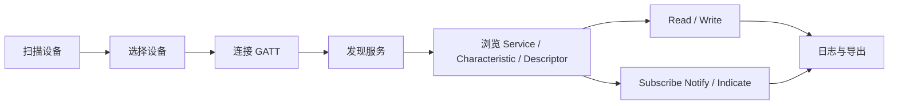

# HarmonyOS 无线调试工具 - 蓝牙需求了解

> 当前文档处于需求了解阶段，不是 PRD。本文只沉淀“蓝牙调试工具应该理解哪些场景、竞品具备哪些能力、HarmonyOS 当前可承载哪些能力、哪些需求还需要确认”。

## 1. 范围

蓝牙模块需要同时覆盖两类调试对象：

| 分类 | 面向对象 | 典型协议/能力 | 典型用户目标 |
| --- | --- | --- | --- |
| 经典蓝牙 | SPP/RFCOMM 串口设备、传统模组、工装设备、音频/外设类设备的基础识别 | BR/EDR、配对设备、发现设备、SPP Client/Server、RFCOMM、L2CAP | 找设备、连设备、收发串口数据、保存日志、复现协议问题 |
| BLE | BLE 外设、BLE 串口模组、传感器、GATT 服务、调试固件 | 扫描、广播、GATT Client/Server、Service/Characteristic/Descriptor、Notify/Indicate、MTU、厂商广播 | 分析广播、浏览 GATT、读写特征、订阅通知、模拟外设 |

蓝牙调试工具不应只理解为“连接后发一段字符串”。主流工具实际覆盖了“发现、过滤、连接、协议浏览、数据收发、日志、复现、导入导出、后台稳定性、权限解释、异常恢复”的完整链路。

## 2. 调研来源

### 2.1 HarmonyOS 官方文档与样例

| 来源 | 用途 |
| --- | --- |
| HarmonyOS Connectivity Kit 蓝牙服务开发概述 | 确认经典蓝牙、BLE、虚拟 MAC、中心/外围角色边界 |
| HarmonyOS 传统蓝牙查找设备 | 确认经典蓝牙发现、配对设备、扫描时间、权限、扫描资源约束 |
| HarmonyOS SPP 连接和传输数据 | 确认 SPP Client/Server、UUID、读写、断开 |
| HarmonyOS BLE 查找设备 | 确认 BLE 扫描、过滤、扫描实例、广播能力 |
| HarmonyOS GATT 连接和传输数据 | 确认 GATT Client/Server、服务发现、读写、描述符、通知/指示 |
| HarmonyOS `ohos.bluetooth.socket` API | 确认 SPP RFCOMM、L2CAP、异步读写、1024 字节读分片、低功耗唤醒延迟等 API 细节 |
| HarmonyOS `ohos.bluetooth.ble` API | 确认 BLE 扫描、广播、GATT、虚拟地址、持久设备标识等 API 细节 |
| GitCode HarmonyOS BluetoothLowEnergy | 确认 HarmonyOS BLE Demo 的实际页面组织、扫描/连接/广播/GATT 示例方式 |

### 2.2 Android/iOS 主流工具与开源源码

| 工具/项目 | 平台 | 重点功能 |
| --- | --- | --- |
| Nordic nRF Connect for Mobile | Android/iOS | BLE 扫描、广播解析、GATT 浏览、读写、通知、DFU/设备调试生态 |
| Punch Through LightBlue | Android/iOS | BLE 扫描、连接、服务/特征浏览、读写、Notify、虚拟外设 |
| Serial Bluetooth Terminal | Android 开源 | 经典蓝牙 SPP 终端、配对设备列表、连接状态、文本/HEX、换行、后台通知 |
| SimpleBluetoothLeTerminal | Android 开源 | BLE 串口终端、常见厂商 BLE 串口 Profile、MTU/分包、通知订阅、HEX/换行 |
| BLE Scanner 类工具 | Android/iOS | 广播扫描、GATT 浏览、读写、Notify/Indicate、RSSI、收藏设备 |

## 3. 主流蓝牙调试 APP 功能点拆解

### 3.1 设备发现与筛选

主流工具通常不只展示“名称 + 地址”，而是围绕可调试性展示更多上下文。

| 功能点 | 经典蓝牙 | BLE | 产品价值 |
| --- | --- | --- | --- |
| 开始/停止扫描 | 支持 | 支持 | 让用户明确控制扫描资源和电量 |
| 已配对设备列表 | 支持 | 通常不作为主入口 | 经典 SPP 设备常先配对再连接 |
| 附近设备列表 | 支持 | 支持 | 找到未配对或广播中的设备 |
| RSSI 显示 | 支持发现结果 RSSI | 支持扫描 RSSI | 判断距离、信号稳定性、连接问题 |
| 名称显示 | 支持设备名 | 支持本地名/广播名 | 快速识别设备 |
| 地址显示 | HarmonyOS 为虚拟地址/随机地址场景 | BLE 常见随机地址 | 调试时需提示地址稳定性风险 |
| 类型识别 | 经典/BLE/双模 | Central/Peripheral 无法完全从扫描直接得出 | 减少误连 |
| 排序 | 名称、RSSI、最近发现、已收藏 | 同左 | 大量设备环境下可用 |
| 过滤 | 名称、地址、RSSI、服务 UUID、厂商数据 | BLE 更强 | 工厂/实验室环境下精准找目标 |
| 重复广播合并 | 不明显 | 必需 | BLE 扫描结果会高频刷新 |
| 设备收藏/命名 | 常见 | 常见 | 解决随机地址、同名设备难辨识问题 |
| 扫描历史 | 常见于专业工具 | 常见于专业工具 | 复盘设备出现/消失、RSSI 漂移 |

HarmonyOS 侧需要特别注意：

- 传统蓝牙发现通常约 12 秒，连接前应停止发现，避免占用硬件资源。
- BLE API 15+ 可通过 `BleScanner` 创建多个扫描实例；较低版本扫描模型更受限。
- HarmonyOS 存在虚拟 MAC/随机地址机制，产品文案不应承诺“物理 MAC 永久稳定”。
- BLE 扫描过滤支持 service UUID、厂商数据、mask、dutyMode、matchMode 等，适合做高级过滤面板。

### 3.2 经典蓝牙 SPP 终端能力

主流 SPP 终端类 APP 的核心不是“串口发送”，而是模拟真实串口调试台。

| 功能点 | 说明 | 需求理解 |
| --- | --- | --- |
| SPP Client 连接 | 用户选择设备与 UUID 后主动连接 | 必备，面向蓝牙串口模组和工装 |
| SPP Server 监听 | 本机注册 UUID，等待外部设备连接 | 专业调试常用，但是否首期需要确认 |
| UUID 输入/选择 | 默认 Serial Port UUID，也支持自定义 UUID | 工厂设备可能使用私有 UUID |
| RFCOMM 支持 | 传统 SPP 主通道 | 必备 |
| L2CAP 支持 | 更底层/特定设备场景 | HarmonyOS API 有能力，产品优先级需确认 |
| 连接状态 | Connecting、Connected、Failed、Lost、Disconnected | 必备，否则用户无法判断失败类型 |
| 文本发送 | 输入字符串后发送 | 必备 |
| HEX 发送 | 输入十六进制字节流 | 必备，调协议时常用 |
| ASCII/HEX 视图切换 | 接收内容可按字符或字节看 | 必备 |
| 换行配置 | None、CR、LF、CRLF | 必备，AT 命令和串口协议依赖 |
| 快捷命令 | 常用命令按钮/收藏 | 高频调试提效 |
| 循环发送 | 固定周期发送命令 | 压测/稳定性调试常用 |
| 发送文件 | 将文件内容作为字节流发送 | 适合固件/脚本/批量数据，需确认 |
| 接收日志保存 | 会话日志、时间戳、方向标识 | 必备 |
| 清屏/复制/导出 | 终端基础操作 | 必备 |
| 后台保持连接 | 前台切后台不立刻断开，通知栏显示状态 | Android 开源工具常见，HarmonyOS 需核对后台策略 |
| 自动重连 | 断开后按策略重连 | 工厂/长测常用 |
| 分包与大数据 | RFCOMM 读写分片、异步读写、写失败提示 | 必须纳入异常设计 |

来自 SimpleBluetoothTerminal 的可借鉴点：

- 设备页优先展示已配对且非 LE 设备。
- 终端页有清空、换行选择、HEX 模式、后台通知。
- 连接过程区分连接失败、连接丢失、未连接。
- 服务层在 UI detach/recreate 时保留队列，避免旋转/页面重建导致数据丢失。

HarmonyOS 能力核对：

- `sppConnect`、`sppListen`、`sppAccept`、`sppWrite`、`sppReadAsync`、`socket.on('sppRead')` 可覆盖 SPP Client/Server 和读写。
- API 18+ 提供更完整的异步读写能力。
- RFCOMM 读超过 1024 字节时存在分片行为，产品日志必须按“字节流”理解，不应把一次回调当作业务包。
- 通道空闲 5-7 秒后可能进入低功耗，下一次发送可能有约 500ms 唤醒耗时。终端里可做发送耗时/超时提示。

### 3.3 BLE 扫描与广播解析

BLE 专业工具的基础价值来自“看懂广播”。

| 功能点 | 说明 | 优先级理解 |
| --- | --- | --- |
| 扫描开关 | 开始/停止 BLE 扫描 | 必备 |
| 扫描模式 | 低功耗/均衡/高频，或 dutyMode 映射 | 必备 |
| 过滤器 | 名称、地址、服务 UUID、厂商 ID、厂商数据、mask、RSSI | 必备 |
| 广播包解析 | Local Name、Service UUID、Manufacturer Data、Service Data、Tx Power | 必备 |
| 原始广播数据 | HEX 展示完整 payload | 必备 |
| RSSI 曲线 | 观察距离和广播稳定性 | 常用 |
| 广播间隔估计 | 根据发现时间粗略估算 | 进阶 |
| 设备详情 | 地址类型、连接能力、最后发现时间、发现次数 | 常用 |
| 导出扫描结果 | CSV/JSON/文本 | 调试交付必备 |

HarmonyOS 能力核对：

- BLE 扫描结果可以结合 ScanFilter 和 ScanOptions 做过滤与模式控制。
- BLE 广播支持启动/停止与状态事件，连接型广播可配合 GATT Server。
- 设置广播名称涉及额外权限，普通应用能力需进一步确认。
- 扫描资源、电量、权限解释必须成为产品体验的一部分。

### 3.4 BLE GATT Client 能力

BLE GATT 调试工具的主路径通常是：

| 功能点 | 说明 |
| --- | --- |
| 连接/断开 | 连接 BLE 外设，显示连接状态与失败原因 |
| 服务发现 | 展示 Primary/Secondary Service、UUID、已知 UUID 名称 |
| 特征属性 | Read、Write、Write Without Response、Notify、Indicate |
| 描述符浏览 | 展示 CCCD、User Description 等 |
| Read | 读取特征值/描述符值 |
| Write | 支持文本/HEX 写入，选择 response/no response |
| Notify/Indicate | 开启/关闭订阅，显示通知值 |
| CCCD 操作 | 自动写入 `00002902-0000-1000-8000-00805f9b34fb` |
| MTU | 展示/请求 MTU，按 MTU 分包 |
| 长包分片 | 发送大 payload 时按 MTU 和写入模式分包 |
| 写队列 | 避免多个 write 并发导致协议错误 |
| 数据格式 | UTF-8、ASCII、HEX、无符号整数、小端/大端可选 |
| 常用命令 | 每个 characteristic 保存常用写入值 |
| 会话日志 | 连接、发现、读、写、通知、错误统一记录 |
| UUID 字典 | 常见 SIG UUID、厂商 Profile 名称识别 |

来自 SimpleBluetoothLeTerminal 的源码借鉴：

- BLE 没有统一串口标准，工具需要支持“已知串口 Profile”与“通用 GATT 浏览”两条路径。
- 常见 BLE 串口 Profile 包括 Nordic UART、TI CC254x、Microchip RN4870/1、Telit Bluemod 等。
- 写入需要队列和 MTU 分包，通知/指示依赖 CCCD。
- 当定位/蓝牙权限或系统定位开关影响扫描时，工具需要给出解释，不应只显示空列表。

HarmonyOS 能力核对：

- GATT Client 支持连接、服务发现、读写 characteristic、读写 descriptor、订阅 characteristic 变化。
- 官方指南要求服务发现完成后再进行读写和订阅。
- Notify/Indicate 需要写 CCCD。
- 可通过虚拟地址创建 client，但“设备身份持久化”需要结合 `access.addPersistentDeviceId` 等能力进一步验证产品边界。

### 3.5 BLE GATT Server / 广播模拟能力

LightBlue、nRF Connect 等专业工具通常支持“本机模拟外设”，用于反向调试手机、网关或主机。

| 功能点 | 说明 | HarmonyOS 可行性理解 |
| --- | --- | --- |
| 创建 GATT Server | 本机提供服务/特征/描述符 | API 有能力，需要做样例验证 |
| 自定义 Service | 输入 UUID、名称、属性 | 可做高级功能 |
| 自定义 Characteristic | Read/Write/Notify/Indicate 属性配置 | 可做高级功能 |
| 广播本机服务 | 让其他 Central 扫描到 | API 有能力 |
| 收到写入请求 | 展示远端写入内容 | 需验证回调细节 |
| 主动 Notify | 对已订阅 Central 推送数据 | 需验证多连接和权限限制 |
| 预设 Profile | Nordic UART、串口服务等 | 高价值 |

该能力是否进入首期需要产品确认。它显著提升专业性，但也提高 UI 复杂度和测试设备要求。

### 3.6 日志、脚本与复现能力

所有主流调试工具最终都要服务于“复现问题”和“交付证据”。

| 功能点 | 说明 |
| --- | --- |
| 会话日志 | 按连接会话记录扫描、连接、收发、错误 |
| 方向标识 | `>>` 发送、`<<` 接收 |
| 时间戳 | 至少毫秒级，便于对齐设备日志 |
| 原始字节 | 保存原始 payload，避免编码丢失 |
| 显示格式 | 文本/HEX/混合视图 |
| 导出格式 | TXT、CSV、JSON |
| 过滤搜索 | 按关键字、方向、UUID、Characteristic、错误过滤 |
| 命令收藏 | 保存常用命令和参数 |
| 宏变量 | 时间、计数器、随机数、校验位等，借鉴 Packet Sender |
| 周期发送 | 固定周期/次数/间隔发送 |
| 面板模式 | 把多条命令做成按钮面板，适合工厂测试 |

## 4. HarmonyOS 蓝牙能力完整性核对

| 能力 | HarmonyOS 状态 | 需求判断 |
| --- | --- | --- |
| 蓝牙权限申请 | 有 `ACCESS_BLUETOOTH` 等权限 | 必须做场景化授权说明 |
| 传统蓝牙发现 | 支持发现和发现结果回调 | 可做经典蓝牙扫描页 |
| 已配对设备 | 支持查询 paired devices | 经典 SPP 入口应支持 |
| 主动配对 | 需要进一步核对普通应用权限与系统弹窗边界 | 待确认 |
| SPP Client | 支持 | 必备 |
| SPP Server | 支持 listen/accept | 是否首期支持待确认 |
| RFCOMM | 支持 | 必备 |
| L2CAP / BLE L2CAP | API 有定义 | 是否纳入调试范围待确认 |
| SPP 异步读写 | API 18+ 支持更完整 | 需要版本能力分级 |
| BLE 扫描 | 支持 | 必备 |
| BLE 多扫描实例 | API 15+ 支持 | 需要版本能力分级 |
| BLE 广播 | 支持 | 可做模拟外设基础 |
| GATT Client | 支持 | 必备 |
| GATT Server | 支持 | 建议纳入高级能力 |
| Notify/Indicate | 支持，需 CCCD | 必备 |
| MTU/分包 | API/实践需要进一步样例验证 | 必须作为设计关注点 |
| 背景运行 | 需结合 HarmonyOS 后台策略验证 | 高风险，需要专项确认 |
| 物理 MAC | HarmonyOS 有虚拟 MAC/随机地址机制 | 不应依赖物理 MAC 做唯一 ID |

## 5. 建议沉淀的蓝牙需求池

### 5.1 基础必备能力

| 编号 | 需求点 | 用户可感知结果 |
| --- | --- | --- |
| BT-001 | 蓝牙权限与状态检查 | 用户进入蓝牙页时知道蓝牙是否可用、缺少什么权限 |
| BT-002 | 经典蓝牙设备列表 | 用户能看到已配对设备和附近可发现设备 |
| BT-003 | BLE 扫描列表 | 用户能扫描附近 BLE 设备，并按 RSSI/名称/最近发现排序 |
| BT-004 | 设备详情页 | 用户能看到名称、地址、RSSI、类型、广播数据、最后发现时间 |
| BT-005 | SPP Client 终端 | 用户能连接传统蓝牙串口设备并收发文本/HEX |
| BT-006 | BLE GATT 浏览器 | 用户能浏览服务、特征、描述符 |
| BT-007 | BLE 读写与订阅 | 用户能 read/write/notify/indicate |
| BT-008 | 会话日志 | 用户能保存、复制、导出调试过程 |
| BT-009 | 常用命令 | 用户能保存高频命令并快速发送 |
| BT-010 | 连接状态和错误解释 | 用户能区分连接失败、断开、权限缺失、服务不存在 |

### 5.2 专业增强能力

| 编号 | 需求点 | 用户可感知结果 |
| --- | --- | --- |
| BT-101 | BLE 广播解析器 | 用户能看到 Local Name、Service UUID、厂商数据、原始 HEX |
| BT-102 | BLE 扫描过滤器 | 用户能按 service UUID、厂商 ID、名称、RSSI 精准筛选 |
| BT-103 | BLE 串口 Profile 预设 | 用户能一键识别 Nordic UART 等常见 BLE 串口 |
| BT-104 | MTU 和分包设置 | 用户能处理长数据包和高吞吐调试 |
| BT-105 | SPP Server | 用户能让 HarmonyOS 设备作为串口服务端 |
| BT-106 | GATT Server/虚拟外设 | 用户能模拟 BLE 外设供其他设备调试 |
| BT-107 | 周期发送/压测 | 用户能定时发送命令并观察稳定性 |
| BT-108 | 命令面板 | 用户能把一组命令做成按钮面板 |
| BT-109 | 多设备会话 | 用户能同时维护多个连接或多个日志会话 |
| BT-110 | 设备别名/收藏 | 用户能标记实验室设备，缓解同名/随机地址问题 |

## 6. 关键限制与风险

| 风险 | 影响 | 需要的产品处理 |
| --- | --- | --- |
| 虚拟 MAC/随机地址 | 设备唯一识别不稳定 | 使用别名、收藏、持久 ID 能力，不承诺物理 MAC |
| 扫描资源占用 | 扫描期间连接可能受影响，耗电高 | 显示扫描状态，连接前停止扫描 |
| BLE 无统一串口标准 | 不能把所有 BLE 设备当串口 | 同时提供通用 GATT 和 Profile 预设 |
| 大包分片 | 日志回调不是业务包边界 | 日志保存原始字节流，显示分片提示 |
| 后台限制 | 切后台可能影响连接稳定性 | 需要专项验证后台任务/通知策略 |
| 权限拒绝 | 扫描结果为空或连接失败 | 需要场景化解释和设置引导 |
| API 版本差异 | 不同 HarmonyOS 版本能力不一致 | 建立能力矩阵，不同版本降级显示 |

## 7. 需要继续确认的问题入口

蓝牙部分的不确定项已汇总到《04-不确定需求确认.md》，重点包括：

- 首期是否只做 Client，还是同时做 SPP Server/GATT Server。
- BLE 是否优先做通用 GATT，还是优先做 BLE 串口终端。
- 是否需要多连接、多会话、后台长连接。
- 日志导出格式、命令面板、周期发送是否作为首批能力。
- 是否需要支持 L2CAP、MTU 高级设置、Profile 预设。

## 8. 参考链接

- [HarmonyOS 蓝牙服务开发概述](https://developer.huawei.com/consumer/cn/doc/harmonyos-guides/bluetooth-overview)
- [HarmonyOS 传统蓝牙查找设备](https://developer.huawei.com/consumer/cn/doc/harmonyos-guides/br-discovery-development-guide)
- [HarmonyOS SPP 开发指南](https://developer.huawei.com/consumer/cn/doc/harmonyos-guides/spp-development-guide)
- [HarmonyOS BLE 查找设备](https://developer.huawei.com/consumer/cn/doc/harmonyos-guides/ble-development-guide)
- [HarmonyOS GATT 开发指南](https://developer.huawei.com/consumer/cn/doc/harmonyos-guides/gatt-development-guide)
- [HarmonyOS Bluetooth Socket API](https://developer.huawei.com/consumer/cn/doc/harmonyos-references/js-apis-bluetooth-socket)
- [HarmonyOS Bluetooth BLE API](https://developer.huawei.com/consumer/cn/doc/harmonyos-references/js-apis-bluetooth-ble)
- [Nordic nRF Connect for Mobile](https://www.nordicsemi.com/Products/Development-tools/nRF-Connect-for-mobile)
- [Punch Through LightBlue](https://punchthrough.com/lightblue/)
- [SimpleBluetoothTerminal](https://github.com/kai-morich/SimpleBluetoothTerminal)
- [SimpleBluetoothLeTerminal](https://github.com/kai-morich/SimpleBluetoothLeTerminal)
