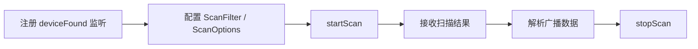
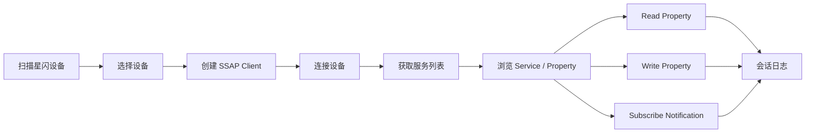
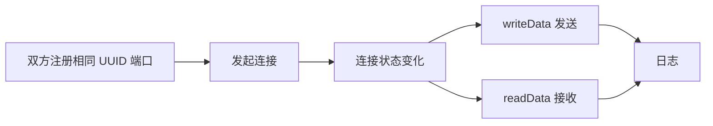

# HarmonyOS 无线调试工具 - 星闪需求了解

> 当前文档处于需求了解阶段，不是 PRD。星闪不是 Android/iOS 生态中的通用能力，因此“竞品对齐”不能直接找 Android/iOS 星闪 APP，而应对齐 BLE/GATT 调试工具、串口终端、HarmonyOS NearLink Kit 官方能力与样例。

## 1. 范围

星闪模块需要覆盖 NearLink Kit 当前开放的三类核心能力：

| 分类 | 面向对象 | 典型能力 | 用户目标 |
| --- | --- | --- | --- |
| 星闪扫描 | NearLink 外设、广播设备 | 扫描、过滤、广播数据解析 | 找到星闪设备并理解广播内容 |
| SSAP 调试 | 星闪 SSAP Client/Server | 连接、服务发现、读写 Property、通知 | 类似 BLE GATT 的服务/属性调试 |
| 数据传输 | NearLink dataTransfer | 端口注册、连接、发送、接收、MTU、加密提示 | 类似串口/Socket 的点对点数据调试 |

星闪工具需要比 BLE 更强调“设备支持与系统版本”提示，因为星闪能力依赖设备硬件、系统版本，不支持模拟器。

## 2. 调研来源

| 来源 | 用途 |
| --- | --- |
| HarmonyOS NearLink Kit 简介 | 确认星闪定位、中心/外围角色、设备支持、模拟器限制 |
| HarmonyOS 发起星闪扫描 | 确认 startScan/stopScan、deviceFound、过滤器、广播字段解析 |
| HarmonyOS SSAP 客户端 | 确认 createClient、connect、getServices、read/write property、notification |
| HarmonyOS 使用星闪传输数据 | 确认 createPort、connect、writeData、readData、MTU、加密边界 |
| GitCode nearlink-kit_sample | 确认实际样例页面：Advertising、Start Scan、Stop Scan、SSAP Service、Client/Server、dataTransfer |
| BLE 调试工具经验 | 用于类比星闪扫描、服务浏览、属性读写、日志、模拟端 |

## 3. 星闪与蓝牙/BLE 的产品映射

星闪在产品形态上可以借鉴 BLE 调试工具，但不能简单复制 BLE 名词。

| BLE/GATT 调试概念 | 星闪对应概念 | 产品映射 |
| --- | --- | --- |
| BLE 扫描 | NearLink 扫描 | 扫描列表、过滤、RSSI/名称/地址 |
| 广播数据解析 | NearLink 广播数据解析 | 解析 local name、service data、manufacturer data |
| GATT Client | SSAP Client | 连接设备、获取服务、读写属性 |
| GATT Server | SSAP Server | 本机作为服务端，提供属性 |
| Characteristic | Property | Read/Write/Notify 的最小数据单元 |
| Notify/Indicate | Property Notification | 订阅属性变化 |
| BLE 串口/Profile | NearLink dataTransfer | 注册 UUID/端口后点对点收发数据 |
| BLE 配对/加密 | NearLink pairing/ACB encrypted | 数据传输加密状态需明确提示 |

## 4. 主流调试工具可借鉴功能点

由于 Android/iOS 没有通用星闪生态，星闪模块应借鉴以下成熟工具能力：

| 借鉴对象 | 可借鉴能力 | 星闪落点 |
| --- | --- | --- |
| nRF Connect / LightBlue | 扫描、过滤、连接、服务浏览、读写、通知、日志 | SSAP 调试台 |
| BLE 串口终端 | 文本/HEX、换行、周期发送、日志导出 | dataTransfer 调试终端 |
| Packet Sender | 发送面板、宏、自动重发、服务端监听 | dataTransfer 高级调试 |
| WiFi/网络诊断工具 | 连接状态、错误解释、会话历史 | 星闪连接可靠性体验 |

## 5. 星闪扫描能力

HarmonyOS 官方指南中，星闪扫描主路径为：

### 5.1 扫描功能点

| 功能点 | 说明 | 需求理解 |
| --- | --- | --- |
| 开始/停止扫描 | 用户主动控制扫描 | 必备 |
| 设备列表 | 展示设备名、地址、RSSI、最后发现时间 | 必备 |
| 过滤器 | 地址、设备名等过滤条件 | 必备 |
| 过滤组合规则提示 | 过滤组之间 OR，组内字段 AND | 高级过滤需解释 |
| 广播字段解析 | discovery level、service data、local name、manufacturer data | 必备 |
| 原始广播 HEX | 保留完整原始数据 | 调协议必备 |
| 扫描历史 | 记录出现/消失、发现次数 | 专业增强 |
| 导出扫描结果 | JSON/CSV/TXT | 测试交付需要 |

HarmonyOS 样例中的扫描页提供了设备名配置、Apply 后连续扫描、结果列表、Stop Scan。产品化后需要补齐高级过滤、原始数据、导出和日志能力。

### 5.2 星闪设备身份风险

官方扫描结果包含随机地址与设备名。产品层不应将扫描地址默认为永久唯一身份。建议：

- 支持设备别名和收藏。
- 记录最近发现时间、RSSI、广播字段作为辅助识别。
- 对随机地址变化给出提示。
- 如果后续有更稳定的设备标识能力，需要通过官方 API 进一步验证。

## 6. SSAP 调试能力

SSAP 的产品形态应类似 BLE GATT Browser。

### 6.1 SSAP Client 功能点

| 功能点 | 说明 | 需求理解 |
| --- | --- | --- |
| 创建 Client | 根据扫描地址创建客户端 | 必备 |
| 连接/断开 | 连接目标星闪设备 | 必备 |
| 连接状态监听 | connected/disconnected/failed | 必备 |
| 获取服务 | `getServices` 展示服务结构 | 必备 |
| 属性读取 | `readProperty` | 必备 |
| 属性写入 | `writeProperty` | 必备 |
| 属性通知 | `setPropertyNotification` 和 propertyChange 监听 | 必备 |
| 属性权限展示 | Read/Write/Notify 能力 | 必备 |
| UUID/Handle 展示 | 让用户定位具体服务属性 | 必备 |
| 文本/HEX 输入输出 | 按协议查看数据 | 必备 |
| 命令收藏 | 常用属性写入值保存 | 增强 |
| 会话日志 | 连接、服务发现、读写、通知全部记录 | 必备 |

### 6.2 SSAP Server 功能点

GitCode nearlink-kit_sample 已包含 SSAP Client/Server 切换与服务端通知能力。产品化可考虑：

| 功能点 | 说明 | 价值 |
| --- | --- | --- |
| 创建 SSAP Server | 本机作为星闪服务端 | 反向调试主机/中心设备 |
| 自定义服务 | 配置 Service UUID/属性 | 模拟设备 |
| 自定义属性 | 配置 Read/Write/Notify | 协议联调 |
| 接收写入 | 展示对端写入内容 | 调试主机行为 |
| 主动通知 | 对订阅方推送属性变化 | 模拟设备状态 |
| 预设模板 | 保存常用服务结构 | 提高复用 |

该能力的优先级需要确认。它对专业调试很有价值，但会明显增加页面复杂度与测试成本。

## 7. dataTransfer 数据传输能力

NearLink dataTransfer 更接近“点对点数据通道”，适合做星闪串口/报文终端。

官方能力主路径：

### 7.1 数据传输功能点

| 功能点 | 说明 | 需求理解 |
| --- | --- | --- |
| 创建端口 | 输入/选择 UUID 注册端口 | 必备 |
| 连接参数 | 目标设备、UUID、MTU 等 | 必备 |
| 连接状态 | 连接中、已连接、失败、断开 | 必备 |
| 发送文本 | 按字符串发送 | 必备 |
| 发送 HEX | 按字节发送 | 必备 |
| 接收显示 | 文本/HEX/混合视图 | 必备 |
| MTU 设置/展示 | 官方支持配置 MTU | 必备 |
| 周期发送 | 压测、长测 | 增强 |
| 文件发送 | 批量数据 | 待确认 |
| 日志导出 | 会话证据 | 必备 |
| 双端角色 | 同一设备可发送/接收 | 产品上应支持“连接端/监听端”理解 |

### 7.2 加密与配对

官方指南明确：dataTransfer 数据通道不保证链路加密。若需要加密数据传输，应先通过 `startPairing` 配对，并通过 `getAcbState` 确认 ENCRYPTED 状态。

产品上必须给出：

- 当前链路是否已加密。
- 未加密发送敏感数据的风险提示。
- 配对入口或配对前置指引。
- 发送日志中记录加密状态，便于复盘。

## 8. HarmonyOS 星闪能力完整性核对

| 能力 | HarmonyOS 状态 | 需求判断 |
| --- | --- | --- |
| 设备支持 | Phone、PC/2in1、TV、Car、Tablet、Wearable 等，版本有差异 | 必须做设备兼容提示 |
| 模拟器支持 | 不支持模拟器 | 必须真机验证 |
| 权限 | `ohos.permission.ACCESS_NEARLINK` | 必须做权限说明 |
| 扫描 | 支持 startScan/stopScan/deviceFound | 必备 |
| 扫描过滤 | 支持地址、设备名等过滤 | 必备 |
| 广播解析 | 支持 discovery level、service data、local name、manufacturer data | 必备 |
| SSAP Client | 支持连接、服务、读写、通知 | 必备 |
| SSAP Server | 样例有服务端能力 | 建议纳入高级能力 |
| dataTransfer | 支持 createPort/connect/writeData/readData | 必备 |
| MTU | dataTransfer 支持配置 | 必备 |
| 链路加密 | dataTransfer 默认不保证，需要配对确认 | 必须做风险提示 |
| 多连接 | 需要进一步验证 API 与样例边界 | 待确认 |
| 后台运行 | 需要结合系统策略验证 | 高风险 |

## 9. 建议沉淀的星闪需求池

### 9.1 基础必备能力

| 编号 | 需求点 | 用户可感知结果 |
| --- | --- | --- |
| NL-001 | 星闪权限与设备支持检查 | 用户知道当前设备是否支持星闪、系统版本是否满足 |
| NL-002 | 星闪扫描列表 | 用户能看到附近星闪设备 |
| NL-003 | 扫描过滤 | 用户能按名称/地址筛选目标设备 |
| NL-004 | 广播解析 | 用户能查看广播字段和原始 HEX |
| NL-005 | SSAP Client | 用户能连接设备并获取服务 |
| NL-006 | Property 读写 | 用户能读取/写入属性 |
| NL-007 | Property 通知 | 用户能订阅属性变化 |
| NL-008 | dataTransfer 终端 | 用户能通过星闪数据通道收发文本/HEX |
| NL-009 | 会话日志 | 用户能保存扫描、连接、收发和错误 |
| NL-010 | 加密状态提示 | 用户知道当前传输是否已加密 |

### 9.2 专业增强能力

| 编号 | 需求点 | 用户可感知结果 |
| --- | --- | --- |
| NL-101 | SSAP Server | 用户能模拟星闪服务端 |
| NL-102 | 自定义服务/属性模板 | 用户能保存并复用调试服务结构 |
| NL-103 | dataTransfer 监听端 | 用户能等待其他设备连接 |
| NL-104 | 周期发送/压测 | 用户能做稳定性测试 |
| NL-105 | 文件发送 | 用户能发送批量数据 |
| NL-106 | 设备收藏/别名 | 用户能标记常用星闪设备 |
| NL-107 | 多会话 | 用户能同时维护多个星闪连接或日志 |
| NL-108 | 配对/加密引导 | 用户能完成加密传输前置条件 |

## 10. 关键限制与风险

| 风险 | 影响 | 产品处理 |
| --- | --- | --- |
| 星闪生态不等同于 Android/iOS 蓝牙生态 | 没有成熟跨平台星闪竞品可直接照搬 | 以 HarmonyOS 官方能力和样例为主，借鉴 BLE 工具交互 |
| 不支持模拟器 | 无法只靠模拟器开发验证 | 必须准备支持星闪的真机/外设 |
| 系统版本和设备支持差异 | 部分用户设备无入口或功能不可用 | 首屏做能力检测 |
| dataTransfer 不保证加密 | 用户可能误发敏感数据 | 明确加密状态和配对要求 |
| 随机地址/设备识别 | 设备身份可能变化 | 收藏/别名/广播特征辅助识别 |
| API 新且样例少 | 边界行为不确定 | 需要真机专项验证多连接、后台、异常恢复 |

## 11. 需要继续确认的问题入口

星闪部分的不确定项已汇总到《04-不确定需求确认.md》，重点包括：

- 首期是否必须同时支持 SSAP Client、SSAP Server、dataTransfer。
- 是否有明确目标星闪外设或协议样例。
- 是否要求链路加密和配对引导。
- 是否需要文件发送、周期发送、多连接、后台长测。
- 是否有真机/外设测试资源。

## 12. 参考链接

- [HarmonyOS NearLink Kit 简介](https://developer.huawei.com/consumer/cn/doc/harmonyos-guides/nearlink-introduction)
- [HarmonyOS 发起星闪扫描](https://developer.huawei.com/consumer/cn/doc/harmonyos-guides/nearlink-start-scan)
- [HarmonyOS SSAP 客户端](https://developer.huawei.com/consumer/cn/doc/harmonyos-guides/nearlink-ssap-client-connect)
- [HarmonyOS 使用星闪传输数据](https://developer.huawei.com/consumer/cn/doc/harmonyos-guides/nearlink-start-data-transfer)
- [HarmonyOS NearLink Kit Sample - GitCode](https://gitcode.com/HarmonyOS_samples/nearlink-kit_sample)
