# HarmonyOS 无线调试工具 PRD - 需求总览与决策基线

## 1. 文档定位

本文是无线调试工具项目的 PRD 总览文档，用于固化当前阶段已经确认的产品方向、模块边界、用户范围、能力分级和需求拆分关系。

本项目后续 PRD 拆分为多个文档，不以一篇长文档承载全部内容。拆分原因不是降低需求深度，而是为了让每个模块能够独立描述清楚：用户目标、功能范围、状态流、异常与限制、能力降级、数据记录和跨模块关系。

## 2. 产品目标

项目目标是在 HarmonyOS 上开发一个无线调试工具，覆盖蓝牙、WiFi、星闪三个无线方向，面向普通开发者、研发和测试人员提供可复现、可记录、可导出的无线调试能力。

产品定位不是轻量演示工具，而是“三个无线模块的专业调试台”。同时，为了降低普通开发者的使用门槛，产品需要支持“专家模式”和“轻量模式”两套使用视角：

| 模式 | 面向用户 | 展示原则 | 功能原则 |
| --- | --- | --- | --- |
| 专家模式 | 研发、测试、协议联调人员 | 展示完整字段、状态、错误码、原始数据、配置项 | 默认可访问完整功能 |
| 轻量模式 | 普通开发者、临时排查用户 | 优先展示常用入口、关键状态、推荐操作 | 隐藏高风险和低频高级参数，但底层能力保持一致 |

轻量模式不能是另一套简化实现。它应是同一套底层能力在 UI/UX 上的不同组织方式。命令、日志、连接状态、导出、权限解释、异常提示等基础能力必须一致，避免专业模式与轻量模式产生行为差异。

## 3. 模块优先级

当前确认的模块优先级为：

| 优先级 | 模块 | 原因 |
| --- | --- | --- |
| P0 | 蓝牙 | 经典 SPP 与 BLE GATT 是无线调试工具最核心、最通用的场景，竞品成熟，需求明确 |
| P1 | WiFi | 需要覆盖 WiFi 环境分析、网络诊断、Socket/协议调试三类能力，范围较大 |
| P2 | 星闪 | 已有星闪设备，但生态较新，依赖 HarmonyOS 真机能力验证 |

三个模块都进入需求池。优先级只影响开发推进顺序，不代表后续文档可以忽略 WiFi 或星闪的完整需求描述。

## 4. 用户范围

| 用户类型 | 典型场景 | 关键诉求 |
| --- | --- | --- |
| 普通开发者 | 临时验证 BLE 服务、TCP/UDP 连接、星闪设备是否可见 | 快速上手、少配置、失败原因明确 |
| 研发工程师 | 调试设备协议、验证收发数据、复现连接问题、分析链路状态 | 字节级数据、完整日志、可配置参数、命令面板 |
| 测试人员 | 执行重复测试、导出日志、对比多轮结果、构造异常场景 | 会话记录、周期发送、导出、可复现步骤 |

当前不把售后、产线作为首要用户，但命令面板、日志导出、设备收藏等能力天然可以服务于工厂和售后场景。后续如要面向产线，需要增加批量脚本、权限收敛、操作防误触、报告模板等需求。

## 5. 产品能力总图

```mermaid
flowchart TB
  A["无线调试工具"] --> B["蓝牙"]
  A --> C["WiFi"]
  A --> D["星闪"]
  A --> E["统一能力"]

  B --> B1["经典蓝牙 SPP/RFCOMM"]
  B --> B2["BLE 扫描与广播解析"]
  B --> B3["BLE GATT Client"]
  B --> B4["BLE Profile 预设"]
  B --> B5["BLE Server/Advertiser 预留"]

  C --> C1["WiFi 环境分析"]
  C --> C2["网络状态诊断"]
  C --> C3["LAN 扫描与端口扫描"]
  C --> C4["TCP/UDP/HTTP/WebSocket/MQTT 调试"]
  C --> C5["P2P/热点/控制能力预留"]

  D --> D1["星闪扫描"]
  D --> D2["SSAP Client"]
  D --> D3["dataTransfer 终端"]
  D --> D4["SSAP Server/广播预留"]

  E --> E1["统一会话日志"]
  E --> E2["命令收藏与命令面板"]
  E --> E3["周期发送"]
  E --> E4["导入导出"]
  E --> E5["权限、后台、降级策略"]
  E --> E6["专家模式/轻量模式"]
```

## 6. 需求文档拆分

| 文档 | 内容边界 |
| --- | --- |
| `00-需求总览与决策基线.md` | 产品定位、用户、优先级、需求拆分和已确认结论 |
| `01-产品信息架构与模式PRD.md` | 首页、模块页、设备页、终端页、日志页、设置页、专家/轻量模式 |
| `02-统一日志与命令面板PRD.md` | 跨蓝牙/WiFi/星闪复用的日志、命令、周期发送、导出能力 |
| `03-蓝牙模块PRD.md` | 经典蓝牙、BLE 扫描、GATT、SPP、Profile、蓝牙状态与限制 |
| `04-WiFi模块PRD.md` | WiFi 环境分析、网络诊断、LAN 扫描、Socket/协议调试 |
| `05-星闪模块PRD.md` | NearLink 扫描、SSAP、dataTransfer、设备能力检测、加密提示 |
| `06-权限后台兼容与降级PRD.md` | 权限申请、后台策略、设备能力、API 版本、降级体验 |
| `07-平台能力验证清单.md` | PRD 中不能直接承诺、需要真机或权限验证的能力项 |

## 7. 已确认决策

### 7.1 总体决策

| 决策项 | 结论 |
| --- | --- |
| 首要用户 | 普通开发者、研发、测试 |
| 产品定位 | 专业调试台为主，同时支持轻量模式 |
| 模块优先级 | 蓝牙、WiFi、星闪 |
| 统一日志中心 | 需要 |
| 日志存储 | 默认仅本地保存，不上云 |
| 导出格式 | TXT、CSV、JSON 都需要 |
| 命令能力 | 命令收藏、命令面板、周期发送都是重点能力 |
| 多设备/多会话 | 首期单模块单会话，底层和 UI 保留扩展 |
| 后台长连接 | 默认支持，可在设置中开启或关闭 |
| 语言 | 中文优先，支持后续扩展 |
| 主题 | 支持浅色、深色、跟随系统 |
| 屏幕形态 | 需求上明确响应式布局，默认竖屏，横屏预留 |

### 7.2 蓝牙决策

| 决策项 | 结论 |
| --- | --- |
| 经典蓝牙首期 | SPP/RFCOMM 优先，预留扩展 |
| SPP Server | 首期 Client 优先，Server 后续增强并预留 |
| UUID/Channel | 支持标准 UUID、自定义 UUID；Channel 直连取决于 HarmonyOS 能力验证 |
| L2CAP | 预留扩展 |
| 配对 | 优先遵循系统配对弹窗或系统引导 |
| 文件发送 | 后续增强 |
| SPP 日志 | 保存原始字节流，不做业务分包 |
| 自动重连 | 提供可开关自动重连 |
| BLE 首期 | 通用 GATT 浏览器优先，串口 Profile 做预设 |
| BLE Advertiser/GATT Server | 预留扩展接口 |
| BLE Profile | 默认支持 Nordic UART，其他 Profile 后续扩展 |
| BLE MTU/分包 | 需要 |
| BLE PHY/连接参数 | 需要核对 HarmonyOS 能力后规划完整功能 |
| BLE 厂商数据 mask 过滤 | 需要 |
| BLE 设备收藏 | 需要别名/收藏，持久 ID 能力需验证 |
| Notify 曲线 | 日志和曲线都需要规划 |

### 7.3 WiFi 决策

| 决策项 | 结论 |
| --- | --- |
| WiFi 主定位 | WiFi 环境分析、网络诊断、Socket 调试三类都需要 |
| 信道图/RSSI 时间图 | 需要 |
| 信道评分 | 后续增强 |
| LAN 子网扫描 | 需要完整功能，文案限定本地诊断 |
| 端口扫描 | TCP、UDP 等端口扫描都需要，范围和频率可设置 |
| Ping/DNS/Traceroute/Whois | 都需要完整功能 |
| TCP/UDP Server | 都需要完整功能 |
| TLS/SSL | 后续增强，预留 |
| HTTP/HTTPS | 需要完整功能，但需要明确与专业 HTTP 工具的边界 |
| MQTT/WebSocket | 需要完整功能 |
| mDNS/Bonjour/SSDP | 预留扩展 |
| WiFi 开关/连接/热点/P2P 控制 | 架构预留，实际能力受权限限制 |

### 7.4 星闪决策

| 决策项 | 结论 |
| --- | --- |
| 目标设备 | 默认暂无明确协议，做通用工具 |
| SSAP Client | 需要完整功能 |
| SSAP Server | 后续扩展 |
| dataTransfer | 需要完整功能 |
| 星闪广播 | 后续扩展 |
| 配对和加密 | 参考 HarmonyOS 文档规划 |
| 文件发送 | 后续扩展 |
| 多连接/多会话 | 默认单连接优先 |
| 真机资源 | 已存在星闪设备 |
| 兼容提示 | 需要能力检测和提示 |

## 8. 产品分级

PRD 中使用以下分级描述需求，避免混淆“首期要做”和“架构必须预留”。

| 分级 | 含义 |
| --- | --- |
| 必须支持 | 当前产品核心能力，后续开发文档应直接拆解 |
| 首期优先 | 进入首批开发范围，但仍需受平台能力验证约束 |
| 完整规划 | PRD 需要完整描述体验和边界，但可按开发阶段拆分 |
| 架构预留 | 当前不作为首期功能入口，但数据模型、导航、设置和能力边界不能堵死 |
| 后续增强 | 当前不阻塞主流程，可在后续版本扩展 |
| 平台待验证 | HarmonyOS 文档或权限边界未完全确认，必须进入验证清单 |

## 9. 核心原则

### 9.1 以调试闭环为核心

每个无线模块都必须形成完整闭环：

只提供单点功能无法满足调试需求。例如只做 BLE 扫描而没有 GATT 读写，或者只做 TCP 发送而没有接收日志，都不能构成可用的专业调试台。

### 9.2 原始数据优先

所有协议收发必须保留原始数据，显示层可以提供文本、HEX、混合视图，但不得以 UI 格式替代原始字节记录。

### 9.3 状态必须可解释

连接失败、扫描无结果、权限拒绝、后台断开、设备能力不支持、API 版本不支持，都必须给用户明确状态和下一步建议。调试工具最不能接受的是“没有反应”或“只显示失败”。

### 9.4 高级能力要有边界

端口扫描、周期发送、后台长连接、UDP 流量发送、蓝牙自动重连等能力有功耗、合规、网络扰动或系统限制风险。产品需要提供开关、范围限制、频率限制和风险提示。

### 9.5 平台能力不能过度承诺

HarmonyOS 的权限、设备能力、系统版本、后台策略会影响功能可达性。PRD 中对敏感能力必须写清楚：

- 文档确认能力。
- 权限受限能力。
- 系统应用/企业应用才可能完整支持的能力。
- 真机验证后才能确认的能力。
- 不支持时的降级展示。

## 10. 参考来源

- HarmonyOS Connectivity Kit 蓝牙、BLE、SPP、GATT、WLAN 文档。
- HarmonyOS Network Kit Socket、Connection、HTTP、WebSocket、MDNS 文档。
- HarmonyOS NearLink Kit Scan、Advertising、SSAP、dataTransfer 文档。
- GitCode HarmonyOS `BluetoothLowEnergy`、`network-query`、`nearlink-kit_sample` 示例。
- GitHub `SimpleBluetoothTerminal`、`SimpleBluetoothLeTerminal`、`WiFiAnalyzer`、`androidnetworktools`、`PacketSender`。
- nRF Connect、LightBlue、Fing、WiFiman、Network Analyzer 等主流调试工具功能形态。
