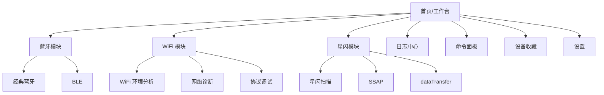

# HarmonyOS 无线调试工具 PRD - 产品信息架构与模式

## 1. 文档定位

本文描述无线调试工具的整体信息架构、页面结构、模式体系、导航关系和跨模块交互原则。本文不描述具体代码实现，不规定工程分层，不写开发排期。

## 2. 信息架构目标

产品信息架构需要同时满足两类使用方式：

| 使用方式 | 用户动作 | 架构要求 |
| --- | --- | --- |
| 按模块进入 | 用户明确知道要调试蓝牙、WiFi 或星闪 | 首页按模块提供明确入口，每个模块内部有独立工作台 |
| 按任务进入 | 用户只知道要“发一条命令”“看日志”“找设备” | 首页或全局入口提供最近会话、命令面板、日志中心 |

因此产品不能只有“蓝牙/WiFi/星闪三个 Tab”。它还需要把跨模块的会话、命令、日志、设置沉淀为稳定的全局能力。

## 3. 顶层页面结构

### 3.1 首页/工作台

首页不是营销页，也不是说明页，应直接承载可操作入口。

| 区域 | 内容 | 用户价值 |
| --- | --- | --- |
| 模块入口 | 蓝牙、WiFi、星闪 | 快速进入目标无线模块 |
| 最近会话 | 最近连接的设备、最近 Socket、最近星闪通道 | 快速恢复上次调试上下文 |
| 当前状态 | 蓝牙状态、WiFi 状态、星闪能力、权限摘要 | 进入前知道哪些能力可用 |
| 快捷命令面板 | 用户收藏的全局命令面板 | 高频操作一键进入 |
| 最近日志 | 最近保存或导出的会话 | 快速复盘 |

首页需要支持专家模式和轻量模式：

- 轻量模式只展示模块入口、最近会话、关键状态。
- 专家模式展示更多状态摘要，例如蓝牙是否开启、WiFi 当前 SSID、星闪是否支持、后台记录是否开启、当前日志存储大小。

### 3.2 蓝牙模块入口

蓝牙模块入口应拆为经典蓝牙和 BLE，不应把两者混在一个列表中。

| 子入口 | 默认目标 | 说明 |
| --- | --- | --- |
| 经典蓝牙 | SPP/RFCOMM 终端 | 面向传统串口设备、工装、模组 |
| BLE | GATT 浏览器 | 面向 BLE 外设、服务、特征、通知 |
| BLE 串口预设 | Nordic UART 等 Profile | 作为 BLE 的快捷路径，不替代通用 GATT |
| 蓝牙收藏 | 已收藏设备、最近连接设备 | 缓解虚拟地址和同名设备识别问题 |

### 3.3 WiFi 模块入口

WiFi 模块功能跨度大，应拆为三类工作台。

| 子入口 | 内容 | 说明 |
| --- | --- | --- |
| WiFi 环境分析 | AP 列表、信道图、RSSI 时间图 | 对齐 WiFiAnalyzer 类能力 |
| 网络诊断 | 当前网络、Ping、DNS、TraceRoute、Whois | 对齐 Network Analyzer 类能力 |
| 协议调试 | TCP、UDP、HTTP、WebSocket、MQTT | 对齐 Packet Sender 类能力 |
| LAN 发现 | 子网扫描、端口扫描、mDNS/SSDP 预留 | 对齐 Fing/WiFiman 类能力 |

### 3.4 星闪模块入口

星闪模块需要优先围绕设备发现、SSAP 和 dataTransfer。

| 子入口 | 内容 | 说明 |
| --- | --- | --- |
| 星闪扫描 | 扫描、过滤、广播解析 | 找设备和理解广播 |
| SSAP Client | 服务浏览、Property 读写、通知 | 类似 BLE GATT Browser |
| dataTransfer | UUID 端口、连接、文本/HEX 收发 | 类似星闪串口/报文终端 |
| 星闪高级 | SSAP Server、Advertising | 后续扩展，但入口结构预留 |

## 4. 模式体系

### 4.1 专家模式

专家模式是完整能力入口，默认面向研发和测试。

| 要求 | 描述 |
| --- | --- |
| 字段完整 | 展示 UUID、地址、地址类型、RSSI、频率、信道、错误码、MTU、PHY、权限状态等 |
| 操作完整 | 支持高级过滤、手动参数、周期发送、自动重连、日志导出 |
| 状态完整 | 显示连接状态、扫描状态、后台状态、降级状态 |
| 风险可见 | 对端口扫描、后台、自动重连、未加密传输等显示提示 |

### 4.2 轻量模式

轻量模式用于降低普通开发者使用门槛。

| 要求 | 描述 |
| --- | --- |
| 保留主路径 | 找设备、连接、发送、接收、保存日志必须可用 |
| 隐藏低频参数 | PHY、连接间隔、复杂过滤、服务端模拟等默认隐藏 |
| 推荐默认值 | 自动选择常用 UUID、常见端口、常见 Profile |
| 错误解释优先 | 扫描失败、连接失败时优先显示下一步操作 |

轻量模式不是功能阉割。用户可以从轻量模式进入高级设置，或者对单个会话切换为专家视图。

### 4.3 模式切换规则

| 场景 | 规则 |
| --- | --- |
| 全局设置切换 | 影响后续新打开页面的默认展示 |
| 单页临时切换 | 只影响当前页面，不改变全局设置 |
| 会话记录 | 日志必须记录实际操作，不受模式隐藏影响 |
| 命令面板 | 面板可以标记适合轻量模式或专家模式 |

## 5. 页面类型

### 5.1 列表页

适用于扫描设备、WiFi AP、LAN 设备、日志会话。

| 要素 | 要求 |
| --- | --- |
| 状态栏 | 显示扫描中、已暂停、最近刷新时间、数量 |
| 过滤入口 | 专家模式显示完整过滤，轻量模式显示搜索和常用过滤 |
| 排序入口 | RSSI、名称、最近发现、类型、收藏 |
| 空状态 | 必须解释为什么为空，例如权限、开关、系统节流、设备不支持 |
| 操作 | 扫描、暂停、刷新、导出、收藏 |

### 5.2 详情页

适用于蓝牙设备、BLE 服务、WiFi AP、星闪设备。

| 要素 | 要求 |
| --- | --- |
| 标识区 | 名称、地址、别名、收藏状态 |
| 能力区 | 支持的协议、服务、属性、频段、安全类型等 |
| 状态区 | 当前连接、RSSI、最后发现、错误状态 |
| 操作区 | 连接、读写、订阅、打开终端、导出 |
| 原始数据区 | 广播包、ScanInfo、服务结构、原始 HEX |

### 5.3 终端页

适用于 SPP、BLE 串口、TCP/UDP、WebSocket、MQTT、星闪 dataTransfer。

| 要素 | 要求 |
| --- | --- |
| 连接摘要 | 协议、目标、状态、耗时、错误 |
| 接收区 | 按时间追加，支持文本/HEX/混合视图 |
| 发送区 | 输入文本/HEX，支持换行、编码、发送按钮 |
| 命令区 | 收藏命令、命令面板、周期发送 |
| 日志区 | 当前会话记录状态、导出入口 |
| 状态提示 | 未连接、发送失败、后台中断、权限缺失 |

### 5.4 图表页

适用于 WiFi 信道图、RSSI 时间图、BLE/星闪 Notify 曲线。

| 要素 | 要求 |
| --- | --- |
| 数据来源 | 明确来自扫描、通知、诊断或日志 |
| 时间范围 | 支持查看最近 N 秒/分钟 |
| 选择对象 | 可选择一个或多个 AP/Characteristic/Property |
| 暂停 | 支持暂停曲线更新，方便观察 |
| 导出 | 支持导出曲线原始数据 |

### 5.5 设置页

设置页必须分组，不应混成一个长列表。

| 设置组 | 内容 |
| --- | --- |
| 显示 | 专家/轻量模式、主题、语言、横屏预留 |
| 日志 | 自动保存、存储位置、导出格式、脱敏选项 |
| 后台 | 后台长连接、后台记录、通知提醒 |
| 命令 | 命令面板、周期发送默认限制、宏变量 |
| 蓝牙 | 自动重连、默认 UUID、BLE MTU 默认值 |
| WiFi | 扫描间隔、端口扫描范围、协议默认超时 |
| 星闪 | 默认 MTU、加密提示、设备能力提示 |
| 安全 | 高风险操作确认、清除本地数据 |

## 6. 会话概念

产品需要统一“会话”概念。会话是调试过程的最小复盘单位。

| 会话类型 | 触发方式 | 结束方式 |
| --- | --- | --- |
| 扫描会话 | 开始蓝牙/BLE/WiFi/星闪扫描 | 停止扫描、离开页面、超时 |
| 连接会话 | 成功或尝试连接设备/Socket/星闪通道 | 主动断开、连接丢失、页面关闭 |
| 诊断会话 | 执行 Ping、DNS、TraceRoute、端口扫描 | 任务完成、取消、失败 |
| 命令会话 | 打开命令面板执行一组命令 | 面板执行完成、用户停止 |

每个会话必须关联：

- 会话 ID。
- 模块类型。
- 目标对象。
- 开始时间和结束时间。
- 状态结果。
- 原始事件日志。
- 用户可见名称。

## 7. 导航与返回

HarmonyOS 设备形态多，页面必须保持清晰的返回关系。

| 场景 | 返回目标 |
| --- | --- |
| 模块子页返回 | 返回对应模块工作台 |
| 终端页返回 | 返回设备详情或协议配置页，连接状态按设置决定是否保持 |
| 日志详情返回 | 返回日志中心 |
| 从最近会话进入 | 返回首页或最近会话列表 |
| 从命令面板进入 | 返回命令面板 |

当用户在连接中返回，必须明确提示：

- 保持后台连接。
- 断开连接并返回。
- 取消返回。

如果用户已在设置中关闭后台长连接，则返回时默认提示断开。

## 8. 响应式布局需求

| 设备形态 | 需求 |
| --- | --- |
| 手机竖屏 | 默认形态，所有主流程必须可用 |
| 手机横屏 | 预留终端和图表横屏能力，首期可不作为默认入口 |
| 平板 | 列表和详情可采用左右分栏 |
| 折叠屏 | 展开后优先采用分栏，折叠时保持当前上下文 |
| PC/2in1 | 优先利用宽屏展示日志、命令面板和详情 |

响应式布局不是视觉设计细节，而是需求边界：长日志、图表、命令面板、服务树结构在大屏上必须有更高信息效率。

## 9. 全局状态提示

产品需要统一状态语义，避免不同模块使用不同表达。

| 状态 | 含义 |
| --- | --- |
| 未开启 | 系统开关关闭，例如蓝牙、WiFi、星闪 |
| 权限不足 | 应用缺少当前功能所需权限 |
| 能力不支持 | 当前设备或系统版本不支持 |
| 可用 | 当前功能可正常进入 |
| 降级可用 | 可进入但部分字段或高级操作不可用 |
| 运行中 | 扫描、连接、诊断、周期发送正在执行 |
| 后台运行中 | 已离开前台但会话仍在继续 |
| 已失败 | 任务失败，需要给出原因和下一步 |

## 10. 参考来源

- HarmonyOS UX 体验标准和折叠屏体验标准。
- HarmonyOS 权限申请最佳实践。
- SimpleBluetoothTerminal 和 SimpleBluetoothLeTerminal 的终端/后台通知/状态组织。
- WiFiAnalyzer 的 AP 列表、图表、过滤、暂停扫描组织。
- Packet Sender 的协议入口、命令面板、服务器监听、持久连接组织。
