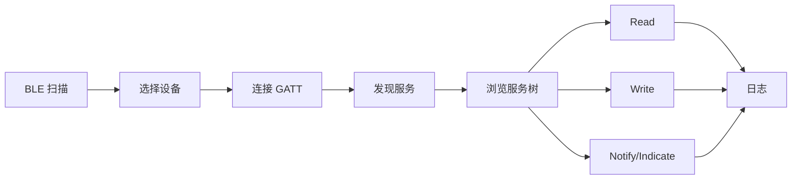

# HarmonyOS 无线调试工具 PRD - 蓝牙模块

## 1. 文档定位

本文描述蓝牙模块的产品需求，覆盖经典蓝牙 SPP/RFCOMM、BLE 扫描与广播解析、BLE GATT Client、BLE 串口 Profile 预设、BLE 高级参数、设备收藏、自动重连和日志。

蓝牙模块优先级为 P0，是本项目最先推进的无线模块。

## 2. 蓝牙模块目标

蓝牙模块要帮助用户完成以下任务：

| 任务 | 用户目标 |
| --- | --- |
| 找到蓝牙设备 | 扫描经典蓝牙或 BLE 设备，识别目标设备 |
| 连接传统串口设备 | 使用 SPP/RFCOMM 连接设备并收发数据 |
| 调试 BLE 外设 | 浏览 GATT 服务、读写 Characteristic/Descriptor、订阅 Notify/Indicate |
| 调试 BLE 串口 | 使用 Nordic UART 等 Profile 快速建立 BLE 串口会话 |
| 记录和复现 | 保存原始字节、连接状态、读写过程和错误 |
| 长时间验证 | 自动重连、后台连接、周期发送、日志持续记录 |

## 3. 范围与分级

| 功能 | 分级 | 说明 |
| --- | --- | --- |
| 蓝牙状态与权限检查 | 必须支持 | 进入蓝牙模块前明确蓝牙是否可用 |
| 经典蓝牙已配对设备 | 必须支持 | SPP 设备常依赖已配对设备 |
| 经典蓝牙发现 | 必须支持 | 支持附近设备发现和 RSSI 展示 |
| SPP Client | 首期优先 | 默认标准 SPP UUID，支持自定义 UUID |
| Channel 直连 | 平台待验证 | 用户要求支持，但需确认 HarmonyOS 是否开放 |
| SPP Server | 架构预留 | 后续增强 |
| L2CAP | 架构预留 | 后续扩展 |
| BLE 扫描 | 必须支持 | 支持过滤、排序、广播解析 |
| BLE GATT Client | 首期优先 | 通用 GATT 浏览器为 BLE 主入口 |
| BLE 串口 Profile | 完整规划 | 首期 Nordic UART，其他后续扩展 |
| BLE Advertiser | 架构预留 | 后续扩展 |
| GATT Server | 架构预留 | 后续扩展 |
| BLE MTU | 必须支持 | HarmonyOS 支持 `setBLEMtuSize` |
| BLE PHY | 完整规划 | HarmonyOS 有部分 API，需按 Client/Server 能力细化 |
| BLE 连接间隔/优先级 | 平台待验证 | 需确认 HarmonyOS 是否开放给普通应用 |
| Notify 曲线 | 完整规划 | 日志和曲线都要规划 |

## 4. 蓝牙首页

蓝牙模块首页需要拆分经典蓝牙和 BLE。

| 区域 | 内容 |
| --- | --- |
| 蓝牙总状态 | 蓝牙开关、权限、后台设置、最近连接 |
| 经典蓝牙入口 | 已配对设备、发现设备、SPP 终端 |
| BLE 入口 | BLE 扫描、GATT 浏览器、BLE 串口预设 |
| 收藏设备 | 已收藏经典蓝牙/BLE 设备 |
| 最近会话 | 最近 SPP、GATT、Notify 会话 |

空状态必须解释具体原因：

- 蓝牙未开启。
- 权限未授权。
- 当前设备不支持某能力。
- 扫描中但暂无结果。
- 系统资源忙或扫描被停止。

## 5. 经典蓝牙设备发现

### 5.1 已配对设备

| 需求 | 描述 |
| --- | --- |
| 展示已配对设备 | 展示名称、虚拟地址、配对状态、设备类型 |
| 刷新 | 手动刷新已配对列表 |
| 排序 | 收藏优先、最近连接、名称 |
| 快捷连接 | 选择设备后进入 SPP 连接配置 |
| 设备详情 | 展示名称、地址、配对状态、最近连接时间、别名 |

HarmonyOS `getPairedDevices` 返回的是虚拟 MAC 地址。产品不能把它描述为物理 MAC。

### 5.2 附近设备发现

| 需求 | 描述 |
| --- | --- |
| 开始发现 | 用户点击开始发现经典蓝牙设备 |
| 停止发现 | 用户可主动停止 |
| 发现结果 | 展示名称、地址、RSSI、类型、最后发现时间 |
| 扫描时长 | 显示倒计时或扫描中状态 |
| 连接前停止扫描 | 连接前提示或自动停止发现 |

HarmonyOS 文档中传统蓝牙发现约 12 秒，且扫描会占用硬件资源。产品应在连接前停止扫描，避免影响 SPP 连接。

## 6. SPP Client

### 6.1 连接配置

| 配置项 | 要求 |
| --- | --- |
| 目标设备 | 从已配对设备或发现结果选择 |
| UUID | 默认标准 Serial Port UUID `00001101-0000-1000-8000-00805F9B34FB` |
| 自定义 UUID | 支持用户输入、收藏、最近使用 |
| Channel | 若 HarmonyOS 支持，提供直连 Channel；若不支持，隐藏并在能力验证中记录 |
| 自动重连 | 可开关，默认遵循全局设置 |
| 后台保持 | 可开关，受全局后台设置控制 |
| 日志保存 | 默认开启 |

### 6.2 连接状态

| 状态 | 用户可见表现 |
| --- | --- |
| 未连接 | 显示可连接操作 |
| 连接中 | 显示目标、UUID、耗时 |
| 已连接 | 显示连接时长、收发统计、日志状态 |
| 连接失败 | 显示错误码、错误说明、建议操作 |
| 连接丢失 | 显示断开原因，提供重连 |
| 自动重连中 | 显示第几次重连、下次重连时间 |
| 已断开 | 保留日志，允许重新连接 |

### 6.3 SPP 终端

| 功能 | 要求 |
| --- | --- |
| 文本发送 | 支持输入文本发送 |
| HEX 发送 | 支持 HEX 输入和校验 |
| 换行配置 | None、CR、LF、CRLF |
| 编码 | UTF-8 默认，ASCII 可选，其他编码预留 |
| 接收显示 | 文本、HEX、混合视图 |
| 清屏 | 清空显示，不删除会话日志 |
| 复制 | 复制选中内容 |
| 周期发送 | 按统一周期发送需求执行 |
| 命令面板 | 绑定 SPP 命令 |
| 原始日志 | 保存原始字节流 |

SPP 是字节流，PRD 明确要求不做业务分包。一次读取回调只代表传输层收到一段字节，不代表业务消息结束。

## 7. BLE 扫描

### 7.1 扫描列表

| 字段 | 要求 |
| --- | --- |
| 设备名 | 广播名或本地名 |
| 地址 | HarmonyOS 虚拟地址或随机地址 |
| RSSI | 当前值和最近变化 |
| 广播类型 | 可连接/不可连接等可获得信息 |
| Service UUID | 从广播解析 |
| Manufacturer Data | 展示厂商 ID 和 HEX |
| Service Data | 展示 UUID 和 HEX |
| 最后发现时间 | 用于判断是否仍在广播 |
| 发现次数 | 用于判断广播稳定性 |

### 7.2 扫描过滤

| 过滤项 | 要求 |
| --- | --- |
| 名称 | 包含/精确匹配 |
| 地址 | 精确匹配 |
| RSSI | 最小 RSSI |
| Service UUID | 支持 UUID 过滤 |
| Manufacturer ID | 支持厂商 ID |
| Manufacturer Data Mask | 必须支持规划 |
| 是否收藏 | 只看收藏设备 |

BLE 扫描过滤需要支持专家模式完整配置，轻量模式只展示名称、RSSI、收藏等常用过滤。

### 7.3 广播详情

广播详情页需要展示：

- 原始广播 HEX。
- Local Name。
- Service UUID。
- Service Data。
- Manufacturer Data。
- Tx Power。
- RSSI 时间变化。
- 是否可连接。
- 解析失败字段的原始数据。

## 8. BLE GATT Client

### 8.1 主流程

### 8.2 服务树

| 节点 | 展示要求 |
| --- | --- |
| Service | UUID、已知名称、Primary/Secondary |
| Characteristic | UUID、属性、当前值摘要 |
| Descriptor | UUID、已知名称、当前值摘要 |

已知 UUID 需要使用字典识别。未知 UUID 显示原始 UUID。

### 8.3 Characteristic 操作

| 操作 | 要求 |
| --- | --- |
| Read | 读取后显示文本/HEX，并写入日志 |
| Write With Response | 显示写入结果 |
| Write Without Response | 显示已提交和可能的失败 |
| Notify | 开启/关闭订阅，记录每次通知 |
| Indicate | 开启/关闭订阅，记录每次指示 |
| CCCD | 自动处理 `00002902-0000-1000-8000-00805f9b34fb` |
| 命令收藏 | 对某个 Characteristic 保存常用写入值 |

### 8.4 MTU 与分包

HarmonyOS BLE Client 支持 `setBLEMtuSize`，取值范围 [23, 517]，未协商默认 23。产品需要：

- 在连接成功后展示当前 MTU。
- 支持用户请求 MTU。
- 订阅 MTU 变化。
- 按 MTU-3 估算单次可写 payload。
- 长数据写入时提示分包。
- 日志记录用户请求 MTU 和最终协商结果。

### 8.5 PHY 与高级连接参数

HarmonyOS BLE API 中存在 PHY 相关能力，例如 GATT Server 侧 `readPhy`、`setPhy`、PHY 更新事件。产品需求层需要完整规划：

| 能力 | 需求判断 |
| --- | --- |
| 读取当前 PHY | 进入平台验证清单，确认 Client/Server 可用边界 |
| 设置 PHY | 进入平台验证清单，确认是否仅 Server 侧开放 |
| 连接间隔 | 平台待验证 |
| 连接优先级 | 平台待验证 |
| 吞吐统计 | 可基于日志和收发字节计算 |

如果平台不支持某参数，UI 不应显示不可操作的死入口，应在专家模式能力说明里展示“不支持或当前设备不可用”。

## 9. BLE 串口 Profile

### 9.1 Profile 预设

首期默认支持 Nordic UART Service。

| Profile | 状态 |
| --- | --- |
| Nordic UART | 首期优先 |
| TI CC254x | 后续扩展 |
| Microchip RN4870/1 | 后续扩展 |
| Telit Bluemod | 后续扩展 |
| 自定义 Profile | 完整规划 |

### 9.2 Profile 识别

| 需求 | 描述 |
| --- | --- |
| 自动识别 | 连接并发现服务后，识别是否匹配已知串口 Profile |
| 手动选择 | 用户可手动选择 Profile |
| 自定义映射 | 用户指定 Service UUID、TX Characteristic、RX Characteristic |
| 保存映射 | 对设备或全局保存自定义 Profile |

## 10. 设备收藏与持久化

### 10.1 收藏字段

| 字段 | 说明 |
| --- | --- |
| 别名 | 用户自定义名称 |
| 设备类型 | 经典蓝牙、BLE、双模 |
| 地址 | HarmonyOS 虚拟地址或随机地址 |
| 持久化状态 | 是否已尝试持久化虚拟地址 |
| 最近 RSSI | 最近扫描到的 RSSI |
| 最近连接 | 时间和结果 |
| 默认连接方式 | SPP UUID、GATT Profile、常用命令面板 |

### 10.2 持久化能力

HarmonyOS `access.addPersistentDeviceId` 可持久化蓝牙虚拟 MAC 地址，但需要 `ACCESS_BLUETOOTH` 和 `PERSISTENT_BLUETOOTH_PEERS_MAC` 权限，并且后者涉及 ACL 权限审核。

产品要求：

- 普通收藏不依赖持久化权限。
- 若权限可用，提供“固化设备地址”能力。
- 若权限不可用，收藏仍可保存别名、最近广播信息和连接历史。
- 地址失效时提示用户重新扫描并更新收藏。

## 11. 自动重连

| 配置 | 要求 |
| --- | --- |
| 开关 | 全局和单设备可配置 |
| 次数 | 可设置最大重试次数 |
| 间隔 | 可设置初始间隔和最大间隔 |
| 停止条件 | 用户手动停止、设备不可用、权限变化、达到次数 |
| 日志 | 每次重连尝试都记录 |
| UI | 显示重连中、次数、下一次时间 |

自动重连不应掩盖真实断连。会话日志必须保留原始断连事件和重连事件。

## 12. 后续扩展能力

| 能力 | 说明 |
| --- | --- |
| SPP Server | 本机注册 UUID，等待外部连接 |
| BLE Advertiser | 本机发送 BLE 广播 |
| GATT Server | 本机模拟 BLE 外设 |
| L2CAP | 专业协议调试 |
| 文件发送 | SPP/BLE 串口大数据发送 |
| Notify 曲线 | 对数值型 Notify 绘制曲线 |

这些能力需要在信息架构和数据模型中预留入口，但不阻塞首期 SPP Client 和 GATT Client。

## 13. 参考来源

- HarmonyOS 蓝牙服务开发概述、传统蓝牙查找设备、SPP 开发指南、BLE 查找设备、GATT 开发指南。
- HarmonyOS `ohos.bluetooth.connection`、`ohos.bluetooth.socket`、`ohos.bluetooth.ble`、`ohos.bluetooth.access`。
- HarmonyOS 低功耗蓝牙基础使用最佳实践。
- SimpleBluetoothTerminal、SimpleBluetoothLeTerminal。
- nRF Connect、LightBlue。
