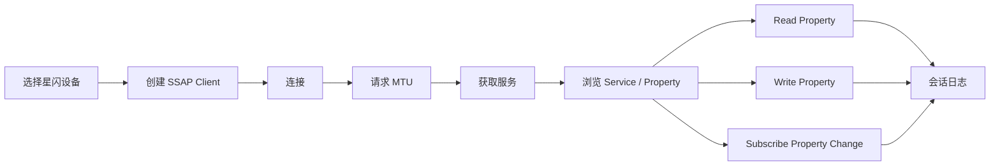

# HarmonyOS 无线调试工具 PRD - 星闪模块

## 1. 文档定位

本文描述星闪模块的产品需求，覆盖 NearLink 设备能力检测、星闪扫描、广播解析、SSAP Client、dataTransfer 终端、配对与加密提示、SSAP Server/Advertising 预留。

星闪模块优先级为 P2。当前已确认存在星闪设备，但暂无明确目标协议，因此产品应先做通用星闪调试工具。

## 2. 星闪模块目标

| 目标 | 说明 |
| --- | --- |
| 判断设备是否支持星闪 | 进入模块前明确当前设备和系统是否可用 |
| 扫描星闪设备 | 发现附近设备，查看地址、名称、广播内容 |
| 调试 SSAP | 连接设备，浏览服务和 Property，读写和订阅变化 |
| 调试 dataTransfer | 通过 UUID 端口建立数据通道，收发文本/HEX |
| 识别加密风险 | 明确 dataTransfer 链路是否已加密 |
| 保存日志 | 扫描、连接、读写、收发、错误进入统一日志 |

## 3. 范围与分级

| 功能 | 分级 | 说明 |
| --- | --- | --- |
| 星闪能力检测 | 必须支持 | 星闪不支持模拟器，设备能力差异明显 |
| ACCESS_NEARLINK 权限 | 必须支持 | 进入具体能力时按场景申请 |
| 星闪扫描 | 必须支持 | startScan、stopScan、deviceFound |
| 扫描过滤 | 必须支持 | 地址、设备名，后续扩展更多字段 |
| 广播解析 | 必须支持 | Local name、service data、manufacturer data |
| SSAP Client | 首期优先 | 用户确认需要完整功能 |
| SSAP MTU | 首期优先 | 官方支持 requestMtuSize，范围 [22, 512] |
| dataTransfer | 首期优先 | 用户确认需要完整功能 |
| 加密状态提示 | 必须支持 | dataTransfer 默认不保证链路加密 |
| SSAP Server | 架构预留 | 用户确认后续扩展 |
| 星闪 Advertising | 架构预留 | 用户确认后续扩展 |
| 文件发送 | 后续增强 | 用户确认后续扩展 |
| 多连接/多会话 | 架构预留 | 首期单连接优先 |

## 4. 星闪首页

| 区域 | 内容 |
| --- | --- |
| 能力状态 | 星闪开关、设备支持、权限、系统版本、真机提示 |
| 星闪扫描 | 扫描设备、查看广播 |
| SSAP | SSAP Client 入口 |
| dataTransfer | 数据通道终端入口 |
| 最近设备 | 最近连接的星闪设备 |
| 最近会话 | 最近 SSAP/dataTransfer 日志 |
| 高级能力 | SSAP Server、Advertising 预留入口或说明 |

如果当前设备不支持星闪，首页必须展示清晰不可用状态，不应让用户进入空白扫描页。

## 5. 设备能力检测

星闪依赖设备硬件和系统能力。产品需要在进入模块时进行能力检查。

| 检查项 | 展示 |
| --- | --- |
| 设备是否支持 NearLink | 支持/不支持/无法确认 |
| 星闪开关状态 | 开启/关闭/无法获取 |
| 权限 | ACCESS_NEARLINK 是否已授权 |
| API 版本 | 当前能力最低版本提示 |
| 模拟器 | 不支持模拟器，提示需真机 |
| 支持协议 | Scan、SSAP、dataTransfer、Advertising 能力 |

## 6. 星闪扫描

### 6.1 扫描主流程

### 6.2 设备列表字段

| 字段 | 要求 |
| --- | --- |
| 设备名 | 广播中携带的名称 |
| 地址 | 扫描得到的随机地址 |
| RSSI | 若扫描结果提供则展示 |
| 最后发现时间 | 判断设备是否仍在广播 |
| 发现次数 | 判断广播稳定性 |
| 广播摘要 | service UUID、厂商数据摘要 |
| 收藏状态 | 是否已收藏 |

### 6.3 扫描过滤

HarmonyOS 星闪扫描过滤支持地址、设备名等条件。官方说明过滤组之间 OR，组内字段 AND。产品要求：

- 轻量模式支持设备名搜索。
- 专家模式支持地址、设备名、过滤组管理。
- 过滤条件为空时给出提示，避免用户误以为过滤生效。
- 扫描中允许暂停/停止。

### 6.4 广播详情

| 字段 | 要求 |
| --- | --- |
| 原始广播 | HEX |
| Local Name | 可读名称 |
| Discovery Level | 官方字段解析 |
| Service Data 16/128 UUID | 展示 UUID 和数据 |
| Manufacturer Data | 厂商 ID 和 HEX |
| 解析错误 | 展示原始数据，不丢弃 |

## 7. SSAP Client

### 7.1 主流程

### 7.2 连接状态

| 状态 | 用户可见表现 |
| --- | --- |
| 未连接 | 展示连接入口 |
| 连接中 | 展示目标设备和耗时 |
| 已连接 | 展示连接时长、MTU、收发统计 |
| 连接失败 | 展示错误码和建议 |
| 已断开 | 保留日志，可重连 |

官方 SSAP 文档说明一个应用针对一个远端设备只需要创建一次 Client 实例。产品层需要避免用户重复创建多个同目标连接。

### 7.3 服务与 Property 浏览

| 节点 | 展示 |
| --- | --- |
| Service | UUID、Handle、已知名称 |
| Property | UUID、Handle、权限、值摘要 |

### 7.4 Property 操作

| 操作 | 要求 |
| --- | --- |
| Read | 读取 Property 值，展示文本/HEX |
| Write | 支持文本/HEX，支持写入类型 |
| Notify | 订阅 Property Change |
| 命令收藏 | 保存常用 Property 写入 |
| 曲线 | 对数值型 Property Change 规划曲线 |
| 日志 | 每次读写、通知、错误进入统一日志 |

### 7.5 MTU

HarmonyOS SSAP Client 支持 `requestMtuSize`，范围 [22, 512]，默认 256 字节。产品要求：

- 展示当前 MTU。
- 支持用户请求 MTU。
- 订阅 mtuChange。
- 日志记录请求值和协商值。
- 写入超过 MTU 的数据时提示分包或不可发送。

## 8. dataTransfer

### 8.1 主流程

### 8.2 端口与连接配置

| 配置 | 要求 |
| --- | --- |
| UUID | 双端必须一致，支持输入、收藏、最近使用 |
| 目标设备 | 来自扫描结果或收藏 |
| MTU | 支持展示和配置 |
| 自动重连 | 可按星闪设置提供 |
| 加密要求 | 可设置“未加密时提醒” |
| 日志 | 默认保存 |

### 8.3 终端能力

| 功能 | 要求 |
| --- | --- |
| 文本发送 | 支持 |
| HEX 发送 | 支持 |
| 接收显示 | 文本、HEX、混合视图 |
| 换行 | None、CR、LF、CRLF |
| 周期发送 | 支持 |
| 命令面板 | 支持 |
| 统计 | 发送/接收字节数、速率、错误数 |
| 导出 | TXT、CSV、JSON |

## 9. 加密与配对

HarmonyOS 官方指南说明 dataTransfer 数据通道不保证链路加密。如果需要加密，应先通过配对，并通过 ACB 状态确认 ENCRYPTED。

产品要求：

| 需求 | 描述 |
| --- | --- |
| 加密状态展示 | 在 dataTransfer 会话顶部显示已加密/未加密/未知 |
| 风险提示 | 未加密时提示不要发送敏感数据 |
| 配对引导 | 按 HarmonyOS 文档提供配对入口或系统引导 |
| 日志记录 | 会话开始和状态变化时记录加密状态 |
| 阻止策略 | 用户可设置未加密时禁止发送 |

具体 `startPairing`、`getAcbState` 能力和入口归入平台验证清单。

## 10. 设备收藏

| 字段 | 说明 |
| --- | --- |
| 别名 | 用户自定义 |
| 地址 | 扫描地址 |
| 最近名称 | 最近广播名称 |
| 默认 UUID | dataTransfer 默认端口 UUID |
| 默认模式 | SSAP 或 dataTransfer |
| 最近连接 | 时间、结果 |
| 加密偏好 | 是否要求加密 |

星闪扫描地址可能变化，因此收藏不能只依赖地址。应保留广播特征、别名、最近会话等辅助识别信息。

## 11. 后续扩展

### 11.1 SSAP Server

官方 API 支持创建 SSAP Server、监听连接状态、Property 读写请求、发送响应、MTU 变化事件。用户确认该能力后续扩展。产品架构需要预留：

- 创建服务。
- 配置 Service/Property。
- 接收读请求。
- 接收写请求。
- 发送响应。
- 主动通知。
- 保存服务模板。

### 11.2 Advertising

官方 API 支持星闪广播启动、停止、广播状态事件，配置项包括广播间隔、发射功率、是否可连接、Service UUID、厂商数据、服务数据、是否包含设备名。用户确认后续扩展。产品架构需要预留：

- 广播模板。
- 广播数据编辑。
- 启停状态。
- 广播 ID 管理。
- 错误提示。

## 12. 关键风险

| 风险 | 产品处理 |
| --- | --- |
| 设备不支持星闪 | 首屏能力检测 |
| 模拟器不可用 | 提示真机要求 |
| API 新、样例少 | 平台验证清单跟踪 |
| dataTransfer 未加密 | 显著提示和可选阻止 |
| 地址不稳定 | 收藏不能只依赖地址 |
| 多连接不确定 | 首期单连接，架构预留 |

## 13. 参考来源

- HarmonyOS NearLink Kit 简介、星闪扫描、SSAP 客户端、星闪数据传输指南。
- HarmonyOS NearLink `scan`、`advertising`、`ssap`、`dataTransfer` API。
- GitCode HarmonyOS `nearlink-kit_sample`。
- BLE GATT 调试工具的服务/属性/通知交互经验。
