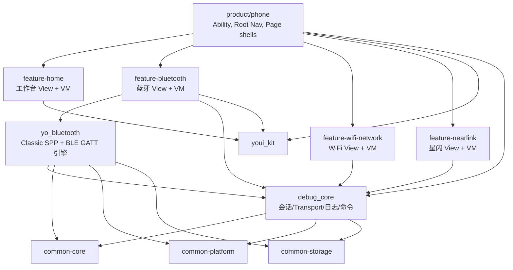

# 无线调试工具总体架构与工程模块化设计

## 1. 设计输入

### 1.1 需求输入

本设计覆盖无线调试工具的三个主功能域：

1. 蓝牙调试：经典蓝牙 SPP/RFCOMM、BLE GATT Client、扫描、配对、设备收藏、自动重连、命令发送、日志记录。
2. WiFi 与网络调试：WiFi 环境分析、网络诊断、TCP/UDP Socket、HTTP/HTTPS、WebSocket、MQTT、LAN 发现、端口扫描。
3. 星闪调试：NearLink 能力检测、扫描、广播解析、SSAP Client、dataTransfer、连接日志、基础命令发送。

公共需求包括：

1. 专家模式与轻量模式共用同一底层能力，只改变 UI 信息密度和默认参数。
2. 统一会话模型，覆盖扫描、连接、诊断、命令发送、日志导出。
3. 统一日志中心，保留原始 payload，支持文本、十六进制、混合展示和 TXT/CSV/JSON 导出。
4. 统一命令面板，支持收藏、模板、周期发送、导入导出、按协议绑定参数。
5. 权限按场景申请，不在启动时批量申请；拒绝后提供设置引导和降级态。
6. 后台长连接、后台日志、后台周期发送必须显式开关，且受到 HarmonyOS 后台任务约束。

### 1.2 技术输入

当前项目配置：

1. `build-profile.json5` 仅包含一个 `entry` 模块。
2. `entry/src/main/module.json5` 为 `entry` HAP，设备类型包含 `phone`、`tablet`、`2in1`。
3. `targetSdkVersion` 与 `compatibleSdkVersion` 为 `6.1.0(23)`。
4. 当前页面仍为默认 `Index.ets`，没有既有业务模块依赖需要迁移。

参考约束：

1. HarmonyOS 推荐产品定制层、基础特性层、公共能力层的三层工程结构。
2. Stage 模型 + UIAbility + WindowStage 是默认应用模型。
3. ArkTS + ArkUI，优先使用 MVVM V2 状态模型。
4. 页面路由采用 `Navigation`、`NavPathStack`、`NavDestination` 与系统路由表。
5. HAR 可承载业务特性模块与公共能力模块；HAR 不在 `module.json5` 中声明 pages，但可通过 Navigation 跳转到 HAR 内页面。
6. HSP 适合动态共享和按需加载，但会引入安装、加载、版本和调试复杂度；本项目首期不默认使用 HSP。

## 2. 架构目标

### 2.1 目标

1. 每个无线协议模块能独立开发、验证和降级。
2. 日志、命令、会话、权限、导出等横向能力只实现一次。
3. 平台 API 回调不直接驱动 UI，必须进入 Repository/RuntimeStore 后再向 ViewModel 暴露稳定状态。
4. 原始字节与业务展示解耦，避免日志中心被具体协议帧格式污染。
5. 所有受权限、设备能力、API 版本影响的能力都必须有可解释的不可用态。
6. 核心连接与扫描资源有明确生命周期，避免页面退出后残留 socket、scan、GATT client、NearLink client。
7. 支持后续从单 HAP 内分层迁移到多 HAR 模块，目录与 API 先按最终形态设计。

### 2.2 非目标

1. 首期不把工具做成 Postman、Wireshark 或完整自动化测试平台。
2. 首期不承诺系统应用权限能力，例如强制开关 WiFi、读取所有真实 MAC、管理热点、后台无限制扫描。
3. 首期不把每个协议的业务帧解析作为底层必选能力；默认保留原始 payload，解析器作为插件式扩展。
4. 首期不使用 HSP 做按需加载，除非包体或安装性能被实测证明需要。

## 3. 总体架构



> 工程已落地：`product/phone` Entry + `features/*` UI HAR + `common/{core,platform,storage,youi_kit,debug_core,yo_bluetooth}`。
> Page 壳归属 product；协议引擎归属 common。

关键结论：

1. `feature-debug-core` 是业务公共内核，不放入 `common`，因为会话、命令、无线调试错误码都带有明确业务语义。
2. `common-*` 只放稳定、可复用、无业务归属的基础能力。
3. 蓝牙、WiFi/网络、星闪互不依赖，它们只通过 `feature-debug-core` 暴露统一会话、日志和命令接口。
4. 日志中心和命令中心不是 `common`，它们是可见业务特性模块。
5. 平台 API 封装可以放在 `common-platform`，但协议级封装仍归各自 feature 的 data 层。

## 4. 工程包管理设计

### 4.1 推荐目标结构

```text
Yovo-HarmonyOS-YoWireTools/
  AppScope/
  entry/                         # 产品 HAP，首期继续作为唯一 HAP
    src/main/ets/
      entryability/
      app/
        AppBootstrap.ets
        AppRouter.ets
        RootNavigation.ets
  features/
    debug_core/                   # HAR，业务底座
    home/                         # HAR
    bluetooth/                    # HAR
    wifi_network/                 # HAR
    nearlink/                     # HAR
    log_center/                   # HAR
    command_center/               # HAR
    settings/                     # HAR
  common/
    core/                         # HAR
    ui/                           # HAR
    platform/                     # HAR
    storage/                      # HAR
  docs/
```

### 4.2 分阶段落地

第一阶段：单 HAP 内落地架构目录。

```text
entry/src/main/ets/
  app/
  common/
    core/
    ui/
    platform/
    storage/
  features/
    debug_core/
    home/
    bluetooth/
    wifi_network/
    nearlink/
    log_center/
    command_center/
    settings/
```

适用原因：

1. 当前工程尚无业务代码，先快速形成业务闭环。
2. 单 HAP 避免过早引入 HAR 构建、跨模块资源、Preview、依赖传递问题。
3. 目录和 import 边界先按最终模块设计，后续拆 HAR 时改动可控。

第二阶段：拆分为 HAR 模块。

拆分触发条件：

1. 蓝牙、WiFi/网络、星闪任一模块形成独立开发节奏。
2. 公共底座被多个 feature 稳定复用。
3. 模块边界通过 lint/import 规则可验证。
4. 需要独立单元测试或独立样例调试。

第三阶段：评估 HSP。

仅在以下条件同时成立时评估 HSP：

1. 包体或安装时间被实测证明成为问题。
2. 某些高级能力，例如 MQTT、报表模板、协议解析插件，存在明显按需加载收益。
3. 团队能接受 HSP 的版本、资源、预览和加载复杂度。

### 4.3 HAP/HAR/HSP 选择

| 类型 | 本项目用途 | 首期策略 |
| --- | --- | --- |
| entry HAP | Ability、WindowStage、根导航、产品装配、权限声明入口 | 必选 |
| feature HAR | 蓝牙、WiFi/网络、星闪、日志、命令、设置、业务底座 | 第二阶段拆分 |
| common HAR | 无业务语义的基础工具、UI、平台、存储 | 第二阶段拆分 |
| HSP | 动态共享/按需加载高级能力 | 首期不使用 |
| Feature HAP | 独立 Ability 或按需安装业务包 | 首期不使用 |

## 5. 分层设计

每个 feature 使用一致的四层结构：

```text
feature_xxx/
  src/main/ets/
    ui/
      page/
      view/
      component/
      dialog/
      navigation/
    viewmodel/
    domain/
      model/
      usecase/
      repository/
      service/
    data/
      repository/
      datasource/
        platform/
        local/
        memory/
      entity/
      mapper/
    export/
      Index.ets
```

### 5.1 UI 层

职责：

1. 只处理页面结构、交互、展示态、弹窗和路由事件。
2. 不直接调用 Bluetooth、WiFi、NearLink、Socket、RDB、Preferences API。
3. 不保存连接真相状态，只订阅 ViewModel 暴露的 UI State。
4. 专家模式和轻量模式只在 UI 层选择信息密度、默认字段和默认筛选条件。

### 5.2 ViewModel 层

职责：

1. 组合 UseCase，形成页面级状态。
2. 使用 MVVM V2 的可观察状态承载 UI State。
3. 将平台错误映射为用户可读错误和操作建议。
4. 持有页面临时输入，例如命令编辑内容、筛选条件、弹窗表单。
5. 页面销毁时释放订阅，不直接释放底层连接资源；资源释放通过 UseCase/SessionManager 完成。

### 5.3 Domain 层

职责：

1. 定义领域模型、Repository 接口、UseCase、策略和状态机。
2. 不 import ArkUI 组件。
3. 不 import 具体平台 API 对象作为公共领域模型。
4. 处理协议无关规则，例如会话状态转换、命令队列、日志归档策略。

### 5.4 Data 层

职责：

1. 实现 Repository。
2. 封装平台 API、RDB、Preferences、文件、导入导出。
3. 将平台回调转换为领域事件。
4. 负责资源注册、注销、destroy、close、off、stopScan 等生命周期。

## 6. 依赖规则

### 6.1 允许

1. `product -> features -> common`
2. `product -> common`（含 `debug_core`、`yo_bluetooth`、`youi_kit`）
3. `features/bluetooth -> yo_bluetooth -> debug_core`
4. `features/wifi_network -> debug_core` / `common-platform`
5. `features/nearlink -> debug_core` / `common-platform`
6. `yo_bluetooth -> debug_core -> common-{core,platform,storage}`

### 6.2 禁止

1. `common -> features`
2. `feature-bluetooth -> feature-wifi-network`
3. `feature-wifi-network -> feature-nearlink`
4. `feature-nearlink -> feature-bluetooth`
5. product Page / Feature UI 直接 import data source。
6. data 层反向 import viewmodel。
7. 公共模块引用 `AppScope` 资源。
8. 通过全局单例绕过 Repository/UseCase 边界直接改运行态。

## 7. 路由与页面组织

### 7.1 根导航

`product/phone` 负责：

1. 创建 `NavPathStack`。
2. 注册全局路由表与 Page 壳。
3. 提供底部/侧边一级导航：工作台、蓝牙、WiFi、星闪、更多。
4. 注入 `AppContext`、`PermissionOrchestrator`、`CapabilityRegistry`、`SessionRuntimeStore`。

### 7.2 目标路由表

| 路由 | 页面 | 所属模块 |
| --- | --- | --- |
| `/home/workbench` | 工作台 | home |
| `/bluetooth/overview` | 蓝牙总览 | bluetooth |
| `/bluetooth/classic-scan` | 经典蓝牙扫描 | bluetooth |
| `/bluetooth/spp-terminal` | SPP 终端 | bluetooth |
| `/bluetooth/ble-scan` | BLE 扫描 | bluetooth |
| `/bluetooth/gatt-detail` | GATT 详情 | bluetooth |
| `/wifi/overview` | WiFi 总览 | wifi_network |
| `/wifi/diagnostics` | 网络诊断 | wifi_network |
| `/wifi/socket-terminal` | Socket 终端 | wifi_network |
| `/wifi/http-client` | HTTP 调试 | wifi_network |
| `/wifi/websocket` | WebSocket 调试 | wifi_network |
| `/wifi/lan-discovery` | 局域网发现 | wifi_network |
| `/nearlink/overview` | 星闪总览 | nearlink |
| `/nearlink/scan` | 星闪扫描 | nearlink |
| `/nearlink/ssap-client` | SSAP Client | nearlink |
| `/nearlink/data-transfer` | dataTransfer | nearlink |
| `/log/list` | 日志中心 | log_center |
| `/log/detail` | 日志详情 | log_center |
| `/command/list` | 命令面板 | command_center |
| `/settings/index` | 设置 | settings |

### 7.3 HAR 路由注意事项

后续拆 HAR 时：

1. HAR 内页面不在 HAR 的 `module.json5` 中声明 pages。
2. 通过 Navigation 和系统 router map 进行跨 HAR 页面装配。
3. 页面入口需要通过模块 `Index.ets` 导出。
4. 不允许 feature 直接持有另一个 feature 的页面 class；跨模块只传路由名与参数模型。

## 8. 运行态总线

### 8.1 单一事实源

所有连接、扫描、诊断和命令运行态进入 `SessionRuntimeStore`：

```text
Platform Callback
  -> DataSource
  -> Repository
  -> UseCase / SessionManager
  -> SessionRuntimeStore
  -> ViewModel
  -> UI
```

禁止以下路径：

```text
Platform Callback -> UI
Platform Callback -> ViewModel local state only
Page local state -> connection truth
```

### 8.2 运行态类型

1. `ScanSessionState`：扫描中、暂停、结束、错误、结果列表、统计。
2. `ConnectionSessionState`：创建中、连接中、已连接、断开中、已断开、重连中、失败。
3. `DiagnosticSessionState`：待执行、执行中、部分成功、成功、失败、取消。
4. `CommandSessionState`：空闲、发送中、周期发送中、背压中、失败、停止。
5. `LogCaptureState`：记录中、落盘中、导出中、暂停、错误。

### 8.3 事件模型

事件使用协议无关 envelope：

```text
DebugEvent
  id
  sessionId
  moduleType
  eventType
  direction
  timestampMs
  severity
  summary
  payloadRef
  nativeCode
  appCode
  attributes
```

其中 `payloadRef` 指向原始 bytes 文件片段或小 payload 内联数据，UI 展示格式不能反写原始数据。

## 9. 模式设计

### 9.1 专家模式

显示：

1. 原始地址/虚拟地址、RSSI、广播字段、服务 UUID、MTU、PHY、socket 参数、错误码。
2. 命令编码、换行符、重复策略、超时、重试。
3. 日志过滤、原始 bytes、时间戳、方向、连接状态迁移。

### 9.2 轻量模式

隐藏：

1. 非必要协议字段。
2. 高风险系统权限入口。
3. 高级扫描参数。
4. 复杂错误码。

保留：

1. 设备发现。
2. 一键连接。
3. 常用命令。
4. 最近日志。
5. 明确的不可用原因。

### 9.3 架构要求

模式不能分裂底层能力。实现方式：

1. `ModeProfile` 定义 UI 字段显隐、默认参数、危险操作提示。
2. UseCase 接收完整参数模型，但 ViewModel 根据模式生成默认参数。
3. 日志、命令、连接状态完全共享。

## 10. 平台能力边界

### 10.1 必须实测确认

1. SPP Client SDP 查询与自定义 UUID 的兼容性。
2. SPP Channel 直连是否有公开 API 支持。
3. BLE 随机地址持久化权限在目标签名下是否可用。
4. BLE MTU 协商上限与目标设备行为。
5. WiFi 扫描频率、缓存结果、真实 BSSID 获取。
6. TCP/UDP 后台连接维持和前台恢复。
7. WebSocket Server 在目标 API 与设备类型上的可用性。
8. NearLink 设备能力、开关路径、SSAP MTU、dataTransfer 可用性。
9. NearLink 配对加密状态查询与失败错误码。

### 10.2 降级原则

1. 能力不可用时给出原因、缺失权限、API 版本或设备能力。
2. 不用 UI 文案伪装能力存在。
3. 不在普通设备上暴露系统应用权限才能完成的操作为默认主路径。
4. 失败事件进入统一日志，便于用户导出给研发分析。

## 11. 安全与隐私基线

1. 默认本地保存，不上传云端。
2. 日志导出前支持用户选择是否脱敏。
3. 原始 payload 默认保留，但导出界面必须提示可能包含敏感数据。
4. HiLog 不输出隐私字段，不直接输出完整 payload。
5. 收藏设备使用可解释的设备标识，区分真实 MAC、虚拟地址、随机地址、用户别名。
6. TLS 证书忽略、明文密码保存、周期后台发送等高风险功能必须显式提示。

## 12. 架构风险

| 风险 | 影响 | 对策 |
| --- | --- | --- |
| 平台 API 版本差异 | 某些功能在目标设备不可用 | CapabilityRegistry 统一探测并进入降级态 |
| 后台任务限制 | 扫描/连接/周期发送被系统中断 | 后台开关 + 长时任务策略 + 前台恢复 reconcile |
| 多协议日志量大 | 卡顿、数据库膨胀 | RDB 存索引，原始 bytes 分片文件存储，UI 分页加载 |
| BLE/GATT 操作并发 | 写入失败或状态错乱 | 每个 GATT Client 单队列串行化 |
| Socket/端口扫描并发 | UI 卡顿、电量消耗、误报 | Worker/TaskPool + 并发限制 + 取消令牌 |
| NearLink 设备稀缺 | 功能无法普遍验证 | 单独维护真机验证清单和样例设备矩阵 |

## 13. 需要产品确认的问题

1. 是否允许首版只发布单 HAP，而不是立即拆 HAR 模块。
2. 是否将 MQTT 作为 P1 完整功能，还是与 TLS 一样放入 P2。
3. 日志默认保留时长、大小上限、自动清理策略。
4. 命令模板是否需要团队共享格式，还是首期仅本地导入导出。
5. 后台周期发送是否默认仅专家模式可见。
6. 是否允许导出未脱敏原始 payload。
