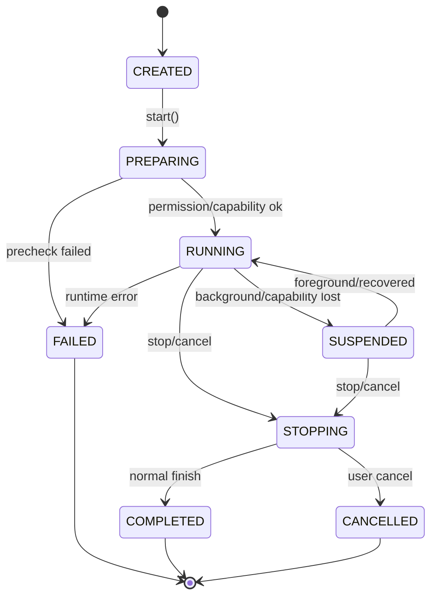
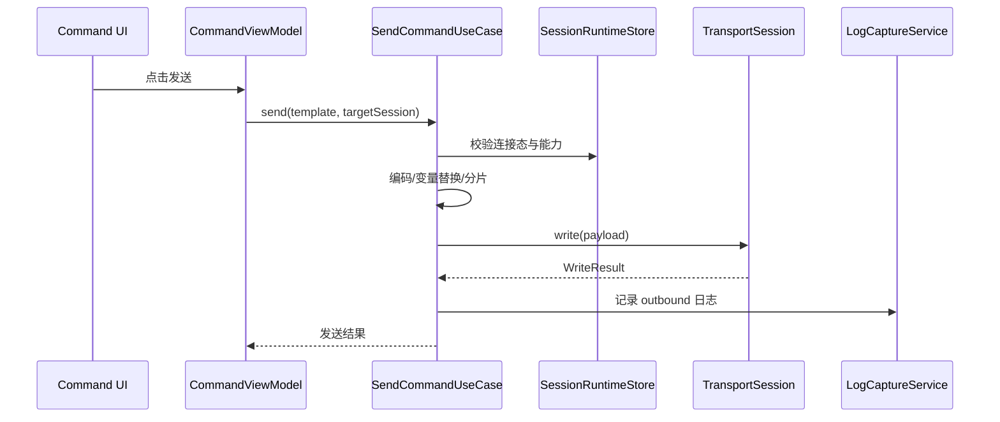

# 公共底座架构设计

## 1. 范围

公共底座覆盖所有无线模块共享的业务能力：

1. 会话管理。
2. 运行态状态机。
3. 日志采集、索引、展示、导出。
4. 命令模板、命令发送、周期发送。
5. 权限申请、权限拒绝处理、设置引导。
6. 平台能力探测与降级。
7. 后台任务策略。
8. 错误码与用户可读诊断。
9. HiLog 观测性。
10. 本地存储、备份边界、清理策略。

公共底座不包含具体协议实现，例如 SPP 连接、BLE GATT 读写、TCP Socket、SSAP Client，这些属于各自模块。

## 2. 模块归属

目标拆分：

```text
features/debug_core/
  domain/
    model/
    repository/
    usecase/
    service/
  data/
    repository/
    datasource/
    mapper/
  runtime/
  export/

features/log_center/
features/command_center/
features/settings/

common/core/
common/platform/
common/storage/
common/ui/
```

职责划分：

| 模块 | 职责 |
| --- | --- |
| `feature-debug-core` | 会话、运行态、协议无关 transport 契约、错误码、日志领域模型、命令领域模型 |
| `feature-log-center` | 日志列表、详情、筛选、导出 UI |
| `feature-command-center` | 命令模板、收藏、周期发送 UI |
| `feature-settings` | 权限、后台、日志保留、显示模式、导出设置 |
| `common-core` | Result、Option、时间、bytes、编码、队列、取消令牌 |
| `common-platform` | 权限、生命周期、能力探测、HiLog facade |
| `common-storage` | Preferences、RDB、文件、导入导出 |
| `common-ui` | 基础 UI 组件、错误态、空态、加载态、表单控件 |

## 3. 统一会话设计

### 3.1 会话类型

```text
DebugSession
  id: string
  type: scan | connection | diagnostic | command | export
  module: bluetooth | wifi | nearlink | system
  protocol: spp | ble_gatt | wifi_scan | tcp | udp | http | websocket | mqtt | ssap | data_transfer | none
  target: DebugTarget
  displayName: string
  mode: expert | light
  state: SessionState
  startAtMs: number
  endAtMs?: number
  result?: SessionResult
  tags: string[]
  attributes: Record<string, string | number | boolean>
```

会话是所有日志、命令、诊断和导出的根对象。

### 3.2 会话状态

基础状态：

1. `CREATED`：已创建，尚未开始。
2. `PREPARING`：权限、能力、参数检查中。
3. `RUNNING`：执行中。
4. `SUSPENDED`：被后台限制、权限变化、系统开关变化等原因暂停。
5. `STOPPING`：主动停止或资源释放中。
6. `COMPLETED`：正常完成。
7. `FAILED`：失败结束。
8. `CANCELLED`：用户取消。

每个模块可以扩展子状态，但必须映射到基础状态。

### 3.3 会话生命周期



### 3.4 SessionManager

接口：

```text
SessionManager
  createSession(input): Promise<DebugSession>
  startSession(sessionId): Promise<void>
  stopSession(sessionId, reason): Promise<void>
  updateState(sessionId, patch): void
  appendEvent(event): Promise<void>
  getSession(sessionId): DebugSession | undefined
  observeSession(sessionId): Observable<DebugSessionState>
  observeActiveSessions(): Observable<DebugSessionSummary[]>
```

规则：

1. 连接会话与扫描会话分离。
2. 一个连接会话可以关联多个命令会话。
3. 日志导出创建独立 export 会话，避免长导出阻塞连接会话。
4. 页面退出不等于会话结束，除非页面明确发起停止。
5. Ability 进入后台时由 `LifecycleCoordinator` 通知所有运行中会话做降级或申请后台策略。

## 4. Transport 抽象

### 4.1 TransportSession

所有可发送/接收 bytes 的通道实现统一接口：

```text
TransportSession
  id: string
  module: ModuleType
  protocol: ProtocolType
  state: TransportState
  capabilities: TransportCapabilities
  connect(params): Promise<void>
  disconnect(reason): Promise<void>
  write(payload, options): Promise<WriteResult>
  observeIncoming(): Observable<IncomingPayload>
  observeState(): Observable<TransportStateSnapshot>
```

协议映射：

| 协议 | Transport 实现 |
| --- | --- |
| SPP/RFCOMM | `SppTransportSession` |
| BLE GATT | `GattTransportSession`，写入 Characteristic，接收 Notify/Indicate |
| TCP Client | `TcpClientTransportSession` |
| TCP Server connection | `TcpServerConnectionTransportSession` |
| UDP | `UdpTransportSession` |
| WebSocket | `WebSocketTransportSession` |
| MQTT | `MqttTransportSession` |
| SSAP | `SsapTransportSession` |
| dataTransfer | `NearLinkDataTransferSession` |

### 4.2 TransportCapabilities

```text
TransportCapabilities
  isByteStream: boolean
  isMessageBased: boolean
  maxWriteBytes?: number
  supportsNotify?: boolean
  supportsMtu?: boolean
  supportsSecure?: boolean
  supportsServerMode?: boolean
  supportsReconnect?: boolean
  supportsBackground?: boolean
```

用途：

1. 命令面板根据能力决定是否显示分片、换行、订阅、周期发送、QoS 等字段。
2. 日志中心根据能力决定显示方向、packet/message 边界。
3. 轻量模式根据能力选择安全默认值。

## 5. 统一日志设计

### 5.1 日志原则

1. 原始 payload 必须保留，展示格式不能改变原始数据。
2. SPP、TCP 等 byte stream 不擅自做业务帧切分，只记录读到的 chunk 和发送 chunk。
3. BLE Notify、UDP、WebSocket、SSAP 可以记录 message/event 边界，但仍保留原始 bytes。
4. 日志默认本地保存，不上传云端。
5. HiLog 只记录调试必要元信息，不输出完整 payload 和隐私字段。

### 5.2 日志模型

```text
DebugLogRecord
  id: string
  sessionId: string
  module: ModuleType
  protocol: ProtocolType
  direction: inbound | outbound | internal
  recordType: bytes | text | state | error | metric | permission | lifecycle
  timestampMs: number
  monotonicMs?: number
  summary: string
  payloadRef?: PayloadRef
  payloadSize: number
  displayHint: text | hex | mixed | json | none
  appCode?: string
  nativeCode?: string | number
  attributes: Record<string, string | number | boolean>
```

### 5.3 存储结构

RDB 表：

1. `debug_session`
2. `debug_log_index`
3. `debug_payload_chunk`
4. `command_template`
5. `command_history`
6. `device_favorite`
7. `capability_result`
8. `app_setting`

文件：

```text
files/debug_payload/
  yyyyMMdd/
    sessionId/
      chunk-000001.bin
      chunk-000002.bin
files/export/
  yyyyMMdd-HHmmss-sessionName.json
```

RDB 存索引与小字段；大 payload 写入文件。原因：

1. RDB 单行和字符串大小存在限制。
2. 大量原始 bytes 直接入库会影响查询和 UI 分页。
3. 文件分片便于导出和清理。

### 5.4 日志采集链路

```text
Transport callback
  -> PayloadNormalizer
  -> LogCaptureService
  -> PayloadChunkWriter
  -> LogIndexRepository
  -> SessionRuntimeStore
  -> LogCenterViewModel
```

`PayloadNormalizer` 只做方向、时间、大小、编码提示，不做业务解释。

### 5.5 展示格式

1. 文本：按 UTF-8 尝试解码，失败字符用替代符，保留原始 bytes。
2. 十六进制：每行偏移 + hex + ASCII 侧栏。
3. 混合：可打印文本直接显示，不可打印字节显示为 hex。
4. JSON：仅当用户手动选择或内容检测为 JSON 时格式化，不作为存储格式。

### 5.6 导出

格式：

1. TXT：适合人工阅读。
2. CSV：适合表格分析。
3. JSON：适合研发复现和工具二次处理。

导出选项：

1. 时间范围。
2. 会话范围。
3. 方向。
4. 日志类型。
5. 是否包含原始 bytes。
6. 是否脱敏。
7. 是否包含设备标识。
8. 是否包含平台错误码。

脱敏策略：

1. 设备地址默认中间段掩码。
2. WiFi SSID 可选掩码。
3. HTTP Header 中 Authorization、Cookie 默认掩码。
4. payload 默认不自动脱敏，只在导出确认页明确提示。

## 6. 命令面板设计

### 6.1 命令模型

```text
CommandTemplate
  id: string
  name: string
  module?: ModuleType
  protocol?: ProtocolType
  payloadEncoding: text | hex | base64 | file
  payload: string
  lineEnding: none | cr | lf | crlf
  writeMode: once | repeat | sequence
  repeatPolicy?: RepeatPolicy
  timeoutMs: number
  tags: string[]
  variables: CommandVariable[]
  createdAtMs: number
  updatedAtMs: number
```

### 6.2 发送流程



### 6.3 周期发送

规则：

1. 默认关闭。
2. 后台周期发送需要用户显式允许，并通过后台任务策略校验。
3. 每个 Transport 同一时间只能有一个默认周期发送任务，避免多任务交错导致调试不可控。
4. 支持最小间隔下限，避免过高频率触发系统资源限制。
5. 支持发送次数上限、持续时间上限、失败停止策略。

### 6.4 分片策略

分片由协议能力决定：

| 协议 | 分片策略 |
| --- | --- |
| SPP | 默认不分片，可由用户设置 chunk size |
| BLE GATT | 按 MTU 与 Characteristic 写入限制分片，串行发送 |
| TCP | 默认不分片，必要时按用户 chunk size |
| UDP | 默认限制单包大小，超限提示 |
| WebSocket | message 边界发送 |
| MQTT | topic/payload/QoS 作为完整消息 |
| SSAP | 按属性写入能力和 MTU 限制 |
| dataTransfer | 按 port MTU 限制 |

## 7. 权限架构

### 7.1 PermissionOrchestrator

职责：

1. 按场景申请权限。
2. 查询权限状态。
3. 记录用户拒绝和弹窗是否展示。
4. 生成设置页引导。
5. 为 ViewModel 输出可解释的 `PermissionUiState`。

接口：

```text
PermissionOrchestrator
  ensurePermission(scenario): Promise<PermissionDecision>
  checkPermission(permission): Promise<PermissionStatus>
  requestFromUser(permissions, reason): Promise<PermissionRequestResult>
  openSettingGuide(permissionGroup): Promise<void>
```

### 7.2 场景权限

| 场景 | 权限 |
| --- | --- |
| Bluetooth 扫描/连接/配对 | `ohos.permission.ACCESS_BLUETOOTH` |
| BLE 随机地址持久化 | `ohos.permission.PERSISTENT_BLUETOOTH_PEERS_MAC`，按签名和 ACL 结果降级 |
| WiFi 信息读取 | `ohos.permission.GET_WIFI_INFO` |
| 真实 WiFi 对端 MAC | `ohos.permission.GET_WIFI_PEERS_MAC`，能力受限时降级 |
| WiFi 配置 | `ohos.permission.SET_WIFI_INFO`，同时受系统/企业权限限制 |
| 网络访问 | `ohos.permission.INTERNET` |
| 网络状态 | `ohos.permission.GET_NETWORK_INFO` |
| NearLink | `ohos.permission.ACCESS_NEARLINK` |

### 7.3 拒绝处理

1. 用户拒绝后不重复强拉系统权限弹窗。
2. 如果系统不再展示弹窗，显示设置引导。
3. 权限未授予时，对应按钮进入禁用态或解释态。
4. 不把权限失败包装成连接失败。
5. 权限事件写入日志，便于用户导出。

## 8. 能力探测与降级

### 8.1 CapabilityRegistry

模型：

```text
CapabilityResult
  capabilityId: string
  module: ModuleType
  status: available | unavailable | limited | unknown
  reason?: string
  apiLevel?: string
  requiredPermission?: string
  nativeCode?: string | number
  verifiedAtMs: number
  deviceInfo?: string
```

能力清单：

1. `bluetooth.adapter.state`
2. `bluetooth.classic.discovery`
3. `bluetooth.spp.client`
4. `bluetooth.spp.server`
5. `bluetooth.ble.scan`
6. `bluetooth.ble.gatt.client`
7. `bluetooth.ble.mtu`
8. `wifi.scan`
9. `wifi.linked.info`
10. `network.tcp.client`
11. `network.tcp.server`
12. `network.udp`
13. `network.http`
14. `network.websocket.client`
15. `network.websocket.server`
16. `nearlink.supported`
17. `nearlink.scan`
18. `nearlink.ssap.client`
19. `nearlink.data_transfer`

### 8.2 降级输出

每个能力不可用时必须输出：

1. 不可用原因。
2. 是否缺权限。
3. 是否设备不支持。
4. 是否 API 版本不足。
5. 是否需要开启系统开关。
6. 用户下一步操作。

## 9. 后台任务策略

### 9.1 LifecycleCoordinator

监听：

1. Ability `onForeground`
2. Ability `onBackground`
3. WindowStage 生命周期
4. 网络状态变化
5. Bluetooth/NearLink/WiFi 开关变化

进入后台时：

1. 检查当前运行会话。
2. 对扫描类会话默认暂停或停止，除非已有合法后台策略。
3. 对连接类会话记录后台事件，并按用户设置决定是否申请长时任务。
4. 对周期发送任务默认停止或暂停，除非用户开启后台周期发送。
5. UI 返回前台后执行 `reconcile()`，用真实平台状态刷新运行态。

### 9.2 任务类型

| 业务 | 后台策略 |
| --- | --- |
| Bluetooth 扫描 | 默认不允许后台持续扫描 |
| BLE/SPP 连接日志 | 用户开启后尝试长时任务，失败则记录降级 |
| WiFi 扫描 | 默认前台操作，后台停止 |
| Socket 长连接 | 用户开启后尝试长时任务，前台恢复时重连 |
| HTTP 下载/导出 | 短任务或前台完成，长任务视文件大小评估 |
| NearLink 扫描 | 默认前台操作 |
| NearLink dataTransfer | 用户开启后尝试长时任务 |
| 周期发送 | 默认前台，后台必须显式启用 |

## 10. 错误码设计

应用错误码格式：

```text
YW-<DOMAIN>-<NUMBER>
```

领域：

| Domain | 含义 |
| --- | --- |
| `CAP` | 能力探测 |
| `PERM` | 权限 |
| `BT` | 经典蓝牙 |
| `BLE` | BLE |
| `WIFI` | WiFi |
| `NET` | Socket/HTTP/WebSocket/MQTT |
| `NL` | NearLink |
| `SESSION` | 会话 |
| `CMD` | 命令 |
| `LOG` | 日志 |
| `STORE` | 存储 |
| `EXPORT` | 导出 |

错误对象：

```text
DebugError
  appCode: string
  message: string
  userAction?: string
  nativeCode?: string | number
  nativeMessage?: string
  severity: info | warning | error | fatal
  retryable: boolean
  attributes: Record<string, string | number | boolean>
```

原则：

1. 平台错误码必须保留到 `nativeCode`。
2. 用户文案不直接展示晦涩 native error。
3. 是否可重试由业务判断，不只看 native code。
4. 错误进入会话日志和 HiLog，但隐私字段不进入 HiLog。

## 11. 观测性

### 11.1 HiLog 规范

1. tag 使用 ASCII，长度控制在 31 字节以内。
2. 正常高频 payload 不进 HiLog。
3. 状态迁移格式：`state_name:s1->s2, reason=xxx`。
4. 参数格式：`name=value`。
5. 日志长度超过平台限制时拆分。
6. release 版本按全局级别控制 DEBUG/INFO。

### 11.2 必打日志点

1. App 启动、前后台切换。
2. 权限申请结果。
3. 能力探测结果。
4. 会话创建、开始、暂停、恢复、结束。
5. 连接状态迁移。
6. 资源释放失败。
7. 导出开始、完成、失败。
8. 后台任务申请、失败、取消。

## 12. 存储策略

### 12.1 Preferences

用于：

1. UI 模式。
2. 默认展示格式。
3. 后台开关。
4. 日志保留策略。
5. 最近使用参数。

不用于：

1. 大日志。
2. 大 payload。
3. 高并发写入数据。
4. 结构化复杂查询。

### 12.2 RDB

用于：

1. 会话索引。
2. 日志索引。
3. 命令模板。
4. 命令历史。
5. 设备收藏。
6. 能力探测记录。

### 12.3 文件

用于：

1. 原始 payload 分片。
2. 导出文件。
3. 导入临时文件。
4. 大型报告。

## 13. 并发与取消

### 13.1 原则

1. UI 线程只做展示和轻量状态更新。
2. socket、扫描解析、端口扫描、日志导出使用异步任务或 Worker/TaskPool。
3. 每个 Transport 有独立写队列。
4. 每个长任务都有 `CancellationToken`。
5. 页面退出只取消页面订阅，不自动取消业务任务，除非任务属于页面临时任务。

### 13.2 队列

| 队列 | 用途 |
| --- | --- |
| `CommandWriteQueue` | 命令串行发送 |
| `GattOperationQueue` | BLE GATT read/write/notify 配置串行执行 |
| `LogWriteQueue` | 日志索引和 payload 落盘 |
| `ScanResultMergeQueue` | 扫描结果去重与排序 |
| `PortScanQueue` | 端口扫描并发限制 |
| `ExportQueue` | 导出任务串行或有限并发 |

## 14. 公共底座验收清单

1. 任意模块创建的会话都能在日志中心看到。
2. 任意 Transport 发送的数据都能进入 outbound 日志。
3. 任意 Transport 接收的数据都能进入 inbound 日志。
4. 权限拒绝不会造成页面崩溃或死循环弹窗。
5. 后台再回前台后，连接状态来自平台真实状态而不是旧 UI 状态。
6. 导出 JSON 能保留 native error、app error、时间戳、方向、payloadRef。
7. Preferences 清空不影响日志数据库完整性。
8. 大日志列表滚动不卡顿，分页加载有效。
9. 同一连接下周期发送和手动发送按队列顺序执行。
10. 所有 DataSource 都有 off/close/destroy/stop 释放路径。
