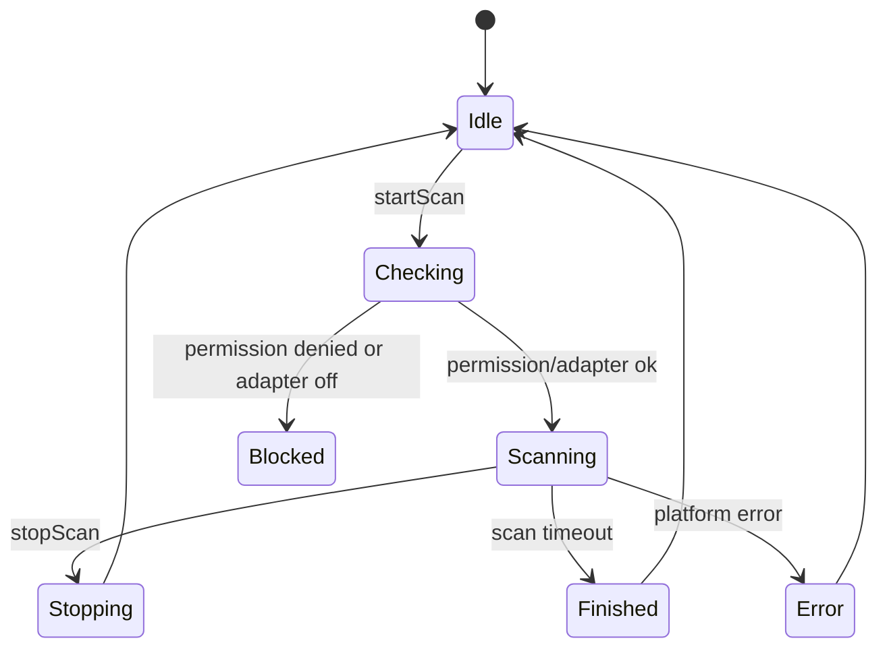
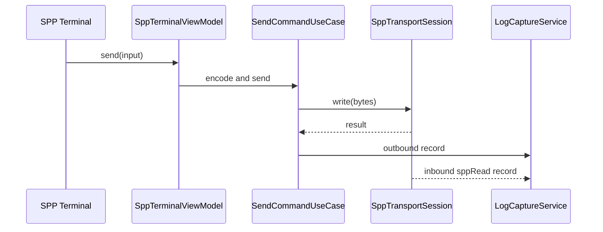

# 钃濈墮妯″潡鏋舵瀯璁捐

> **鐘舵€?*锛氭€诲唽瀹氱锛坴1.2 路 2026-07-23锛? 
> **缁嗗垎鏂囨。**锛歚bluetooth/00`锝瀈06`锛堣韩浠藉簳搴?+ 涓夎矾寰?+ 浼氳瘽闃熷垪 + MVVM 鐩綍锛? 
> **鍔熻兘鎬诲唽**锛歚7-UIUX璁捐/.../02-钃濈墮妯″潡/00-钃濈墮鍔熻兘鎬绘竻鍗曚笌浼樺厛绾х煩闃?md`  
> **瀹樻柟渚濇嵁**锛欳onnectivity Kit锛坅ccess / connection / ble / socket锛? 鐭窛 FAQ + 閿欒鐮? 
> **绔炲搧瀵圭収**锛歯RF Connect 路 SimpleBT SPP/LE 路 Serial Terminal 路 LightBlue

## 1. 鑼冨洿涓庝紭鍏堢骇

钃濈墮妯″潡 v1 瑕嗙洊锛堣瑙佸姛鑳芥€诲唽 P0/P1锛夛細

1. 浼犺緭绫诲瀷涓庡弻鍦板潃韬唤锛坄00`锛夈€?2. 缁忓吀 Inquiry 涓庡凡閰嶅闈?LE銆?3. SPP Client锛?*鍗曟椿璺冨啓绔?* + 缁堢鏀跺彂 + TX 闃熷垪 + SessionLog銆?4. BLE 鎵弿锛堝惈 Manufacturer Mask锛? GATT 娴忚鍣紙澶氫細璇濆簲鐢ㄥ眰 鈮?锛夈€?5. BLE-UART 鐙珛璺緞锛圢ordic P0锛涘け璐ヨ烦杞?GATT锛夈€?6. 璁惧鏀惰棌/鏈€杩戣繛鎺ワ紱妯″潡璁惧畾楠ㄦ灦銆?7. 涓?`debug_core` 缁熶竴浼氳瘽/鏃ュ織/鍛戒护銆?
棰勭暀缂濓紙闈?v1 瀹炵幇锛夛細SPP Server銆丩2CAP銆丄dvertiser銆丟ATT Server銆佺湡瀹?MAC 涓昏矾寰勩€丏FU銆丮acros 28 寮曟搸銆?
**缁嗗垎闃呰**锛氳 [`bluetooth/README.md`](bluetooth/README.md)銆?
## 2. 骞冲彴鑳藉姏杈圭晫

### 2.0 鍏叡搴曞骇锛堟柊澧烇紝鍏ㄦā鍧楀己鍒讹級

1. 涓夋柟榛樿鍙湁**铏氭嫙 MAC**锛沀I 绂佹绉般€岀墿鐞?MAC銆嶃€?2. **浼犺緭绫诲瀷 API 瀛樺湪**锛歚connection.getRemoteDeviceTransport` 鈫?`BR_EDR | LE | DUAL | UNKNOWN`锛圓PI20+锛夈€?3. **CoD 鈮?浼犺緭绫诲瀷**锛歚deviceClass` / `getRemoteDeviceClass` 鍙綔灞曠ず銆?4. SPP 鍒楄〃鐧藉悕鍗曪細`BR_EDR | DUAL`锛涙帓闄?`LE`銆?5. BLE 鎵弿鍦板潃 鈮?缁忓吀鍦板潃锛?*绂佹**浜ゅ弶鐢ㄤ簬 `sppConnect` / GATT銆?6. 鍙屾ā妗ユ帴鍙蛋瀹樻柟鎺ㄨ崘锛欱LE MAC `pairDevice` 鈫?閰嶅鍒楄〃鍑虹幇缁忓吀 MAC 鈫?鍚嶇О鍖归厤 鈫?SPP銆?7. `connectAllowedProfiles` 浠?A2DP/HFP/HID锛?*姘镐笉**鎵挎媴 SPP銆?8. 缁嗚妭瑙?`bluetooth/00-浼犺緭绫诲瀷涓庡弻鍦板潃韬唤妯″瀷璁捐.md`銆?
### 2.1 缁忓吀钃濈墮

宸茬‘璁ゅ彲浣滀负璁捐鍩虹锛?
1. `ACCESS_BLUETOOTH`锛涘彂鐜板墠妫€鏌ラ€傞厤鍣ㄧ姸鎬併€?2. Inquiry ~12s锛沗isBluetoothDiscovering`锛涜繛鎺ュ墠蹇呴』 stop锛涙壂鎻忎笉鍙厤 filter銆?3. API18+ `discoveryResult`锛氳櫄鎷?MAC + RSSI + 鍚嶇О + CoD銆?4. `getPairedDevices()` 浠呭湴鍧€鍒楄〃 鈫?搴旂敤灞傝ˉ transport 鍚庤繃婊ゃ€?5. `sppConnect` + RFCOMM + UUID锛涜/鍐?close/`off` 鎴愬銆?6. 閰嶅绯荤粺寮圭獥锛沗bondStateChange` 涓虹湡鐩搞€?
蹇呴』鐪熸満楠岃瘉锛?
1. `getRemoteDeviceTransport` 鍦ㄥ凡閰嶅/Inquiry 鍦烘櫙鍑嗙‘搴︺€?2. 鑷畾涔?UUID SDP锛泂ecure 鍏煎鎬э紱鏂繛閿欒鐮佷笌 read 琛屼负銆?3. Channel 鐩磋繛鍏紑 API锛堟棤鍒欎笉鍋氾級銆?
### 2.2 BLE

宸茬‘璁ゅ彲浣滀负璁捐鍩虹锛?
1. `ACCESS_BLUETOOTH`锛沗createBleScanner` 澶氳矾锛圓PI15+锛夋垨鏃у崟璺壂鎻忋€?2. ScanFilter锛坣ame/UUID/manufacturer/mask 绛夛級锛涘箍鎾暱搴︽湁闄愩€?3. GATT锛歝onnect 鈫?getServices 鈫?涓茶鎿嶄綔锛汵otify 闇€鍏堣闃咃紱MTU鈭?銆?4. 鍦板潃闅愮涓庡弻鍦板潃妯″瀷瑙佹枃妗?00锛汫ATT 鍙敤 `bleDeviceId`銆?
蹇呴』鐪熸満楠岃瘉锛?
1. MTU 涓?write 涓婇檺锛涘杩炴帴璧勬簮涓婇檺锛汵otify 楂橀鎬ц兘銆?2. `PERSISTENT_BLUETOOTH_PEERS_MAC` 鏄惁鍙幏鍙栥€?3. 鍙屾ā BLE鈫扖lassic 妗ユ帴鍦ㄧ洰鏍囨ā缁勪笂鐨勬垚鍔熺巼銆?
## 3. 妯″潡缁撴瀯

> **瀹氱鐩綍鏍戜笌 MVVM 绂佷护**锛氳 `bluetooth/06-妯″潡鐩綍涓嶮VVM瑁呴厤瑙勮寖.md`銆? 
> **浼氳瘽/闃熷垪**锛氳 `bluetooth/05-浼氳瘽闃熷垪涓庣粺涓€鍚庣闆嗘垚璁捐.md`銆?
```text
features/bluetooth/src/main/ets/
  domain/model/{identity,device,scan,spp,gatt,uart,session}/
  domain/service/{registry,queue,scan,spp,gatt,uart}/
  domain/usecase/{overview,classic,spp,ble,gatt,uart,device,command,shared}/
  data/{datasource/platform,mapper,transport,repository,kit}/
  viewmodel/{overview,spp,ble,gatt,uart,settings}/
  ui/{page,view,component,menu,lab}/
```

## 4. 椤甸潰涓庡姛鑳界偣

### 4.1 钃濈墮鎬昏椤?
鍔熻兘锛?
1. 鏄剧ず钃濈墮寮€鍏崇姸鎬併€?2. 鏄剧ず鏉冮檺鐘舵€併€?3. 鏄剧ず鏈€杩戣繛鎺ヨ澶囥€?4. 鏄剧ず鏀惰棌璁惧銆?5. 鏄剧ず鏈€杩戜細璇濄€?6. 鍏ュ彛锛氱粡鍏歌摑鐗欐壂鎻忋€丼PP 缁堢銆丅LE 鎵弿銆丟ATT 璋冭瘯銆?7. 鑳藉姏涓嶅彲鐢ㄦ椂鏄剧ず鍘熷洜鍜岃缃叆鍙ｃ€?
ViewModel 鐘舵€侊細

```text
BluetoothOverviewUiState
  permissionState
  adapterState
  classicSupported
  bleSupported
  recentDevices
  favoriteDevices
  activeSessions
  warnings
```

### 4.2 缁忓吀钃濈墮鎵弿椤?
鍔熻兘锛?
1. 寮€濮?鍋滄 Inquiry锛涙樉绀哄€掕鏃讹紙~12s锛夈€?2. 鍒锋柊宸查厤瀵?*缁忓吀鍊欓€?*锛坄transport 鈭?{BR_EDR, DUAL}`锛屾帓闄?LE-only锛夈€?3. 鍚堝苟宸查厤瀵逛笌鏂板彂鐜帮紱鎺掑簭锛氭渶杩戣繛鎺?鈫?宸查厤瀵?鈫?鏀惰棌 鈫?RSSI 鈫?鏃堕棿銆?4. 绛涢€夛細鍚嶇О銆佺粡鍏歌櫄鎷熷湴鍧€銆佸凡閰嶅銆佹敹钘忋€丷SSI锛堥檮杩戯級銆?5. 鍗＄墖锛氬悕绉般€佺粡鍏歌櫄鎷熷湴鍧€銆丷SSI銆佷紶杈撳窘绔狅紙缁忓吀/鍙屾ā/鏈煡锛夈€侀厤瀵规€併€?6. 璇︽儏锛歵ransport銆丆oD銆乸rofile UUID銆佸叧鑱?bleDeviceId銆佷細璇濅笌閿欒銆?7. 鍙戣捣閰嶅锛涜繘鍏?SPP 浠呭綋 `classicDeviceId` 宸茶В鏋愩€?8. 浼犺緭杩囨护鍦?Repository 瀹屾垚锛岄〉闈笉鎵胯浇绫诲瀷鐪熺浉銆?
鐘舵€佹満锛?


瀹炵幇缁嗚妭锛?
1. 鎵弿鍓嶈皟鐢ㄨ兘鍔涙鏌ャ€?2. SPP 杩炴帴鍓嶅己鍒跺仠姝㈡壂鎻忥紝閬垮厤鍙戠幇杩囩▼褰卞搷杩炴帴鎴愬姛鐜囥€?3. 鎵弿缁撴灉杩涘叆 `ScanResultMergeQueue`锛孶I 涓嶇洿鎺ュ鐞嗗钩鍙板洖璋冦€?4. 鎵弿浼氳瘽鍐欏叆鏃ュ織锛屽寘鍚紑濮嬨€佸仠姝€佸彂鐜拌澶囨暟閲忋€侀敊璇爜銆?
### 4.3 SPP 连接 Dialog（无独立连接页）
鍔熻兘锛?
1. 閫夋嫨鏍囧噯 UUID銆?2. 杈撳叆鑷畾涔?UUID銆?3. secure 寮€鍏炽€?4. 杩炴帴瓒呮椂璁剧疆銆?5. 鑷姩閲嶈繛寮€鍏炽€?6. 杩炴帴鍓嶆鏌ラ厤瀵圭姸鎬併€?7. 鏈厤瀵规椂寮曞绯荤粺閰嶅銆?8. 杩炴帴鎴愬姛杩涘叆 SPP 缁堢銆?
UUID 绛栫暐锛?
1. 榛樿鎻愪緵 Serial Port Profile 甯哥敤 UUID銆?2. 鐢ㄦ埛鍙敹钘忚嚜瀹氫箟 UUID銆?3. Channel 鐩磋繛浠呭湪骞冲彴楠岃瘉鏀寔鍚庡紑鏀撅紱鏈獙璇佸墠涓嶄綔涓轰富鍏ュ彛銆?4. 杩炴帴澶辫触鏃朵繚鐣?native error 骞舵彁绀哄彲鑳藉師鍥狅細UUID 涓嶅尮閰嶃€佽澶囨湭鐩戝惉銆佽摑鐗欏叧闂€佹壂鎻忔湭鍋滄銆佽窛绂昏繃杩溿€?
### 4.4 SPP 缁堢椤?
鍔熻兘锛?
1. 鏄剧ず杩炴帴鐘舵€併€?2. 鏄剧ず璁惧淇℃伅銆?3. 鍙戦€佹枃鏈€乭ex銆乥ase64 payload銆?4. 璁剧疆琛岀粨鏉熺銆?5. 鍛ㄦ湡鍙戦€併€?6. 鏄剧ず inbound/outbound 鏃ュ織銆?7. 鍒囨崲鏂囨湰/hex/娣峰悎灞曠ず銆?8. 鏆傚仠 UI 婊氬姩浣嗕笉鏆傚仠鏃ュ織钀界洏銆?9. 鎵嬪姩鏂紑銆?10. 鑷姩閲嶈繛銆?
SPP 鏃ュ織鍘熷垯锛?
1. `sppRead` 姣忔鍥炶皟浣滀负 transport chunk 璁板綍銆?2. 涓嶆妸 chunk 瑙ｉ噴涓轰笟鍔¤褰曡竟鐣屻€?3. 涓嶈嚜鍔ㄥ幓鎺夋崲琛屻€佸ご灏惧瓧鑺傛垨涓嶅彲瑙佸瓧绗︺€?4. UI 鍙互鎸夎灞曠ず锛屼絾鍘熷 payload 蹇呴』鍙洖鐪嬨€?
鍙戦€佹祦绋嬶細



### 4.5 BLE 鎵弿椤?
鍔熻兘锛?
1. 寮€濮?鍋滄鎵弿銆?2. 鎵弿杩囨护锛氬悕绉般€乻ervice UUID銆乵anufacturer ID銆乵anufacturer data銆乵ask銆丷SSI 闃堝€笺€?3. 鎵弿鍙傛暟锛氫綆鍔熻€?鍧囪　/浣庡欢杩熼璁俱€?4. 鏄剧ず璁惧鍚嶃€佸湴鍧€/铏氭嫙鍦板潃銆丷SSI銆佸箍鎾被鍨嬨€佹槸鍚﹀彲杩炴帴銆佹渶杩戝嚭鐜版椂闂淬€?5. 骞挎挱鏁版嵁璇︽儏锛歴ervice UUID銆乵anufacturer data銆乻ervice data銆乴ocal name銆乺aw adv bytes銆?6. RSSI 鏇茬嚎銆?7. 鏀惰棌璁惧鍜屽埆鍚嶃€?8. 杩涘叆 GATT 璇︽儏銆?
骞挎挱瑙ｆ瀽锛?
1. 瑙ｆ瀽鍣ㄨ緭鍑虹粨鏋勫寲瀛楁鍜?raw bytes銆?2. 瀛楁缂哄け鏃朵笉鐚滄祴銆?3. 璁惧鍚嶆潵婧愰渶瑕佹爣娉細绯荤粺鍚嶃€佸箍鎾?local name銆乻can response銆?4. manufacturer data 鏀寔 mask 鍛戒腑楂樹寒銆?
### 4.6 GATT 璇︽儏椤?
鍔熻兘锛?
1. 杩炴帴 GATT銆?2. 鏄剧ず杩炴帴鐘舵€併€?3. 鏈嶅姟鍙戠幇銆?4. 灞曠ず Service/Characteristic/Descriptor 鏍戙€?5. 璇诲彇 Characteristic銆?6. 鍐?Characteristic锛屾敮鎸佹枃鏈?hex/base64銆?7. 鍐?Descriptor銆?8. 寮€鍚?鍏抽棴 Notify/Indicate銆?9. MTU 璇锋眰涓庡睍绀恒€?10. Characteristic 鏉冮檺鏄剧ず銆?11. Notify 鏃ュ織鍜屾洸绾裤€?12. 涓插彛 Profile 棰勮銆?
GATT 鎿嶄綔瑙勫垯锛?
1. 杩炴帴鎴愬姛鍚庢墠鑳芥湇鍔″彂鐜般€?2. 鏈嶅姟鍙戠幇瀹屾垚鍚庢墠鑳借鍐欍€?3. 鎵€鏈?GATT 鎿嶄綔杩涘叆 `GattOperationQueue` 涓茶鎵ц銆?4. Notify 璁㈤槄鎴愬姛鍚庢墠鍏佽杩涘叆娴佸紡鏃ュ織妯″紡銆?5. 椤甸潰閫€鍑轰笉鑷姩鏂紑杩炴帴锛涚敤鎴锋槑纭柇寮€鎴栦細璇濈瓥鐣ュ喅瀹氭柇寮€銆?
### 4.7 BLE 涓插彛 Profile 棰勮

棣栨湡棰勮锛?
1. Nordic UART Service銆?2. 鑷畾涔?RX/TX Characteristic 杈撳叆銆?3. 鑷姩璇嗗埆鍊欓€?writable characteristic銆?4. 鑷姩璇嗗埆鍊欓€?notify characteristic銆?
棰勮涓嶆敼鍙樺簳灞傛ā鍨嬶紝鍙槸鐢熸垚鍛戒护闈㈡澘鍜岃闃呴厤缃€?
## 5. 棰嗗煙妯″瀷

> 瀹屾暣瀹氫箟瑙?`bluetooth/00`锛涙澶勪负鎬诲唽鎽樿銆?
```text
BluetoothTransportType = BR_EDR | LE | DUAL | UNKNOWN
BluetoothListRail = CLASSIC_SCAN | BLE_SCAN

BluetoothDevice
  identityId
  displayName / alias?
  classicDeviceId?          # SPP 鐩爣
  bleDeviceId?              # GATT 鐩爣
  primaryDeviceId           # 褰撳墠鍒楄〃鎿嶄綔鍦板潃
  addressPrivacy: virtual | real | unknown
  transport: BluetoothTransportType
  deviceClassCod: number    # CoD锛涚姝㈠綋 transport 鐢?  listRail: BluetoothListRail
  rssi / paired / pairState / connectable / favorite
  profileUuids[]
  discoverySource
  firstSeenAtMs / lastSeenAtMs
```

```text
SppConnectionParams
  classicDeviceId           # 绂佹 BLE MAC
  transport: BR_EDR | DUAL
  uuid / secure / timeoutMs / autoReconnect
```

```text
BleScanFilter
  namePrefix?
  serviceUuid?
  manufacturerId?
  manufacturerData?
  manufacturerMask?
  minRssi?
```

```text
GattCharacteristicNode
  serviceUuid
  characteristicUuid
  properties
  descriptors
  lastValueRef?
  notifyEnabled
```

## 6. Repository 涓?UseCase

### 6.1 Repository

```text
BluetoothRepository
  getAdapterState() / observeAdapterState()
  loadPairedClassicCandidates()      # 闈?LE
  loadPairedBleCandidates()          # 闈炵函 BR_EDR
  getRemoteDeviceTransport(deviceId)
  startClassicScan / stopClassicScan
  observeClassicDevices / observeBleDevices
  pairDevice / linkDualModeIdentity
  resolveClassicIdForSpp(device)
  createSppTransport(params)         # params.classicDeviceId
  startBleScan / stopBleScan
  createGattClient(bleDeviceId)
```

### 6.2 UseCase

1. `LoadPairedClassicDevicesUseCase`锛堥潪 LE锛?2. `StartClassicScanUseCase` / `StopClassicScanUseCase`
3. `PairBluetoothDeviceUseCase`
4. `BridgeBleToClassicPairUseCase`
5. `ResolveSppTargetAddressUseCase`
6. `ConnectSppUseCase` / `DisconnectSppUseCase` / `SendSppCommandUseCase`
7. `StartBleScanUseCase` / `StopBleScanUseCase`
8. `ConnectGattUseCase` / `DiscoverGattServicesUseCase`
9. `Read/WriteGattCharacteristicUseCase` / `SetGattNotificationUseCase` / `RequestBleMtuUseCase`
10. `SaveBluetoothFavoriteUseCase` / `ResolveBluetoothCapabilityUseCase`
11. `ListActiveSppSessionsUseCase`

## 7. DataSource

```text
ClassicBluetoothDataSource
  access/connection锛歞iscovery銆乸aired銆乸air銆乥ondState
  getRemoteDeviceTransport / getRemoteDeviceClass / getRemoteDeviceName
  getRemoteProfileUuids

SppPlatformGateway + SppRfcommClient（`data/platform/spp`；非单例 DataSource）
  sppConnect / sppReadAsync|on(sppRead) / sppWrite*|close/off；一 clientSocket 一读
  拒绝 BLE MAC（上层已校验）；详见 bluetooth/02
BleScannerDataSource
  BLE scan / ScanFilter / ScanResult 鈫?bleDeviceId

GattClientDataSource
  createGattClientDevice(bleDeviceId) / connect/getServices/R/W/notify/disconnect/close

BluetoothIdentityDataSource
  classic/ble 鍙屽湴鍧€鍏宠仈銆乿irtual/persistent銆佹敹钘忎笌鏈€杩?```

璧勬簮閲婃斁瑙勫垯锛?
1. scan 蹇呴』 stop + off銆?2. spp socket 蹇呴』 off `sppRead` + close銆?3. GATT client 蹇呴』鍙栨秷 Notify + disconnect/close銆?4. adapter state listener 蹇呴』 off銆?5. 椤甸潰璁㈤槄蹇呴』鍦ㄩ〉闈㈤攢姣佹椂閲婃斁銆?
## 8. 鑷姩閲嶈繛

### 8.1 SPP 鑷姩閲嶈繛

瑙﹀彂锛?
1. 闈炵敤鎴蜂富鍔ㄦ柇寮€銆?2. 钃濈墮寮€鍏虫仮澶嶃€?3. App 鍥炲埌鍓嶅彴銆?4. socket 寮傚父鏂紑銆?
绛栫暐锛?
1. 鎸囨暟閫€閬裤€?2. 鏈€澶ф鏁般€?3. 閲嶈繛鍓嶇‘璁よ澶囦粛宸查厤瀵广€?4. 閲嶈繛鍓嶅仠姝㈡壂鎻忋€?5. 姣忔閲嶈繛鍒涘缓鏂扮殑杩炴帴浼氳瘽瀛愪簨浠讹紝涓嶅鐢ㄥ凡鍏抽棴 socket銆?
### 8.2 BLE 鑷姩閲嶈繛

瑙﹀彂锛?
1. 闈炵敤鎴蜂富鍔ㄦ柇寮€銆?2. 宸叉湁鍙敤璁惧韬唤銆?3. GATT Client 鍙噸鏂板垱寤恒€?
闄愬埗锛?
1. 闅忔満鍦板潃璁惧鏈寔涔呭寲鏃朵笉鎵胯蹇€熷洖杩炪€?2. 鏉冮檺鎴?ACL 涓嶆弧瓒虫椂闄嶇骇涓洪噸鏂版壂鎻忋€?3. 鏈嶅姟鍙戠幇闇€瑕侀噸鍋氾紝鏃?characteristic 寮曠敤涓嶅彲澶嶇敤銆?
## 9. 閿欒涓庨檷绾?
鍏稿瀷鏄犲皠锛?
| native 鍦烘櫙 | appCode | 鐢ㄦ埛鍔ㄤ綔 |
| --- | --- | --- |
| 鏃?`ACCESS_BLUETOOTH` | `YW-PERM-1001` | 鎺堟潈钃濈墮鏉冮檺 |
| 钃濈墮鏈紑鍚?| `YW-BT-1001` | 鍒扮郴缁熻缃紑鍚摑鐗?|
| profile 涓嶆敮鎸?| `YW-BT-1002` | 鏇存崲璁惧鎴栧崗璁?|
| 璁惧鏈繛鎺?| `YW-BT-1003` | 閲嶆柊杩炴帴 |
| operation busy | `YW-BT-1004` | 绛夊緟涓婁竴娆℃搷浣滃畬鎴?|
| BLE MTU 璇锋眰澶辫触 | `YW-BLE-2001` | 浣跨敤榛樿 MTU |
| Notify 璁㈤槄澶辫触 | `YW-BLE-2002` | 妫€鏌?Characteristic 鏉冮檺 |

## 10. 娴嬭瘯涓庣湡鏈洪獙璇?
### 10.1 鍗曞厓娴嬭瘯

1. 骞挎挱鏁版嵁瑙ｆ瀽銆?2. manufacturer mask 鍖归厤銆?3. GATT 鏍?mapper銆?4. SPP 鍙戦€佺紪鐮併€?5. 鑷姩閲嶈繛閫€閬跨瓥鐣ャ€?6. 鏃ュ織 payload 淇濈湡銆?
### 10.2 鐪熸満娴嬭瘯

1. 钃濈墮鏉冮檺鐢宠銆佹嫆缁濄€佽缃〉杩斿洖銆?2. 缁忓吀钃濈墮鎵弿鍜屽仠姝€?3. 閰嶅娴佺▼銆?4. SPP 鏍囧噯 UUID 杩炴帴銆?5. SPP 鑷畾涔?UUID 杩炴帴銆?6. SPP 澶?payload 鍙戦€佸拰鎺ユ敹銆?7. 杩炴帴鍓嶆湭鍋滄鎵弿鐨勫け璐ュ鐜颁笌淇纭銆?8. BLE 鎵弿澶氳繃婊ゆ潯浠躲€?9. BLE GATT 鏈嶅姟鍙戠幇銆?10. BLE Characteristic read/write/notify銆?11. BLE MTU 鍗忓晢鍜屽垎鐗囥€?12. App 鍚庡彴鍐嶅墠鍙扮姸鎬?reconcile銆?
## 11. 棣栨湡寮€鍙戜换鍔?
1. 寤虹珛钃濈墮妯″潡鐩綍鍜岃矾鐢便€?2. 瀹炵幇鏉冮檺涓?adapter 鐘舵€佹鏌ャ€?3. 瀹炵幇缁忓吀钃濈墮鎵弿銆?4. 瀹炵幇 SPP Client 杩炴帴鍜岀粓绔€?5. 鎺ュ叆缁熶竴鏃ュ織涓庡懡浠ら潰鏉裤€?6. 瀹炵幇 BLE 鎵弿鍜屽箍鎾В鏋愩€?7. 瀹炵幇 GATT Client 鍩虹璇诲啓璁㈤槄銆?8. 瀹炵幇璁惧鏀惰棌鍜屽埆鍚嶃€?9. 瀹屾垚鐪熸満楠岃瘉琛ㄣ€?