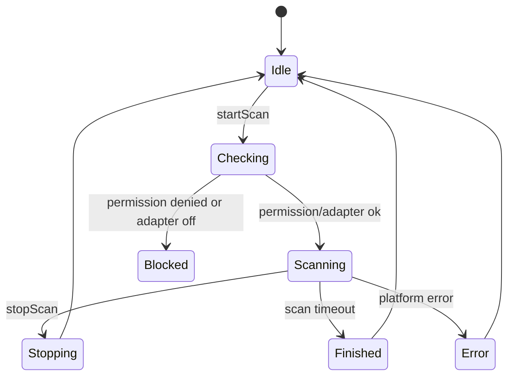
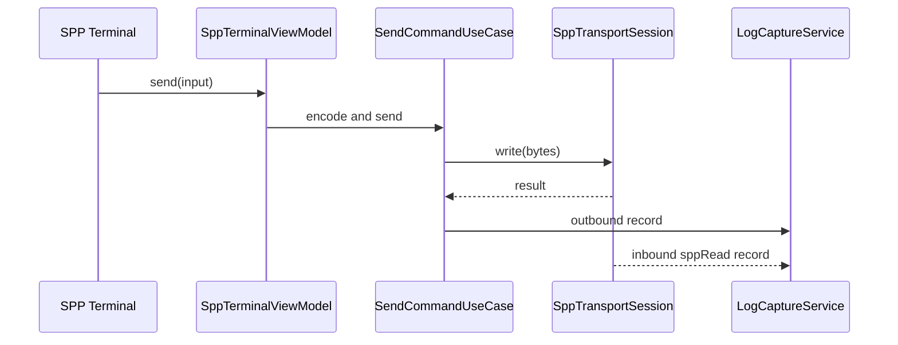

# 蓝牙模块架构设计

## 1. 范围与优先级

蓝牙模块首期覆盖：

1. 经典蓝牙设备发现。
2. 已配对设备读取。
3. 配对发起与系统配对弹窗承接。
4. SPP/RFCOMM Client 连接。
5. SPP 终端收发。
6. SPP 原始字节日志。
7. SPP 自动重连。
8. BLE 扫描。
9. BLE 广播数据解析。
10. BLE GATT Client 连接、服务发现、特征读写、Notify/Indicate 订阅。
11. BLE 串口 Profile 预设，默认支持 Nordic UART 类模型。
12. BLE MTU 协商、分片发送、Notify 日志和曲线展示。
13. 设备别名、收藏、最近连接。

预留但不作为首期完成目标：

1. SPP Server。
2. L2CAP。
3. BLE Advertiser。
4. BLE GATT Server。
5. BLE PHY、连接参数深度调优。
6. 基于业务协议的帧解析插件。

## 2. 平台能力边界

### 2.1 经典蓝牙

已确认可作为设计基础：

1. 使用 `ACCESS_BLUETOOTH` 权限访问蓝牙能力。
2. 发现设备前必须检查蓝牙开关状态。
3. 经典蓝牙发现约持续 12 秒，连接前应停止发现。
4. `sppConnect(peerDevice, SppOptions)` 支持 RFCOMM 类型。
5. SPP 读通过 `sppRead` 事件接收，写通过 `sppWrite`。
6. SPP socket 使用完必须注销事件并关闭。
7. 配对通过系统弹窗完成，应用不应伪造配对流程。

必须真机验证：

1. 自定义 UUID 的 SDP 查询行为。
2. Channel 直连是否存在公开可用 API；如无，首期只支持 UUID/SDP 路径。
3. 不同设备 SPP 断开后的错误码和 read 事件行为。
4. SPP secure 参数在目标设备上的兼容性。

### 2.2 BLE

已确认可作为设计基础：

1. BLE 扫描需要 `ACCESS_BLUETOOTH`。
2. 新 API 的扫描器支持多个扫描实例，旧 API 可能只有单扫描实例。
3. 扫描过滤支持 manufacturer data 和 mask。
4. BLE 广播数据长度有限，设备名可能来自广播字段而非系统名。
5. GATT Client 必须连接后执行服务发现，再读写 Characteristic。
6. Notify/Indicate 需要先配置订阅。
7. 随机地址和虚拟地址存在隐私机制，设备身份不能简单等同真实 MAC。

必须真机验证：

1. 目标设备 MTU 协商范围和实际 write payload 上限。
2. `PERSISTENT_BLUETOOTH_PEERS_MAC` 权限是否可签名获取。
3. Notify 高频日志的 UI 刷新和落盘性能。
4. 多个 BLE 连接同时存在时系统资源上限。

## 3. 模块结构

```text
features/bluetooth/
  ui/
    page/
      BluetoothOverviewPage.ets
      ClassicScanPage.ets
      SppConnectPage.ets
      SppTerminalPage.ets
      BleScanPage.ets
      BleDeviceDetailPage.ets
      GattServicePage.ets
    component/
      BluetoothDeviceCard.ets
      RssiChart.ets
      AdvDataView.ets
      GattTreeView.ets
      MtuEditor.ets
    dialog/
      UuidSelectDialog.ets
      PairingGuideDialog.ets
      CharacteristicWriteDialog.ets
  viewmodel/
    BluetoothOverviewViewModel.ets
    ClassicScanViewModel.ets
    SppTerminalViewModel.ets
    BleScanViewModel.ets
    GattDetailViewModel.ets
  domain/
    model/
    repository/
    usecase/
    service/
  data/
    repository/
    datasource/platform/
    mapper/
```

## 4. 页面与功能点

### 4.1 蓝牙总览页

功能：

1. 显示蓝牙开关状态。
2. 显示权限状态。
3. 显示最近连接设备。
4. 显示收藏设备。
5. 显示最近会话。
6. 入口：经典蓝牙扫描、SPP 终端、BLE 扫描、GATT 调试。
7. 能力不可用时显示原因和设置入口。

ViewModel 状态：

```text
BluetoothOverviewUiState
  permissionState
  adapterState
  classicSupported
  bleSupported
  recentDevices
  favoriteDevices
  activeSessions
  warnings
```

### 4.2 经典蓝牙扫描页

功能：

1. 开始扫描。
2. 停止扫描。
3. 显示扫描倒计时。
4. 合并已配对设备和新发现设备。
5. 设备按已配对、RSSI、名称、最近出现时间排序。
6. 设备筛选：名称、地址、已配对、收藏。
7. 设备详情：名称、地址或虚拟地址、设备类型、配对状态、RSSI、发现时间。
8. 发起配对。
9. 进入 SPP 连接参数页。

状态机：



实现细节：

1. 扫描前调用能力检查。
2. SPP 连接前强制停止扫描，避免发现过程影响连接成功率。
3. 扫描结果进入 `ScanResultMergeQueue`，UI 不直接处理平台回调。
4. 扫描会话写入日志，包含开始、停止、发现设备数量、错误码。

### 4.3 SPP 连接参数页

功能：

1. 选择标准 UUID。
2. 输入自定义 UUID。
3. secure 开关。
4. 连接超时设置。
5. 自动重连开关。
6. 连接前检查配对状态。
7. 未配对时引导系统配对。
8. 连接成功进入 SPP 终端。

UUID 策略：

1. 默认提供 Serial Port Profile 常用 UUID。
2. 用户可收藏自定义 UUID。
3. Channel 直连仅在平台验证支持后开放；未验证前不作为主入口。
4. 连接失败时保留 native error 并提示可能原因：UUID 不匹配、设备未监听、蓝牙关闭、扫描未停止、距离过远。

### 4.4 SPP 终端页

功能：

1. 显示连接状态。
2. 显示设备信息。
3. 发送文本、hex、base64 payload。
4. 设置行结束符。
5. 周期发送。
6. 显示 inbound/outbound 日志。
7. 切换文本/hex/混合展示。
8. 暂停 UI 滚动但不暂停日志落盘。
9. 手动断开。
10. 自动重连。

SPP 日志原则：

1. `sppRead` 每次回调作为 transport chunk 记录。
2. 不把 chunk 解释为业务记录边界。
3. 不自动去掉换行、头尾字节或不可见字符。
4. UI 可以按行展示，但原始 payload 必须可回看。

发送流程：



### 4.5 BLE 扫描页

功能：

1. 开始/停止扫描。
2. 扫描过滤：名称、service UUID、manufacturer ID、manufacturer data、mask、RSSI 阈值。
3. 扫描参数：低功耗/均衡/低延迟预设。
4. 显示设备名、地址/虚拟地址、RSSI、广播类型、是否可连接、最近出现时间。
5. 广播数据详情：service UUID、manufacturer data、service data、local name、raw adv bytes。
6. RSSI 曲线。
7. 收藏设备和别名。
8. 进入 GATT 详情。

广播解析：

1. 解析器输出结构化字段和 raw bytes。
2. 字段缺失时不猜测。
3. 设备名来源需要标注：系统名、广播 local name、scan response。
4. manufacturer data 支持 mask 命中高亮。

### 4.6 GATT 详情页

功能：

1. 连接 GATT。
2. 显示连接状态。
3. 服务发现。
4. 展示 Service/Characteristic/Descriptor 树。
5. 读取 Characteristic。
6. 写 Characteristic，支持文本/hex/base64。
7. 写 Descriptor。
8. 开启/关闭 Notify/Indicate。
9. MTU 请求与展示。
10. Characteristic 权限显示。
11. Notify 日志和曲线。
12. 串口 Profile 预设。

GATT 操作规则：

1. 连接成功后才能服务发现。
2. 服务发现完成后才能读写。
3. 所有 GATT 操作进入 `GattOperationQueue` 串行执行。
4. Notify 订阅成功后才允许进入流式日志模式。
5. 页面退出不自动断开连接；用户明确断开或会话策略决定断开。

### 4.7 BLE 串口 Profile 预设

首期预设：

1. Nordic UART Service。
2. 自定义 RX/TX Characteristic 输入。
3. 自动识别候选 writable characteristic。
4. 自动识别候选 notify characteristic。

预设不改变底层模型，只是生成命令面板和订阅配置。

## 5. 领域模型

```text
BluetoothDevice
  id
  name
  alias
  address
  addressType
  identityType: classic | ble | persistent | virtual | unknown
  rssi
  paired
  connectable
  favorite
  lastSeenAtMs
  raw
```

```text
SppConnectionParams
  deviceId
  uuid
  secure
  timeoutMs
  autoReconnect
```

```text
BleScanFilter
  namePrefix?
  serviceUuid?
  manufacturerId?
  manufacturerData?
  manufacturerMask?
  minRssi?
```

```text
GattCharacteristicNode
  serviceUuid
  characteristicUuid
  properties
  descriptors
  lastValueRef?
  notifyEnabled
```

## 6. Repository 与 UseCase

### 6.1 Repository

```text
BluetoothRepository
  getAdapterState()
  observeAdapterState()
  getPairedDevices()
  startClassicScan(params)
  stopClassicScan(scanId)
  pairDevice(deviceId)
  createSppTransport(params)
  startBleScan(params)
  stopBleScan(scanId)
  createGattClient(deviceId)
```

### 6.2 UseCase

1. `StartClassicScanUseCase`
2. `StopClassicScanUseCase`
3. `PairBluetoothDeviceUseCase`
4. `ConnectSppUseCase`
5. `DisconnectSppUseCase`
6. `SendSppCommandUseCase`
7. `StartBleScanUseCase`
8. `ConnectGattUseCase`
9. `DiscoverGattServicesUseCase`
10. `ReadGattCharacteristicUseCase`
11. `WriteGattCharacteristicUseCase`
12. `SetGattNotificationUseCase`
13. `RequestBleMtuUseCase`
14. `SaveBluetoothFavoriteUseCase`
15. `ResolveBluetoothCapabilityUseCase`

## 7. DataSource

```text
ClassicBluetoothDataSource
  wraps access/connection/socket classic APIs

SppSocketDataSource
  wraps sppConnect/sppRead/sppWrite/close/off

BleScannerDataSource
  wraps BLE scan APIs

GattClientDataSource
  wraps connect/getServices/read/write/notify/disconnect/close

BluetoothIdentityDataSource
  resolves virtual/persistent identifiers where allowed
```

资源释放规则：

1. scan 必须 stop + off。
2. spp socket 必须 off `sppRead` + close。
3. GATT client 必须取消 Notify + disconnect/close。
4. adapter state listener 必须 off。
5. 页面订阅必须在页面销毁时释放。

## 8. 自动重连

### 8.1 SPP 自动重连

触发：

1. 非用户主动断开。
2. 蓝牙开关恢复。
3. App 回到前台。
4. socket 异常断开。

策略：

1. 指数退避。
2. 最大次数。
3. 重连前确认设备仍已配对。
4. 重连前停止扫描。
5. 每次重连创建新的连接会话子事件，不复用已关闭 socket。

### 8.2 BLE 自动重连

触发：

1. 非用户主动断开。
2. 已有可用设备身份。
3. GATT Client 可重新创建。

限制：

1. 随机地址设备未持久化时不承诺快速回连。
2. 权限或 ACL 不满足时降级为重新扫描。
3. 服务发现需要重做，旧 characteristic 引用不可复用。

## 9. 错误与降级

典型映射：

| native 场景 | appCode | 用户动作 |
| --- | --- | --- |
| 无 `ACCESS_BLUETOOTH` | `YW-PERM-1001` | 授权蓝牙权限 |
| 蓝牙未开启 | `YW-BT-1001` | 到系统设置开启蓝牙 |
| profile 不支持 | `YW-BT-1002` | 更换设备或协议 |
| 设备未连接 | `YW-BT-1003` | 重新连接 |
| operation busy | `YW-BT-1004` | 等待上一次操作完成 |
| BLE MTU 请求失败 | `YW-BLE-2001` | 使用默认 MTU |
| Notify 订阅失败 | `YW-BLE-2002` | 检查 Characteristic 权限 |

## 10. 测试与真机验证

### 10.1 单元测试

1. 广播数据解析。
2. manufacturer mask 匹配。
3. GATT 树 mapper。
4. SPP 发送编码。
5. 自动重连退避策略。
6. 日志 payload 保真。

### 10.2 真机测试

1. 蓝牙权限申请、拒绝、设置页返回。
2. 经典蓝牙扫描和停止。
3. 配对流程。
4. SPP 标准 UUID 连接。
5. SPP 自定义 UUID 连接。
6. SPP 大 payload 发送和接收。
7. 连接前未停止扫描的失败复现与修复确认。
8. BLE 扫描多过滤条件。
9. BLE GATT 服务发现。
10. BLE Characteristic read/write/notify。
11. BLE MTU 协商和分片。
12. App 后台再前台状态 reconcile。

## 11. 首期开发任务

1. 建立蓝牙模块目录和路由。
2. 实现权限与 adapter 状态检查。
3. 实现经典蓝牙扫描。
4. 实现 SPP Client 连接和终端。
5. 接入统一日志与命令面板。
6. 实现 BLE 扫描和广播解析。
7. 实现 GATT Client 基础读写订阅。
8. 实现设备收藏和别名。
9. 完成真机验证表。
