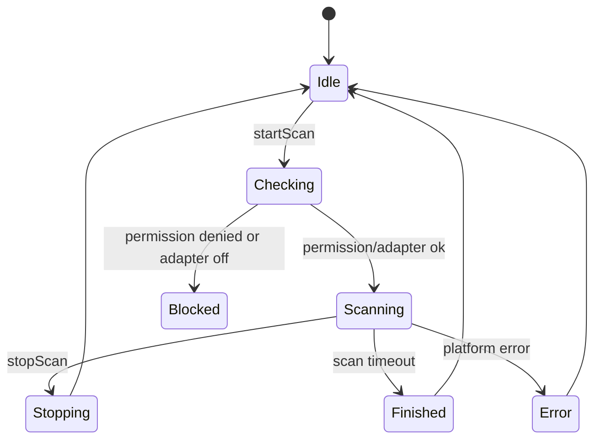
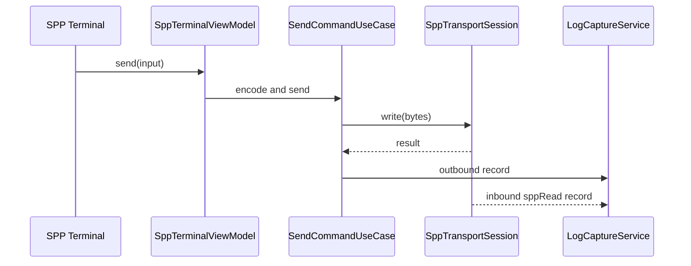

# 蓝牙模块架构设计

> **状态**：总册定稿（v1.2 · 2026-07-23）  
> **细分文档**：`bluetooth/00`～`06`（身份底座 + 三路径 + 会话队列 + MVVM 目录）  
> **功能总册**：`7-UIUX设计/.../02-蓝牙模块/00-蓝牙功能总清单与优先级矩阵.md`  
> **官方依据**：Connectivity Kit（access / connection / ble / socket）+ 短距 FAQ + 错误码  
> **竞品对照**：nRF Connect · SimpleBT SPP/LE · Serial Terminal · LightBlue

## 1. 范围与优先级

蓝牙模块 v1 覆盖（详见功能总册 P0/P1）：

1. 传输类型与双地址身份（`00`）。
2. 经典 Inquiry 与已配对非 LE。
3. SPP Client：**单活跃写端** + 终端收发 + TX 队列 + SessionLog。
4. BLE 扫描（含 Manufacturer Mask）+ GATT 浏览器（多会话应用层 ≤4）。
5. BLE-UART 独立路径（Nordic P0；失败跳转 GATT）。
6. 设备收藏/最近连接；模块设定骨架。
7. 与 `feature_debug_core` 统一会话/日志/命令。

预留缝（非 v1 实现）：SPP Server、L2CAP、Advertiser、GATT Server、真实 MAC 主路径、DFU、Macros 28 引擎。

**细分阅读**：见 [`bluetooth/README.md`](bluetooth/README.md)。

## 2. 平台能力边界

### 2.0 公共底座（新增，全模块强制）

1. 三方默认只有**虚拟 MAC**；UI 禁止称「物理 MAC」。
2. **传输类型 API 存在**：`connection.getRemoteDeviceTransport` → `BR_EDR | LE | DUAL | UNKNOWN`（API20+）。
3. **CoD ≠ 传输类型**：`deviceClass` / `getRemoteDeviceClass` 只作展示。
4. SPP 列表白名单：`BR_EDR | DUAL`；排除 `LE`。
5. BLE 扫描地址 ≠ 经典地址；**禁止**交叉用于 `sppConnect` / GATT。
6. 双模桥接只走官方推荐：BLE MAC `pairDevice` → 配对列表出现经典 MAC → 名称匹配 → SPP。
7. `connectAllowedProfiles` 仅 A2DP/HFP/HID，**永不**承担 SPP。
8. 细节见 `bluetooth/00-传输类型与双地址身份模型设计.md`。

### 2.1 经典蓝牙

已确认可作为设计基础：

1. `ACCESS_BLUETOOTH`；发现前检查适配器状态。
2. Inquiry ~12s；`isBluetoothDiscovering`；连接前必须 stop；扫描不可配 filter。
3. API18+ `discoveryResult`：虚拟 MAC + RSSI + 名称 + CoD。
4. `getPairedDevices()` 仅地址列表 → 应用层补 transport 后过滤。
5. `sppConnect` + RFCOMM + UUID；读/写/close/`off` 成对。
6. 配对系统弹窗；`bondStateChange` 为真相。

必须真机验证：

1. `getRemoteDeviceTransport` 在已配对/Inquiry 场景准确度。
2. 自定义 UUID SDP；secure 兼容性；断连错误码与 read 行为。
3. Channel 直连公开 API（无则不做）。

### 2.2 BLE

已确认可作为设计基础：

1. `ACCESS_BLUETOOTH`；`createBleScanner` 多路（API15+）或旧单路扫描。
2. ScanFilter（name/UUID/manufacturer/mask 等）；广播长度有限。
3. GATT：connect → getServices → 串行操作；Notify 需先订阅；MTU−3。
4. 地址隐私与双地址模型见文档 00；GATT 只用 `bleDeviceId`。

必须真机验证：

1. MTU 与 write 上限；多连接资源上限；Notify 高频性能。
2. `PERSISTENT_BLUETOOTH_PEERS_MAC` 是否可获取。
3. 双模 BLE→Classic 桥接在目标模组上的成功率。

## 3. 模块结构

> **定稿目录树与 MVVM 禁令**：见 `bluetooth/06-模块目录与MVVM装配规范.md`。  
> **会话/队列**：见 `bluetooth/05-会话队列与统一后端集成设计.md`。

```text
features/bluetooth/src/main/ets/
  domain/model/{identity,device,scan,spp,gatt,uart,session}/
  domain/service/{registry,queue,scan,spp,gatt,uart}/
  domain/usecase/{overview,classic,spp,ble,gatt,uart,device,command,shared}/
  data/{datasource/platform,mapper,transport,repository,kit}/
  viewmodel/{overview,spp,ble,gatt,uart,settings}/
  ui/{page,view,component,menu,lab}/
```

## 4. 页面与功能点

### 4.1 蓝牙总览页

功能：

1. 显示蓝牙开关状态。
2. 显示权限状态。
3. 显示最近连接设备。
4. 显示收藏设备。
5. 显示最近会话。
6. 入口：经典蓝牙扫描、SPP 终端、BLE 扫描、GATT 调试。
7. 能力不可用时显示原因和设置入口。

ViewModel 状态：

```text
BluetoothOverviewUiState
  permissionState
  adapterState
  classicSupported
  bleSupported
  recentDevices
  favoriteDevices
  activeSessions
  warnings
```

### 4.2 经典蓝牙扫描页

功能：

1. 开始/停止 Inquiry；显示倒计时（~12s）。
2. 刷新已配对**经典候选**（`transport ∈ {BR_EDR, DUAL}`，排除 LE-only）。
3. 合并已配对与新发现；排序：最近连接 → 已配对 → 收藏 → RSSI → 时间。
4. 筛选：名称、经典虚拟地址、已配对、收藏、RSSI（附近）。
5. 卡片：名称、经典虚拟地址、RSSI、传输徽章（经典/双模/未知）、配对态。
6. 详情：transport、CoD、profile UUID、关联 bleDeviceId、会话与错误。
7. 发起配对；进入 SPP 仅当 `classicDeviceId` 已解析。
8. 传输过滤在 Repository 完成，页面不承载类型真相。

状态机：



实现细节：

1. 扫描前调用能力检查。
2. SPP 连接前强制停止扫描，避免发现过程影响连接成功率。
3. 扫描结果进入 `ScanResultMergeQueue`，UI 不直接处理平台回调。
4. 扫描会话写入日志，包含开始、停止、发现设备数量、错误码。

### 4.3 SPP 连接参数页

功能：

1. 选择标准 UUID。
2. 输入自定义 UUID。
3. secure 开关。
4. 连接超时设置。
5. 自动重连开关。
6. 连接前检查配对状态。
7. 未配对时引导系统配对。
8. 连接成功进入 SPP 终端。

UUID 策略：

1. 默认提供 Serial Port Profile 常用 UUID。
2. 用户可收藏自定义 UUID。
3. Channel 直连仅在平台验证支持后开放；未验证前不作为主入口。
4. 连接失败时保留 native error 并提示可能原因：UUID 不匹配、设备未监听、蓝牙关闭、扫描未停止、距离过远。

### 4.4 SPP 终端页

功能：

1. 显示连接状态。
2. 显示设备信息。
3. 发送文本、hex、base64 payload。
4. 设置行结束符。
5. 周期发送。
6. 显示 inbound/outbound 日志。
7. 切换文本/hex/混合展示。
8. 暂停 UI 滚动但不暂停日志落盘。
9. 手动断开。
10. 自动重连。

SPP 日志原则：

1. `sppRead` 每次回调作为 transport chunk 记录。
2. 不把 chunk 解释为业务记录边界。
3. 不自动去掉换行、头尾字节或不可见字符。
4. UI 可以按行展示，但原始 payload 必须可回看。

发送流程：



### 4.5 BLE 扫描页

功能：

1. 开始/停止扫描。
2. 扫描过滤：名称、service UUID、manufacturer ID、manufacturer data、mask、RSSI 阈值。
3. 扫描参数：低功耗/均衡/低延迟预设。
4. 显示设备名、地址/虚拟地址、RSSI、广播类型、是否可连接、最近出现时间。
5. 广播数据详情：service UUID、manufacturer data、service data、local name、raw adv bytes。
6. RSSI 曲线。
7. 收藏设备和别名。
8. 进入 GATT 详情。

广播解析：

1. 解析器输出结构化字段和 raw bytes。
2. 字段缺失时不猜测。
3. 设备名来源需要标注：系统名、广播 local name、scan response。
4. manufacturer data 支持 mask 命中高亮。

### 4.6 GATT 详情页

功能：

1. 连接 GATT。
2. 显示连接状态。
3. 服务发现。
4. 展示 Service/Characteristic/Descriptor 树。
5. 读取 Characteristic。
6. 写 Characteristic，支持文本/hex/base64。
7. 写 Descriptor。
8. 开启/关闭 Notify/Indicate。
9. MTU 请求与展示。
10. Characteristic 权限显示。
11. Notify 日志和曲线。
12. 串口 Profile 预设。

GATT 操作规则：

1. 连接成功后才能服务发现。
2. 服务发现完成后才能读写。
3. 所有 GATT 操作进入 `GattOperationQueue` 串行执行。
4. Notify 订阅成功后才允许进入流式日志模式。
5. 页面退出不自动断开连接；用户明确断开或会话策略决定断开。

### 4.7 BLE 串口 Profile 预设

首期预设：

1. Nordic UART Service。
2. 自定义 RX/TX Characteristic 输入。
3. 自动识别候选 writable characteristic。
4. 自动识别候选 notify characteristic。

预设不改变底层模型，只是生成命令面板和订阅配置。

## 5. 领域模型

> 完整定义见 `bluetooth/00`；此处为总册摘要。

```text
BluetoothTransportType = BR_EDR | LE | DUAL | UNKNOWN
BluetoothListRail = CLASSIC_SCAN | BLE_SCAN

BluetoothDevice
  identityId
  displayName / alias?
  classicDeviceId?          # SPP 目标
  bleDeviceId?              # GATT 目标
  primaryDeviceId           # 当前列表操作地址
  addressPrivacy: virtual | real | unknown
  transport: BluetoothTransportType
  deviceClassCod: number    # CoD；禁止当 transport 用
  listRail: BluetoothListRail
  rssi / paired / pairState / connectable / favorite
  profileUuids[]
  discoverySource
  firstSeenAtMs / lastSeenAtMs
```

```text
SppConnectionParams
  classicDeviceId           # 禁止 BLE MAC
  transport: BR_EDR | DUAL
  uuid / secure / timeoutMs / autoReconnect
```

```text
BleScanFilter
  namePrefix?
  serviceUuid?
  manufacturerId?
  manufacturerData?
  manufacturerMask?
  minRssi?
```

```text
GattCharacteristicNode
  serviceUuid
  characteristicUuid
  properties
  descriptors
  lastValueRef?
  notifyEnabled
```

## 6. Repository 与 UseCase

### 6.1 Repository

```text
BluetoothRepository
  getAdapterState() / observeAdapterState()
  loadPairedClassicCandidates()      # 非 LE
  loadPairedBleCandidates()          # 非纯 BR_EDR
  getRemoteDeviceTransport(deviceId)
  startClassicScan / stopClassicScan
  observeClassicDevices / observeBleDevices
  pairDevice / linkDualModeIdentity
  resolveClassicIdForSpp(device)
  createSppTransport(params)         # params.classicDeviceId
  startBleScan / stopBleScan
  createGattClient(bleDeviceId)
```

### 6.2 UseCase

1. `LoadPairedClassicDevicesUseCase`（非 LE）
2. `StartClassicScanUseCase` / `StopClassicScanUseCase`
3. `PairBluetoothDeviceUseCase`
4. `BridgeBleToClassicPairUseCase`
5. `ResolveSppTargetAddressUseCase`
6. `ConnectSppUseCase` / `DisconnectSppUseCase` / `SendSppCommandUseCase`
7. `StartBleScanUseCase` / `StopBleScanUseCase`
8. `ConnectGattUseCase` / `DiscoverGattServicesUseCase`
9. `Read/WriteGattCharacteristicUseCase` / `SetGattNotificationUseCase` / `RequestBleMtuUseCase`
10. `SaveBluetoothFavoriteUseCase` / `ResolveBluetoothCapabilityUseCase`
11. `ListActiveSppSessionsUseCase`

## 7. DataSource

```text
ClassicBluetoothDataSource
  access/connection：discovery、paired、pair、bondState
  getRemoteDeviceTransport / getRemoteDeviceClass / getRemoteDeviceName
  getRemoteProfileUuids

SppSocketDataSource
  sppConnect(classicDeviceId) / sppRead|sppReadAsync / sppWrite*|close/off
  拒绝 BLE MAC（上层已校验；DS 可再断言）

BleScannerDataSource
  BLE scan / ScanFilter / ScanResult → bleDeviceId

GattClientDataSource
  createGattClientDevice(bleDeviceId) / connect/getServices/R/W/notify/disconnect/close

BluetoothIdentityDataSource
  classic/ble 双地址关联、virtual/persistent、收藏与最近
```

资源释放规则：

1. scan 必须 stop + off。
2. spp socket 必须 off `sppRead` + close。
3. GATT client 必须取消 Notify + disconnect/close。
4. adapter state listener 必须 off。
5. 页面订阅必须在页面销毁时释放。

## 8. 自动重连

### 8.1 SPP 自动重连

触发：

1. 非用户主动断开。
2. 蓝牙开关恢复。
3. App 回到前台。
4. socket 异常断开。

策略：

1. 指数退避。
2. 最大次数。
3. 重连前确认设备仍已配对。
4. 重连前停止扫描。
5. 每次重连创建新的连接会话子事件，不复用已关闭 socket。

### 8.2 BLE 自动重连

触发：

1. 非用户主动断开。
2. 已有可用设备身份。
3. GATT Client 可重新创建。

限制：

1. 随机地址设备未持久化时不承诺快速回连。
2. 权限或 ACL 不满足时降级为重新扫描。
3. 服务发现需要重做，旧 characteristic 引用不可复用。

## 9. 错误与降级

典型映射：

| native 场景 | appCode | 用户动作 |
| --- | --- | --- |
| 无 `ACCESS_BLUETOOTH` | `YW-PERM-1001` | 授权蓝牙权限 |
| 蓝牙未开启 | `YW-BT-1001` | 到系统设置开启蓝牙 |
| profile 不支持 | `YW-BT-1002` | 更换设备或协议 |
| 设备未连接 | `YW-BT-1003` | 重新连接 |
| operation busy | `YW-BT-1004` | 等待上一次操作完成 |
| BLE MTU 请求失败 | `YW-BLE-2001` | 使用默认 MTU |
| Notify 订阅失败 | `YW-BLE-2002` | 检查 Characteristic 权限 |

## 10. 测试与真机验证

### 10.1 单元测试

1. 广播数据解析。
2. manufacturer mask 匹配。
3. GATT 树 mapper。
4. SPP 发送编码。
5. 自动重连退避策略。
6. 日志 payload 保真。

### 10.2 真机测试

1. 蓝牙权限申请、拒绝、设置页返回。
2. 经典蓝牙扫描和停止。
3. 配对流程。
4. SPP 标准 UUID 连接。
5. SPP 自定义 UUID 连接。
6. SPP 大 payload 发送和接收。
7. 连接前未停止扫描的失败复现与修复确认。
8. BLE 扫描多过滤条件。
9. BLE GATT 服务发现。
10. BLE Characteristic read/write/notify。
11. BLE MTU 协商和分片。
12. App 后台再前台状态 reconcile。

## 11. 首期开发任务

1. 建立蓝牙模块目录和路由。
2. 实现权限与 adapter 状态检查。
3. 实现经典蓝牙扫描。
4. 实现 SPP Client 连接和终端。
5. 接入统一日志与命令面板。
6. 实现 BLE 扫描和广播解析。
7. 实现 GATT Client 基础读写订阅。
8. 实现设备收藏和别名。
9. 完成真机验证表。
