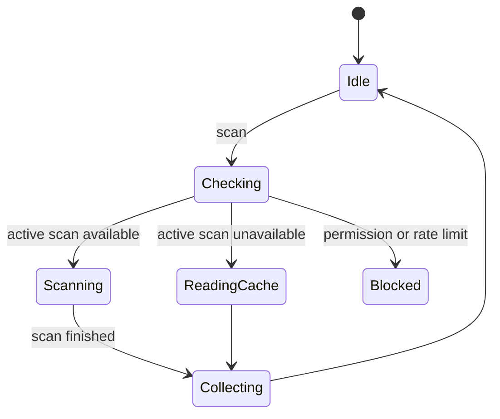

# WiFi 与网络模块架构设计

## 1. 范围与优先级

首期覆盖：

1. WiFi 开关状态和当前连接信息。
2. WiFi 扫描结果展示。
3. RSSI、信道、频段、BSSID/SSID 展示与权限降级。
4. 网络状态感知。
5. Ping。
6. DNS 查询。
7. Traceroute 能力评估与实现方案。
8. TCP Client。
9. TCP Server。
10. UDP Client/Server。
11. HTTP/HTTPS 请求。
12. WebSocket Client。
13. WebSocket Server 能力探测。
14. LAN 主机发现。
15. TCP/UDP 端口扫描。
16. MQTT Client。
17. mDNS/Bonjour/SSDP 预留或实验入口。

预留：

1. WiFi 开关控制。
2. 连接指定 WiFi。
3. 热点管理。
4. WiFi P2P。
5. TLS 深度证书管理。
6. 完整 Postman 替代能力。

## 2. 平台能力边界

### 2.1 WiFi

设计依据：

1. 读取 WiFi 信息需要 `GET_WIFI_INFO`。
2. 真实 BSSID/MAC 能力受权限和系统策略影响，可能需要 `GET_WIFI_PEERS_MAC`。
3. WiFi 扫描有前后台频率限制，后台扫描受严格限制。
4. 主动扫描 API 版本和权限要求需要按目标设备验证。
5. WiFi 开关和连接配置涉及 `SET_WIFI_INFO` 及系统/企业能力，不作为普通应用首期主路径。

架构结论：

1. WiFi 模块以信息读取、分析和诊断为主。
2. 控制类功能作为“能力受限入口”，不放在默认主路径。
3. 扫描结果必须标注更新时间和可能为缓存。

### 2.2 Network Kit

设计依据：

1. Socket、HTTP、WebSocket 需要 `INTERNET`。
2. Socket API 建议在 Worker/TaskPool 或异步任务中使用，避免阻塞 UI。
3. 应用进入后台后网络连接可能中断，前台恢复时需要重建。
4. HTTP request 对象按请求创建，用完 destroy，不复用。
5. HTTP 默认超时和响应大小有限，需要在 UI 中提供限制说明。
6. WebSocket Server 在不同 API 和设备类型存在差异，需要能力探测。
7. mDNS 有独立 API 和生命周期。

## 3. 模块结构

```text
features/wifi_network/
  ui/
    page/
      WifiOverviewPage.ets
      WifiScanPage.ets
      NetworkDiagnosticsPage.ets
      SocketWorkbenchPage.ets
      HttpClientPage.ets
      WebSocketPage.ets
      MqttClientPage.ets
      LanDiscoveryPage.ets
    component/
      WifiSignalChart.ets
      ChannelChart.ets
      SocketTerminalView.ets
      HttpHeaderEditor.ets
      PortRangeEditor.ets
      HostResultTable.ets
    dialog/
      SocketConnectDialog.ets
      HttpBodyEditorDialog.ets
      ScanLimitDialog.ets
  viewmodel/
  domain/
  data/
```

## 4. WiFi 环境分析

### 4.1 WiFi 总览页

功能：

1. 显示 WiFi 是否启用。
2. 显示当前连接 SSID、BSSID、RSSI、频段、链路速度、IP 信息。
3. 显示网络可用性。
4. 显示权限缺失项。
5. 入口：扫描、诊断、LAN 发现、Socket、HTTP、WebSocket、MQTT。

降级：

1. 无 `GET_WIFI_INFO`：只能显示权限提示。
2. 无真实 MAC 权限：BSSID 展示为不可用或脱敏。
3. WiFi 未开启：诊断和 socket 仍可使用蜂窝/其他网络，但 WiFi 分析不可用。

### 4.2 WiFi 扫描页

功能：

1. 发起扫描或读取系统扫描缓存。
2. 展示 SSID、BSSID、RSSI、频段、信道、安全类型、时间戳。
3. RSSI 图表。
4. 信道占用图。
5. 筛选：SSID、频段、信号强度、安全类型。
6. 排序：RSSI、SSID、信道、最近更新时间。
7. 扫描频率提示。

扫描状态：



实现注意：

1. 扫描按钮需要冷却时间。
2. 后台不继续扫描。
3. 扫描失败时展示频率限制、权限或系统状态原因。
4. 扫描结果写入诊断日志，但不记录敏感信息到 HiLog。

## 5. 网络诊断

### 5.1 功能

1. 网络状态监听。
2. 默认网络信息。
3. IP 地址、网关、DNS。
4. Ping。
5. DNS lookup。
6. Traceroute。
7. HTTP 连通性测试。
8. Socket 连通性测试。
9. 网络切换事件时间线。

### 5.2 DiagnosticSession

```text
NetworkDiagnosticSession
  targetHost
  targetPort?
  checks: ping | dns | traceroute | http | tcp
  timeoutMs
  maxHop?
  resultItems
```

每个检查项单独输出：

```text
DiagnosticItemResult
  name
  state
  startAtMs
  endAtMs
  latencyMs?
  nativeCode?
  appCode?
  detail
```

### 5.3 Traceroute 边界

HarmonyOS 普通应用是否能完全实现传统 ICMP/TTL Traceroute 需要验证。设计策略：

1. 若 API/权限不足，则实现 TCP/UDP 近似探测或给出不可用说明。
2. 不使用系统未公开命令作为默认能力。
3. UI 标注“诊断方式”和“平台限制”。

## 6. Socket 工作台

### 6.1 TCP Client

功能：

1. 输入 host、port、超时。
2. 建立连接。
3. 发送文本/hex/base64。
4. 接收日志。
5. 周期发送。
6. 断线重连。
7. 前后台恢复。

状态：

```text
TcpClientState
  disconnected
  resolving
  connecting
  connected
  sending
  reconnecting
  disconnecting
  failed
```

实现：

1. 连接过程创建 `ConnectionSession`。
2. socket 回调进入 `TcpClientTransportSession`。
3. 收发 payload 进入统一日志。
4. 后台返回前台后重新确认 socket 可用性；不可用则进入重连或断开状态。

### 6.2 TCP Server

功能：

1. 绑定本地地址和端口。
2. 监听连接。
3. 显示客户端列表。
4. 选择单客户端或广播发送。
5. 每个客户端独立日志。
6. 断开指定客户端。
7. 关闭 server。

设计：

1. server 本身是一个 `ConnectionSession`。
2. 每个 accepted connection 生成子 `TransportSession`。
3. 日志使用同一 server sessionId，加 clientId 属性。
4. 端口占用、权限、网络切换必须单独错误提示。

### 6.3 UDP Client/Server

功能：

1. 绑定本地端口。
2. 设置目标 host/port。
3. 发送 datagram。
4. 接收 datagram。
5. 支持广播开关。
6. 显示来源地址。

规则：

1. UDP 是 message based，日志保留 datagram 边界。
2. 单包大小超限时发送前提示。
3. 广播发送需要明确风险提示。

### 6.4 Multicast

作为实验能力：

1. 加入/离开组。
2. 发送组播消息。
3. 接收组播消息。
4. 网络变化时重新加入组。

## 7. HTTP/HTTPS 调试

### 7.1 功能

1. Method：GET、POST、PUT、PATCH、DELETE、HEAD、OPTIONS。
2. URL 输入和历史记录。
3. Query 参数编辑。
4. Header 编辑。
5. Body：text、JSON、form、binary file。
6. Timeout 设置。
7. Response header/body/status/time 展示。
8. JSON 格式化。
9. 保存为命令模板。
10. 导出请求和响应。

### 7.2 边界

1. HTTP request 对象按请求创建，用完 destroy。
2. 大响应使用 stream 或限制大小，不一次性载入 UI。
3. TLS 证书忽略不作为默认功能；若后续支持，必须专家模式显式开关。
4. 不实现完整 Postman Collection 生态，只实现本地模板导入导出。

### 7.3 日志

记录：

1. request method/url。
2. request headers，敏感 header 默认脱敏。
3. request body payloadRef。
4. response status。
5. response headers。
6. response body payloadRef。
7. timing。
8. native curl error 映射。

## 8. WebSocket

### 8.1 WebSocket Client

功能：

1. URL 输入。
2. Header 编辑。
3. 连接/断开。
4. 文本/bytes 发送。
5. ping/pong 设置。
6. 自动重连。
7. 消息日志。

规则：

1. `connect` 请求发起成功不等于真正打开，必须等 open 事件。
2. close/error 事件进入统一状态机。
3. 心跳参数进入连接配置。

### 8.2 WebSocket Server

功能：

1. 能力探测。
2. 监听端口。
3. 客户端连接列表。
4. 单发/广播。
5. 日志。

降级：

1. API 或设备类型不支持时，隐藏 server 主入口或显示只读说明。
2. 不用 UI 伪装 server 可用。

## 9. MQTT

### 9.1 功能

1. Broker host/port。
2. ClientId。
3. Username/password。
4. TLS 开关预留。
5. Connect/disconnect。
6. Subscribe/unsubscribe。
7. Publish。
8. QoS。
9. Retain。
10. Topic 历史。
11. 消息日志。

### 9.2 实现策略

HarmonyOS SDK 是否提供直接 MQTT 能力需要确认；若无，采用纯 ArkTS MQTT 客户端库或自研轻量 MQTT 编解码需单独技术选型。首期架构要求：

1. MQTT 不能直接耦合 WebSocket 或 TCP UI。
2. MQTT 作为 `TransportSession` 的 message based 实现。
3. TLS 和证书策略单独建模。
4. 密码不进入 HiLog，导出默认脱敏。

## 10. LAN 发现与端口扫描

### 10.1 LAN 主机发现

功能：

1. 根据当前网络计算候选网段。
2. 用户可手动输入网段。
3. 并发探测主机存活。
4. 展示 IP、host name、响应时间、开放端口摘要。
5. 保存目标到收藏。

实现边界：

1. 不进行高频无限扫描。
2. 并发数可配置且有上限。
3. 扫描任务可取消。
4. 后台停止或暂停。

### 10.2 端口扫描

功能：

1. TCP 端口范围。
2. UDP 探测。
3. 超时。
4. 并发数。
5. 服务名提示。
6. 导出结果。

风险控制：

1. 默认扫描本地网段。
2. 大范围扫描需要二次确认。
3. 记录扫描参数和时间，便于用户审计。

## 11. mDNS/SSDP

首期建议：

1. mDNS 作为实验入口，使用系统 mDNS 能力进行服务发现。
2. SSDP 可基于 UDP multicast 实现，但需单独验证组播权限和后台行为。
3. 发现结果统一映射为 `DiscoveredNetworkService`。

模型：

```text
DiscoveredNetworkService
  id
  type: mdns | ssdp | manual
  name
  host
  port
  protocol
  txt
  firstSeenAtMs
  lastSeenAtMs
```

## 12. 领域模型

```text
WifiAccessPoint
  ssid
  bssid
  bssidVisible
  rssi
  band
  channel
  securityType
  lastSeenAtMs
```

```text
NetworkEndpoint
  host
  port
  protocol: tcp | udp | http | websocket | mqtt
  name?
  favorite
```

```text
SocketConnectionParams
  mode: tcpClient | tcpServer | udp
  host?
  port
  localPort?
  timeoutMs
  reconnectPolicy?
```

```text
HttpRequestTemplate
  method
  url
  queryParams
  headers
  bodyRef
  timeoutMs
  followRedirects
```

## 13. Repository 与 UseCase

### 13.1 Repository

```text
WifiNetworkRepository
  getWifiState()
  getLinkedInfo()
  startWifiScan()
  getScanResults()
  observeNetworkState()
  createTcpClient(params)
  createTcpServer(params)
  createUdpSession(params)
  executeHttp(request)
  createWebSocket(params)
  createMqttSession(params)
  startLanDiscovery(params)
  startPortScan(params)
```

### 13.2 UseCase

1. `LoadWifiOverviewUseCase`
2. `StartWifiScanUseCase`
3. `RunNetworkDiagnosticsUseCase`
4. `OpenTcpClientUseCase`
5. `OpenTcpServerUseCase`
6. `OpenUdpSessionUseCase`
7. `ExecuteHttpRequestUseCase`
8. `OpenWebSocketUseCase`
9. `OpenMqttSessionUseCase`
10. `StartLanDiscoveryUseCase`
11. `StartPortScanUseCase`
12. `SaveNetworkTargetUseCase`

## 14. DataSource

```text
WifiInfoDataSource
  wraps wifiManager state/link/scan APIs

NetworkConnectionDataSource
  wraps net.connection state and DNS APIs

SocketDataSource
  wraps TCP/UDP/Multicast sockets

HttpDataSource
  wraps http request/requestInStream

WebSocketDataSource
  wraps webSocket client/server APIs

MdnsDataSource
  wraps mdns discovery APIs

MqttDataSource
  wraps selected MQTT implementation
```

资源释放：

1. TCP/UDP socket close。
2. Server 停止监听并关闭所有 connection。
3. HTTP destroy。
4. WebSocket close + off。
5. mDNS stopSearching + off。
6. Port scan 取消所有未完成任务。

## 15. 错误与降级

| 场景 | appCode | 处理 |
| --- | --- | --- |
| 无 INTERNET | `YW-PERM-2001` | 请求网络权限 |
| 无 GET_WIFI_INFO | `YW-PERM-2002` | 请求 WiFi 信息权限 |
| WiFi 扫描受限 | `YW-WIFI-1001` | 显示频率限制和缓存结果 |
| 真实 BSSID 不可见 | `YW-WIFI-1002` | 降级为脱敏或不可用 |
| DNS 失败 | `YW-NET-1001` | 展示 DNS 错误 |
| 连接超时 | `YW-NET-1002` | 允许重试 |
| 端口占用 | `YW-NET-1003` | 更换端口 |
| HTTP 超过大小限制 | `YW-NET-1004` | 使用 stream 或限制导出 |
| WebSocket Server 不支持 | `YW-CAP-2001` | 隐藏 server 能力 |

## 16. 测试与真机验证

1. WiFi 权限拒绝和设置页恢复。
2. 当前 WiFi 信息读取。
3. 扫描频率限制。
4. 缓存扫描结果提示。
5. TCP Client 与本地 server 通信。
6. TCP Server 接受多客户端。
7. UDP 单播/广播。
8. HTTP GET/POST/大响应。
9. HTTP destroy 后无资源泄漏。
10. WebSocket open/message/close/error。
11. App 后台后 socket 中断和前台重连。
12. LAN 扫描取消。
13. 端口扫描并发限制。
14. MQTT 与测试 broker 通信。

## 17. 首期开发任务

1. 建立 WiFi/Network 模块目录和路由。
2. 实现 WiFi 总览和权限降级。
3. 实现 WiFi 扫描展示与信道图。
4. 实现网络诊断基础项。
5. 实现 TCP/UDP 工作台。
6. 实现 HTTP 请求页。
7. 实现 WebSocket Client。
8. 实现 LAN 发现和端口扫描。
9. 接入统一日志、命令面板和导出。
