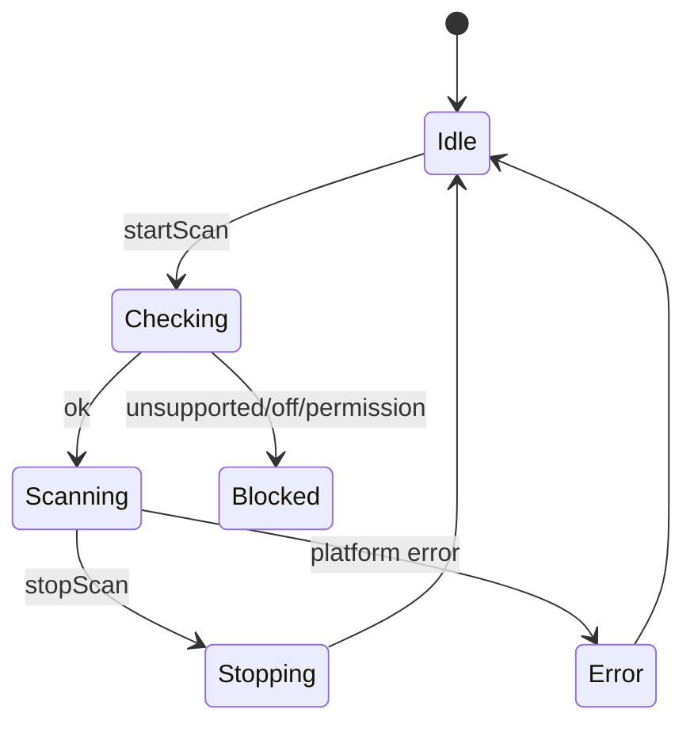

# 星闪模块架构设计

## 1. 范围与优先级

星闪模块首期定位为通用 NearLink 调试工具，不绑定特定业务协议。

首期覆盖：

1. NearLink 设备能力探测。
2. NearLink 开关状态读取。
3. 权限申请。
4. 星闪扫描。
5. 扫描过滤。
6. 广播数据解析。
7. 设备收藏和别名。
8. SSAP Client 连接。
9. SSAP 服务发现。
10. SSAP 属性读写。
11. SSAP 属性变更通知。
12. dataTransfer port 创建、连接、收发、关闭。
13. 配对/加密状态的能力预留和基础验证。

预留：

1. 星闪广播。
2. SSAP Server。
3. 文件发送。
4. 多连接管理。
5. 复杂业务协议解析。

## 2. 平台能力边界

已确认：

1. NearLink Kit 使用 `@kit.NearLinkKit`。
2. 需要 `ohos.permission.ACCESS_NEARLINK`。
3. 需要真机支持，模拟器不可作为主要验证环境。
4. 可通过 NearLink manager 查询支持状态和开关状态。
5. 扫描使用 startScan/stopScan/on/off deviceFound。
6. 旧版本 startScan 可能要求至少一个非空过滤条件；新版本可空过滤但不推荐。
7. 扫描结果使用随机远端地址，设备身份需要谨慎处理。
8. SSAP Client 使用 `ssap.createClient(address)` 后连接、发现服务、读写属性、订阅属性变化。
9. dataTransfer 使用 uuid 创建 port，双方 uuid 一致后连接收发。
10. dataTransfer 不保证链路加密；需要先配对并检查加密状态。

必须真机验证：

1. 目标设备是否支持 NearLink。
2. API 版本差异。
3. 开关路径和状态变化回调。
4. scan filter 空条件行为。
5. SSAP MTU 范围。
6. dataTransfer MTU 和拥塞错误。
7. 配对/加密状态查询 API 与错误码。
8. 扫描结果名称来源和广播字段解析。

## 3. 模块结构

```text
features/nearlink/
  ui/
    page/
      NearLinkOverviewPage.ets
      NearLinkScanPage.ets
      NearLinkDeviceDetailPage.ets
      SsapClientPage.ets
      DataTransferPage.ets
    component/
      NearLinkDeviceCard.ets
      NearLinkAdvDataView.ets
      SsapServiceTreeView.ets
      DataTransferTerminalView.ets
    dialog/
      NearLinkFilterDialog.ets
      SsapPropertyWriteDialog.ets
      DataTransferPortDialog.ets
  viewmodel/
  domain/
  data/
```

## 4. 页面与功能点

### 4.1 星闪总览页

功能：

1. 显示设备是否支持 NearLink。
2. 显示 NearLink 开关状态。
3. 显示权限状态。
4. 显示最近扫描设备。
5. 显示最近连接会话。
6. 显示收藏设备。
7. 入口：扫描、SSAP Client、dataTransfer。
8. 不支持时显示设备级不可用说明。

ViewModel：

```text
NearLinkOverviewUiState
  permissionState
  supportedState
  switchState
  recentDevices
  favoriteDevices
  activeSessions
  capabilityWarnings
```

### 4.2 星闪扫描页

功能：

1. 扫描前检查权限、设备支持、开关状态。
2. 扫描过滤：设备名、服务 UUID、manufacturer data、RSSI 阈值。
3. 开始扫描。
4. 停止扫描。
5. 显示扫描结果。
6. 展示设备名来源。
7. 展示随机地址。
8. 展示 RSSI、广播字段、raw adv bytes。
9. 收藏设备。
10. 进入设备详情、SSAP 或 dataTransfer。

状态：



扫描规则：

1. 旧 API 若不支持空过滤，UI 必须要求至少一个过滤项。
2. 新 API 虽允许空过滤，轻量模式仍默认要求设备名或服务过滤，减少功耗和噪声。
3. 扫描结果去重使用 address + advertising signature + lastSeenAt。
4. 不把随机地址当成长期稳定设备身份。

### 4.3 广播数据解析

解析字段：

1. discovery level。
2. service UUID list。
3. service data 16/128。
4. local name。
5. manufacturer data。
6. raw TLV。

名称处理：

1. 标注名称来源字段。
2. 若 local name 长度与 TLV 长度不一致，显示解析警告。
3. 不用截断后的名称覆盖用户别名。

### 4.4 SSAP Client 页

功能：

1. 创建 Client。
2. 连接设备。
3. 连接状态监听。
4. 服务发现。
5. 展示 Service/Property 树。
6. 读取 Property。
7. 写入 Property，支持文本/hex/base64。
8. 订阅属性变化。
9. 关闭 Client。
10. 记录 SSAP 日志。

状态：

```text
SsapClientState
  idle
  creating
  connecting
  connected
  discovering
  ready
  reading
  writing
  notifying
  closing
  closed
  failed
```

规则：

1. 同一远端设备在一个应用内只创建一个 Client 实例。
2. Client close 后旧 service/property 引用失效。
3. read/write/notify 串行进入操作队列。
4. 服务发现失败时允许重新 discover。
5. 属性读写 payload 进入统一日志。

### 4.5 dataTransfer 页

功能：

1. 输入或选择 UUID。
2. 创建 port。
3. 连接目标设备。
4. 设置 MTU。
5. 发送文本/hex/base64。
6. 接收数据。
7. 周期发送。
8. 关闭 port。
9. 处理拥塞错误。

状态：

```text
DataTransferState
  idle
  portCreating
  portReady
  connecting
  connected
  sending
  congested
  disconnecting
  closed
  failed
```

规则：

1. UUID 是 port 绑定身份，重复注册需要提示并复用或销毁旧 port。
2. 对端 UUID 必须一致。
3. MTU 超限时发送前分片或提示。
4. 拥塞错误进入退避，不盲目重发。
5. destroyPort 是资源释放必经路径。

### 4.6 配对与加密

首期策略：

1. SSAP 基础读写可不强制配对，取决于目标设备属性权限。
2. dataTransfer 涉及敏感或用户选择“加密连接”时，先发起配对。
3. 配对流程使用系统能力，不自定义伪配对界面。
4. 加密状态 API 未确认前，UI 显示“未验证加密状态”，不显示“已加密”。

## 5. 领域模型

```text
NearLinkDevice
  id
  name
  nameSource
  alias
  address
  addressType
  rssi
  connectable
  favorite
  lastSeenAtMs
  advertising
```

```text
NearLinkAdvertisingData
  rawPayloadRef
  discoveryLevel?
  serviceUuids
  serviceData
  localName?
  manufacturerData
  parseWarnings
```

```text
SsapServiceNode
  serviceUuid
  properties: SsapPropertyNode[]
```

```text
SsapPropertyNode
  propertyUuid
  permissions
  lastValueRef?
  notifyEnabled
```

```text
DataTransferPortConfig
  uuid
  mtu
  secureRequired
  autoReconnect
```

## 6. Repository 与 UseCase

### 6.1 Repository

```text
NearLinkRepository
  isSupported()
  getState()
  observeState()
  startScan(params)
  stopScan(scanId)
  createSsapClient(deviceId)
  createDataTransferPort(config)
  pairDevice(deviceId)
  getEncryptionState(deviceId)
```

### 6.2 UseCase

1. `ResolveNearLinkCapabilityUseCase`
2. `StartNearLinkScanUseCase`
3. `StopNearLinkScanUseCase`
4. `ParseNearLinkAdvertisingUseCase`
5. `ConnectSsapClientUseCase`
6. `DiscoverSsapServicesUseCase`
7. `ReadSsapPropertyUseCase`
8. `WriteSsapPropertyUseCase`
9. `SetSsapPropertyNotificationUseCase`
10. `CreateDataTransferPortUseCase`
11. `ConnectDataTransferUseCase`
12. `SendDataTransferCommandUseCase`
13. `PairNearLinkDeviceUseCase`
14. `SaveNearLinkFavoriteUseCase`

## 7. DataSource

```text
NearLinkManagerDataSource
  wraps support/state/stateChange

NearLinkScanDataSource
  wraps startScan/stopScan/on/off deviceFound

SsapClientDataSource
  wraps createClient/connect/getServices/read/write/notify/close

DataTransferDataSource
  wraps createPort/connect/writeData/readData/destroyPort

NearLinkPairingDataSource
  wraps pairing/encryption APIs after validation
```

资源释放：

1. scan stop + off。
2. SSAP Client close + off。
3. dataTransfer destroyPort + off readData/connectionStateChanged。
4. stateChange off。

## 8. 日志设计

记录：

1. NearLink 能力探测结果。
2. 开关状态变化。
3. 扫描开始、停止、设备发现。
4. 广播 raw bytes。
5. SSAP connect/disconnect/stateChange。
6. SSAP read/write/notify payload。
7. dataTransfer createPort/connect/write/read/destroy。
8. dataTransfer 拥塞与重试。
9. 配对/加密状态。

不记录到 HiLog：

1. 完整 payload。
2. 完整设备地址。
3. 用户输入敏感内容。

## 9. 错误与降级

| 场景 | appCode | 处理 |
| --- | --- | --- |
| 无 ACCESS_NEARLINK | `YW-PERM-3001` | 请求星闪权限 |
| 设备不支持 NearLink | `YW-NL-1001` | 隐藏连接入口，显示设备不支持 |
| 星闪未开启 | `YW-NL-1002` | 引导系统设置开启 |
| 扫描过滤为空且 API 不支持 | `YW-NL-1003` | 要求填写过滤条件 |
| SSAP 连接失败 | `YW-NL-2001` | 允许重试或重新扫描 |
| SSAP 属性权限不足 | `YW-NL-2002` | 显示属性不可读/不可写 |
| dataTransfer UUID 已注册 | `YW-NL-3001` | 复用或销毁旧 port |
| dataTransfer port 达上限 | `YW-NL-3002` | 关闭其他 port |
| dataTransfer 拥塞 | `YW-NL-3003` | 退避后重试 |
| 加密状态不可确认 | `YW-NL-4001` | 标注未验证，不宣称安全 |

## 10. 测试与真机验证

### 10.1 单元测试

1. TLV 广播解析。
2. 设备名来源选择。
3. 扫描结果去重。
4. SSAP service tree mapper。
5. dataTransfer 分片。
6. UUID 重复注册处理。

### 10.2 真机测试

1. 无 NearLink 设备降级。
2. 有 NearLink 设备能力探测。
3. 权限申请和拒绝。
4. 开关状态变化。
5. 带过滤扫描。
6. 空过滤扫描在目标 API 的行为。
7. 广播数据解析。
8. SSAP Client 连接。
9. SSAP 服务发现。
10. SSAP 属性读写。
11. SSAP notify。
12. dataTransfer port 创建。
13. dataTransfer 连接和收发。
14. dataTransfer 拥塞错误。
15. 配对和加密状态。

## 11. 首期开发任务

1. 建立 NearLink 模块目录和路由。
2. 实现权限、支持状态、开关状态探测。
3. 实现扫描和广播解析。
4. 实现设备详情和收藏。
5. 实现 SSAP Client 基础读写订阅。
6. 实现 dataTransfer 终端。
7. 接入统一日志和命令面板。
8. 完成真机验证表。
