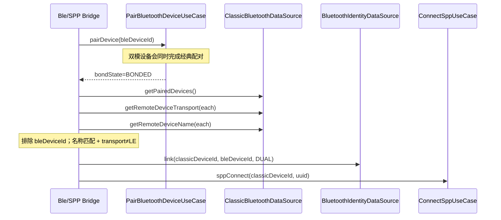

# 00 — 传输类型与双地址身份模型设计

> **状态**：架构定稿（依据官方文档全量审查后补齐）  
> **版本**：v1.0 · 2026-07-23  
> **官方依据**：
>
> - `ohos.bluetooth.connection`：`getRemoteDeviceTransport` / `getPairedDevices` / `getRemoteDeviceClass` / `getRemoteProfileUuids` / `discoveryResult`
> - `ohos.bluetooth.common`：`BluetoothAddress` / `BluetoothAddressType` / `BluetoothRawAddressType`
> - FAQ：`如何通过已连接的BLE蓝牙设备的虚拟MAC地址建立经典蓝牙连接`
> - FAQ：`三方应用如何获取蓝牙MAC地址`
> - 蓝牙服务开发概述（BR/EDR vs BLE、虚拟 MAC 隐私）
>
> **竞品对照**：GGEC `YoCbtDeviceType`（CLASSIC/LE/DUAL）+ `deviceMAC` / `bleAddress` 分字段  
> **产品对照**：B-SPP-03「已配对非 LE」；PRD §5.1 展示经典/BLE/双模

---

## 1. 问题定义

HarmonyOS 蓝牙子系统对三方应用默认只暴露**虚拟 MAC**。同一物理双模设备在配对列表中可能同时出现：

1. **经典虚拟 MAC**（BR/EDR）— 可走 `socket.sppConnect`
2. **BLE 虚拟 MAC** — 可走 `ble` / GATT，**不可**直接 `sppConnect`

当前工程缺口：

| 缺口 | 现状 | 风险 |
| --- | --- | --- |
| 传输类型未建模 | `BluetoothDevice.deviceType` 实际存 CoD | 无法按 CLASSIC/LE/DUAL 过滤 |
| 双地址未关联 | 仅单一 `deviceId` | 双模设备裂成两条无关联记录 |
| SPP 已配对未滤 LE | `getPairedDevices` 全量标 CLASSIC | BLE-only 误入 SPP 列表 |
| 扫描路径标签 ≠ 传输类型 | `kind` 只表示列表轨 | UI 误把 BLE 配对显示为「经典」 |

本设计补齐**传输类型**、**双地址身份**、**列表准入规则**三层模型，作为经典扫描 / SPP / BLE 三条子域的公共基础。

---

## 2. 官方能力边界（审查结论）

### 2.1 传输类型 API（存在，必须使用）

`connection.getRemoteDeviceTransport(deviceId): BluetoothTransport`（**API 20+**）

| 枚举 | 值 | 含义 | SPP 列表 | BLE 列表 |
| --- | --- | --- | --- | --- |
| `TRANSPORT_BR_EDR` | 0 | 传统蓝牙 | ✅ 准入 | ❌ 默认排除 |
| `TRANSPORT_LE` | 1 | 纯 BLE | ❌ 排除 | ✅ 准入 |
| `TRANSPORT_DUAL` | 2 | 双模（API20+） | ✅ 准入 | ✅ 准入（BLE 轨用 BLE 地址） |
| `TRANSPORT_UNKNOWN` | 3 | 未知（API20+） | ⚠ 降级策略见 §5 | ⚠ 降级策略见 §5 |

硬约束：

1. API 21+ 可用真实 MAC 查询；首期默认只用虚拟 MAC。
2. 失败错误码 `2900099`（Get transport failed）→ 记 `UNKNOWN`，不崩溃。
3. **平台没有**「按传输类型过滤 `getPairedDevices`」的专用 API；过滤必须在应用层完成。

### 2.2 地址与身份（虚拟 / 真实 / 协议类型）

| 概念 | API / 类型 | 说明 |
| --- | --- | --- |
| 虚拟 MAC | `BluetoothAddressType.VIRTUAL` | 三方发现/配对默认拿到的地址 |
| 真实 MAC | `BluetoothAddressType.REAL`（API21+） | 隐私敏感；首期不做主路径 |
| 协议地址类型 | `BluetoothRawAddressType.PUBLIC / RANDOM`（API23+） | PUBLIC≈经典；BLE 可为 PUBLIC/RANDOM |
| 配对列表 | `getPairedDevices(): string[]` | **仅地址**，无类型字段 |
| 虚拟 MAC 生命周期 | 官方 `getPairedDevices` 说明 | 已配对相对稳定；**重启蓝牙开关后虚拟地址会变**；取消配对后按使用情况变更 |

### 2.3 CoD ≠ 传输类型（禁止混用）

| 字段 | API | 含义 | 能否滤 LE |
| --- | --- | --- | --- |
| `deviceClass` / `DeviceClass` | `discoveryResult.deviceClass`、`getRemoteDeviceClass` | Class of Device（Major/Minor/服务位） | **不能** |
| `BluetoothTransport` | `getRemoteDeviceTransport` | BR/EDR / LE / DUAL | **能** |

架构强制：领域模型中 **CoD 与 Transport 分字段**，禁止再把 CoD 塞进名为 `deviceType` 的传输语义字段。

### 2.4 双模桥接（BLE MAC → Classic MAC）

官方 FAQ 结论（不可违背）：

1. `ble.startBLEScan` 得到的虚拟 MAC **不能**直接 `sppConnect`。
2. 双模设备：用 **BLE 虚拟 MAC** `pairDevice` 时，**同时完成经典配对**。
3. 配对成功后 `getPairedDevices()` 会出现 **BLE + Classic 两条虚拟 MAC**。
4. 排除 BLE 地址后，用 `getRemoteDeviceName` **名称二次匹配**得到经典虚拟 MAC，再 `sppConnect`。
5. **不支持**「先经典再 BLE」的反向桥接路径作为推荐方案。
6. 系统**暂无**公开取消配对 API；只能引导系统设置。

### 2.5 Profile / 连接能力切分

| 能力 | API | 是否覆盖 SPP |
| --- | --- | --- |
| A2DP / HFP / HID | `connectAllowedProfiles` | **否** |
| Profile UUID 查询 | `getRemoteProfileUuids`（建议仅已配对） | 辅助分类；标准 SPP UUID 未必出现在枚举中 |
| SPP / RFCOMM | `socket.sppConnect` + UUID | **唯一** SPP 路径 |

---

## 3. 领域模型（定稿）

### 3.1 枚举

```text
BluetoothTransportType
  BR_EDR      # TRANSPORT_BR_EDR
  LE          # TRANSPORT_LE
  DUAL        # TRANSPORT_DUAL
  UNKNOWN     # TRANSPORT_UNKNOWN 或查询失败

BluetoothListRail
  CLASSIC_SCAN    # 经典 Inquiry / SPP 候选列表轨
  BLE_SCAN        # BLE 扫描 / GATT 候选列表轨

AddressPrivacyKind
  VIRTUAL
  REAL
  UNKNOWN

BluetoothRawAddrKind
  PUBLIC
  RANDOM
  UNKNOWN
```

说明：

- `BluetoothListRail` 替代当前 `BluetoothDeviceKind` 的「列表轨」语义（或保留 kind 但明确=列表轨，不再等同传输类型）。
- `BluetoothTransportType` 是**设备能力真相**，必须来自 `getRemoteDeviceTransport`（或明确降级）。

### 3.2 统一设备模型（细化）

```text
BluetoothDevice
  identityId: string                 # 应用侧稳定身份（见 DeviceIdentity）
  displayName: string
  alias?: string

  # —— 地址（可双地址）——
  classicDeviceId?: string           # 经典虚拟 MAC；SPP 必填其一
  bleDeviceId?: string               # BLE 虚拟 MAC；GATT 必填其一
  primaryDeviceId: string            # 当前列表轨使用的展示/操作地址
  addressPrivacy: AddressPrivacyKind # 默认 VIRTUAL
  rawAddressKind?: BluetoothRawAddrKind

  # —— 类型（必须分字段）——
  transport: BluetoothTransportType  # 传输类型真相
  deviceClassCod: number             # CoD 整型；0=未知
  majorClass?: number
  majorMinorClass?: number
  listRail: BluetoothListRail        # 当前条目所属列表轨

  # —— 状态与元数据 ——
  rssi?: number
  paired: boolean
  pairState: PairingState
  connectable: boolean
  favorite: boolean
  profileUuids: string[]
  discoverySource: paired | discovery | bleAdv | favorite | recent | bridged
  firstSeenAtMs: number
  lastSeenAtMs: number
```

双地址规则：

1. `transport == BR_EDR` → 必有 `classicDeviceId`；`bleDeviceId` 可空。
2. `transport == LE` → 必有 `bleDeviceId`；`classicDeviceId` 必须空。
3. `transport == DUAL` → 理想状态两地址皆有；若仅一侧已知，另一侧通过 §4 桥接补齐。
4. `sppConnect` **只接受** `classicDeviceId`（或已解析的经典虚拟/真实 MAC）。
5. `createGattClientDevice` **只接受** `bleDeviceId`。

### 3.3 DeviceIdentity（稳定身份）

```text
DeviceIdentity
  identityId: string
  module: bluetooth
  classicDeviceId?: string
  bleDeviceId?: string
  classicIdHash?: string
  bleIdHash?: string
  transport: BluetoothTransportType
  displayNameHint?: string
  userAlias?: string
  identityStability: pairedStable | currentSession | unknown
  lastPairState
  lastConnectedAtMs?
  linkedAtMs?                        # 双地址关联建立时间
```

合并键优先级（更新）：

1. 已关联的 `identityId`（双地址已桥接）。
2. 已配对 + 同 `transport` + 同侧 deviceId。
3. 当前侧 `deviceId`。
4. `deviceIdHash + displayName`（仅辅助，双模同名需谨慎）。
5. 用户别名（最低优先级，仅展示合并提示，不自动改写真相）。

---

## 4. 双地址桥接流程

### 4.1 BLE → Classic（官方推荐，首期支持）



桥接成功条件（全部满足）：

1. 配对状态 `BONDED`。
2. 配对列表中存在 ≠ `bleDeviceId` 的地址。
3. 候选地址 `transport ∈ {BR_EDR, DUAL}`（或名称匹配且非 LE）。
4. `getRemoteDeviceName(candidate)` 与 BLE 侧名称一致（大小写不敏感；允许 trim）。

失败降级：

1. 仅名称冲突（多同名）→ 提示用户进经典扫描二次确认。
2. 仅出现 LE 地址 → 判定非双模，禁止 SPP。
3. transport 查询失败 → 标注 UNKNOWN，不自动 sppConnect。

### 4.2 Classic → BLE

官方明确「不支持先经典再 BLE」作为可靠路径。  
架构：**不做自动反向桥接**；BLE 列表仍走 `ble.startBLEScan`。

### 4.3 Inquiry 路径与 BLE 扫描路径互不串地址

| 来源 | 地址写入字段 | transport 初值 |
| --- | --- | --- |
| `discoveryResult` / classic find | `classicDeviceId` | 优先 `getRemoteDeviceTransport`；失败暂 `UNKNOWN` 或按来源推断 `BR_EDR` |
| `BLEDeviceFind` / ScanResult | `bleDeviceId` | `LE`（双模设备在 BLE 轨也先记 LE，桥接后升为 DUAL） |
| `getPairedDevices` | 按 transport 分流写入 | **必须**调用 `getRemoteDeviceTransport` |

---

## 5. 列表准入规则（功能细化）

### 5.1 SPP / 经典扫描轨（`CLASSIC_SCAN`）

**准入（白名单）**：

```text
transport ∈ { BR_EDR, DUAL }
```

**排除**：

```text
transport == LE
```

**UNKNOWN 降级（按优先级）**：

1. API ≥ 20：重试 `getRemoteDeviceTransport` 一次。
2. 已配对：调用 `getRemoteProfileUuids`；若含典型 BR profile（A2DP/HFP/HID 等）→ 暂准入并标 `transportHint=BR_PROFILE`。
3. 来源为 classic `discoveryResult` 且非 BLE 扫描轨 → 暂准入，UI 标「类型未知」。
4. 否则排除出 SPP 候选；可出现在「全部蓝牙设备」调试视图（若后续做）。

对齐 GGEC：

- BES：`(getType() & CLASSIC) != 0` → CLASSIC + DUAL  
- YoCbt bonded：`SUPPORTED_TYPES = {CLASSIC, DUAL}`  
- YoWire：`transport ∈ {BR_EDR, DUAL}`

### 5.2 BLE / GATT 轨（`BLE_SCAN`）

**准入**：

```text
transport ∈ { LE, DUAL } 或 来源为 BLE 扫描结果
```

**排除**：纯 `BR_EDR`（无 BLE 地址）不得进入 GATT 连接入口。

### 5.3 过滤落点（强制分层）

| 层 | 职责 |
| --- | --- |
| DataSource | `getRemoteDeviceTransport` / `getRemoteDeviceClass` / 原始地址 |
| Mapper | 填充 `transport`、`deviceClassCod`、双地址字段；**禁止**把 LE 标成 CLASSIC |
| Repository | `loadPairedDevicesForClassic()` / `loadPairedDevicesForBle()` 分轨发布 |
| UseCase | SPP UseCase 仅消费 classic 轨；连接前二次校验 `classicDeviceId` |
| ViewModel / View | 只展示已过滤列表；不做唯一真相过滤 |

禁止：仅在 `SppMainViewModel` 过滤（其它入口会再次漏滤）。

---

## 6. Repository / DataSource 契约扩展

### 6.1 ClassicBluetoothDataSource 新增

```text
getRemoteDeviceTransport(deviceId): Result<BluetoothTransportType>
getRemoteDeviceClass(deviceId): Result<DeviceClassCod>
getPairedDeviceSnapshots(): Result<PairedDeviceSnapshot[]>
  # 对每个 paired id 聚合：name + transport + cod
```

### 6.2 BluetoothRepository 分轨 API

```text
loadPairedClassicCandidates()   # 过滤 LE；写入 classicDeviceId
loadPairedBleCandidates()       # 过滤纯 BR_EDR；写入 bleDeviceId
observeClassicDevices()         # 仅 CLASSIC_SCAN 轨
observeBleDevices()             # 仅 BLE_SCAN 轨
linkDualModeIdentity(classicId, bleId, nameHint)
resolveClassicIdForSpp(device): Result<string>  # 保证返回 classic MAC
```

### 6.3 UseCase 细化

| UseCase | 行为 |
| --- | --- |
| `LoadPairedClassicDevicesUseCase` | 调 `loadPairedClassicCandidates`；保证无 LE-only |
| `StartClassicScanUseCase` | Inquiry；合并时对每条结果补 transport（能查则查） |
| `ResolveSppTargetAddressUseCase` | 输入任意 BluetoothDevice → 输出可 sppConnect 的 classicId；失败给明确原因 |
| `BridgeBleToClassicPairUseCase` | 执行 §4.1 桥接 |
| `LoadPairedBleDevicesUseCase` | BLE 轨配对候选（可选 P1） |

---

## 7. UI / 文案约束

1. UI **禁止**写「物理 MAC」；统一「地址 / 虚拟地址」。
2. 设备卡展示传输类型徽章：`经典` / `BLE` / `双模` / `未知`。
3. SPP 连接按钮：仅当 `resolveClassicIdForSpp` 成功才可启用（本期可继续禁用按钮，但列表必须已滤 LE）。
4. 双模且仅有 BLE 地址时：提供「配对以获取经典地址」引导，而不是直接 sppConnect。

---

## 8. 与现有代码的映射（迁移清单）

| 现有 | 目标 |
| --- | --- |
| `BluetoothDevice.deviceType: number`（实为 CoD） | 拆为 `deviceClassCod` + `transport` |
| `BluetoothDeviceKind.CLASSIC/BLE` | 明确为 `listRail`；或保留 kind=rail |
| `fromPaired` 强制 CLASSIC | 按 `getRemoteDeviceTransport` 分流 |
| `loadPairedDevices` → classicMerger 全量 | `loadPairedClassicCandidates` 白名单 |
| 单一 `deviceId` | `classicDeviceId` / `bleDeviceId` / `primaryDeviceId` |
| SPP VM `applyScanDevices` 无过滤 | 消费已过滤 Observable，VM 不再负责类型真相 |

迁移原则：先补 DataSource + Mapper + Repository 分轨，再改 SPP UI；避免 UI 先滤导致领域真相继续错误。

---

## 9. 错误码（新增）

| 场景 | appCode | 处理 |
| --- | --- | --- |
| transport 查询失败 | `YW-BT-1301` | 标 UNKNOWN，按 §5 降级 |
| SPP 目标为 LE-only | `YW-BT-1302` | 拒绝连接，提示非经典设备 |
| BLE 地址用于 sppConnect | `YW-BT-1303` | 拒绝；引导桥接或经典扫描 |
| 双模桥接名称匹配失败 | `YW-BT-1304` | 提示同名冲突，进入经典扫描确认 |
| 经典地址用于 GATT | `YW-BT-1305` | 拒绝；引导 BLE 扫描 |

---

## 10. 真机验证清单

1. API20+：`getRemoteDeviceTransport` 对 BR_EDR / LE / DUAL 返回正确。
2. 已配对列表含 BLE 耳机 + 经典串口模块时，SPP 列表只出现经典/双模。
3. 双模模组：BLE 扫描 → pair → 配对列表出现双地址 → 名称匹配得到 classicId → sppConnect 成功。
4. 纯 BLE 设备：无法进入 SPP 连接，错误码 `YW-BT-1302`。
5. Inquiry 结果不把 CoD 当成 transport。
6. 蓝牙开关重启后：虚拟地址变化，收藏/最近通过 identity 策略降级而不崩溃。
7. `connectAllowedProfiles` 永不被 SPP 路径调用。

---

## 11. 决策摘要

1. **传输类型是一等公民**：以 `getRemoteDeviceTransport` 为准。  
2. **CoD 只作展示/辅助**，不参与 LE 过滤。  
3. **双地址分字段**：`classicDeviceId` / `bleDeviceId`；SPP 只用前者。  
4. **SPP 白名单**：`BR_EDR | DUAL`；排除 `LE`。  
5. **双模桥接只走 BLE→Classic 官方路径**。  
6. **过滤在 Data/Domain 层完成**，UI 只消费结果。
