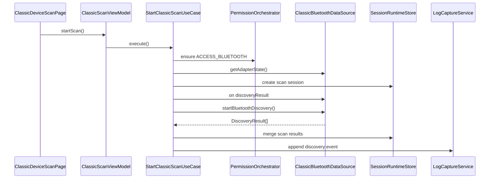

# 经典蓝牙发现、配对与设备身份设计

## 1. 官方能力边界

依据 WSL 官方文档：

1. 经典蓝牙查找设备需要 `ohos.permission.ACCESS_BLUETOOTH`。
2. 推荐 API 18+ 使用 `connection.on('discoveryResult')` 获取更完整信息，包括设备地址、RSSI、名称和设备类型。
3. API 17 及以前的 `connection.on('bluetoothDeviceFind')` 只返回设备地址。
4. `connection.startBluetoothDiscovery()` 发起扫描，扫描过程约 12 秒。
5. 连接前必须停止扫描，因为扫描消耗蓝牙硬件资源并可能影响连接。
6. 非系统应用一般不应关注或设置本机蓝牙扫描模式，系统设置负责可发现性。
7. 已配对设备可通过 `connection.getPairedDevices()` 获取。
8. 配对通过 `connection.pairDevice()` 发起，过程中由系统弹出配对确认或鉴权弹窗。
9. 蓝牙实际 MAC 属于隐私信息，发现过程中蓝牙子系统会分配虚拟 MAC 地址。
10. API 21+ 在已知地址类型时可使用带 `BluetoothAddress` 的配对方式；未知地址类型时应使用旧形式的 `pairDevice(deviceId)`。
11. `connectAllowedProfiles()` 仅覆盖 A2DP/HFP/HID，不覆盖 SPP；SPP 必须走 socket SPP 流程。

## 2. 功能边界

本功能只负责：

1. 蓝牙权限检查。
2. 蓝牙开关状态读取。
3. 已配对设备读取。
4. 经典蓝牙扫描。
5. 扫描结果合并。
6. 配对发起。
7. 配对状态监听。
8. 设备身份建模。
9. 设备收藏、别名、最近设备。
10. 跳转到 SPP 连接参数页。

不负责：

1. A2DP/HFP/HID 音频或输入设备管理。
2. 本机可发现性控制。
3. SPP socket 生命周期。
4. BLE GATT 连接。

## 3. 页面设计

### 3.1 ClassicDeviceScanPage

显示区域：

1. 顶部能力条：权限、蓝牙开关、扫描状态、扫描剩余时间。
2. 操作区：开始扫描、停止扫描、读取已配对设备、筛选。
3. 设备列表：设备名、别名、虚拟地址、RSSI、配对状态、最近发现时间、收藏标记。
4. 详情抽屉：地址来源、设备类型、profile UUID、最近会话、错误历史。

按钮状态：

| 状态 | 开始扫描 | 停止扫描 | 配对 | SPP |
| --- | --- | --- | --- | --- |
| 无权限 | 禁用 | 禁用 | 禁用 | 禁用 |
| 蓝牙关闭 | 禁用 | 禁用 | 禁用 | 禁用 |
| 扫描中 | 禁用 | 可用 | 可用 | 禁用，提示需停止扫描 |
| 空闲 | 可用 | 禁用 | 可用 | 可用 |

### 3.2 PairingGuideDialog

触发条件：

1. 设备未配对且用户尝试 SPP 连接。
2. 用户点击配对。
3. 配对状态变为失败或取消。

内容：

1. 明确系统会弹出配对窗口。
2. 展示设备名和地址脱敏信息。
3. 提醒不同设备可能要求确认密钥、输入通行码或无输入确认。
4. 提供“重新发起配对”和“查看日志”。

## 4. 数据流向

### 4.1 启动扫描



### 4.2 停止扫描

```text
ClassicScanViewModel.stop()
  -> StopClassicScanUseCase
  -> ClassicBluetoothDataSource.isBluetoothDiscovering()
  -> ClassicBluetoothDataSource.stopBluetoothDiscovery()
  -> ClassicBluetoothDataSource.offDiscoveryResult()
  -> SessionRuntimeStore.markCompleted()
  -> LogCaptureService.append(lifecycle stop)
```

### 4.3 发起配对

```text
User pair
  -> PairBluetoothDeviceUseCase
  -> subscribe bondStateChange
  -> pairDevice(deviceId | BluetoothAddress)
  -> system pairing dialog
  -> bondStateChange
  -> update DeviceIdentity + PairingUiState
  -> append permission/pairing log
```

## 5. 状态模型

### 5.1 ClassicScanState

```text
ClassicScanState
  idle
  checkingPermission
  checkingAdapter
  scanning
  stopping
  completed
  failed
```

状态约束：

1. `scanning` 只能由 `checkingAdapter` 进入。
2. 连接 SPP 前必须从 `scanning` 退出到 `idle/completed`。
3. `failed` 必须附带 `DebugError`。
4. 页面销毁时，如果扫描由页面发起且没有后台策略，必须 stop + off。

### 5.2 PairingState

```text
PairingState
  unknown
  unpaired
  pairing
  paired
  failed
  cancelled
```

来源：

1. `getPairState(deviceId)` 初始读取。
2. `bondStateChange` 实时更新。
3. 配对 Promise 只代表发起结果，不等价最终已配对。

## 6. 数据模型

### 6.1 ClassicBluetoothDevice

```text
ClassicBluetoothDevice
  id: string                         # 内部稳定 ID
  displayName: string
  alias?: string
  deviceId: string                   # 平台返回地址，可能是虚拟 MAC
  addressKind: virtual | real | unknown
  addressType?: real | random | unknown
  rssi?: number
  deviceType?: string
  pairState: unknown | unpaired | pairing | paired
  profileUuids: string[]
  source: paired | discovery | manual | favorite
  firstSeenAtMs: number
  lastSeenAtMs: number
  favorite: boolean
  raw?: string
```

### 6.2 DeviceIdentity

```text
DeviceIdentity
  identityId: string
  module: bluetooth
  platformDeviceId: string
  platformDeviceIdHash: string
  userAlias?: string
  identityStability: pairedStable | currentSession | unknown
  lastPairState
  lastConnectedAtMs?
  notes?
```

建模原因：

1. 虚拟 MAC 在配对和蓝牙重启情况下稳定性不同。
2. 收藏不能只依赖未说明来源的地址。
3. 导出日志时可以脱敏 `platformDeviceId`，但保留 hash 便于关联。

### 6.3 ClassicScanResult

```text
ClassicScanResult
  sessionId
  device: ClassicBluetoothDevice
  rssi?
  discoveredAtMs
  eventSource: discoveryResult | bluetoothDeviceFind | pairedDevice
```

## 7. Repository 与 DataSource

### 7.1 ClassicBluetoothRepository

```text
ClassicBluetoothRepository
  getAdapterState(): Promise<BluetoothAdapterState>
  observeAdapterState(): Observable<BluetoothAdapterState>
  getPairedDevices(): Promise<ClassicBluetoothDevice[]>
  getPairState(deviceId: string): Promise<PairingState>
  startDiscovery(sessionId: string): Promise<void>
  stopDiscovery(sessionId: string): Promise<void>
  observeDiscovery(sessionId: string): Observable<ClassicScanResult[]>
  pairDevice(target: PairingTarget): Promise<void>
  observeBondState(): Observable<PairingEvent>
  getRemoteProfileUuids(deviceId: string): Promise<string[]>
```

### 7.2 ClassicBluetoothDataSource

封装平台 API：

1. `connection.on('discoveryResult')`
2. `connection.on('bluetoothDeviceFind')`
3. `connection.startBluetoothDiscovery()`
4. `connection.stopBluetoothDiscovery()`
5. `connection.isBluetoothDiscovering()`
6. `connection.getPairedDevices()`
7. `connection.getPairState()`
8. `connection.on('bondStateChange')`
9. `connection.pairDevice()`
10. `connection.getRemoteProfileUuids()`

释放规则：

1. 扫描完成或取消必须 `off` 对应扫描事件。
2. 配对页面销毁必须解除 `bondStateChange` 页面级订阅；业务级订阅由 PairingCoordinator 管理。
3. 扫描异常时先尝试 stop，再 mark failed。

## 8. 去重与合并

合并来源：

1. 已配对设备。
2. discoveryResult。
3. bluetoothDeviceFind。
4. 收藏设备。
5. 最近连接。

合并键优先级：

1. 已配对设备稳定 identity。
2. 当前平台 deviceId。
3. deviceId hash + name。
4. 手动用户别名。

排序：

1. 已连接或最近连接。
2. 已配对。
3. 收藏。
4. RSSI 从高到低。
5. lastSeenAtMs 从新到旧。

## 9. 错误与降级

| 场景 | appCode | 处理 |
| --- | --- | --- |
| 无蓝牙权限 | `YW-PERM-1001` | 请求 `ACCESS_BLUETOOTH` |
| 蓝牙关闭 | `YW-BT-1001` | 引导系统设置开启 |
| 扫描中再次扫描 | `YW-BT-1101` | 显示已有扫描会话 |
| 扫描前台资源失败 | `YW-BT-1102` | 停止旧扫描并重试一次 |
| API 17 只返回地址 | `YW-CAP-1101` | 设备卡片标注信息有限 |
| 配对被取消 | `YW-BT-1201` | 保持未配对状态 |
| profile UUID 获取失败 | `YW-BT-1202` | 不阻断 SPP UUID 手动输入 |

## 10. 真机验证

1. 无权限启动扫描。
2. 拒绝权限后再次点击扫描，不重复死循环弹窗。
3. 蓝牙关闭时启动扫描。
4. 蓝牙开启后读取已配对设备。
5. API 18+ `discoveryResult` 字段完整性。
6. 扫描约 12 秒后结束。
7. 扫描中点击 SPP，必须先停止扫描。
8. 未配对设备发起配对。
9. 配对成功、失败、取消状态。
10. 蓝牙重启后虚拟地址变化记录。
11. 收藏设备脱敏导出。
