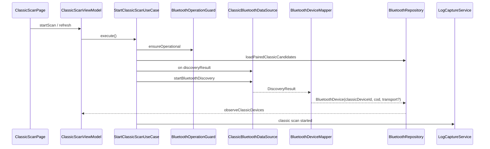

# 01 — 经典蓝牙发现、配对与设备身份设计

> **状态**：架构更新（v1.1 · 2026-07-23）  
> **依赖**：先读 `00-传输类型与双地址身份模型设计.md`  
> **官方依据**：`ohos.bluetooth.connection` / `access` / 传统蓝牙「查找设备」「配对与连接」指南 / 错误码  
> **产品依据**：B-SPP-02/03/09~11；PRD §5 发现与配对

---

## 1. 官方能力边界

依据 WSL 官方文档（全量审查后修订）：

1. 经典蓝牙查找设备需要 `ohos.permission.ACCESS_BLUETOOTH`。
2. 推荐 API 18+ 使用 `connection.on('discoveryResult')`，字段含：
   - `deviceId`（**虚拟 MAC**）
   - `rssi`
   - `deviceName`
   - `deviceClass`（**CoD**，含 majorClass / majorMinorClass / classOfDevice）
3. API 17 及以前的 `bluetoothDeviceFind` 只返回地址数组。
4. `startBluetoothDiscovery()` 约持续 **12s**；扫描中勿重复调用；可用 `isBluetoothDiscovering()` 判断。
5. **扫描停止后才能开启下一次**；连接前必须 `stopBluetoothDiscovery()`。
6. 官方说明：经典扫描过程可发现传统蓝牙与 BLE，但**无法配置过滤参数**；应用层必须用传输类型过滤。
7. `getPairedDevices(): string[]` **仅返回地址**；类型需自行 `getRemoteDeviceTransport`（API20+）。
8. 配对：`pairDevice(deviceId)`；API21+ 可用 `BluetoothAddress`（VIRTUAL/REAL）。
9. 配对弹窗由系统负责；`bondStateChange` 才是最终配对真相。
10. `connectAllowedProfiles()` 仅 A2DP/HFP/HID，**不覆盖 SPP**。
11. 实际 MAC 属隐私；三方默认虚拟 MAC。已配对地址相对稳定，**重启蓝牙开关后虚拟地址会变**。
12. 无公开取消配对 API；引导系统蓝牙设置。

---

## 2. 功能边界

### 2.1 负责

1. 蓝牙权限与适配器状态检查。
2. 已配对设备读取，并按传输类型分流（经典候选 / BLE 候选）。
3. 经典 Inquiry 扫描（~12s）与倒计时。
4. 扫描结果合并、去重、排序、筛选。
5. 传输类型解析与 CoD 展示（分字段）。
6. 配对发起与 `bondStateChange` 承接。
7. Profile UUID 查询（辅助展示，不阻断 SPP）。
8. 设备身份、收藏、别名、最近设备。
9. 双模 BLE→Classic 桥接入口（见文档 00）。
10. 跳转 SPP 连接参数页（仅经典地址就绪时）。

### 2.2 不负责

1. A2DP/HFP/HID 音频或输入设备管理（可用 `connectAllowedProfiles` 但不做产品入口）。
2. 本机可发现性控制（`setBluetoothScanMode`）。
3. SPP socket 生命周期（文档 02）。
4. BLE GATT 连接（文档 03）。
5. 真实 MAC 主路径（API21+ 能力预留，首期不做）。

---

## 3. 页面与功能细化

### 3.1 ClassicScanPanel（SPP 页扫描段）

与产品 L1「经典 SPP」页对齐时复用经典扫描领域能力；**扫描本身是 BR/EDR Inquiry，不是 SPP 扫描**。

UI 装配：`SppMainPage` → `SppMainContentView` → `ClassicScanPanelView`（过滤器 + 设备列表）。
活动连接段：`SppActivePanelView`（SPP 会话，与扫描轨解耦）。

显示区域：

1. 能力条：权限、蓝牙开关、扫描状态、剩余时间、传输过滤提示。
2. 分段（产品期）：经典扫描 | 活动连接；全量产品可演进为已配对 | 附近 | 收藏。
3. 设备列表字段：
   - 显示名 / 别名
   - **经典虚拟地址**（`classicDeviceId`）
   - RSSI
   - 传输徽章：`经典` / `双模` / `未知`
   - **Profile 能力行**（`getRemoteProfileUuids` → `SPP · A2DP · HFP`；失败不阻断）
   - CoD 主类文案（可选，次级信息）
   - 配对状态、最近发现时间、收藏
4. 详情：地址来源、transport、CoD、profile UUID、桥接关联的 bleDeviceId、最近会话、错误历史。

按钮状态：

| 状态 | 开始扫描 | 停止扫描 | 配对 | 进入 SPP |
| --- | --- | --- | --- | --- |
| 无权限 | 禁用 | 禁用 | 禁用 | 禁用 |
| 蓝牙关闭 | 禁用 | 禁用 | 禁用 | 禁用 |
| 扫描中 | 禁用 | 可用 | 可用 | 禁用（提示先停扫） |
| 空闲 + transport 合法 | 可用 | 禁用 | 可用 | 可用（需 classicDeviceId） |
| 空闲 + LE-only | 可用 | 禁用 | 可用 | **禁用**（`YW-BT-1302`） |

### 3.2 已配对刷新（B-SPP-03）

```text
onEnter / onResume / 标题栏刷新
  -> LoadPairedClassicDevicesUseCase
  -> getPairedDevices()
  -> for each id:
       name = getRemoteDeviceName
       transport = getRemoteDeviceTransport
       cod = getRemoteDeviceClass（可选）
  -> 过滤 transport ∈ {BR_EDR, DUAL}（UNKNOWN 按文档 00 §5 降级）
  -> classicMerger.replaceAll(candidates)
  -> publishClassicDevices()
```

**禁止**：把全部配对结果无差别 `fromPaired → kind=CLASSIC`。

### 3.3 Inquiry 流程（B-SPP-09~11）

```text
StartClassicScanUseCase
  -> ensure ACCESS_BLUETOOTH + adapter on
  -> loadPairedClassicCandidates（预置已配对）
  -> create SCAN session (ProtocolType.CLASSIC_SCAN)
  -> on('discoveryResult')
  -> startBluetoothDiscovery()
  -> ~12s ClassicScanTimer / isBluetoothDiscovering
  -> 超时或手动 stop -> off + mark session completed
```

发现结果处理：

1. 写入 `classicDeviceId = deviceId`。
2. 填充 `deviceClassCod`（来自 `deviceClass`）。
3. 尽量补 `transport`（能查则查；查不到标 UNKNOWN，Inquiry 来源可暂准入）。
4. **不得**用 CoD 判断是否 LE。
5. 连接 SPP 前强制 stop discovery。

### 3.4 PairingGuideDialog

触发：

1. 未配对设备尝试 SPP（`Index.openSppConnectDialog`：`!item.paired` → 先引导再进 `SppConnectDialog`）。
2. 用户点配对。
3. 配对失败/取消（Dialog 内「重试」）。

内容：系统会弹窗；展示名与虚拟地址；密钥/PIN 可能由系统处理；提供重试；无取消配对 API 时提供「打开系统蓝牙设置」（`BluetoothSettingsNavigator`）。

实现：`features/bluetooth/.../PairingGuideDialog.ets`（`promptAction.openCustomDialog`）；调用 `PairBluetoothDeviceUseCase` + 订阅 `bondStateChange`；**不**伪造系统 PIN UI。

---

## 4. 数据流向

### 4.1 启动扫描



### 4.2 停止扫描

```text
StopClassicScanUseCase
  -> stopBluetoothDiscovery
  -> off discoveryResult / bluetoothDeviceFind
  -> stop SCAN session
  -> resetClassicScanPhase
```

### 4.3 发起配对

```text
PairBluetoothDeviceUseCase
  -> ensurePermission
  -> subscribe bondStateChange（PairingCoordinator）
  -> pairDevice(deviceId | BluetoothAddress)
  -> system dialog
  -> bondStateChange
  -> 若来源为 BLE 地址且目标要 SPP：走 BridgeBleToClassicPairUseCase
  -> update DeviceIdentity + PairingUiState
```

---

## 5. 状态模型

### 5.1 ClassicScanState

```text
idle | checkingPermission | checkingAdapter | scanning | stopping | completed | failed | blocked
```

约束：

1. `scanning` 只能由检查通过进入。
2. SPP 连接前必须退出 `scanning`。
3. `failed` 附带 `DebugError`。
4. 页面销毁且无后台策略时必须 stop + off。

### 5.2 PairingState

```text
unknown | unpaired | pairing | paired | failed | cancelled
```

来源：`getPairState` + `bondStateChange`；配对 Promise 成功 ≠ 已配对。

---

## 6. 数据模型（与文档 00 对齐）

### 6.1 经典列表设备（视图投影）

```text
ClassicBluetoothDeviceView
  identityId
  displayName
  alias?
  classicDeviceId          # 必填（列表准入后）
  bleDeviceId?             # 双模关联时可选展示
  addressPrivacy: virtual | real | unknown
  transport: BR_EDR | DUAL | UNKNOWN
  deviceClassCod: number
  rssi?
  pairState
  profileUuids[]           # 列表行展示为 Profile 能力短文案
  profileCapabilitiesText  # 如 SPP · A2DP · HFP
  source: paired | discovery | favorite | bridged
  favorite
  firstSeenAtMs
  lastSeenAtMs
```

### 6.2 DeviceIdentity

见文档 00 §3.3；经典侧必须能持久化 `classicDeviceId`（及 hash），双模时同时存 `bleDeviceId`。

### 6.3 ClassicScanResult

```text
ClassicScanResult
  sessionId
  device: BluetoothDevice   # listRail=CLASSIC_SCAN
  rssi?
  discoveredAtMs
  eventSource: discoveryResult | bluetoothDeviceFind | pairedDevice
```

---

## 7. Repository 与 DataSource

### 7.1 契约

```text
ClassicBluetoothRepository / BluetoothRepository classic 面
  getAdapterState()
  observeAdapterState()
  loadPairedClassicCandidates()      # 非 LE
  getPairState(deviceId)
  getRemoteDeviceTransport(deviceId)
  getRemoteDeviceClass(deviceId)
  startDiscovery(sessionId)
  stopDiscovery()
  observeClassicDevices()
  pairDevice(target)
  observeBondState()
  getRemoteProfileUuids(deviceId)
  linkDualModeIdentity(...)
```

### 7.2 DataSource 封装的平台 API

1. `discoveryResult` / `bluetoothDeviceFind`
2. `startBluetoothDiscovery` / `stop` / `isBluetoothDiscovering`
3. `getPairedDevices` / `getRemoteDeviceName`
4. **`getRemoteDeviceTransport`（新增，必用）**
5. **`getRemoteDeviceClass`（新增，补 CoD）**
6. `getPairState` / `bondStateChange` / `pairDevice`
7. `getRemoteProfileUuids`
8. `pinRequired` / `setDevicePinCode`（P1，完整配对引导时）

释放规则：扫描 off；页面级 bond 订阅释放；异常先 stop 再 failed。

---

## 8. 去重、合并与排序

合并来源：已配对经典候选、discoveryResult、bluetoothDeviceFind、收藏、最近、双模桥接。

合并键：见文档 00 §3.3。

排序：

1. 活动 SPP 连接 / 最近连接  
2. 已配对  
3. 收藏  
4. RSSI 高→低  
5. lastSeenAtMs 新→旧  

筛选（Filter）：名称、经典地址、RSSI（附近）、仅已配对、仅收藏；**传输类型过滤为系统强制，不作为可选 Filter**。

---

## 9. 错误与降级

| 场景 | appCode | 处理 |
| --- | --- | --- |
| 无蓝牙权限 | `YW-PERM-1001` | 请求 `ACCESS_BLUETOOTH` |
| 蓝牙关闭 | `YW-BT-1001` | 引导系统设置 |
| 扫描中再次扫描 | `YW-BT-1101` | 提示已有扫描 |
| 扫描资源失败 | `YW-BT-1102` / 平台 `2900009` | stop 后重试一次 |
| API17 仅地址 | `YW-CAP-1101` | 卡片标注信息有限 |
| 配对取消 | `YW-BT-1201` | 保持未配对 |
| profile UUID 失败 | `YW-BT-1202` | 不阻断 SPP UUID 手动输入 |
| transport 失败 | `YW-BT-1301` | UNKNOWN 降级 |
| LE-only 进 SPP | `YW-BT-1302` | 列表排除 + 连接拒绝 |

---

## 10. 真机验证

1. 无权限 / 拒权 / 蓝牙关闭。  
2. 已配对含 BLE 耳机 + 经典串口 → SPP 列表仅经典/双模。  
3. `getRemoteDeviceTransport` 与列表徽章一致。  
4. Inquiry ~12s 自动结束；扫描中不可重复 start。  
5. 连接 SPP 前必须已 stop discovery。  
6. 未配对 → 系统配对弹窗 → bondStateChange。  
7. 蓝牙重启后虚拟地址变化，收藏策略不崩溃。  
8. CoD 展示正确且不参与 LE 过滤。  
9. 双模 BLE 配对桥接得到 classicId（联调文档 00 §10）。
