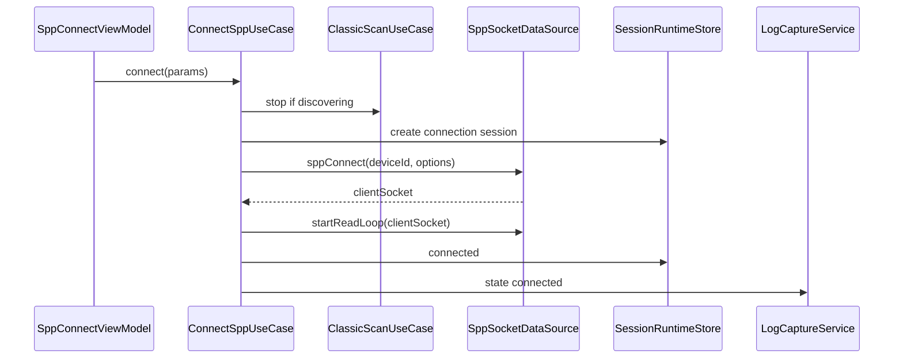
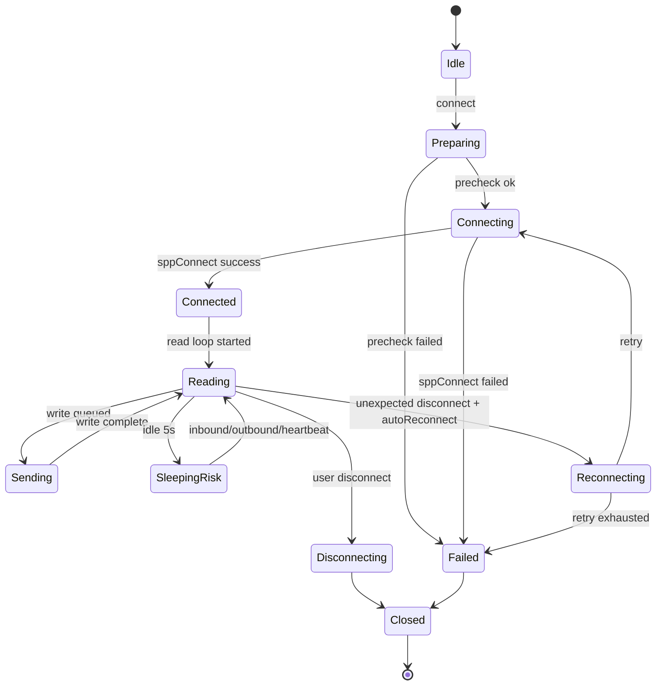

# SPP 终端连接、收发与日志设计

## 1. 官方能力边界

依据 WSL `ohos.bluetooth.socket` 官方文档：

1. `socket.sppConnect(deviceId, SppOptions, callback)` 创建客户端套接字并连接远端服务。
2. `SppOptions` 通过 `uuid`、`secure`、`type` 指定服务，首期使用 `SPP_RFCOMM`。
3. 连接成功后 callback 返回 `clientSocket`，后续读写和关闭都依赖该 socket id。
4. `socket.sppWrite()` 同步发起写；API 18+ `socket.sppWriteAsync()` 可在异常断连时抛错，适合终端工具。
5. `socket.on('sppRead')` 和 API 18+ `socket.sppReadAsync()` 不能混用，同一路 socket 只能选一种读取方式。
6. `sppReadAsync()` 需要业务循环调用，且需等上一次返回后再下一次调用；不及时调用会丢失接收数据。
7. RFCOMM 接收数据超过 1024 字节会自动分多次接收，每次范围 [1,1024]。
8. 数据通道空闲 5-7 秒会进入休眠，下一次发送可能多耗时约 500ms；每 3 秒心跳可保活但增加功耗。
9. `socket.sppCloseClientSocket()` 是关闭客户端连接的正式释放路径。
10. `socket.getDeviceId(clientSocket)` 获取的是虚拟 MAC；已配对地址相对稳定，蓝牙重启可变化。

## 2. 功能范围

首期实现：

1. SPP Client。
2. UUID 输入与收藏。
3. secure 开关。
4. RFCOMM 类型。
5. 连接、断开、重连。
6. 文本/hex/base64 发送。
7. 行结束符。
8. 周期发送。
9. 可选心跳。
10. 原始字节日志。
11. 文本/hex/混合展示。
12. 连接状态和错误日志。

暂不实现：

1. SPP Server。
2. L2CAP 与 L2CAP_BLE。
3. 业务帧解析。
4. Channel 直连，除非平台验证存在公开 API。

## 3. 页面架构

### 3.1 SppConnectPage

字段：

1. 目标设备。
2. UUID。
3. UUID 来源：标准、收藏、手动、历史。
4. secure。
5. 超时。
6. 自动重连。
7. 心跳配置。
8. 连接前停止扫描开关，默认开启且不可关闭。

连接前校验：

1. `ACCESS_BLUETOOTH`。
2. 蓝牙开启。
3. 设备地址存在。
4. UUID 格式合法。
5. 若 classic discovery 正在运行，先 stop。
6. 若设备未配对，提示先配对或继续尝试。

### 3.2 SppTerminalPage

区域：

1. 状态栏：连接状态、socket id、UUID、secure、已收发字节、空闲时长。
2. 日志区：时间、方向、长度、展示格式、payload。
3. 输入区：编码、payload、行结束符、发送按钮。
4. 命令区：收藏命令、周期发送、停止周期。
5. 工具区：清屏、暂停滚动、导出、断开、重连。

UI 约束：

1. 清屏只清 UI 缓存，不删除落盘日志。
2. 暂停滚动不暂停接收和落盘。
3. 自动滚动只在用户位于底部时开启。
4. 大 payload 使用折叠和分页，不把完整 bytes 全量渲染到 Text。

## 4. 数据流向

### 4.1 连接流程



### 4.2 发送流程

```text
SppTerminalViewModel.send()
  -> SendCommandUseCase
  -> CommandEncoder(text/hex/base64 + lineEnding)
  -> CommandWriteQueue.enqueue()
  -> SppTransportSession.write()
  -> socket.sppWriteAsync(clientSocket, bytes)
  -> LogCaptureService.append(outbound bytes)
  -> SessionRuntimeStore.update(bytesOut)
```

### 4.3 接收流程

推荐 API 18+：

```text
SppTransportSession.startReadLoop()
  while connected:
    buffer = await socket.sppReadAsync(clientSocket)
    IncomingPayload(direction=inbound, bytes=buffer, chunkBoundary=transport)
    LogCaptureService.append(inbound bytes)
    SessionRuntimeStore.update(bytesIn)
  catch error:
    close socket
    mark disconnected/failed
```

降级 API：

```text
socket.on('sppRead', clientSocket, callback)
  -> callback(ArrayBuffer)
  -> append inbound bytes
```

选择规则：

1. API 18+ 优先 `sppReadAsync`，因为能感知异常断连。
2. 如果设备/API 不支持，降级 `on('sppRead')`。
3. 两种方式严禁同时启用。

## 5. 状态机



## 6. 数据模型

### 6.1 SppConnectionParams

```text
SppConnectionParams
  targetDeviceId: string
  targetDisplayName: string
  uuid: string
  uuidSource: standard | favorite | manual | history
  secure: boolean
  type: rfcomm
  connectTimeoutMs: number
  autoReconnect: boolean
  reconnectPolicy: ReconnectPolicy
  heartbeat?: SppHeartbeatConfig
```

### 6.2 SppRuntimeState

```text
SppRuntimeState
  sessionId: string
  clientSocket?: number
  state: idle | preparing | connecting | connected | reading | reconnecting | disconnecting | closed | failed
  bytesIn: number
  bytesOut: number
  lastReadAtMs?: number
  lastWriteAtMs?: number
  idleMs: number
  readStrategy: asyncLoop | eventCallback
  maxReceiveDataSize?: number
  virtualDeviceId?: string
  error?: DebugError
```

### 6.3 SppLogChunk

```text
SppLogChunk
  id
  sessionId
  direction: inbound | outbound
  timestampMs
  byteLength
  chunkBoundary: transport
  payloadRef
  readStrategy
```

## 7. 日志设计

### 7.1 保真要求

1. 不丢弃 `0x00`。
2. 不自动 trim。
3. 不自动按换行拆记录。
4. 不合并相邻 chunk 改变原始接收边界。
5. 允许 UI 层按行视图展示，但必须能切回 chunk 视图。

### 7.2 展示视图

1. Chunk 视图：每次平台回调/读取作为一条。
2. 流视图：按方向连续拼接，只用于阅读。
3. 行视图：按 `\r`、`\n`、`\r\n` 渲染，只用于阅读。
4. Hex 视图：offset + hex + ASCII。

### 7.3 特殊事件

记录为 internal log：

1. connect start/success/fail。
2. read loop start/stop。
3. write queue blocked。
4. idle sleep risk。
5. heartbeat sent。
6. reconnect scheduled/cancelled/exhausted。
7. socket close。

## 8. 周期发送与心跳

### 8.1 周期发送

约束：

1. 用户显式开启。
2. 最小间隔有下限。
3. 进入后台默认暂停，除非用户开启后台周期发送并满足后台任务策略。
4. 失败策略可配置：停止、继续、重试 N 次。
5. 周期发送与手动发送共用 `CommandWriteQueue`，保证顺序。

### 8.2 心跳

官方提到约 3 秒心跳可避免 SPP 通道休眠，但会增加功耗。架构设计：

1. 默认关闭。
2. 专家模式可见。
3. 心跳 payload 可配置但默认单字节。
4. 心跳事件进入 internal log。
5. 低电量、后台、用户关闭屏幕时提示功耗风险。

## 9. 自动重连

触发条件：

1. read loop 捕获 IO error。
2. writeAsync 返回断连错误。
3. 蓝牙短暂关闭后恢复。
4. App 前台恢复发现 socket 不可用。

不触发条件：

1. 用户主动断开。
2. 权限被撤销。
3. 蓝牙关闭且用户未开启自动恢复。
4. UUID 参数为空或被删除。

策略：

```text
ReconnectPolicy
  maxAttempts: number
  initialDelayMs: number
  maxDelayMs: number
  backoffFactor: number
  stopOnPermissionLost: boolean
  stopOnPairLost: boolean
```

## 10. 资源释放

必须顺序：

1. 停止周期发送。
2. 停止心跳。
3. 标记 read loop cancellation。
4. 若使用 `on('sppRead')`，调用 `socket.off('sppRead', clientSocket, callback)`。
5. 调用 `socket.sppCloseClientSocket(clientSocket)`。
6. 更新 session 状态。
7. append close log。

## 11. 错误映射

| native | appCode | 说明 |
| --- | --- | --- |
| 201 | `YW-PERM-1001` | 蓝牙权限缺失 |
| 401 | `YW-BT-1301` | 参数非法，通常是 UUID/deviceId/socket id |
| 801 | `YW-BT-1302` | 设备或系统不支持 SPP |
| 2900001 | `YW-BT-1303` | 蓝牙服务停止 |
| 2900003 | `YW-BT-1001` | 蓝牙关闭 |
| 2900004 | `YW-BT-1304` | Profile 不支持 |
| 2901054 | `YW-BT-1305` | IO 错误 |
| 2900099 | `YW-BT-1399` | SPP 操作失败 |

## 12. 验证清单

1. 标准 SPP UUID 连接。
2. 自定义 UUID 连接。
3. secure true/false。
4. 连接前扫描未停止的失败复现和自动停止确认。
5. `sppReadAsync` 大于 1024 字节接收拆分。
6. `sppReadAsync` 断连错误捕获。
7. `on('sppRead')` 降级路径。
8. 两种读方式不会同时注册。
9. 周期发送顺序。
10. 心跳开启后 idle 延迟变化。
11. 自动重连次数和退避。
12. 主动断开不自动重连。
13. 页面退出后 socket 是否按策略保留或关闭。
14. 日志导出 payload 保真。
