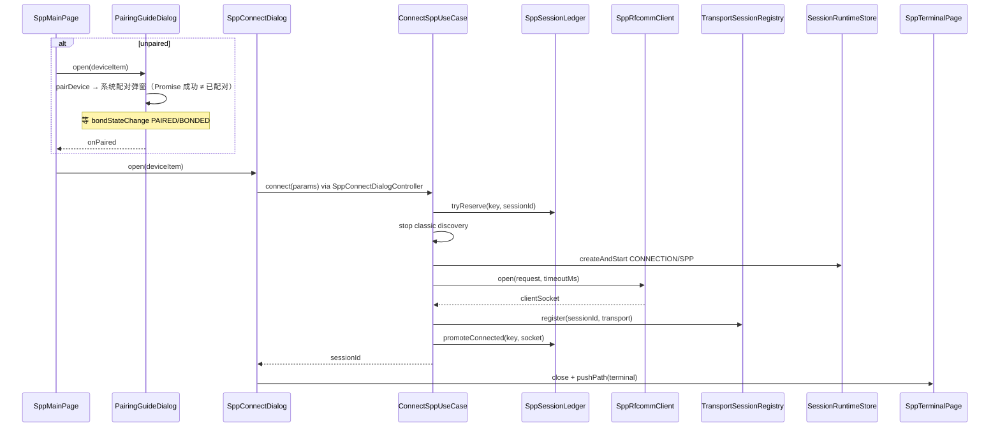
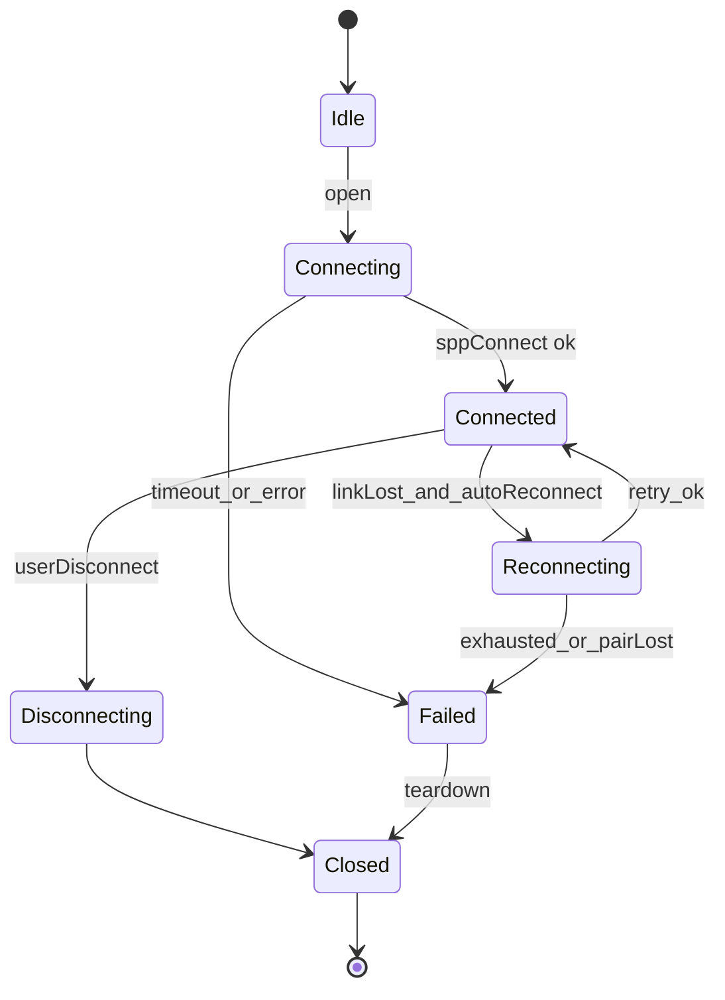

# 02 — SPP 终端连接、收发与日志设计

> **状态**：架构定稿（v1.3 · 2026-07-27）  
> **依赖**：`00-传输类型与双地址身份模型设计.md`、`01-经典蓝牙发现配对与设备身份设计.md`、`05-会话队列与统一后端集成设计.md`  
> **官方依据**：`ohos.bluetooth.socket`、传统蓝牙「连接和传输数据」、FAQ「同 UUID 不可并发 / sppReadAsync」、错误码 2901054；配对/开蓝牙为系统弹窗（`connection.pairDevice` / access），应用仅提供 RFCOMM 选项 Dialog

## 1. 官方能力边界

依据 HarmonyOS `ohos.bluetooth.socket` 与短距 FAQ：

1. `socket.sppConnect(deviceId, SppOptions, callback)` 创建客户端套接字并连接远端服务。
2. **`deviceId` 必须是经典侧地址**（经典虚拟 MAC；API21+/5.1 起亦可真实 MAC）。  
   **禁止**把 BLE 虚拟 MAC 直接传入 `sppConnect`。
3. `SppOptions`：`uuid`（RFCOMM 必选）、`secure`、`type`（首期 `SPP_RFCOMM=0`）；标准 SPP UUID：`00001101-0000-1000-8000-00805F9B34FB`。
4. 连接成功返回 `clientSocket`；读写与关闭均依赖该 id。
5. 写：`sppWrite` / API18+ `sppWriteAsync`；建议单次 **&lt;600B，不建议 &gt;1024**。
6. 读：`on('sppRead')` 与 `sppReadAsync` **同一 clientSocket 不可混用**；`sppReadAsync` 必须串行 await。
7. RFCOMM 接收 &gt;1024 自动分片，每片 [1,1024]。
8. 空闲 5–7s 可能休眠；心跳可保活但增功耗。
9. 关闭：先 `off('sppRead')`（若用事件读），再 `sppCloseClientSocket`。
10. **同设备同 UUID 不可并发连接**（平台 FAQ）；不同设备可共享标准 UUID；同设备不同 UUID 可并行。
11. 断连感知：`sppReadAsync`/`sppWriteAsync` 错误 **2901054**；可选 ACL 事件 / API22 `isConnected`。
12. `connectAllowedProfiles` **永不**用于 SPP。首期不做 L2CAP / Server。

## 2. 功能范围

### 2.1 本轮实现

1. SPP Client（仅经典/双模）；**多路 RFCOMM 并行**，应用层 cap=`SPP_MAX_SESSIONS`（默认 4）。
2. 会话身份 `SppSessionKey(classicDeviceId, serviceUuid)`；`SppSessionLedger` 为槽位唯一真相。
3. 连接前 `ResolveSppTargetAddressUseCase`；强制 stop classic discovery。
4. UUID / secure / timeout / autoReconnect；默认标准 SPP UUID。
5. 每会话独立 `SppRfcommClient` + `CommandWriteQueue`；读默认 `sppReadAsync`。
6. 活动连接列表（`SppSessionCatalog`）；按 `(MAC, UUID)` 区分。
7. Feature：`SppMainPage` + **`PairingGuideDialog`**（未配对引导）+ **`SppConnectDialog`**（弹窗配置后连接）+ `SppTerminalPage`（focusSessionId）。
   **无独立连接页**；系统配对/开蓝牙弹窗与应用 RFCOMM Dialog 严格分离。

### 2.2 暂不实现

1. SPP Server（`sppListen` / `sppAccept`）。
2. L2CAP / Channel 直连。
3. 业务帧解析插件。

## 3. 分层架构（自底向上）

```text
L6 Feature     SppMainVM · PairingGuideDialog · SppConnectDialog · SppTerminalVM
L5 UseCases    Connect / Disconnect / Send / List / Observe / QueryEligibility
L4 Domain      SppSessionLedger · AdmissionPolicy · Catalog · SessionKey
L3 Transport   SppTransportSession (ITransportSession + ISppTransportFacet)
L2 RFCOMM      SppRfcommClient（一 clientSocket 一生）
L1 Platform    SppPlatformGateway（无状态 socket.* 封装）
L7 debug_core  SessionRuntimeStore · LogCaptureService · TransportSessionRegistry
```

### 依赖禁令

1. Domain **不得** `instanceof` 具体 Transport；只认 `ISppTransportFacet`。
2. Platform **不得** 持有会话/槽位状态。
3. Feature **不得** 直接调用 `socket.*`。
4. 槽位计数**唯一真相**：`SppSessionLedger`（禁止 SlotRegistry 与 Repository 双计数）。

## 4. 核心域模型

### 4.1 SppSessionKey

```text
SppSessionKey
  classicDeviceId: string      # trim + uppercase
  serviceUuid: string          # trim + lowercase
  compositeKey(): string       # `${classicDeviceId}#${serviceUuid}`
```

Connect / AdmissionPolicy / Catalog / Ledger **必须**经 `SppSessionKey.fromParts`（或等价 normalize）构造，禁止各自拼 key。

### 4.2 SppSessionLedger（单一真相）

```text
SppLedgerPhase: reserved | connecting | connected | reconnecting | closing

SppLedgerEntry
  sessionKey, sessionId, phase, reservedAtMs, clientSocket?

SppSessionLedger
  tryReserve(key, sessionId): Result   # DUPLICATE / LIMIT
  markConnecting(key)
  promoteConnected(key, clientSocket)
  markReconnecting(key)                # 不 release
  markClosing(key)                     # Disconnect 前瞬态
  release(key, reason)                 # 唯一出口（幂等）
  listActive() / findBySessionId() / hasKey() / getActiveCount()
```

规则：

1. 同 `compositeKey` 已存在 → `YW-BT-1316 SPP_DUPLICATE_SESSION`。
2. `activeCount >= SPP_MAX_SESSIONS` → `YW-BT-1317 SPP_SESSION_LIMIT`。
3. 重连：`markReconnecting`，**不** release key。
4. Transport FAILED / 重连耗尽 / 配对丢失：**必须**完整 teardown（`SppSessionTeardown.failCleanup`：含 `TSR.remove` + `ledger.release` + `stopSession`；见 §6）。
5. 用户断开：`SppSessionTeardown.userDisconnectCleanup`（`markClosing` → `release`）；禁止槽位泄漏。
### 4.3 ISppTransportFacet

```text
ISppTransportFacet
  getSessionKey(): SppSessionKey | undefined
  getClientSocketId(): number
  getReadStrategy(): SppReadStrategy
```

### 4.4 SppSessionDescriptor（读模型）

```text
sessionId, transportId, sessionKey, displayName,
classicAddress, serviceUuid, uuidShortLabel, stateLabel,
clientSocket, bytesIn, bytesOut
```

字节计数来自 `SessionRuntimeStore.getState(sessionId).bytesIn/Out`（**不是** `DebugSession`）。

### 4.5 SppConnectParams

```text
classicDeviceId, displayName, uuid, secure, timeoutMs,
autoReconnect, reconnectPolicy, transport, bleDeviceId?
```

## 5. 数据流向

### 5.1 连接（扫描 → Dialog → sppConnect）

**UX 分层（对齐官方）**：

| 层级 | 谁弹 | 何时 |
|------|------|------|
| 系统 | 开蓝牙 / `pairDevice` 配对 | 适配器关、未配对（系统弹窗，应用不替代） |
| 应用 | `PairingGuideDialog`（`openCustomDialog` + 自绘 AdvancedDialog 结构） | 未配对点「连接」：说明 + 触发配对/重试/开设置 |
| 应用 | `SppConnectDialog`（`openCustomDialog` + 自绘 AdvancedDialog 结构） | 已配对（或配对成功后）：UUID/secure/timeout/reconnect；底栏文字按钮；失败不自动关闭 |
| 导航 | `SppTerminalPage` | **连接成功后**再 push，不经连接页 |



失败回滚（固定顺序）：

```text
transport.destroy → ledger.release → stopSession → republishClassicDevices
```

断开顺序：

```text
CommandWriteQueue.reset → transport.disconnect → TSR.remove
→ ledger.markClosing → ledger.release → Coordinator.unbind → stopSession → republish
```

### 5.2 发送 / 接收

```text
Send: TerminalVM → SendSppCommandUseCase → CommandWriteQueue
    → SppTransportSession.write → sppWriteAsync
    → LogCapture + RuntimeStore.applyPatch(bytesOutDelta)

Recv: SppRfcommClient sppReadAsync loop (per socket)
    → IncomingPayload → LogCapture + applyPatch(bytesInDelta)
```

读策略：默认 `sppReadAsync`；仅在 async 连续失败时 per-socket 降级 `on('sppRead')`；严禁混用。

### 5.3 连接超时

`SppRfcommClient.open` 使用 cancel token：超时返回 `YW-BT-1318`；迟到成功的 `clientSocket` **必须立即 close**，防泄漏。

## 6. 状态机（三层分离，禁止混用）

扫描态、Ledger 槽位态、Transport 链路态是三套独立状态机；UI Dialog 仅反映 connecting 布尔与错误文案，不另开一套业务状态机。

### 6.0 UX / Dialog（瞬时）

```text
Closed → Open(form) → Submitting(connecting=true)
  → Success → Closed → navigate Terminal
  → Fail → Open(error+hints)  // 保持弹窗，可改参重试
  → Cancel / mask dismiss → Closed  // connecting 时禁止 dismiss
```

### 6.1 Transport / Runtime



`Failed` / 重连耗尽 / 配对丢失 teardown（**契约，缺一不可**）：

```text
SppSessionTeardown.failCleanup(sessionId, reason)
  ≈ queue.reset → cancelReconnect → notifyFailed
  → TSR.remove(destroy/close) → ledger.release → stopSession → republish
```

禁止只标 `FAILED` 却留槽位 / 留 Registry 条目 / 留 Runtime 会话。  
共享实现：`domain/service/spp/SppSessionTeardown.failCleanup`（Coordinator pair-lost/耗尽等入口）；用户断开走 `userDisconnectCleanup`。

### 6.2 Ledger Phase

```text
tryReserve → RESERVED → markConnecting → CONNECTING
  → promoteConnected → CONNECTED
  → markReconnecting → RECONNECTING → CONNECTED
  → CLOSING → release → (removed)
  → FAILED / timeout / open 失败 → release → (removed)
```

### 6.3 Classic Scan（独立，见 01）

连接前 `ConnectSppUseCase` **强制 stop discovery**；扫描状态机不得与 Ledger/Transport 混用。

## 7. Use Case 清单

| UseCase | 职责 |
|---------|------|
| `ConnectSppUseCase` | guard→resolve→ledger.reserve→stopScan→bootstrap→connect→register→promote |
| `DisconnectSppUseCase` | queue.reset→disconnect→unregister→release→stopSession |
| `SendSppCommandUseCase` | per sessionId 写队列 + SendCommand |
| `ListSppSessionsUseCase` | Catalog 快照 |
| `ObserveSppSessionsUseCase` | 订阅 RuntimeStore activeList + Ledger |
| `QuerySppConnectEligibilityUseCase` | 预检 DUPLICATE/LIMIT |

## 8. Feature 页面与 Dialog

| 表面 | 职责 |
|------|------|
| `SppMainPage` | 经典扫描轨 + 活动连接列表；活动行 → Terminal；「连接」→（未配对先 `PairingGuideDialog`）`SppConnectDialog` |
| `PairingGuideDialog` + `SppPairingGuideController` | 自绘系统风格弹出框（居中标题 / 模糊 / 底栏文字按钮）；说明系统配对弹窗；触发 `pairDevice` / 重试 / 打开蓝牙设置；**配对真相 = `bondStateChange` → `PairingState.PAIRED`**；成功后进入 `SppConnectDialog` |
| `SppConnectDialog` + `SppConnectDialogController` | 自绘 AdvancedDialog；分段 **标准 SPP \| Nordic UART \| 自定义**；自定义档标题左对齐 + `YoTitleBarActionRow`（`YoTitleBarMenuItem` / HDS menuStyle 同构：列表 + 收藏）；收藏经 Preferences `bluetooth.spp.uuidFavorites`（首缺 key 时种子 HS01 AT）；列表用 `bindSheet` 半模态管理（点选回填 / 增删改）；secure / timeout / reconnect；Controller 预检后 Connect；成功回调 sessionId |
| `SppTerminalPage` + `SppTerminalViewModel` | 业界终端排布（对齐 Serial Bluetooth Terminal / nRF Serial Terminal）：紧凑状态条（StatusPill + 设备/MAC/UUID + RX·TX）→ SessionSwitcher chips → 全高日志视口（文本/HEX/混合 + RX/TX 分色 + 清屏）→ 底栏 Composer（TEXT/HEX + None/CR/LF/CRLF + 输入 + 发送）；断开/清屏进标题栏 More；收发仅绑 `focusSessionId`，切路不断开其他会话 |

**已移除**：`SppConnectPage` / `SppConnectViewModel` / 路由 `/bluetooth/spp/connect`。

活动列表展示：`displayName` + MAC + UUID 短标签 + 状态。  
断开：菜单/按钮，**禁止**把行点击默认绑成断开。

## 9. 多连接验收矩阵

| 场景 | 预期 |
|------|------|
| 设备 A + 设备 B 各一路 | 允许 |
| 同设备 UUID₁ + UUID₂ | 允许 |
| 同设备同 UUID ×2 | `YW-BT-1316` |
| 第 5 路 | `YW-BT-1317` |
| A 断连 | 仅 release A；B 不受影响 |
| A 重连中 | phase=reconnecting，不释放 key |
| Terminal 发送 | 仅 focusSessionId |

## 10. 日志与保真

1. 不丢弃 `0x00`；不 trim；不按换行拆传输边界。
2. UI 可做行/流视图，必须能切回 chunk 视图。
3. 清屏只清 UI 缓存，不删落盘日志。

## 11. 自动重连

- **单一重连所有者**：`SppReconnectCoordinator`（per-session `bind`/`unbind`）。  
  Transport 仅上报 linkLost / 执行一次 RFCOMM `open` 重试动作；**禁止** Transport 与 Coordinator 并行各开一套调度（双所有者）。
- **触发**：read/write IO 2901054、适配器恢复、前台 reconcile（且 autoReconnect）。
- **不触发**：用户断开、权限撤销、配对丢失（若 `stopOnPairLost`）。
- **行为**：多路各自 backoff；全局不 release 他人槽位；pair-lost / 耗尽 → `SppSessionTeardown.failCleanup`（§6）。

## 12. 资源释放（单 socket）

1. 停周期发送 / 心跳。  
2. 标记 read loop cancel。  
3. 若事件读：`off('sppRead', clientSocket, handler)`。  
4. `sppCloseClientSocket(clientSocket)`。  
5. Ledger release + RuntimeStore 更新。

## 13. 错误码

| code | 含义 |
|------|------|
| `YW-BT-1316` | 同 (MAC, UUID) 已占用 |
| `YW-BT-1317` | 超过 `SPP_MAX_SESSIONS` |
| `YW-BT-1318` | sppConnect 超时 |
| `YW-BT-1315` | IO / 2901054 |
| `YW-BT-1399` | 通用连接失败 |
| `YW-BT-1401` | TX 队列满 |

（地址/权限类错误码见 `00` / `BluetoothErrorCodes`。）

## 14. 已删除 / 禁止复活的旧组件

1. `SppActiveWritePolicy`（单活跃写端）。
2. `SppSocketDataSource` 单例全局读订阅。
3. 应用层「同时仅 1 个 Ready SPP 写端」策略。
4. `SppConnectPage` / 独立连接导航页（改用 `SppConnectDialog`）。

## 15. 验证清单

1. 标准 / 自定义 UUID 连接（Dialog 内完成）。  
2. 多设备并行 + 同设备多 UUID。  
3. 同 UUID 拒绝 + cap 拒绝。  
4. 连接前强制 stop discovery。  
5. `sppReadAsync` 分片与断连。  
6. 超时后无 socket 泄漏。  
7. 断一路不影响其他路读写。  
8. Terminal focus 发送隔离。  
9. 用户断开不自动重连。  
10. 日志 payload 保真。  
11. 编译通过；无旧 DataSource/ActiveWrite/ConnectPage 引用。  
12. 扫描点连接 → Dialog → 成功进 Terminal；connecting 中不可 mask 关闭。  
13. 未配对设备：系统配对弹窗与应用 Dialog 不互相替代。
