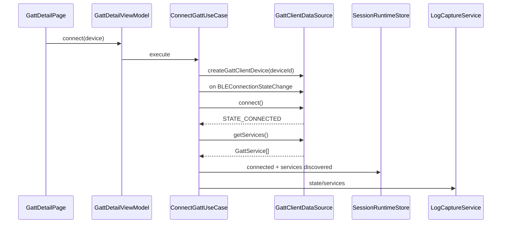

# BLE 扫描、GATT 与串口预设设计

## 1. 官方能力边界

依据 WSL BLE 官方文档：

1. BLE 扫描需要 `ACCESS_BLUETOOTH`。
2. API 15+ 推荐 `ble.createBleScanner()` 创建扫描实例，支持应用管理多路扫描。
3. API 14 及以前 `ble.startBLEScan()` 只支持单路扫描，再次扫描前必须停止上一路。
4. 扫描过滤支持 manufacturer id、manufacturer data、mask。
5. `filters` 传 null 会扫描所有可发现 BLE 设备，但官方不建议，可能增加功耗并扫到非预期设备。
6. BLE 广播报文长度通常受 31 字节限制；携带设备名可能导致广播启动失败。扫描端也不能假设设备名完整。
7. GATT Client 必须先 `createGattClientDevice(deviceId)`。
8. 连接状态通过 `BLEConnectionStateChange` 获取。
9. 连接完成后需要 `getServices()` 服务发现，后续 read/write/notify 必须基于服务发现结果。
10. Notify/Indicate 必须先订阅 `BLECharacteristicChange`，再调用 `setCharacteristicChangeNotification` 或 `setCharacteristicChangeIndication`。
11. GATT Client 不再使用时必须 `disconnect()`，若实例不再使用必须 `close()`。

## 2. 功能拆分

BLE 子模块分为：

1. BLE 扫描。
2. 广播数据解析。
3. GATT Client 连接。
4. GATT 服务树。
5. 特征/描述符读写。
6. Notify/Indicate。
7. MTU 与分片。
8. 串口 Profile 预设。
9. Notify 数据曲线。

BLE Advertiser 与 GATT Server 首期只保留架构预留，不进入默认功能。

## 3. BLE 扫描设计

### 3.1 页面功能

1. 扫描模式：低功耗、均衡、低延迟。
2. 过滤器：
   - deviceId/address。
   - name。
   - serviceUuid。
   - manufacturerId。
   - manufacturerData。
   - manufacturerDataMask。
   - RSSI 阈值。
3. 结果列表：
   - 设备名。
   - 地址/虚拟地址。
   - RSSI。
   - 是否可连接。
   - service UUID 摘要。
   - manufacturer data 摘要。
   - 最近出现时间。
4. 详情页：
   - raw advertising bytes。
   - parsed AD structures。
   - RSSI 曲线。
   - 广播字段来源。

### 3.2 扫描 DataSource 策略

```text
BleScanDataSource
  if api >= 15:
    scanner = ble.createBleScanner()
    scanner.on('BLEDeviceFind', callback)
    scanner.startScan(filters, options)
  else:
    ble.on('BLEDeviceFind', callback)
    ble.startBLEScan(filters, options)
```

释放：

```text
if api >= 15:
  scanner.off('BLEDeviceFind', callback)
  scanner.stopScan()
else:
  ble.off('BLEDeviceFind', callback)
  ble.stopBLEScan()
```

### 3.3 扫描状态

```text
BleScanState
  idle
  checkingPermission
  selectingApi
  scanning
  stopping
  stopped
  failed
```

### 3.4 广播解析模型

```text
BleAdvertisingPacket
  deviceId
  rssi
  connectable
  rawPayloadRef
  localName?: string
  serviceUuids: string[]
  serviceData: BleServiceData[]
  manufacturerData: BleManufacturerData[]
  txPower?
  flags?
  parseWarnings: string[]
```

解析规则：

1. raw bytes 优先落盘。
2. 字段解析失败不能丢弃 raw。
3. manufacturer mask 匹配结果作为 `filterMatch`，不改变原数据。
4. 设备名标注来源：scan result name、advertising local name、scan response、用户别名。

## 4. GATT Client 设计

### 4.1 数据流



### 4.2 GATT 状态

```text
GattClientState
  idle
  creating
  connecting
  connected
  discovering
  ready
  reading
  writing
  subscribing
  disconnecting
  closed
  failed
```

规则：

1. `ready` 之前不允许 read/write/notify。
2. `disconnecting` 后丢弃未执行操作队列。
3. `closed` 后 GATT Client 实例不可复用。
4. 蓝牙关闭事件会将状态转为 `failed` 或 `closed`，并触发资源释放。

### 4.3 GATT 服务树模型

```text
GattServiceNode
  serviceUuid
  isPrimary
  characteristics: GattCharacteristicNode[]
  includeServices: string[]

GattCharacteristicNode
  serviceUuid
  characteristicUuid
  properties: GattCharacteristicProperty[]
  permissions: string[]
  descriptors: GattDescriptorNode[]
  notifyState: disabled | enabling | enabled | disabling | failed
  lastValueRef?

GattDescriptorNode
  serviceUuid
  characteristicUuid
  descriptorUuid
  permissions: string[]
  lastValueRef?
```

### 4.4 操作队列

GATT 操作必须串行：

```text
GattOperationQueue
  enqueue(readCharacteristic)
  enqueue(writeCharacteristic)
  enqueue(readDescriptor)
  enqueue(writeDescriptor)
  enqueue(setNotification)
  enqueue(requestMtu)
```

原因：

1. GATT 协议和平台实现对并发操作敏感。
2. UI 可能快速点击多个读写按钮。
3. Notify 订阅期间写 CCCD 和订阅事件顺序必须稳定。

## 5. 读写设计

### 5.1 Characteristic 读取

输入：

1. serviceUuid。
2. characteristicUuid。
3. descriptor list。

输出：

1. value payloadRef。
2. value encoding hint。
3. timestamp。
4. nativeCode/appCode。

日志：

1. internal：read request。
2. inbound：read result payload。
3. error：失败原因。

### 5.2 Characteristic 写入

字段：

1. encoding：text/hex/base64。
2. writeType：WRITE / WRITE_NO_RESPONSE，具体枚举按平台能力映射。
3. chunkSize：由 MTU 和特征限制计算。
4. intervalMs：分片间隔。

流程：

```text
CommandEncoder
  -> BleGattPacketizer
  -> GattOperationQueue
  -> writeCharacteristicValue
  -> outbound log
```

## 6. Notify/Indicate 设计

开启顺序：

1. 检查服务发现结果中 Characteristic 存在。
2. 检查 CCCD `00002902-0000-1000-8000-00805f9b34fb`。
3. 注册 `BLECharacteristicChange` 回调。
4. 调用 notification 或 indication enable。
5. 状态置为 enabled。

关闭顺序：

1. 调用 notification/indication disable。
2. 注销回调或从 dispatcher 移除该 characteristic。
3. 状态置为 disabled。

数据流：

```text
BLECharacteristicChange
  -> GattNotificationDispatcher
  -> LogCaptureService(inbound)
  -> CharacteristicLiveValueStore
  -> ChartViewModel
```

## 7. MTU 与分片

MTU 策略：

1. 默认使用平台默认 MTU。
2. 用户可手动请求 MTU。
3. 写入可用 payload 上限按 `mtu - protocolOverhead` 估算，实际失败时降级。
4. Notify 单包大小按实际收到数据记录，不假设业务帧边界。

分片模型：

```text
BleChunkPolicy
  mtu
  overheadBytes
  maxPayloadBytes
  interChunkDelayMs
  stopOnFirstError
```

## 8. 串口 Profile 预设

### 8.1 预设内容

```text
BleSerialPreset
  id
  name
  serviceUuid
  rxCharacteristicUuid
  txCharacteristicUuid
  txNotifyType: notification | indication
  writeType
  defaultLineEnding
  defaultEncoding
```

首期预设：

1. Nordic UART Service。
2. 用户自定义 BLE Serial。

### 8.2 自动识别

规则：

1. 优先匹配 serviceUuid。
2. 找到 writable characteristic 作为 RX。
3. 找到 notify/indicate characteristic 作为 TX。
4. 自动识别结果必须展示给用户确认。

## 9. 错误与降级

| 场景 | appCode | 处理 |
| --- | --- | --- |
| API 14 单路扫描 | `YW-CAP-2101` | 禁止多扫描实例 |
| 扫描无过滤 | `YW-BLE-2101` | 专家模式允许，轻量模式提示功耗 |
| GATT 未连接读写 | `YW-BLE-2201` | 按钮禁用 |
| 服务未发现读写 | `YW-BLE-2202` | 要求先服务发现 |
| Characteristic 不存在 | `YW-BLE-2203` | 刷新服务树 |
| Notify 无 CCCD | `YW-BLE-2301` | 禁用订阅 |
| MTU 协商失败 | `YW-BLE-2401` | 使用默认 MTU |

## 10. 验证清单

1. API 15+ BleScanner 创建、扫描、停止、off。
2. 单路扫描降级。
3. manufacturerData + mask 过滤。
4. 广播 raw bytes 保留。
5. 可连接设备进入 GATT。
6. GATT 连接状态变化。
7. 服务发现后构建服务树。
8. read/write Characteristic。
9. read/write Descriptor。
10. Notify 开启和关闭。
11. Indicate 开启和关闭。
12. 高频 Notify 日志不卡 UI。
13. MTU 请求与分片。
14. 串口 Profile 自动识别。
15. 断开后 close，不复用旧实例。
