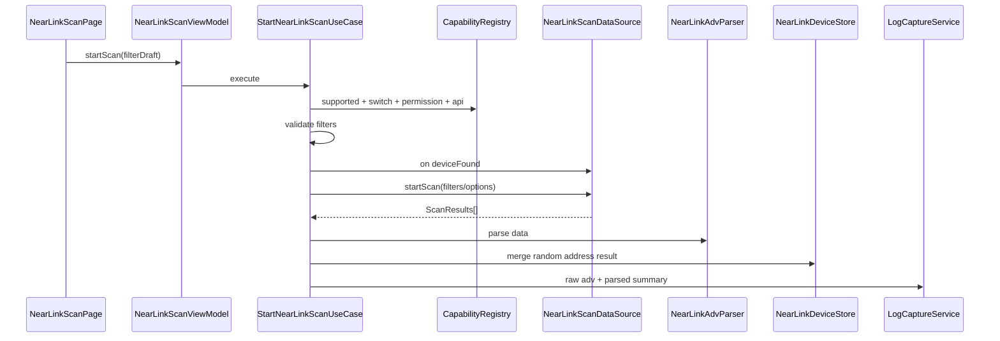

# NearLink 能力探测、扫描与广播解析设计

## 1. 官方能力边界

依据 WSL NearLink 官方文档：

1. NearLink Kit 使用 `@kit.NearLinkKit`。
2. 需要 `ohos.permission.ACCESS_NEARLINK`。
3. 扫描 API 仅 Stage 模型可用。
4. `scan.startScan(filters, options)` 起始 5.0.1(13)，要求 filters 中不能全部为空过滤器，否则返回 401。
5. API 26.0.0 起 `startScan(filters | null)` 允许传 null 进行无过滤扫描，但官方不建议，可能扫到非预期设备并增加功耗。
6. `scan.stopScan()` 停止扫描。
7. `scan.on('deviceFound')` 返回 `ScanResults[]`，扫描结果携带远端设备随机地址。
8. `ScanResults.rssi` 范围 [-128,127]，127 表示无效值。
9. `ScanResults.data` 是广播包原始数据。
10. `ScanFilters` 支持 address、deviceName、manufacturerId、manufacturerData、manufacturerDataMask。
11. manufacturerData 需要同时配置 manufacturerId；manufacturerDataMask 需要同时配置 manufacturerData 且长度一致。
12. `ScanOptions.duration` 范围 [10,60] 秒，默认全时段扫描；scanMode 默认低功耗。

## 2. 功能范围

首期实现：

1. NearLink 支持状态。
2. NearLink 开关状态。
3. NearLink 权限。
4. 扫描过滤。
5. 扫描启动/停止。
6. 扫描时长控制。
7. 扫描结果去重。
8. 广播 raw data 保留。
9. 广播 TLV 解析。
10. 设备收藏和别名。
11. 连接入口能力判断。

预留：

1. 星闪广播。
2. 合作设备集合。
3. 设备类型高级识别。

## 3. 页面设计

### 3.1 NearLinkOverviewPage

展示：

1. 设备支持状态。
2. NearLink 开关状态。
3. 权限状态。
4. 最近扫描设备。
5. 收藏设备。
6. 最近 SSAP/dataTransfer 会话。
7. 不可用原因。

### 3.2 NearLinkScanPage

字段：

1. deviceName。
2. address。
3. manufacturerId。
4. manufacturerData。
5. manufacturerDataMask。
6. scanMode：低功耗、均衡、低延迟。
7. duration：10-60 秒或全时段。
8. 是否允许无过滤扫描。

轻量模式：

1. 默认要求 deviceName 或 manufacturerId。
2. 不显示无过滤扫描。
3. 扫描时长默认 10 秒。

专家模式：

1. 可配置全部过滤字段。
2. API 26+ 可允许 null filter，但显示功耗和噪声提示。
3. 显示 raw data 和解析警告。

## 4. 数据流向



## 5. 状态模型

```text
NearLinkCapabilityState
  unknown
  unsupported
  supportedOff
  supportedOnNoPermission
  ready
  failed
```

```text
NearLinkScanState
  idle
  checkingCapability
  validatingFilter
  scanning
  stopping
  completed
  failed
```

## 6. 数据模型

### 6.1 NearLinkScanFilterDraft

```text
NearLinkScanFilterDraft
  address?: string
  deviceName?: string
  manufacturerId?: number
  manufacturerDataHex?: string
  manufacturerDataMaskHex?: string
  allowNullFilter: boolean
  scanMode: lowPower | balanced | lowLatency
  durationSec?: number
```

校验：

1. API < 26：至少一个有效过滤字段。
2. manufacturerData 必须有 manufacturerId。
3. manufacturerDataMask 必须有 manufacturerData 且长度一致。
4. duration 如果设置必须在 [10,60]。

### 6.2 NearLinkDeviceSnapshot

```text
NearLinkDeviceSnapshot
  id
  randomAddress
  displayName
  nameSource
  alias?
  rssi
  rssiValid
  connectable
  deviceClass?
  advertising: NearLinkAdvertisingPacket
  firstSeenAtMs
  lastSeenAtMs
  favorite
```

### 6.3 NearLinkAdvertisingPacket

```text
NearLinkAdvertisingPacket
  rawPayloadRef
  rawSize
  serviceUuids: string[]
  serviceData: NearLinkServiceData[]
  manufacturerData: NearLinkManufacturerData[]
  localName?: string
  discoveryLevel?
  parseWarnings: string[]
```

## 7. 广播解析策略

1. 先保存 raw data。
2. 再按 TLV 解析字段。
3. 长度不匹配时不丢弃，记录 parse warning。
4. deviceName 与 localName 冲突时保留两者，展示来源。
5. FAQ 提到名称长度配置错误可能导致扫描结果名称异常，因此 UI 必须显示 raw field。

## 8. 去重策略

由于地址是随机地址，去重不能假设长期稳定：

```text
nearlinkScanKey =
  randomAddress + serviceUuidSet + manufacturerId + localName + timeWindow
```

收藏策略：

1. 收藏保存用户别名和最近随机地址。
2. 标注“地址可能变化”。
3. 后续通过名称、服务、厂商数据辅助重新识别。

## 9. 错误与降级

| 场景 | appCode | 处理 |
| --- | --- | --- |
| 无 ACCESS_NEARLINK | `YW-PERM-3001` | 请求权限 |
| 设备不支持 | `YW-NL-1001` | 隐藏扫描入口 |
| NearLink 关闭 | `YW-NL-1002` | 引导系统设置 |
| API 13 空过滤 | `YW-NL-1003` | 要求至少一项过滤 |
| manufacturer mask 长度不一致 | `YW-NL-1004` | 表单校验 |
| RSSI 127 | `YW-NL-1005` | 显示无效信号 |
| 扫描失败 1009700099 | `YW-NL-1099` | 保留 nativeCode |

## 10. 验证清单

1. 不支持 NearLink 设备。
2. 支持但开关关闭。
3. 权限拒绝。
4. API 13 空过滤返回 401。
5. API 26 null filter。
6. manufacturerData + mask。
7. duration 10/60/非法值。
8. scanMode 三档。
9. RSSI 127 显示无效。
10. raw data 落盘。
11. 名称来源展示。
12. 收藏随机地址设备。
