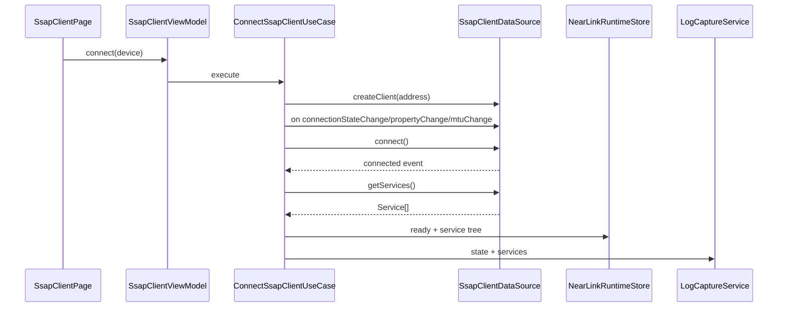

# SSAP Client、服务属性与 MTU 设计

## 1. 官方能力边界

依据 WSL SSAP 官方文档：

1. `ssap.createClient(address)` 创建 Client，起始 5.0.1(13)。
2. SSAP API 仅 Stage 模型可用。
3. 需要 `ACCESS_NEARLINK`。
4. 一个应用针对一个远端设备只需要创建一次 Client 实例。
5. `client.connect()` 连接远端服务端。
6. `client.disconnect()` 断开已有连接或终止正在建立的连接。
7. `client.close()` 关闭 Client，关闭后实例不可再用。
8. `client.getServices()` 获取服务端服务列表。
9. `client.readProperty()`、`client.writeProperty()` 读写属性。
10. `client.setPropertyNotification()` 订阅属性变化。
11. `client.on('propertyChange')` 接收属性变化。
12. `client.on('connectionStateChange')` 监听连接状态。
13. `client.requestMtuSize(mtu)` 发起 MTU 协商，范围 [22,512]，默认 256。
14. `client.on('mtuChange')` 接收协商后的 MTU。

## 2. 功能范围

首期实现：

1. 创建 Client。
2. 连接/断开。
3. 连接状态监听。
4. 服务发现。
5. Service/Property 树展示。
6. Property 读取。
7. Property 写入。
8. Property 通知开启/关闭。
9. MTU 请求。
10. MTU 变化日志。
11. SSAP 命令模板。

SSAP Server 作为后续功能预留。

## 3. 页面设计

### 3.1 SsapClientPage

区域：

1. 设备栏：设备名、随机地址、RSSI、支持状态。
2. 连接栏：连接状态、Client 状态、MTU。
3. 服务树：serviceUuid、propertyUuid、权限、notify 状态。
4. 属性操作：读、写、订阅、取消订阅。
5. 终端日志：read/write/notify/connection/mtu。
6. 命令模板：绑定 serviceUuid/propertyUuid。

按钮状态：

| 状态 | 连接 | 服务发现 | 读写 | 通知 | MTU |
| --- | --- | --- | --- | --- | --- |
| idle | 可用 | 禁用 | 禁用 | 禁用 | 禁用 |
| connecting | 禁用 | 禁用 | 禁用 | 禁用 | 禁用 |
| connected | 禁用 | 可用 | 禁用 | 禁用 | 可用 |
| ready | 禁用 | 可刷新 | 可用 | 可用 | 可用 |
| closed | 可重新创建 | 禁用 | 禁用 | 禁用 | 禁用 |

## 4. 数据流向

### 4.1 连接与服务发现



### 4.2 属性写入

```text
SsapClientViewModel.writeProperty()
  -> CommandEncoder
  -> SsapOperationQueue.enqueue(write)
  -> client.writeProperty(property)
  -> LogCaptureService.append(outbound)
  -> update property lastValueRef
```

### 4.3 属性通知

```text
client.on('propertyChange')
  -> SsapPropertyChangeDispatcher
  -> LogCaptureService.append(inbound)
  -> PropertyLiveValueStore
  -> UI refresh/chart
```

## 5. 状态模型

```text
SsapClientRuntimeState
  idle
  creating
  connecting
  connected
  discovering
  ready
  reading
  writing
  subscribing
  disconnecting
  closed
  failed
```

MTU 状态：

```text
SsapMtuState
  default
  requesting
  negotiated
  failed
```

## 6. 数据模型

### 6.1 SsapClientSession

```text
SsapClientSession
  sessionId
  deviceId
  randomAddress
  clientInstanceId
  state
  mtu: number
  services: SsapServiceNode[]
  bytesIn
  bytesOut
  lastEventAtMs
```

### 6.2 SsapServiceNode

```text
SsapServiceNode
  serviceUuid
  properties: SsapPropertyNode[]
  raw?
```

### 6.3 SsapPropertyNode

```text
SsapPropertyNode
  serviceUuid
  propertyUuid
  permissions: read | write | notify | unknown[]
  notifyState: disabled | enabling | enabled | disabling | failed
  lastValueRef?
  lastUpdatedAtMs?
```

### 6.4 SsapPropertyCommand

```text
SsapPropertyCommand
  serviceUuid
  propertyUuid
  encoding: text | hex | base64
  payload
  expectNotify
  timeoutMs
```

## 7. 操作队列

SSAP 操作也必须串行：

```text
SsapOperationQueue
  readProperty
  writeProperty
  setPropertyNotification
  requestMtuSize
```

原因：

1. 避免 UI 快速点击造成状态错乱。
2. MTU 协商、服务发现、读写需要稳定顺序。
3. 日志顺序必须可复现。

## 8. MTU 策略

1. 默认 256。
2. 用户输入范围 [22,512]。
3. 请求前校验范围。
4. 请求后等待 `mtuChange` 更新最终值。
5. 写入分片按协商后 MTU 计算。
6. 未收到 `mtuChange` 时保留默认值并记录 warning。

## 9. 资源释放

关闭顺序：

1. 停止周期发送。
2. 取消属性通知。
3. `off('propertyChange')`。
4. `off('connectionStateChange')`。
5. `off('mtuChange')`。
6. `disconnect()`，如果处于连接或连接中。
7. `close()`。
8. 状态进入 closed。

## 10. 错误与降级

| 场景 | appCode | 处理 |
| --- | --- | --- |
| createClient 失败 | `YW-NL-2101` | 重新扫描设备 |
| connect 失败 | `YW-NL-2102` | 重试或检查开关 |
| getServices 失败 | `YW-NL-2103` | 允许刷新 |
| readProperty 失败 | `YW-NL-2201` | 标注不可读或权限不足 |
| writeProperty 失败 | `YW-NL-2202` | 检查属性权限 |
| setNotification 失败 | `YW-NL-2301` | 标注不可订阅 |
| MTU 超范围 | `YW-NL-2401` | 表单阻止 |
| MTU 协商失败 | `YW-NL-2402` | 使用默认 MTU |

## 11. 验证清单

1. 一个远端只创建一个 Client。
2. connect 前注册 connectionStateChange。
3. 连接成功后 getServices。
4. 服务树展示。
5. readProperty。
6. writeProperty。
7. propertyChange 订阅。
8. 取消 propertyChange。
9. requestMtuSize 22/512/非法值。
10. mtuChange 更新 UI。
11. disconnect。
12. close 后实例不可复用。
13. NearLink 关闭时状态更新。
14. 日志保留 property payload。
