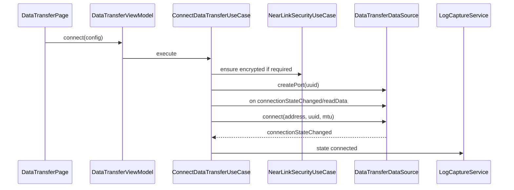

# dataTransfer 端口数传、配对加密与拥塞设计

## 1. 官方能力边界

依据 WSL dataTransfer 官方文档：

1. dataTransfer 起始 5.1.0(18)。
2. API 仅 Stage 模型可用。
3. 需要 `ACCESS_NEARLINK`。
4. `dataTransfer.createPort(uuid)` 注册端口通道。
5. `dataTransfer.destroyPort(uuid)` 销毁端口通道。
6. `dataTransfer.connect(params)` 建立端口通道。
7. `dataTransfer.disconnect(params)` 断开远端设备，销毁端口通道。
8. `dataTransfer.on('connectionStateChanged')` 监听端口连接状态。
9. `dataTransfer.getConnectionState(params)` 查询端口连接状态。
10. `dataTransfer.writeData(params)` 发送数据。
11. `dataTransfer.on('readData')` 接收数据。
12. `createPort` 可能返回 `1009700020 UUID already registered` 和 `1009700021 port upper limit`。
13. `destroyPort` 未注册 UUID 返回 `1009700022`。
14. `writeData` 拥塞返回 `1009700023 Write data congest`。
15. 数据传输通道不保证链路加密；如需加密，需先通过 `remoteDevice.startPairing()` 配对，并通过 `getAcbState` 查询 `ENCRYPTED`。

## 2. 功能范围

首期实现：

1. Port UUID 输入/选择/收藏。
2. createPort。
3. connectionStateChanged。
4. readData。
5. connect。
6. writeData。
7. disconnect。
8. destroyPort。
9. getConnectionState。
10. 文本/hex/base64 发送。
11. 周期发送。
12. 拥塞退避。
13. 可选配对加密。

## 3. 页面设计

### 3.1 DataTransferPage

区域：

1. 设备栏：设备、随机地址、RSSI。
2. Port 栏：UUID、MTU、port 状态。
3. 安全栏：是否要求加密、配对状态、ACB 状态。
4. 连接栏：连接状态、connect/disconnect。
5. 终端区：收发日志。
6. 输入区：编码、payload、发送、周期发送。
7. 资源区：destroyPort、导出日志。

按钮状态：

| 状态 | createPort | connect | send | disconnect | destroy |
| --- | --- | --- | --- | --- | --- |
| idle | 可用 | 禁用 | 禁用 | 禁用 | 禁用 |
| portReady | 禁用 | 可用 | 禁用 | 禁用 | 可用 |
| connecting | 禁用 | 禁用 | 禁用 | 可用 | 禁用 |
| connected | 禁用 | 禁用 | 可用 | 可用 | 禁用 |
| congested | 禁用 | 禁用 | 暂停 | 可用 | 禁用 |
| disconnected | 禁用 | 可用 | 禁用 | 禁用 | 可用 |

## 4. 数据流向

### 4.1 端口创建和连接



### 4.2 收发

```text
write:
  CommandEncoder
    -> DataTransferPacketizer
    -> DataTransferWriteQueue
    -> dataTransfer.writeData({ address, uuid, data })
    -> outbound log

read:
  dataTransfer.on('readData')
    -> inbound log
    -> terminal UI
```

## 5. 状态模型

```text
DataTransferRuntimeState
  idle
  creatingPort
  portReady
  pairing
  checkingEncryption
  connecting
  connected
  sending
  congested
  disconnecting
  disconnected
  destroyingPort
  closed
  failed
```

安全状态：

```text
NearLinkSecurityState
  notRequired
  unknown
  pairing
  paired
  encrypted
  notEncrypted
  failed
```

## 6. 数据模型

### 6.1 DataTransferPortConfig

```text
DataTransferPortConfig
  uuid
  mtu?: number
  secureRequired: boolean
  autoReconnect: boolean
  congestionPolicy: CongestionPolicy
```

### 6.2 DataTransferConnectionParams

```text
DataTransferConnectionParams
  address
  uuid
  mtu?
```

### 6.3 DataTransferPacket

```text
DataTransferPacket
  direction
  address
  uuid
  payloadRef
  byteLength
  timestampMs
  sequence?
```

### 6.4 CongestionPolicy

```text
CongestionPolicy
  initialBackoffMs
  maxBackoffMs
  maxRetryCount
  stopRepeatOnCongest
```

## 7. 配对与加密

### 7.1 加密要求

因为官方明确 dataTransfer 不保证链路加密，所以：

1. 默认显示“加密状态未要求”。
2. 用户开启“要求加密”后，连接前必须执行安全检查。
3. 未配对时调用 `remoteDevice.createRemoteDevice(address)` 和 `startPairing()`。
4. 配对后调用 `getAcbState`，仅 `ENCRYPTED` 可标记为已加密。
5. 若 API 未验证或状态不可读，不能显示“已加密”，只能显示“未确认”。

### 7.2 安全数据流

```text
ConnectDataTransferUseCase
  -> if secureRequired
       PairNearLinkDeviceUseCase.startPairing()
       QueryAcbStateUseCase.getAcbState()
       require ENCRYPTED
  -> createPort/connect
```

## 8. 拥塞处理

`1009700023 Write data congest` 处理：

1. 当前写任务进入 congested。
2. 暂停周期发送。
3. 按 `CongestionPolicy` 退避。
4. 重试成功后恢复。
5. 超过最大次数后停止发送并记录 error。

不允许：

1. 拥塞时无限重试。
2. 拥塞时继续入队大量 payload。
3. 隐藏拥塞错误。

## 9. 资源释放

正常断开：

1. 停止周期发送。
2. 清空写队列。
3. `disconnect(params)`。
4. `off('readData')`。
5. `off('connectionStateChanged')`。
6. `destroyPort(uuid)`。
7. 状态 closed。

异常断开：

1. 查询 `getConnectionState`。
2. 若 port 仍注册，允许 destroy。
3. 若 UUID not registered，标记已释放，不重复报错。

## 10. 错误与降级

| native | appCode | 处理 |
| --- | --- | --- |
| 201 | `YW-PERM-3001` | 请求权限 |
| 401 | `YW-NL-3101` | 参数非法 |
| 801 | `YW-CAP-3001` | dataTransfer 不支持 |
| 1009700003 | `YW-NL-1002` | NearLink 关闭 |
| 1009700020 | `YW-NL-3201` | UUID 已注册，提示复用/销毁 |
| 1009700021 | `YW-NL-3202` | port 达上限 |
| 1009700022 | `YW-NL-3203` | UUID 未注册 |
| 1009700023 | `YW-NL-3301` | 写拥塞退避 |
| 1009700099 | `YW-NL-3099` | 通用失败 |

## 11. 验证清单

1. createPort 成功。
2. UUID 重复注册。
3. port 上限。
4. connect 成功。
5. connectionStateChanged。
6. readData。
7. writeData。
8. writeData 拥塞。
9. disconnect。
10. destroyPort。
11. destroy 未注册 UUID。
12. secureRequired 配对流程。
13. ACB ENCRYPTED 才显示已加密。
14. API 不支持 dataTransfer 降级。
15. 周期发送遇拥塞暂停。
