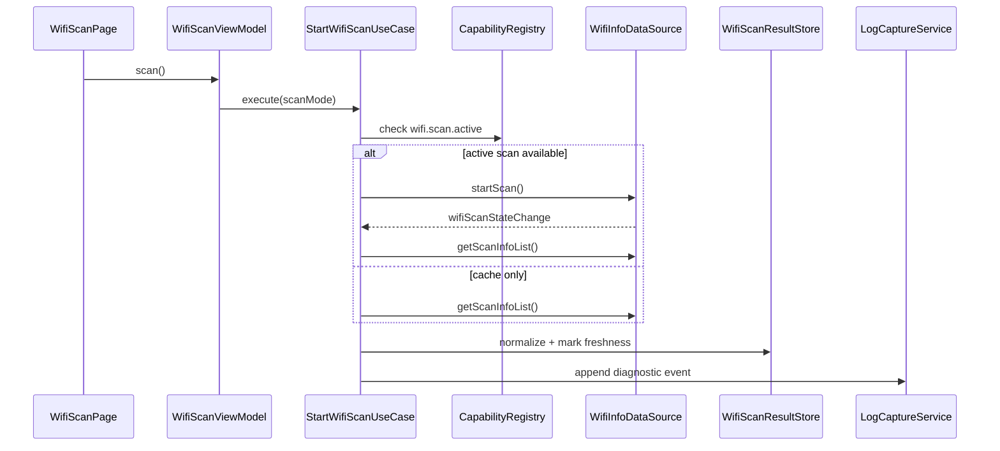

# WiFi 扫描、STA 信息与环境分析设计

## 1. 官方能力边界

依据 WSL WLAN 官方文档：

1. `wifiManager.isWifiActive()` 查询 WLAN 是否开启。
2. `wifiManager.enableWifi15+` 和 `disableWifi20+` 需要 `SET_WIFI_INFO`，并且还依赖系统应用 `MANAGE_WIFI_CONNECTION` 或企业应用 `MANAGE_ENTERPRISE_WIFI_CONNECTION`，普通应用不应作为默认能力。
3. `wifiManager.startScan21+` 前台两分钟最多扫描四次，后台三十分钟最多一次；需要 `SET_WIFI_INFO`。
4. WiFi 扫描指南仍强调应用侧主要通过 `getScanInfoList()` 获取扫描结果，并说明替代主动扫描接口仅向系统应用开放；因此设计必须支持“读取缓存结果”路径。
5. 获取扫描结果需要 `GET_WIFI_INFO`，真实 BSSID 可能需要 `GET_WIFI_PEERS_MAC` 或位置相关权限，且 PRD 已将真实 MAC 能力列为验证项。
6. WiFi 连接过程中、温度达到阈值、后台场景等会触发扫描管控。
7. STA 模式可通过 `wifiStateChange`、`wifiConnectionChange` 监听 WiFi 开关和连接变化。
8. `getLinkedInfo()` 获取当前连接信息。
9. `getSignalLevel(rssi, band)` 可将 RSSI 映射为信号等级。

## 2. 功能范围

首期实现：

1. WiFi 开关状态展示。
2. 当前连接信息展示。
3. WiFi 扫描结果读取。
4. 可用时触发主动扫描。
5. 扫描频率冷却和后台降级。
6. RSSI 等级和曲线。
7. 信道占用图。
8. BSSID/SSID 脱敏展示。
9. WiFi 连接状态时间线。

预留：

1. 添加候选网络。
2. 连接指定 WiFi。
3. WiFi 开关控制。
4. P2P 和热点。

## 3. 页面设计

### 3.1 WifiOverviewPage

区域：

1. WiFi 状态：启用、禁用、启用中、禁用中、未知。
2. 当前连接：SSID、BSSID 可见性、RSSI、等级、频段、IP、网关、DNS。
3. 权限状态：GET_WIFI_INFO、GET_WIFI_PEERS_MAC、SET_WIFI_INFO。
4. 最近扫描摘要：AP 数量、更新时间、缓存/主动扫描标记。
5. 快捷入口：扫描环境、网络诊断、LAN 发现、Socket、HTTP。

### 3.2 WifiScanPage

操作：

1. 刷新缓存结果。
2. 主动扫描，若能力可用。
3. 筛选 SSID。
4. 频段筛选。
5. 信号强度筛选。
6. 安全类型筛选。
7. 导出扫描结果。

展示：

1. AP 列表。
2. 信道图。
3. RSSI 趋势。
4. 扫描管控提示。
5. 结果时间戳。

## 4. 数据流向

### 4.1 加载 WiFi 总览

```text
WifiOverviewViewModel.load()
  -> EnsurePermissionUseCase(GET_WIFI_INFO)
  -> WifiInfoRepository.getWifiState()
  -> WifiInfoRepository.getLinkedInfo()
  -> WifiInfoRepository.observeWifiStateChange()
  -> WifiInfoRepository.observeWifiConnectionChange()
  -> WifiOverviewUiState
```

### 4.2 扫描/读取结果



## 5. 状态模型

```text
WifiScanState
  idle
  checkingPermission
  checkingCapability
  coolingDown
  activeScanning
  readingCache
  completed
  limited
  failed
```

状态解释：

1. `coolingDown`：前台两分钟四次限制或自定义冷却未过。
2. `activeScanning`：确实调用了可用主动扫描 API。
3. `readingCache`：只读取系统扫描缓存。
4. `limited`：权限、后台、温控、连接过程或系统策略导致无法主动扫描。

## 6. 数据模型

### 6.1 WifiLinkedInfoSnapshot

```text
WifiLinkedInfoSnapshot
  capturedAtMs
  wifiActive: boolean
  connected: boolean
  ssid?: string
  bssid?: string
  bssidVisible: boolean
  rssi?: number
  signalLevel?: number
  band?: number
  frequency?: number
  linkSpeed?: number
  ipAddress?: string
  gateway?: string
  dnsServers: string[]
  raw?: string
```

### 6.2 WifiAccessPointSnapshot

```text
WifiAccessPointSnapshot
  id
  ssid
  bssid?
  bssidVisible
  bssidMaskReason?: permissionDenied | unavailable | hidden
  rssi
  signalLevel
  band
  frequency
  channel
  channelWidth?
  securityType?
  capabilities?
  timestamp?
  supportedWifiCategory?
  isHiLinkNetwork?
  source: activeScan | cache
  capturedAtMs
```

### 6.3 WifiScanPolicy

```text
WifiScanPolicy
  activeScanSupported: boolean
  foregroundLimitWindowMs: 120000
  foregroundLimitCount: 4
  backgroundLimitWindowMs: 1800000
  backgroundLimitCount: 1
  appCooldownMs
  cacheMaxAgeMs
```

## 7. 权限策略

| 能力 | 权限 | UI 行为 |
| --- | --- | --- |
| WiFi 开关状态 | 无或 GET_WIFI_INFO，按 API 实测 | 可显示基础状态 |
| 链路信息 | `GET_WIFI_INFO` | 缺失则显示授权入口 |
| 扫描结果 | `GET_WIFI_INFO` | 缺失则不读取 |
| 真实 BSSID | `GET_WIFI_PEERS_MAC` 或其他平台要求 | 缺失则脱敏/不可见 |
| 主动扫描 | `SET_WIFI_INFO` + API/策略 | 缺失则读取缓存 |
| 开关 WiFi | 系统/企业权限 | 普通应用隐藏主入口 |

## 8. 信道与 RSSI

信道计算：

1. 2.4GHz：根据 frequency 映射 1-14。
2. 5GHz/6GHz：按标准频点映射。
3. 未识别频率进入 unknown channel。

RSSI：

1. 原始 RSSI 保留。
2. UI 等级使用 `getSignalLevel` 或本地 fallback。
3. RSSI 曲线以 AP id + timestamp 存储，不覆盖历史。

## 9. 降级与错误

| 场景 | appCode | 处理 |
| --- | --- | --- |
| 无 GET_WIFI_INFO | `YW-PERM-2002` | 请求权限 |
| 无 GET_WIFI_PEERS_MAC | `YW-PERM-2003` | BSSID 脱敏 |
| 主动扫描不可用 | `YW-WIFI-1001` | 读取缓存并标注 |
| 扫描频率受限 | `YW-WIFI-1002` | 进入冷却倒计时 |
| WiFi 关闭 | `YW-WIFI-1003` | 引导系统设置 |
| 扫描结果过旧 | `YW-WIFI-1004` | 显示缓存时间警告 |

## 10. 验证清单

1. 无权限加载总览。
2. 授权后读取 linked info。
3. BSSID 权限缺失时脱敏。
4. 获取扫描缓存。
5. 主动扫描 API 可用时触发扫描。
6. 前台两分钟四次限制。
7. 后台扫描降级。
8. WiFi 关闭状态。
9. WiFi 连接过程中扫描失败提示。
10. 信道图频点映射。
11. RSSI 曲线连续刷新。
12. 导出不泄露未授权 BSSID。
