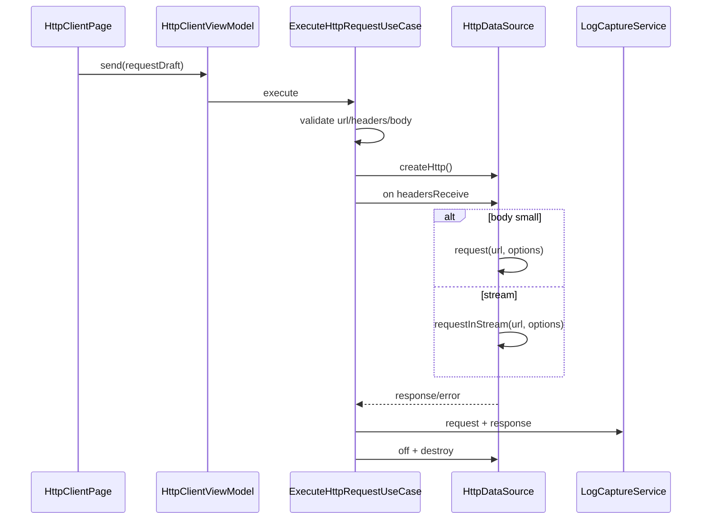

# HTTP、WebSocket 与 MQTT 调试设计

## 1. 官方能力边界

依据 WSL Network Kit 官方文档：

1. `http.createHttp()` 创建 `HttpRequest`，每个对象对应一个 HTTP 请求任务，不可复用。
2. HTTP 请求使用完必须 `destroy()`，否则会内存泄漏。
3. 普通 `request` 默认只接收 5MB 以内数据；API 23 起最大接收 50MB，较大响应应设置 `maxLimit` 或使用 `requestInStream`。
4. HTTP 错误码映射为 `2300000 + curl 错误码`。
5. URL 含中文或其他语言时需编码后请求。
6. WebSocket Client 需先 `createWebSocket()`，再 `connect()`。
7. WebSocket `connect` callback/Promise 的 boolean 只表示连接请求创建是否成功，真实连接成功必须订阅 `open`。
8. WebSocket URL 长度限制随 API 变化：早期 1024，API 15 为 2048，API 26 为 8196。
9. WebSocket 单次发送最大支持 `5 * 1024 * 1024 - 16` 字节。
10. WebSocket Server API 23 起全设备支持；此前仅 TV。
11. WebSocket Server 需要先 `createWebSocketServer()`，再 `start()`，连接通过 `connect` 事件感知。

## 2. HTTP 调试

### 2.1 页面功能

1. Method：GET、POST、PUT、PATCH、DELETE、HEAD、OPTIONS、TRACE、CONNECT。
2. URL。
3. Query 参数编辑。
4. Header 编辑。
5. Body：none、text、JSON、form、multipart、binary file。
6. Timeout：connect/read。
7. 代理：系统代理、禁用代理、SOCKS5。
8. TLS：系统 CA、caPath、caData、clientCert、certificatePinning。
9. 响应展示：status、headers、cookies、timing、body。
10. 大响应流式下载。
11. 保存为命令模板。
12. 导出请求/响应。

### 2.2 数据流



### 2.3 模型

```text
HttpRequestDraft
  id
  method
  url
  queryParams: KeyValueParam[]
  headers: KeyValueParam[]
  body: HttpBodyDraft
  connectTimeoutMs
  readTimeoutMs
  expectDataType
  maxLimitBytes
  followRedirects
  proxyConfig?
  tlsConfig?
```

```text
HttpResponseRecord
  requestId
  responseCode
  headers
  cookies
  resultType
  bodyRef?
  bodySize
  timing
  connectionExtraInfo?
  nativeCode?
```

### 2.4 资源释放

必须使用 finally：

```text
try request
catch map error
finally
  off('headersReceive')
  destroy()
```

### 2.5 大响应策略

1. 默认 `maxLimit` 5MB。
2. 用户超过阈值时提示使用流式。
3. `requestInStream` 写入 payload 文件，不进入 UI 内存。
4. UI 只展示前 N KB 预览。

## 3. WebSocket Client

### 3.1 页面功能

1. URL。
2. Header。
3. TLS 参数。
4. 连接/断开。
5. open/message/close/error 时间线。
6. 文本/bytes 发送。
7. 周期发送。
8. ping/pong 参数，若平台支持则映射。
9. 自动重连。

### 3.2 状态

```text
WebSocketClientState
  idle
  creating
  connectingRequestCreated
  open
  sending
  closing
  closed
  reconnecting
  failed
```

关键规则：

1. `connect()` 返回 true 后只能进入 `connectingRequestCreated`，不能标记为 `open`。
2. 只有收到 `open` 事件才能允许发送。
3. `message` 事件进入 inbound 日志。
4. `close` 事件附 code/reason。
5. `error` 事件保留 nativeCode。

### 3.3 数据模型

```text
WebSocketConfig
  url
  headers
  tlsConfig?
  autoReconnect
  heartbeat?
  maxMessageBytes
```

```text
WebSocketMessageRecord
  direction
  messageType: text | binary
  payloadRef
  timestampMs
  connectionId
```

## 4. WebSocket Server

### 4.1 能力探测

`websocket.server` 能力：

1. API >= 23：全设备可尝试启用。
2. API < 23：仅 TV，Phone/Tablet/PC 隐藏或标记不可用。
3. 端口占用和防火墙/网络策略需运行时验证。

### 4.2 功能

1. 设置监听端口。
2. start。
3. connect 事件。
4. listAllConnections。
5. 单客户端发送。
6. 广播发送。
7. close client。
8. stop server。
9. messageReceive 日志。

### 4.3 模型

```text
WebSocketServerRuntime
  sessionId
  serverPort
  state
  clients: WebSocketClientConnection[]

WebSocketClientConnection
  id
  clientIP
  clientPort
  connectedAtMs
  bytesIn
  bytesOut
```

## 5. MQTT 调试

### 5.1 能力选型

HarmonyOS Network Kit 不直接提供 MQTT API。首期架构保留三种实现路线：

1. 纯 ArkTS MQTT 客户端库。
2. MQTT over WebSocket。
3. 自研轻量 MQTT 编解码 + TCP。

选型标准：

1. 是否支持 HarmonyOS ArkTS。
2. 是否支持 QoS 0/1/2。
3. 是否支持 TLS。
4. 是否可取消、可重连。
5. 是否能接入统一日志且不泄露密码。

### 5.2 功能

1. Broker host/port。
2. ClientId。
3. username/password。
4. clean session。
5. keepAlive。
6. connect/disconnect。
7. subscribe/unsubscribe。
8. publish。
9. QoS。
10. retain。
11. topic 历史。
12. 消息日志。

### 5.3 模型

```text
MqttConnectionConfig
  brokerHost
  brokerPort
  transport: tcp | websocket
  clientId
  username?
  passwordSecretRef?
  cleanSession
  keepAliveSec
  tlsConfig?

MqttMessageRecord
  topic
  qos
  retain
  direction
  payloadRef
  packetType
  packetId?
```

## 6. 安全与脱敏

默认脱敏：

1. Authorization。
2. Cookie。
3. Set-Cookie。
4. Proxy-Authorization。
5. MQTT username/password。
6. TLS key password。

导出提醒：

1. Body/payload 默认可能包含敏感数据。
2. 用户选择包含原始 payload 时需要二次确认。

## 7. 错误映射

| 场景 | appCode | 处理 |
| --- | --- | --- |
| HTTP DNS 失败 2300006 | `YW-NET-3001` | 检查域名/DNS |
| HTTP 连接失败 2300007 | `YW-NET-3002` | 检查 host/port |
| HTTP timeout 2300028 | `YW-NET-3003` | 调整 timeout |
| HTTP 超限 | `YW-NET-3004` | 使用 stream/maxLimit |
| HTTP 未 destroy | `YW-NET-3005` | 代码审查阻断 |
| WebSocket url error 2302001 | `YW-NET-3101` | 校验 URL |
| WebSocket 已存在 2302003 | `YW-NET-3102` | 先关闭旧连接 |
| WebSocket 未 open 发送 | `YW-NET-3103` | 禁用发送 |
| WebSocket Server 不支持 | `YW-CAP-3101` | 隐藏 server |
| MQTT 库不可用 | `YW-CAP-3201` | 降级为预留 |

## 8. 验证清单

1. HTTP 每次请求独立 createHttp。
2. 成功、失败、取消均 destroy。
3. headersReceive 订阅和 off。
4. 5MB 默认限制提示。
5. requestInStream 大响应落盘。
6. URL 编码。
7. TLS 参数错误映射。
8. WebSocket connect true 不直接标记 open。
9. open 前发送按钮禁用。
10. message/close/error 日志。
11. WebSocket 单包超限。
12. WebSocket Server API 23 能力探测。
13. MQTT over TCP/WebSocket 选型验证。
14. 导出脱敏。
