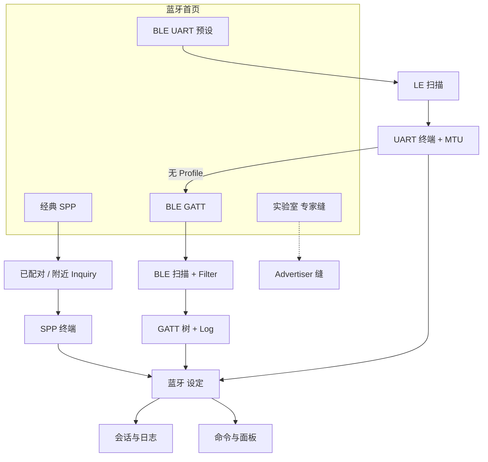

# 02-蓝牙模块 — 功能清单索引

> **状态：架构定稿配套 · 2026-07-23**  
> **基线目录**：`.projectark/7-UIUX设计/无线调试工具/01-功能清单/02-蓝牙模块/`  
> **全局对照**：[`00-全局能力边界与PRD对照.md`](../00-全局能力边界与PRD对照.md)  
> **总册**：[`00-蓝牙功能总清单与优先级矩阵.md`](00-蓝牙功能总清单与优先级矩阵.md)

---

## 1. 模块定位

YoWire 蓝牙模块采用 **三路径并列 IA**，对标不同竞品基准，统一后端 SessionLog/Command，**无全局日志中心**：

| 路径 | 竞品基准 | 功能清单 | 定稿要点 |
| --- | --- | --- | --- |
| **BLE GATT 调试** | nRF Connect 4.29.x | [`01-BLE-GATT全量功能清单.md`](01-BLE-GATT全量功能清单.md) | 多 Session≤4（P1）；Mask Filter P0 |
| **经典 SPP 终端** | SimpleBluetoothTerminal | [`02-经典SPP功能清单.md`](02-经典SPP功能清单.md) | 单活跃写；TX 队列；Inquiry 增值 |
| **BLE UART 串口预设** | SimpleBluetoothLeTerminal | [`03-BLE-UART功能清单.md`](03-BLE-UART功能清单.md) | 独立 L1；Nordic P0；失败→GATT |
| **BLE 实验室/高级** | nRF Advertiser/Server/DFU/Macros | [`04-BLE实验室与高级功能清单.md`](04-BLE实验室与高级功能清单.md) | **仅架构缝**，v1 不承诺 |

---

## 2. 阅读顺序

| 顺序 | 文档 | 读者场景 |
| --- | --- | --- |
| 0 | `../00-全局能力边界与PRD对照.md` | IA、SessionLog、跨模块边界 |
| 1 | **`00-蓝牙功能总清单与优先级矩阵.md`** | **优先级与实现状态总表（必读）** |
| 2 | 本文 README | 索引与 ID 命名规范 |
| 3 | `01-BLE-GATT` | BLE 主入口；缺口见 §18 |
| 4 | `02-经典SPP` / `03-BLE-UART` | 终端路径；缺口见各分册回写节 |
| 5 | `04-BLE实验室` | P2/P3 缝 |

**架构设计**：`.projectark/5-架构设计/无线调试工具/bluetooth/README.md`（`00`～`06`）。

**深研源稿**（只读引用）：`.research/feature-inventory/` 下 nRF / SPP / UART / Gap 矩阵文档。

**PRD**：`.projectark/2-需求文档/无线调试工具/PRD/03-蓝牙模块PRD.md`

---

## 3. Feature ID 命名规范

| 前缀 | 含义 | 示例 |
| --- | --- | --- |
| `S-*` | nRF Scanner Tab | S-01 实时列表 |
| `B-*` | nRF Bonded Tab | B-01 bond 列表 |
| `CM-*` | Connection ⋮ 菜单 | CM-07 Request MTU |
| `LOG-*` | Log pane 控件 | LOG-04 四图标 |
| `SET-*` | Settings 持久项 | SET-CONN-06 Auto MTU |
| `SET-FIL-*` | Filter Sheet 维 | SET-FIL-10 Mfg Mask |
| `GATT-*` | GATT 树操作 | GATT-08 Reliable Write |
| `B-SPP-*` | YoWire 经典 SPP | B-SPP-09 Inquiry |
| `B-UART-*` | YoWire BLE UART | B-UART-C-04 Profile 匹配 |
| `BT-BASE-*` | 总册公共底座 | BT-BASE-04 stop-before-connect |
| `ADV-*` / `GSRV-*` / `DFU-*` | 实验室 | ADV-06 Discoverable |
| `MAC-*` | Macros UI/ops | MAC-UI-05 Step Over |

**Gap 分级**：以 **`00` 总册** 为准（多 GATT 为 P1；实验室为 P3 缝）。

---

## 4. 三路径 IA 关系图

---

## 5. v1 必达 vs 实验室（速查）

| P0 必达（三路径） | P1 专家 | P2–P3 实验室缝 |
| --- | --- | --- |
| 双地址 + transport + stop-before-connect | 多 GATT≤4、命令面板、重连 UX | Advertiser、GATT Server |
| SPP 列表+Inquiry+终端+TX 队列 | 模块设定页、收藏别名 | DFU / Macros 28 |
| GATT 扫描+Mask+树 R/W/N/I+MTU+Log | CONNECT⋮、Reliable Write | Automated Tests |
| UART 独立页+Nordic+失败→GATT | 四 Profile | — |
| SessionLog；无全局日志中心 | 840vp 三分栏 | — |

---

## 6. 变更记录

| 日期 | 变更 |
| --- | --- |
| 2026-07-03 | 初稿：四份子清单 + 本 README |
| 2026-07-23 | 接入 `00` 总册；阅读顺序调整；多 GATT/实验室定稿对齐架构 |
