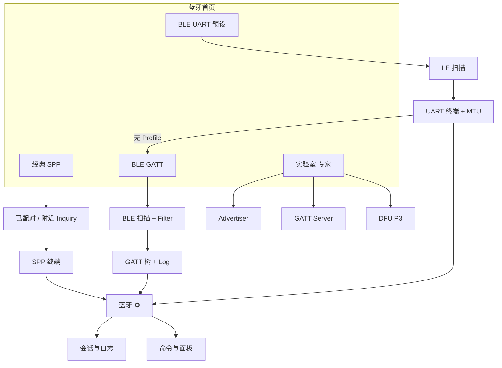

# 02-蓝牙模块 — 功能清单索引

> **状态：深研草稿，未定稿。**  
> **基线目录**：`.projectark/7-UIUX设计/无线调试工具/01-功能清单/02-蓝牙模块/`  
> **全局对照**：[`00-全局能力边界与PRD对照.md`](../00-全局能力边界与PRD对照.md)

---

## 1. 模块定位

YoWire 蓝牙模块采用 **三路径并列 IA**，对标不同竞品基准，统一后端 SessionLog/Command，**无全局日志中心**：

| 路径 | 竞品基准 | 功能清单 | 行数规模 | 深扩章节（2026-07-03） |
| --- | --- | --- | --- | --- |
| **BLE GATT 调试** | nRF Connect 4.29.x | [`01-BLE-GATT全量功能清单.md`](01-BLE-GATT全量功能清单.md) | **~500 行** | §13 GATT-OP · §14 CM-01~14 · §15 LOG SAVE · §16 Tests 27 · §17 Web |
| **经典 SPP 终端** | SimpleBluetoothTerminal | [`02-经典SPP功能清单.md`](02-经典SPP功能清单.md) | **~374 行** | §10 SPP-01~29 源码 · §11 YoWire 增值 · §12 Web · §13 追溯 |
| **BLE UART 串口预设** | SimpleBluetoothLeTerminal | [`03-BLE-UART功能清单.md`](03-BLE-UART功能清单.md) | ~280 行 | — |
| **BLE 实验室/高级** | nRF Advertiser/GATT Server/DFU/Macros | [`04-BLE实验室与高级功能清单.md`](04-BLE实验室与高级功能清单.md) | **~410 行** | §12 DFU Nordic URL · §13 Macros 28 FULL · §14 ADV · §15 GSRV |

**合计**：本模块功能清单 **~1560+ 行**（四份子清单 + 本 README；01/02/04 已深扩至 350+ 行）。

---

## 2. 阅读顺序

| 顺序 | 文档 | 读者场景 |
| --- | --- | --- |
| 0 | `00-全局能力边界与PRD对照.md` | IA、SessionLog、跨模块边界 |
| 1 | 本文 README | 索引与 ID 命名规范 |
| 2 | `01-BLE-GATT` | BLE 主入口；nRF 全量 ID；**深扩** GATT-OP/CM/LOG/Tests/Web | [`01`](01-BLE-GATT全量功能清单.md) ↔ [`04`](04-BLE实验室与高级功能清单.md) |
| 3 | `02-经典SPP` 或 `03-BLE-UART` | 终端类路径；SPP 含 SPP-01~29 源码对照 | [`02`](02-经典SPP功能清单.md) ↔ [`03`](03-BLE-UART功能清单.md) |
| 4 | `04-BLE实验室` | P2/P3 专家；DFU URL · Macros 28 · ADV/GSRV | [`04`](04-BLE实验室与高级功能清单.md) ↔ [`01`](01-BLE-GATT全量功能清单.md) §7/§16 |

**深研源稿**（只读引用，不替代本目录）：

- `.research/feature-inventory/01-nRF-Connect-BLE-全量功能清单-v2.md`
- `.research/feature-inventory/08-nRF-Connect-Scanner到Connection逐步流程-v2.md`
- `.research/feature-inventory/09-nRF-Connect-Settings与ReleaseNotes-v2.md`
- `.research/feature-inventory/11-nRF-Connect-Macros-28操作逐步流程-v2.md`
- `.research/feature-inventory/13-nRF-Connect-DFU与Connection菜单-v2.md`
- `.research/feature-inventory/19-经典SPP与BLE-UART-源码级逐步流程-v2.md`
- `.research/feature-inventory/21-nRF-Connect-UNKNOWN项交叉验证-v2.md`
- `.research/feature-inventory/22-YoWire-PRD与竞品能力差距矩阵-v2.md` §1–§3

**PRD**：`.projectark/2-需求文档/无线调试工具/PRD/03-蓝牙模块PRD.md`

---

## 3. Feature ID 命名规范

| 前缀 | 含义 | 示例 |
| --- | --- | --- |
| `S-*` | nRF Scanner Tab | S-01 实时列表 |
| `B-*` | nRF Bonded Tab | B-01 bond 列表 |
| `CM-*` | Connection ⋮ 菜单 | CM-07 Request MTU |
| `LOG-*` | Log pane 控件 | LOG-04 四图标 |
| `SET-*` | Settings 持久项 | SET-CONN-06 Auto MTU |
| `SET-FIL-*` | Filter Sheet 维 | SET-FIL-10 Mfg Mask |
| `GATT-*` | GATT 树操作 | GATT-08 Reliable Write |
| `B-SPP-*` | YoWire 经典 SPP | B-SPP-09 Inquiry |
| `B-UART-*` | YoWire BLE UART | B-UART-C-04 Profile 匹配 |
| `ADV-*` / `GSRV-*` / `DFU-*` | 实验室 | ADV-06 Discoverable |
| `MAC-*` | Macros UI/ops | MAC-UI-05 Step Over |

**Gap 分级**：P0 / P1 / P2 / P3 — 定义见 `00-全局` §4.3 与 `22-…` §8。

---

## 4. 三路径 IA 关系图

---

## 5. v1 必达 vs 实验室（速查）

| P0 必达（三路径） | P1 专家 | P2–P3 实验室 |
| --- | --- | --- |
| GATT 扫描+Mask+树 R/W/N/I+MTU+Log | Reliable Write、CONNECT⋮、Parse UUIDs | Advertiser、GATT Server |
| SPP 已配对+Inquiry+UUID+终端 | 自动重连、命令面板、周期发送 | DFU/McuMgr/SUIT |
| UART Nordic+MTU 展示+失败→GATT | 四 Profile、Filter、阶段条 | Macros 28-tag 全引擎 |
| SessionLog 导出；模块 ⚙ 可达 | 收藏持久化、840vp 三分栏 | ADB Automated Tests |

---

## 6. 模块 ⚙ 设置分组（速查）

| 分组 | 覆盖路径 | 详见 |
| --- | --- | --- |
| 会话与日志 | SPP / GATT / UART | `00-全局` §3.2 · `19` §3 |
| 命令与面板 | SPP 发送、BLE Write、Macro 步骤 | `01` §7 · `02` §5 |
| 经典蓝牙 | UUID、Inquiry | `02` §5 |
| BLE 扫描 | Filter 预设、PHY、mode | `01` §6 |
| BLE 连接 | MTU、auto discover、Profile | `03` §9 |
| BLE 高级 | RW、Parse、实验室门控 | `01` §6 · `04` |
| 收藏与设备 | 别名、持久化地址 | PRD §10 |
| 连接/后台 | 重连、后台通知 | `02` §2.5 · `00` §5.4 |

---

## 7. 宽屏文档交叉

| 路径 | 线框文档 |
| --- | --- |
| BLE GATT | `.research/feature-inventory/10-HarmonyOS-840vp-蓝牙模块三分栏线框-v2.md` |
| SPP + UART | `.research/feature-inventory/17-HarmonyOS-840vp-经典SPP与UART三分栏线框-v2.md` |
| 断点规范 | `.research/feature-inventory/07-HarmonyOS宽屏规范-深读摘要-v2.md` |

---

## 8. 下游消费者

| 消费者 | 用途 |
| --- | --- |
| UIUX V2 设计稿 | 页面级控件与状态矩阵 |
| `08-验收与状态` | 交互状态与空态验收 |
| 平台验证清单 | PHY/Channel/持久化地址 |
| 实现 Backlog | 按 P0→P1→P2 拆分 Story |

---

## 9. 变更记录

| 日期 | 变更 |
| --- | --- |
| 2026-07-03 | 初稿：四份子清单 + 本 README；自 `.research/feature-inventory` 迁入 01-功能清单 |
| 2026-07-03 | 更新行数与交叉链接：01/02/04 深扩至 350+ 行 |
