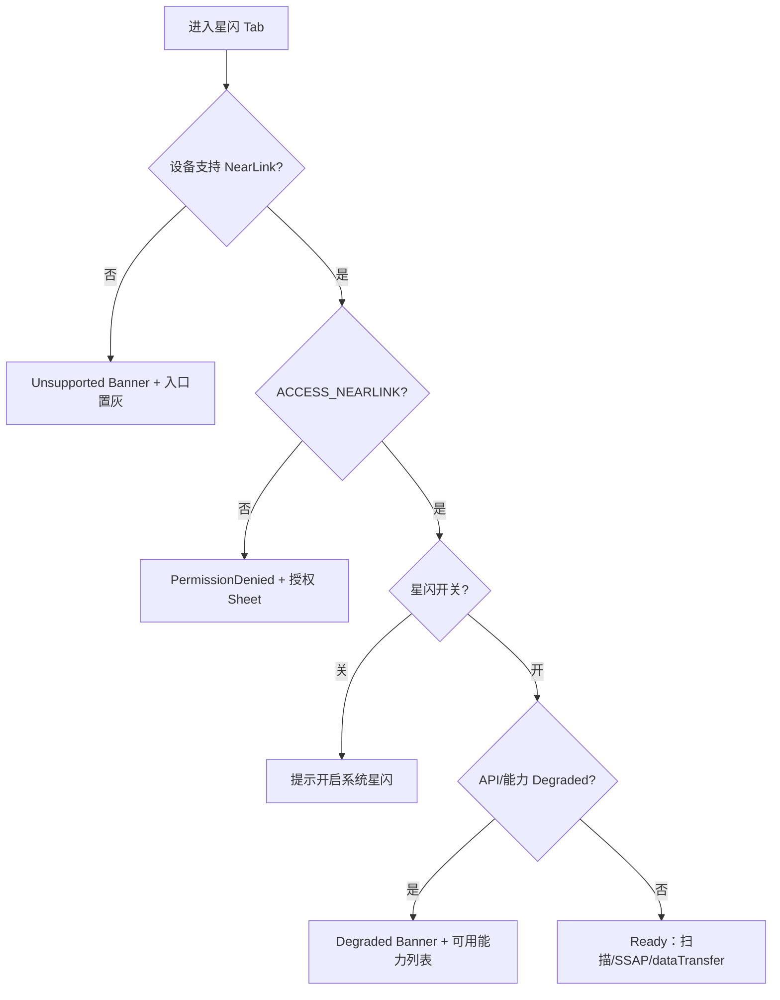

# 星闪全量功能清单

> **状态**：深研草稿  
> **证据**：`.research/feature-inventory/20-星闪模块-功能清单与逐步流程-v2.md`、`04-星闪与宽屏HarmonyOS-功能清单与布局重设计.md`  
> **PRD 映射**：`05-星闪模块PRD.md` · `06-权限后台兼容与降级PRD.md` §7.3 · 差距矩阵 `22` §6（NL-01～18）  
> **竞品**：**无 OSS**；UX 参照 nRF GATT（SSAP 树）+ SimpleBluetoothTerminal（dataTransfer 终端）  
> **IA 原则**：星闪 Tab 自治；⚙ **星闪设置**；无全局日志中心

---

## 1. 文档目的

将星闪模块能力枚举为 **N-NL-01～N-NL-14** 功能 ID 表，并展开 SSAP Client、dataTransfer、加密与配对、能力检测与降级、设置映射及宽屏要点。

---

## 2. 功能 ID 总表（N-NL-01～14）

| 功能 ID | 名称 | 分级 | PRD | Gap | 主 UI / 设置 |
| --- | --- | --- | --- | --- | --- |
| **N-NL-01** | 能力检测 Banner（Unsupported/Denied/Degraded/Ready） | 必须 | §4–§5 · 降级 §7.3 | P0 NL-01 | L0 顶栏下 |
| **N-NL-02** | 扫描列表：名称/随机地址/RSSI/发现次数 | 必须 | §6.2 | P0 NL-02 | B 栏列表 |
| **N-NL-03** | stopScan → 连接阶段条 | 必须 | §6.1 | P0 NL-02 | 连接前互斥 |
| **N-NL-04** | SSAP 服务树 Read/Write/Subscribe | 首期优先 | §7 | P0 NL-05 | C 栏树 60% |
| **N-NL-05** | Write Sheet + 高风险 Property 二次确认 | 必须 | §7.4 | P0 | Sheet / Dialog |
| **N-NL-06** | dataTransfer 终端（文本/HEX/换行） | 首期优先 | §8 · E-SBT-005 | P0 NL-08 | C Segmented 终端 |
| **N-NL-07** | 加密状态展示与 SessionLog 记录 | 必须 | §9 | P0 NL-09 | C **顶栏加密条** |
| **N-NL-08** | 收藏设备（别名+广播特征，非单地址） | 必须 | §10 | P1 NL-12 | B Segmented + **星闪 ⚙·收藏** |
| **N-NL-09** | 星闪设置·命令面板（SSAP Write + dataTransfer） | 必须 | §7.4/§8.3 | P1 NL-13 | **星闪 ⚙·命令与面板** |
| **N-NL-10** | 星闪设置·会话导出 TXT/CSV/JSON | 必须 | §8.3 | P0 NL-14 | **星闪 ⚙·会话与日志** |
| **N-NL-11** | SSAP MTU 请求 [22,512] 默认 256 | 首期优先 | §7.5 | P0 NL-06 | C 工具栏 MTU Chip |
| **N-NL-12** | dataTransfer Port UUID / MTU / 拥塞退避 | 首期优先 | §8 · nearlink/03 | P1 NL-11 | Port 栏 + 错误 1009700023 |
| **N-NL-13** | SSAP Server / Advertising | 架构预留 | §11 | P3 NL-16 | A 栏高级说明 |
| **N-NL-14** | 单连接优先 | 首期 | §3 · §12 风险 | P0 NL-07 | 连接管理器 |

**PRD 矩阵扩展**（doc 22，与本表交叉）：

| PRD ID | 映射 N-NL | 备注 |
| --- | --- | --- |
| NL-03 | N-NL-02 + Filter | 扫描过滤名/址，组 OR 内 AND |
| NL-04 | 广播详情 | §6.4，非独立 N-NL 编号 |
| NL-10 | 配对 startPairing | P1，**星闪 ⚙·连接** |
| NL-15 | Property 数值曲线 | P2，与 BLE Notify 曲线复用 |
| NL-17 | 840vp A/B/C | P1，doc 18 |
| NL-18 | Reliable Write / Parse UUIDs | P2 专家 |

---

## 3. 能力检测与降级（N-NL-01）

### 3.1 状态机



### 3.2 降级矩阵（R-PRD 06 §7.3）

| 受限项 ID | 受限项 | UI | 行为 |
| --- | --- | --- | --- |
| NL-DG-01 | 设备不支持星闪 | Banner「本机不支持」 | 扫描/连接置灰；设置隐藏 NearLink 专项 |
| NL-DG-02 | 无 `ACCESS_NEARLINK` | Banner + 授权 Sheet | 不扫描、不连接 |
| NL-DG-03 | 星闪开关关闭 | Banner + 系统设置引导 | **禁止**空白扫描页 |
| NL-DG-04 | 模拟器 | 真机提示 | PRD §5 |
| NL-DG-05 | dataTransfer 加密未知 | 显示「**未知**」 | **禁止**标记为已加密 |
| NL-DG-06 | 多连接未验证 | — | 限制单连接（N-NL-14） |
| NL-DG-07 | SSAP Server / Advertising 未开发 | 高级区说明或隐藏 | N-NL-13 预留 |

### 3.3 检测项展示（PRD §5）

| 检查项 ID | 检查项 | 展示 |
| --- | --- | --- |
| NL-CHK-01 | 设备是否支持 NearLink | 支持 / 不支持 / 无法确认 |
| NL-CHK-02 | 星闪开关 | 开 / 关 / 无法获取 |
| NL-CHK-03 | 权限 ACCESS_NEARLINK | 已授权 / 未授权 |
| NL-CHK-04 | API 版本 | 最低能力版本提示 |
| NL-CHK-05 | 支持协议 | Scan / SSAP / dataTransfer / Advertising |
| NL-CHK-06 | 模拟器 | 需真机 |

---

## 4. 模块 IA

```text
星闪首页（L0）
├── CapabilityBanner + 最近设备/收藏/活跃 Session
├── 扫描列表 ──→ 设备详情 ──→ SSAP 服务树 | dataTransfer 终端
├── 收藏设备 / 最近会话（deep link 模块内页）
└── ⚙ 星闪设置（NavDestination，非 Sheet）
```

**禁止**：Unsupported 时进入空白扫描（PRD §4 · NL-DG-01）。

---

## 5. 扫描（N-NL-02/03）

### 5.1 设备列表字段

| 字段 ID | 字段 | 要求 |
| --- | --- | --- |
| NL-SCN-01 | 设备名 | 广播 Local Name |
| NL-SCN-02 | 地址 | 随机地址 |
| NL-SCN-03 | RSSI | 若提供 |
| NL-SCN-04 | 最后发现时间 | |
| NL-SCN-05 | 发现次数 | 广播稳定性 |
| NL-SCN-06 | 广播摘要 | Service UUID / 厂商摘要 |
| NL-SCN-07 | 收藏状态 | N-NL-08 |

### 5.2 扫描过滤（PRD §6.3）

| 模式 | 能力 |
| --- | --- |
| 轻量 | 设备名搜索 |
| 专家 | 地址、设备名、过滤组；组间 **OR**、组内 **AND** |
| 空 Filter | 提示未生效 |

### 5.3 逐步流程 NL-01～06

| 步 ID | 用户动作 | 系统反馈 |
| --- | --- | --- |
| NL-01 | 进入星闪 Tab | CapabilityBanner |
| NL-02 | 开始扫描 | 权限+开关+支持检查 |
| NL-03 | 扫描中 | 列表 RSSI/名称/地址/发现次数 |
| NL-04 | 筛选（专家） | Filter Sheet |
| NL-05 | 点设备行 | **stopScan** → 设备详情 L1 |
| NL-06 | 查看广播详情 | RAW HEX / Local Name / Service Data / Manufacturer |

### 5.4 广播详情（PRD §6.4）

| 字段 ID | 字段 |
| --- | --- |
| NL-ADV-01 | 原始广播 HEX |
| NL-ADV-02 | Local Name |
| NL-ADV-03 | Discovery Level |
| NL-ADV-04 | Service Data 16/128 UUID |
| NL-ADV-05 | Manufacturer Data |
| NL-ADV-06 | 解析错误 → 仍展示原始 |

---

## 6. SSAP Client（N-NL-04/05/11）

### 6.1 连接阶段条（NL-A1～A5）

| 阶段 ID | UI 文案 | API |
| --- | --- | --- |
| NL-A1 | 连接中… | `ssap.createClient(address)` |
| NL-A2 | 正在连接 | `client.connect()` |
| NL-A3 | 请求 MTU | `requestMtuSize` [22,512] 默认 256 |
| NL-A4 | 发现服务 | `getServices()` |
| NL-A5 | Ready | 服务树可操作；**一设备一 Client** |

### 6.2 服务树节点

| 节点 | 展示 | 操作 |
| --- | --- | --- |
| Service | UUID、Handle、已知名称 | 展开 |
| Property | UUID、Handle、权限、值摘要 | Read / Write / Subscribe |

### 6.3 Property 操作 ID

| 操作 ID | 操作 | 要求 | 日志 |
| --- | --- | --- | --- |
| NL-SSAP-R01 | Read | 文本/HEX Sheet | 连接 Log pane |
| NL-SSAP-W01 | Write | Write Sheet；N-NL-05 高风险确认 | 同上 |
| NL-SSAP-N01 | Subscribe | Notify 开关；`propertyChange` | 同上 |
| NL-SSAP-D01 | 断开 | 保留 Log，可重连 | `disconnect`/`close` |

### 6.4 MTU（N-NL-11）

| 项 ID | 要求 |
| --- | --- |
| NL-MTU-01 | 展示当前 MTU |
| NL-MTU-02 | 用户请求 MTU |
| NL-MTU-03 | 订阅 `mtuChange` |
| NL-MTU-04 | Log 记录请求值与协商值 |
| NL-MTU-05 | 写入超 MTU → 提示分包或不可发送 |

**宽屏**：B 扫描列表 + C SSAP 树 + 下半 Log pane 40%（对齐 BLE GATT，`18` §2.1）。

---

## 7. dataTransfer 终端（N-NL-06/12）

### 7.1 连接阶段（NL-B1～B8）

| 步 ID | 阶段 | UI / 行为 |
| --- | --- | --- |
| NL-B1 | Port UUID | 输入/收藏/最近 |
| NL-B2 | createPort | idle → portReady |
| NL-B3 | connect | 阶段条；**检查加密状态** N-NL-07 |
| NL-B4 | 已连接 | 方向/时间/长度；HEX toggle；Clear 仅 UI |
| NL-B5 | 发送 | 文本/HEX + 换行 None/CR/LF/CRLF |
| NL-B6 | 接收 | 文本/HEX/混排；底层全记录 |
| NL-B7 | 拥塞 | 错误 `1009700023` → 暂停发送+退避 |
| NL-B8 | disconnect/destroyPort | 保留会话 Log |

### 7.2 终端能力 ID

| 能力 ID | 要求 |
| --- | --- |
| NL-DT-01 | 文本发送 |
| NL-DT-02 | HEX 发送 |
| NL-DT-03 | 接收：文本/HEX/混合 |
| NL-DT-04 | 换行：None/CR/LF/CRLF |
| NL-DT-05 | 周期发送 |
| NL-DT-06 | 命令面板快捷（N-NL-09） |
| NL-DT-07 | 统计：字节数、速率、错误数 |
| NL-DT-08 | 导出：TXT/CSV/JSON（N-NL-10） |

### 7.3 Port 配置（N-NL-12）

| 配置 ID | 配置 |
| --- | --- |
| NL-PORT-01 | UUID 双端一致；收藏/最近 |
| NL-PORT-02 | MTU 展示与配置 |
| NL-PORT-03 | 自动重连（**星闪 ⚙·连接**） |
| NL-PORT-04 | 拥塞退避策略 |

---

## 8. 加密与配对（N-NL-07 · PRD §9）

> 官方：dataTransfer **不保证**链路加密；需配对 + ACB `ENCRYPTED`。

| 场景 ID | 场景 | UI | 行为 |
| --- | --- | --- | --- |
| NL-C1 | 会话顶栏 | **已加密 / 未加密 / 未知** | 必须可见 |
| NL-C2 | 未加密 | 风险提示 Banner | 勿发敏感数据 |
| NL-C3 | 用户策略 | **星闪 ⚙·连接** | 未加密：提醒 / **禁止发送** |
| NL-C4 | 需加密 | 配对引导 | `startPairing` + `getAcbState` |
| NL-C5 | 状态变化 | 写入 SessionLog | |
| NL-C6 | 加密未知 | 显示「未知」 | NL-DG-05：**禁止**标为已加密 |

---

## 9. 收藏设备（N-NL-08 · PRD §10）

| 字段 ID | 字段 | 说明 |
| --- | --- | --- |
| NL-FAV-01 | 别名 | 用户自定义 |
| NL-FAV-02 | 地址 | 可能变化 |
| NL-FAV-03 | 最近名称 | 广播名称 |
| NL-FAV-04 | 默认 UUID | dataTransfer |
| NL-FAV-05 | 默认模式 | SSAP / dataTransfer |
| NL-FAV-06 | 最近连接 | 时间、结果 |
| NL-FAV-07 | 加密偏好 | 是否要求加密 |
| NL-FAV-08 | 广播特征 | **非单地址**识别 |

---

## 10. 星闪 ⚙ 设置映射

| 分组 | 设置项 | 对应 N-NL |
| --- | --- | --- |
| **会话与日志** | SSAP/dataTransfer 会话列表；导出；清理 | N-NL-10 |
| **命令与面板** | SSAP Property Write 收藏；dataTransfer 面板；周期发送默认 | N-NL-09 |
| **连接** | 自动重连；**加密提醒策略** | N-NL-07、NL-C3 |
| **扫描** | 扫描间隔；Filter 预设；空 Filter 提示 | N-NL-02 |
| **收藏与设备** | 别名；默认 UUID；默认模式；加密偏好 | N-NL-08 |

**全局「更多」Tab 不含**星闪日志/命令（IA-01）。

---

## 11. 日志 UI 归属

| 场景 | 主 UI | 完整记录 |
| --- | --- | --- |
| SSAP 已连接 | C **连接 Log pane** | **星闪 ⚙·会话** 导出 |
| dataTransfer | C 终端混排流 + 加密条 | **星闪 ⚙·会话** |
| 扫描 | 无独立页 | 扫描 Session 可导出 |
| 工作台 | 最近会话卡片 → deep link | — |

---

## 12. 与蓝牙模块差分

| 项 | BLE GATT | 星闪 SSAP | 星闪 dataTransfer |
| --- | --- | --- | --- |
| 扫描 API | BLE Scanner | NearLink scan | 同左 |
| 树节点 | Service/Char/Descriptor | Service/Property | 无树 |
| 终端 | 可选 UART | 无 | 专用字节流 |
| 加密 | 配对可选 | SSAP 层 | **必须提示** |
| MTU | [23,517] | [22,512] 默认 256 | Port MTU + 拥塞 |
| 竞品 | nRF Connect | 无 OSS | E-SBT-005 UX |

---

## 13. 架构预留（N-NL-13）

### 13.1 SSAP Server（PRD §11.1）

| 能力 ID | 能力 |
| --- | --- |
| NL-SRV-01 | 创建服务 |
| NL-SRV-02 | 配置 Service/Property |
| NL-SRV-03 | 接收读/写请求、发送响应 |
| NL-SRV-04 | 主动通知 |
| NL-SRV-05 | 服务模板保存 |

### 13.2 Advertising（PRD §11.2）

| 能力 ID | 能力 |
| --- | --- |
| NL-ADV-S01 | 广播模板 / 数据编辑 |
| NL-ADV-S02 | 启停；广播 ID |
| NL-ADV-S03 | 间隔、功率、可连接、Service UUID、厂商/服务数据 |

v1：A 栏「高级能力」说明区或隐藏入口。

---

## 16. NearLink Kit API 映射（discovery / SSAP / dataTransfer）

> **平台基线**：HarmonyOS **API 13+** / SDK 5.0.1+；权限 `ohos.permission.ACCESS_NEARLINK`；**模拟器不支持**。  
> **证据**：E-NL-001~005 · `07-联网调研证据/01` §7 · PRD 07 V-NL-* · `05-星闪模块PRD.md`

### 16.1 Kit 模块与 import

| 项 | 官方/样例说明 | YoWire 架构层 | 证据 URL |
| --- | --- | --- | --- |
| Kit 包 | `@kit.NearLinkKit` / `@kit.ConnectivityKit` nearLink | 领域 nearlink/* | https://gitcode.com/HarmonyOS_Samples/nearlink-kit_-sample-code |
| module.json5 | requestPermissions ACCESS_NEARLINK | 启动不申请；进 Tab 按场景 | https://developer.aliyun.com/article/1683555 |
| 最低系统 | HarmonyOS 5.0.1 Release+ | CapabilityBanner API 版本文案 | https://gitee.com/harmonyos_codelabs/nearlink-kit_-codelab |
| 设备 | 手机/平板/PC/2in1 真机 | NL-DG-04 模拟器拦截 | E-NL-001 |

### 16.2 Discovery 扫描 API 映射（N-NL-02）

| 功能 ID | YoWire UI 行为 | NearLink API / 事件 | 参数与约束 | 证据 URL |
| --- | --- | --- | --- | --- |
| NL-API-SCAN-01 | 开始扫描 | `nearLink.startScan()` / 样例 Scan 页 | 能力检测通过后 | E-NL-001 |
| NL-API-SCAN-02 | 停止扫描 | `nearLink.stopScan()` | **连接前必须 stop** N-NL-03 | E-NL-001 |
| NL-API-SCAN-03 | 设备发现 | `on('deviceFound', callback)` | 名称/地址/RSSI/次数 | E-NL-001 |
| NL-API-SCAN-04 | 扫描过滤 | Filter 组 OR、组内 AND | 名/址；轻量仅名称搜索 | E-NL-002 · PRD 05 §6.3 |
| NL-API-SCAN-05 | 广播解析 | ScanRecord → LocalName/ServiceData/Mfg | RAW HEX 保留 NL-ADV-* | E-NL-001 |
| NL-API-SCAN-06 | 权限拒绝 | ACCESS_NEARLINK denied | Banner NL-DG-02 | https://ost.51cto.com/posts/40506 |

### 16.3 SSAP Client API 映射（N-NL-04/05/11）

| 阶段 ID | YoWire 阶段条 | API 调用序 | 回调/事件 | MTU | 证据 URL |
| --- | --- | --- | --- | --- | --- |
| NL-A1 | 连接中… | `ssap.createClient(address)` | address=扫描 MAC | — | https://ost.51cto.com/posts/30776 |
| NL-A2 | 正在连接 | `client.connect()` | Promise/async | — | E-NL-003 |
| NL-A3 | 请求 MTU | `client.requestMtuSize(n)` | `on('mtuChange')` | [22,512] 默认 256 | E-NL-002 · V-NL-007 |
| NL-A4 | 发现服务 | `client.getServices()` | Service/Property 树 | — | E-NL-002 |
| NL-A5 | Ready | — | **一设备一 Client** NL-07 | 展示 MTU Chip | E-NL-002 |
| NL-SSAP-R01 | Read Property | `client.readProperty(handle)` | 文本/HEX Sheet | — | E-NL-002 SsapClientPage |
| NL-SSAP-W01 | Write Property | `client.writeProperty(handle, value)` | 高风险确认 N-NL-05 | 超 MTU 提示 NL-MTU-05 | E-NL-002 |
| NL-SSAP-N01 | Subscribe | `setPropertyNotification` + `on('propertyChange')` | Log pane | — | E-NL-002 |
| NL-SSAP-D01 | 断开 | `disconnect()` / `close()` | 保留 SL | — | E-NL-002 |

**连接状态订阅**：

```text
client.on('connectionStateChange', (state: ssap.ConnectionChangeState) => { ... })
```

证据：https://ost.51cto.com/posts/30776 · https://gitcode.com/HarmonyOS_Samples/nearlink-kit_-sample-code

### 16.4 SSAP Server API 映射（N-NL-13 架构预留 P3）

| 功能 ID | 能力 | API | YoWire v1 | 证据 URL |
| --- | --- | --- | --- | --- |
| NL-SRV-API-01 | 创建服务端 | `ssap.createServer()` | A 栏说明/隐藏 | https://ost.51cto.com/posts/40506 |
| NL-SRV-API-02 | 监听读 | `server.on('propertyRead', cb)` | P3 | E-NL-002 |
| NL-SRV-API-03 | 监听写 | `server.on('propertyWrite', cb)` | P3 | E-NL-002 |
| NL-SRV-API-04 | 添加服务 | `server.addService(service)` | P3 | https://gitee.com/harmonyos_codelabs/nearlink-kit_-codelab |
| NL-SRV-API-05 | 主动通知 | `server.notifyPropertyChanged(...)` | P3 | E-NL-002 |

### 16.5 dataTransfer / SleDataChannel API 映射（N-NL-06/12）

| 步 ID | YoWire 终端阶段 | API / 概念 | 加密检查 | 证据 |
| --- | --- | --- | --- | --- |
| NL-B1 | Port UUID | `createPort(uuid)` / 样例 dataTransfer | — | E-NL-001 · PRD 05 §8 |
| NL-B2 | portReady | 端口创建成功 | — | 架构 nearlink/03 |
| NL-B3 | connect | `connect(device)` + **加密状态** | N-NL-07 顶栏 | V-NL-011 |
| NL-B4 | 已连接 | 收发统计 | 加密条三态 | PRD 05 §9 |
| NL-B5 | 发送 | `writeData(bytes)` 文本/HEX+换行 | 未加密策略 NL-C3 | E-SBT-004 UX 参照 |
| NL-B6 | 接收 | `on('dataReceived')` | 底层全记录 SL-TYPE-08 | PRD 02 §3.3 |
| NL-B7 | 拥塞 | 错误码 **1009700023** | 暂停+退避 | 架构 nearlink/03 |
| NL-B8 | 断开 | `disconnect` / `destroyPort` | 保留会话 | PRD 05 §8.3 |

**SleDataChannel 术语**：官方文档与样例混用 dataTransfer 端口数传；YoWire UI 统一文案 **dataTransfer 终端**，SL `protocol=dataTransfer`。

### 16.6 权限与 ACCESS_NEARLINK（NL-DG-02）

| 场景 | 权限 API | UI | 降级 | 证据 URL |
| --- | --- | --- | --- | --- |
| 进入星闪 Tab | 检查已授权 | Banner Ready/ Denied | 不扫描 | E-NL-004 |
| 首次扫描 | `requestPermissionsFromUser(['ohos.permission.ACCESS_NEARLINK'])` | 系统 Sheet | NL-DG-02 | https://ost.51cto.com/posts/40506 |
| 拒绝后 | — | 去设置引导 G-PERM-02 | 扫描/连接置灰 | PRD 06 §4.2 |
| module.json5 声明 | requestPermissions 块 | — | — | https://developer.aliyun.com/article/1683555 |

### 16.7 平台 API 13+ 与降级矩阵（扩展）

| 受限项 ID | 条件 | API/能力 | UI 行为 | 日志 | 证据 URL |
| --- | --- | --- | --- | --- | --- |
| NL-DG-01 | 硬件不支持 | — | Banner「本机不支持」入口置灰 | 能力检测事件 | V-NL-001 |
| NL-DG-02 | 无 ACCESS_NEARLINK | 扫描/SSAP/DT 不可用 | 授权 Sheet | permission_denied | E-NL-004 |
| NL-DG-03 | 星闪开关关 | startScan 失败 | 系统设置引导 | switch_off | PRD 05 §4 |
| NL-DG-04 | 模拟器 | 全能力不可用 | 真机提示 | emulator | E-NL-001 |
| NL-DG-05 | 加密状态未知 | dataTransfer | **禁止**标「已加密」 | encrypt_unknown | PRD 05 §9 |
| NL-DG-06 | 多连接未验证 | 第二 connect 拒绝 | 单连接 N-NL-14 | multi_conn_denied | V-NL-012 |
| NL-DG-07 | API < 13 | NearLink Kit 不可用 | Unsupported Banner | api_low | E-NL-005 |
| NL-DG-08 | SSAP Server 未实现 | createServer | 高级说明区 | — | NL-NL-13 |
| NL-DG-09 | Advertising 未实现 | startAdvertising | 隐藏/说明 | — | PRD 05 §11 |
| NL-DG-10 | 后台连接 | 系统杀进程 | 设置可关 G-BG | background_lost | V-NL-013 |

### 16.8 配对与加密 API（NL-10 / N-NL-07）

| 功能 ID | 场景 | API（待 V-NL-011 验证） | UI | SessionLog | 证据 |
| --- | --- | --- | --- | --- | --- |
| NL-C-API-01 | 需加密 | `startPairing()` | 配对引导 Sheet | pair_start | PRD 05 §9 |
| NL-C-API-02 | 加密状态 | `getAcbState()` → ENCRYPTED/… | 顶栏三态 | encrypt_state | V-NL-011 |
| NL-C-API-03 | 未加密 | — | 风险 Banner NL-C2 | warn_unencrypted | PRD 05 |
| NL-C-API-04 | 用户禁止未加密发送 | — | 发送按钮 disable | policy_block | NL-C3 |
| NL-C-API-05 | 状态变化 | ACB 回调 | 刷新加密条 | encrypt_change | PRD 05 §9 |

官方声明：**dataTransfer 不保证链路加密** — 必须可见提示，不得默认安全。

### 16.9 NearLink API ↔ N-NL 功能 ID 总表

| N-NL ID | 用户能力 | 主要 API | 验证 ID | 证据 URL |
| --- | --- | --- | --- | --- |
| N-NL-01 | 能力 Banner | 能力检测+权限 | V-NL-001 | E-NL-001 |
| N-NL-02 | 扫描列表 | startScan/deviceFound | V-NL-002 | E-NL-001 |
| N-NL-03 | stopScan→连接 | stopScan+connect | V-NL-002 | E-NL-003 |
| N-NL-04 | SSAP 树 R/W/N | createClient+getServices+RW | V-NL-006 | E-NL-002 |
| N-NL-05 | Write 确认 | writeProperty | V-NL-006 | E-NL-002 |
| N-NL-06 | dataTransfer 终端 | createPort+writeData | V-NL-009 | E-NL-001 |
| N-NL-07 | 加密条 | getAcbState | V-NL-011 | PRD 05 §9 |
| N-NL-08 | 收藏 | 本地存储+广播特征 | — | PRD 05 §10 |
| N-NL-09 | 命令面板 | CMD/PNL 执行器 | V-C-004 | `06-统一后端` |
| N-NL-10 | 会话导出 | SL-EXP 模块 ⚙ | V-C-002 | LOG-02 |
| N-NL-11 | SSAP MTU | requestMtuSize | V-NL-007 | E-NL-002 |
| N-NL-12 | Port/拥塞 | writeData+错误码 | V-NL-009 | nearlink/03 |
| N-NL-13 | SSAP Server/Adv | createServer/startAdvertising | V-NL-005/008 | E-NL-002 |
| N-NL-14 | 单连接 | 连接管理器 | V-NL-012 | PRD 05 §3 |

### 16.10 联网引用（NearLink 专用）

| 来源 | URL | 用途 |
| --- | --- | --- |
| HarmonyOS 官方样例 | https://gitcode.com/HarmonyOS_Samples/nearlink-kit_-sample-code | SSAP/Scan 主证据 E-NL-001 |
| Gitee Codelab | https://gitee.com/harmonyos_codelabs/nearlink-kit_-codelab | createClient/Server 步骤 E-NL-002 |
| 51CTO SSAP 教程 | https://ost.51cto.com/posts/30776 | createClient+connect E-NL-003 |
| 51CTO 权限+Server | https://ost.51cto.com/posts/40506 | ACCESS_NEARLINK E-NL-004 |
| 阿里云 API13 案例 | https://developer.aliyun.com/article/1683555 | module.json5 E-NL-005 |
| YoWire 架构 SSAP | `.projectark/5-架构设计/无线调试工具/nearlink/02-*` | MTU/Property |
| YoWire 架构 DT | `.projectark/5-架构设计/无线调试工具/nearlink/03-*` | 拥塞/加密 |
| 证据索引 | `07-联网调研证据/01` §7 | E-NL-* 注册 |
| PRD 主索引 | `08-PRD全量需求ID主索引` §7 | NL-* / V-NL-* |

---

## 17. 840vp 布局（≥840vp）

```text
A 栏：Sidebar 模块 Nav（星闪●）
B 栏：扫描/收藏列表 + Filter
C 栏：SSAP 树 或 dataTransfer 终端
      下半：Log pane / Traffic
Inspector/Sheet：Write / Port UUID / 命令面板 / 导出
```

断点：<600vp 手机 Nav 栈；600–839vp 双分栏；≥840vp 三分栏（doc 18）。

---

## 18. 验收要点（节选）

- [ ] API 13+ / ACCESS_NEARLINK 降级矩阵生效（§16.7 NL-DG-07/02）
- [ ] ssap.createClient → connect → getServices 阶段条可验收（§16.3）
- [ ] dataTransfer 加密条三态+禁止误标已加密（§16.8）
- [ ] Unsupported 不进入空白扫描（NL-DG-01）
- [ ] stopScan 后再连接（N-NL-03）
- [ ] SSAP 单 Client；MTU 请求+日志（N-NL-11）
- [ ] dataTransfer 加密条始终可见（N-NL-07）
- [ ] 未加密 + 「禁止发送」策略生效（NL-C3）
- [ ] ⚙ 含会话/命令/扫描/连接，无全局日志中心
- [ ] 折叠/旋转 Session 不断

---

## 19. 相关文档

| 文档 | 路径 |
| --- | --- |
| 深研流程 v2 | `.research/feature-inventory/20-星闪模块-功能清单与逐步流程-v2.md` |
| 840vp 线框 | `.research/feature-inventory/18-HarmonyOS-840vp-星闪模块三分栏线框-v2.md` |
| 权限降级流程 | `04-原型图/…/docs/05-星闪权限设置与降级流程.md` |
| PRD | `.projectark/2-需求文档/无线调试工具/PRD/05-星闪模块PRD.md` |
| SSAP 架构 | `.projectark/5-架构设计/无线调试工具/nearlink/02-SSAP客户端服务属性与MTU设计.md` |
| dataTransfer 架构 | `.projectark/5-架构设计/无线调试工具/nearlink/03-dataTransfer端口数传配对加密与拥塞设计.md` |
| 证据索引 | `07-联网调研证据/01-竞品版本基线与公开证据索引.md` |
| PRD 主索引 | `08-PRD全量需求ID主索引.md` |
| SessionLog/Command | `06-统一后端/01-SessionLog与Command能力清单.md` |
