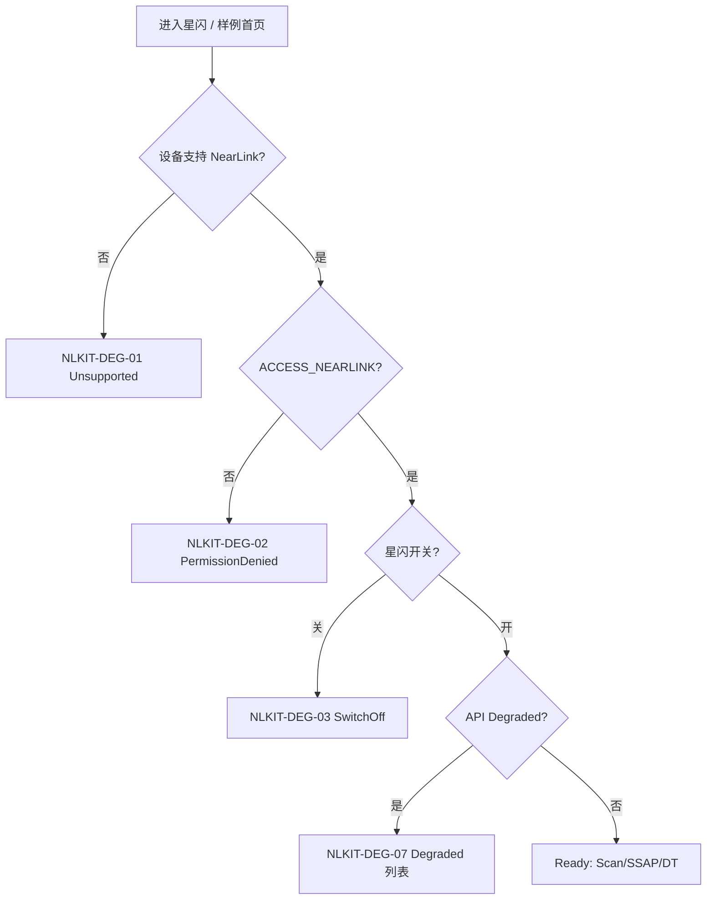

# HarmonyOS NearLink Kit 全量功能清单（平台参考）

> **状态**：深研草稿，未定稿  
> **定位**：星闪模块 **无 OSS 竞品**；本文档即 **HarmonyOS 平台参考应用行为** 的功能全集  
> **功能 ID 前缀**：**NLKIT-***（NearLink Kit）  
> **证据**：`.research/feature-inventory/20-星闪模块-功能清单与逐步流程-v2.md` · PRD `05-星闪模块PRD.md` · PRD `06-权限后台兼容与降级PRD.md` §7.3  
> **公开来源**：[HarmonyOS_Samples/nearlink-kit_-sample-code](https://gitcode.com/HarmonyOS_Samples/nearlink-kit_-sample-code) · [harmonyos_codelabs/nearlink-kit_-codelab](https://gitee.com/harmonyos_codelabs/nearlink-kit_-codelab) · 华为开发者 SSAP / dataTransfer 文档 · 社区教程 E-NL-003/004  
> **YoWire 产品化正文**：`04-星闪模块/01-星闪全量功能清单.md`（N-NL-*）  
> **说明**：非第三方 App 竞品清单；用于 YoWire 星闪 Tab **能力上限与降级边界** 的对照基线

---

## 1. 文档目的

HarmonyOS **NearLink Kit**（`@kit.NearLinkKit` / `@kit.ConnectivityKit` nearLink）提供 discovery 扫描、SSAP Client/Server、dataTransfer 端口数传、广播与权限模型。官方样例与 Codelab 即 **事实上的「参考 App」**。本文将 Kit API 与样例 UI 行为枚举为 **NLKIT-*** ID，并映射 YoWire **N-NL-***。

---

## 2. 平台基线与 Kit 模块（NLKIT-APP-*）

| 功能 ID | 项 | 内容 | 证据 |
| --- | --- | --- | --- |
| NLKIT-APP-01 | 最低 API | HarmonyOS **API 13+** / SDK 5.0.1 Release+ | E-NL-005 |
| NLKIT-APP-02 | Kit 包 | `@kit.NearLinkKit`；样例亦用 ConnectivityKit nearLink | E-NL-001 |
| NLKIT-APP-03 | 权限 | `ohos.permission.ACCESS_NEARLINK`（module.json5 声明 + 运行时申请） | E-NL-004 |
| NLKIT-APP-04 | 设备 | 手机/平板/PC/2in1 **真机** | E-NL-001 |
| NLKIT-APP-05 | 模拟器 | **不支持** NearLink 能力 | PRD 05 §5 · NL-DG-04 |
| NLKIT-APP-06 | 无 OSS 竞品 | UX 参照 nRF GATT（SSAP 树）+ SimpleBT（dataTransfer 终端） | doc 20 §7 |
| NLKIT-APP-07 | 样例仓库结构 | Scan 页 · SSAP Client 页 · SSAP Server 页 · dataTransfer 页 | gitcode 样例 |

**YoWire 原则**：星闪 Tab 自治；⚙ **星闪设置**；无全局日志中心（E-HMS-002）。

---

## 3. 信息架构（官方样例 → YoWire 映射）

```text
NearLink Kit Sample（典型多页）
├── 能力/权限说明（进入前）
├── Discovery — scan.startScan / deviceFound / stopScan
├── SSAP Client — createClient → connect → getServices → R/W/Notify
├── SSAP Server — createServer → addService → on(read/write) → notify
├── dataTransfer — createPort → connect → writeData / dataReceived
└── Advertising — startAdvertising / stopAdvertising（Server 侧样例）

YoWire 星闪 Tab（产品 IA）
├── CapabilityBanner（NLKIT-DEG-*）
├── 扫描列表 → 设备详情 → SSAP 树 | dataTransfer 终端
├── 收藏 / 最近会话
└── ⚙ 星闪设置
```

| 样例页面 | NLKIT 前缀 | YoWire 落点 |
| --- | --- | --- |
| Scan | NLKIT-DSC-* | N-NL-02/03 |
| SSAP Client | NLKIT-SSAP-C-* | N-NL-04/05/11 |
| SSAP Server | NLKIT-SSAP-S-* | N-NL-13 P3 |
| dataTransfer | NLKIT-DT-* | N-NL-06/12 |
| Advertising | NLKIT-ADV-* | N-NL-13 P3 |
| 权限/降级 | NLKIT-DEG-* | N-NL-01 |

---

## 4. Discovery 扫描（NLKIT-DSC-*）

| 功能 ID | 名称 | API / 事件 | 样例行为 | YoWire N-NL | 证据 |
| --- | --- | --- | --- | --- | --- |
| NLKIT-DSC-01 | 开始扫描 | `nearLink.startScan()` / 样例 Scan API | 列表刷新 | N-NL-02 | E-NL-001 |
| NLKIT-DSC-02 | 停止扫描 | `nearLink.stopScan()` | 连接前必须 stop | **N-NL-03** | E-NL-003 |
| NLKIT-DSC-03 | 设备发现回调 | `on('deviceFound', callback)` | 名称/地址/RSSI | N-NL-02 | E-NL-001 |
| NLKIT-DSC-04 | 设备地址 | ScanResult address（随机地址） | 列表列 | N-NL-02 | PRD §6.2 |
| NLKIT-DSC-05 | RSSI | ScanResult rssi（若提供） | 列表列 | N-NL-02 | 同上 |
| NLKIT-DSC-06 | 设备名称 | 广播 Local Name | 列表主标题 | N-NL-02 | 同上 |
| NLKIT-DSC-07 | 发现次数/时间 | 样例可累计；YoWire 要求发现次数 | 稳定性指标 | N-NL-02 | PRD §6.2 |
| NLKIT-DSC-08 | ScanRecord 原始 | 广播字节 | 详情 RAW HEX | NL-ADV-* | PRD §6.4 |
| NLKIT-DSC-09 | Local Name 解析 | ScanRecord | 详情字段 | NL-ADV-02 | 同上 |
| NLKIT-DSC-10 | Service Data | 16/128 UUID + payload | 详情 | NL-ADV-04 | 同上 |
| NLKIT-DSC-11 | Manufacturer Data | Mfg 字段 | 详情 | NL-ADV-05 | 同上 |
| NLKIT-DSC-12 | 扫描前权限检查 | ACCESS_NEARLINK granted | 未授权不扫 | N-NL-01 | E-NL-004 |
| NLKIT-DSC-13 | 星闪系统开关 | 系统设置星闪 ON | 关则 Banner | NL-DG-03 | PRD §4 |
| NLKIT-DSC-14 | 扫描互斥 | 连接进行中 stopScan | 阶段条 | N-NL-03 | doc 20 NL-05 |

### 4.1 扫描过滤（样例有限 · YoWire 扩展）

| 功能 ID | 能力 | Kit/样例 | YoWire |
| --- | --- | --- | --- |
| NLKIT-DSC-F01 | 按名称过滤 | 样例部分 | 轻量搜索 PRD §6.3 |
| NLKIT-DSC-F02 | 按地址过滤 | — | 专家 Filter |
| NLKIT-DSC-F03 | 过滤组 OR / 组内 AND | — | PRD §6.3 NL-03 |

---

## 5. SSAP Client 操作（NLKIT-SSAP-C-*）

SSAP（Starflash Service Access Protocol）对标 BLE GATT；Client 侧 **Service / Property** 树。

### 5.1 连接生命周期

| 功能 ID | 阶段 | API | 事件 | YoWire 阶段条 | 证据 |
| --- | --- | --- | --- | --- | --- |
| NLKIT-SSAP-C-01 | 创建 Client | `ssap.createClient(address)` | — | NL-A1 连接中… | E-NL-003 |
| NLKIT-SSAP-C-02 | 连接 | `client.connect()` | Promise/async | NL-A2 正在连接 | E-NL-002 |
| NLKIT-SSAP-C-03 | 连接状态 | — | `on('connectionStateChange', state)` | 阶段条/顶栏 | ost.51cto 30776 |
| NLKIT-SSAP-C-04 | 请求 MTU | `client.requestMtuSize(n)` | `on('mtuChange')` | NL-A3；[22,512] 默认 256 | E-NL-002 · V-NL-007 |
| NLKIT-SSAP-C-05 | 发现服务 | `client.getServices()` | 返回 Service 数组 | NL-A4 发现服务 | E-NL-002 |
| NLKIT-SSAP-C-06 | Ready | — | 树可操作 | NL-A5 | 同上 |
| NLKIT-SSAP-C-07 | 单 Client 实例 | 一 address 一 client | — | N-NL-14 单连接 | PRD §7.2 |
| NLKIT-SSAP-C-08 | 断开 | `client.disconnect()` | — | NL-SSAP-D01 | E-NL-002 |
| NLKIT-SSAP-C-09 | 关闭释放 | `client.close()` | — | 保留 Log 可重连 | 同上 |

### 5.2 Property 读写订阅

| 功能 ID | 操作 | API | 样例 UI | YoWire | 证据 |
| --- | --- | --- | --- | --- | --- |
| NLKIT-SSAP-C-R01 | Read Property | `readProperty(handle)` | 展示值 | NL-SSAP-R01 Sheet 文本/HEX | E-NL-002 SsapClientPage |
| NLKIT-SSAP-C-W01 | Write Property | `writeProperty(handle, value)` | 输入 hex/文本 | NL-SSAP-W01 + N-NL-05 确认 | 同上 |
| NLKIT-SSAP-C-N01 | Subscribe Notify | `setPropertyNotification(handle, true)` | 开关 | NL-SSAP-N01 | 同上 |
| NLKIT-SSAP-C-N02 | 属性变化 | — | `on('propertyChange', cb)` | Log pane | 同上 |
| NLKIT-SSAP-C-M01 | 当前 MTU 展示 | mtuChange 回调 | 标签 | NL-MTU-01 N-NL-11 | 架构 nearlink/02 |
| NLKIT-SSAP-C-M02 | 超 MTU 写入 | 平台返回/拒绝 | 提示 | NL-MTU-05 | 同上 |

### 5.3 服务树节点模型

| 节点 | 字段 | NLKIT 展示 ID |
| --- | --- | --- |
| Service | UUID、Handle | NLKIT-SSAP-C-T01 |
| Property | UUID、Handle、权限、值摘要 | NLKIT-SSAP-C-T02 |

---

## 6. SSAP Server 操作（NLKIT-SSAP-S-* · 架构预留）

| 功能 ID | 能力 | API | 样例/Codelab | YoWire v1 | 证据 |
| --- | --- | --- | --- | --- | --- |
| NLKIT-SSAP-S-01 | 创建 Server | `ssap.createServer()` | Server 页 | N-NL-13 隐藏/说明 | E-NL-004 |
| NLKIT-SSAP-S-02 | 添加 Service | `server.addService(service)` | 配置 UUID/Property | P3 NL-SRV-02 | E-NL-002 |
| NLKIT-SSAP-S-03 | 监听读 | `on('propertyRead', cb)` | 回调响应 | P3 NL-SRV-03 | 同上 |
| NLKIT-SSAP-S-04 | 监听写 | `on('propertyWrite', cb)` | 回调响应 | P3 NL-SRV-03 | 同上 |
| NLKIT-SSAP-S-05 | 主动通知 | `notifyPropertyChanged(...)` | Notify 按钮 | P3 NL-SRV-04 | 同上 |
| NLKIT-SSAP-S-06 | 服务模板 | 样例硬编码服务 | 保存模板 | P3 NL-SRV-05 | PRD §11.1 |

**YoWire**：v1 Client + dataTransfer 优先；Server 仅 A 栏「高级能力」说明（NL-DG-08）。

---

## 7. dataTransfer 端口数传（NLKIT-DT-*）

官方文档与样例混用 **dataTransfer** / SleDataChannel；YoWire UI 统一 **dataTransfer 终端**。

| 功能 ID | 阶段 | API / 概念 | 样例 | YoWire | 证据 |
| --- | --- | --- | --- | --- | --- |
| NLKIT-DT-01 | Port UUID | `createPort(uuid)` | 输入 UUID | NL-B1 N-NL-12 | E-NL-001 |
| NLKIT-DT-02 | 端口就绪 | createPort 成功 | 按钮态变化 | NL-B2 portReady | 架构 nearlink/03 |
| NLKIT-DT-03 | 连接设备 | `connect(device)` | connect 按钮 | NL-B3 | PRD §8.1 |
| NLKIT-DT-04 | 发送数据 | `writeData(ArrayBuffer)` | 文本/hex 输入 | NL-B5 NL-DT-01/02 | 样例 |
| NLKIT-DT-05 | 接收数据 | `on('dataReceived', cb)` | 日志区 | NL-B6 NL-DT-03 | 同上 |
| NLKIT-DT-06 | 断开 | `disconnect()` | — | NL-B8 | PRD §8.2 |
| NLKIT-DT-07 | 销毁端口 | `destroyPort()` | — | NL-B8 | 同上 |
| NLKIT-DT-08 | Port MTU | 端口级 MTU 展示/配置 | 样例部分 | NL-PORT-02 N-NL-12 | nearlink/03 |
| NLKIT-DT-09 | 拥塞错误 | 错误码 **1009700023** | 暂停发送 | NL-B7 退避 | 架构 nearlink/03 §1 |
| NLKIT-DT-10 | 换行发送 | 样例常 plain bytes | None/CR/LF/CRLF | NL-DT-04 E-SBT-005 UX | PRD §8.3 |
| NLKIT-DT-11 | HEX 模式 | bytes 编解码 | toggle | NL-DT-02 | 同上 |
| NLKIT-DT-12 | 收发统计 | 样例基础 | 字节/速率/错误 | NL-DT-07 | YoWire PRD |

**官方声明**：dataTransfer **不保证链路加密** → 必须 UI 提示（NLKIT-ENC-*）。

---

## 8. Advertising 广播（NLKIT-ADV-* · 预留）

| 功能 ID | 能力 | API | YoWire v1 | 证据 |
| --- | --- | --- | --- | --- |
| NLKIT-ADV-01 | 开始广播 | `advertising.startAdvertising(config)` | NL-DG-09 隐藏 | PRD §11.2 |
| NLKIT-ADV-02 | 停止广播 | `stopAdvertising()` | 同上 | 同上 |
| NLKIT-ADV-03 | 广播数据编辑 | 模板：间隔/功率/可连接/UUID/厂商数据 | NL-ADV-S01~03 P3 | 同上 |
| NLKIT-ADV-04 | 广播 ID | 系统分配 | NL-ADV-S02 | 同上 |

---

## 9. 加密与配对（NLKIT-ENC-*）

| 功能 ID | 场景 | API（待 V-NL-011 真机验证） | UI 要求 | YoWire N-NL | 证据 |
| --- | --- | --- | --- | --- | --- |
| NLKIT-ENC-01 | 加密状态查询 | `getAcbState()` → ENCRYPTED / … | 顶栏三态 | **N-NL-07** | PRD §9 |
| NLKIT-ENC-02 | 发起配对 | `startPairing()` | 配对 Sheet | NL-10 P1 | 同上 |
| NLKIT-ENC-03 | 未加密会话 | dataTransfer 常见 | 风险 Banner | NL-C2 | PRD §9 |
| NLKIT-ENC-04 | 加密未知 | API 无法确认 | 显示「**未知**」 | NL-DG-05 | **禁止**标已加密 |
| NLKIT-ENC-05 | 状态变化回调 | ACB 状态监听 | 刷新加密条 + SL | NL-C5 | PRD §9 |
| NLKIT-ENC-06 | SSAP 层加密 | 与配对关系 | 连接 Log 记录 | N-NL-07 | 架构 |
| NLKIT-ENC-07 | 用户策略 | — | 未加密禁止发送 | NL-C3 **星闪 ⚙·连接** | PRD §9 |

---

## 10. 权限 ACCESS_NEARLINK（NLKIT-PERM-*）

| 功能 ID | 场景 | 行为 | API/配置 | YoWire 降级 | 证据 |
| --- | --- | --- | --- | --- | --- |
| NLKIT-PERM-01 | module.json5 声明 | requestPermissions 块 | `ohos.permission.ACCESS_NEARLINK` | G-PERM | E-NL-005 |
| NLKIT-PERM-02 | 进入模块检查 | 已授权 / 未授权 | abilityAccessCtrl | N-NL-01 Banner | E-NL-004 |
| NLKIT-PERM-03 | 首次扫描申请 | 系统权限 Sheet | requestPermissionsFromUser | NL-DG-02 | ost.51cto 40506 |
| NLKIT-PERM-04 | 用户拒绝 | 不扫描不连接 | — | 去设置 G-PERM-02 | PRD 06 §4.2 |
| NLKIT-PERM-05 | 无权限 SSAP/DT | 全阻断 | — | 入口置灰 | NL-DG-02 |

**YoWire**：启动不批量申请；进星闪 Tab 按场景触发（PRD 06）。

---

## 11. 能力检测与降级（NLKIT-DEG-*）

### 11.1 状态机（平台 + YoWire Banner）



### 11.2 降级矩阵

| 功能 ID | 条件 | UI（样例弱 · YoWire 强） | 行为 | YoWire NL-DG | 证据 |
| --- | --- | --- | --- | --- | --- |
| NLKIT-DEG-01 | 硬件不支持 | Toast/空白 | 不应空白扫描 | NL-DG-01 | V-NL-001 |
| NLKIT-DEG-02 | 无 ACCESS_NEARLINK | 样例可能 crash/无引导 | Banner + Sheet | NL-DG-02 | E-NL-004 |
| NLKIT-DEG-03 | 星闪开关关 | 扫描失败 | 系统设置引导 | NL-DG-03 | PRD §4 |
| NLKIT-DEG-04 | 模拟器 | 能力不可用 | 真机提示 | NL-DG-04 | E-NL-001 |
| NLKIT-DEG-05 | 加密未知 | 样例常无 UI | **禁止**标已加密 | NL-DG-05 | PRD §9 |
| NLKIT-DEG-06 | 多连接 | 样例未约束 | 单连接 N-NL-14 | NL-DG-06 | V-NL-012 |
| NLKIT-DEG-07 | API < 13 | Kit 不可用 | Unsupported Banner | NL-DG-07 | E-NL-005 |
| NLKIT-DEG-08 | SSAP Server 未实现 | — | 高级说明 | NL-DG-08 | N-NL-13 |
| NLKIT-DEG-09 | Advertising 未实现 | — | 隐藏 | NL-DG-09 | PRD §11 |
| NLKIT-DEG-10 | 后台杀进程 | 连接丢失 | 可选关 G-BG | NL-DG-10 | V-NL-013 |

### 11.3 能力检测展示项（PRD §5）

| 检查 ID | 检查项 | 展示值 |
| --- | --- | --- |
| NLKIT-CHK-01 | 设备支持 NearLink | 支持 / 不支持 / 无法确认 |
| NLKIT-CHK-02 | 星闪开关 | 开 / 关 / 无法获取 |
| NLKIT-CHK-03 | ACCESS_NEARLINK | 已授权 / 未授权 |
| NLKIT-CHK-04 | API 版本 | 最低能力提示 |
| NLKIT-CHK-05 | 支持协议 | Scan / SSAP / dataTransfer / Advertising |
| NLKIT-CHK-06 | 运行环境 | 真机 / 模拟器 |

---

## 12. 官方样例逐步流程（NLKIT-FLOW-*）

### 12.1 扫描 → SSAP Client（对标 doc 20 NL-A*）

| 步 ID | 用户/样例动作 | Kit 行为 | NLKIT ID |
| --- | --- | --- | --- |
| NLKIT-FLOW-S01 | 打开 Scan 页 | 检查权限 | NLKIT-PERM-* |
| NLKIT-FLOW-S02 | 点 Scan | startScan | NLKIT-DSC-01 |
| NLKIT-FLOW-S03 | 列表出现设备 | deviceFound | NLKIT-DSC-03 |
| NLKIT-FLOW-S04 | 点设备 | stopScan | NLKIT-DSC-02 |
| NLKIT-FLOW-S05 | 进入 SSAP Client | createClient(address) | NLKIT-SSAP-C-01 |
| NLKIT-FLOW-S06 | Connect | connect() | NLKIT-SSAP-C-02 |
| NLKIT-FLOW-S07 | 请求 MTU | requestMtuSize(256) | NLKIT-SSAP-C-04 |
| NLKIT-FLOW-S08 | 加载服务树 | getServices() | NLKIT-SSAP-C-05 |
| NLKIT-FLOW-S09 | Read 某 Property | readProperty | NLKIT-SSAP-C-R01 |
| NLKIT-FLOW-S10 | Write Property | writeProperty | NLKIT-SSAP-C-W01 |
| NLKIT-FLOW-S11 | 开 Notify | setPropertyNotification | NLKIT-SSAP-C-N01 |
| NLKIT-FLOW-S12 | Disconnect | disconnect/close | NLKIT-SSAP-C-08/09 |

### 12.2 扫描 → dataTransfer（对标 NL-B*）

| 步 ID | 动作 | Kit 行为 | NLKIT ID |
| --- | --- | --- | --- |
| NLKIT-FLOW-D01 | 输入 Port UUID | — | NLKIT-DT-01 |
| NLKIT-FLOW-D02 | Create Port | createPort | NLKIT-DT-02 |
| NLKIT-FLOW-D03 | Connect | connect(device) | NLKIT-DT-03 |
| NLKIT-FLOW-D04 | 检查加密 | getAcbState | NLKIT-ENC-01 |
| NLKIT-FLOW-D05 | 发送文本/HEX | writeData | NLKIT-DT-04 |
| NLKIT-FLOW-D06 | 接收 | dataReceived | NLKIT-DT-05 |
| NLKIT-FLOW-D07 | 拥塞 | 1009700023 | NLKIT-DT-09 |
| NLKIT-FLOW-D08 | 断开 | disconnect/destroyPort | NLKIT-DT-06/07 |

---

## 13. 样例 vs YoWire 能力差距（Kit 有 · 样例 UI 弱）

| 维度 | 官方样例/Codelab | YoWire 必须补 |
| --- | --- | --- |
| 能力 Banner | 弱或无 | N-NL-01 完整状态机 |
| 扫描 Filter | 无组 OR/AND | PRD §6.3 专家 Filter |
| Write 确认 | 直接写 | N-NL-05 高风险二次确认 |
| 加密 UI | 常缺失 | N-NL-07 顶栏三态 + 禁止误标 |
| 会话导出 | 无 | N-NL-10 TXT/CSV/JSON |
| 命令面板 | 无 | N-NL-09 SSAP Write + DT 面板 |
| 收藏设备 | 无 | N-NL-08 广播特征 |
| 840vp 三分栏 | 单页栈 | NL-17 doc 18 |
| 模块 ⚙ 设置 | 无 | 会话/命令/连接/扫描/收藏 |
| SessionLog 统一 | 无 | SL-TYPE-08 `06-统一后端` |

**结论**：NLKIT-* 定义 **平台能力上限**；YoWire N-NL-* 定义 **产品化与调试工具 UX**。

---

## 14. YoWire 功能 ID 映射（NLKIT-* → N-NL-*）

| NLKIT 簇 | YoWire ID | 分级 | 主 UI / 设置 |
| --- | --- | --- | --- |
| NLKIT-DEG + NLKIT-PERM + NLKIT-CHK | **N-NL-01** | P0 | L0 Banner |
| NLKIT-DSC-01~14 | **N-NL-02** | P0 | B 扫描列表 |
| NLKIT-DSC-02 / FLOW-S04 | **N-NL-03** | P0 | stopScan→连接 |
| NLKIT-SSAP-C-* | **N-NL-04/05/11** | P0 | C SSAP 树 + MTU |
| NLKIT-DT-* | **N-NL-06/12** | P0 | C dataTransfer 终端 |
| NLKIT-ENC-* | **N-NL-07** | P0 | C 加密条 |
| —（样例无） | **N-NL-08** | P1 | 收藏 · 星闪 ⚙ |
| —（样例无） | **N-NL-09** | P1 | 星闪 ⚙·命令与面板 |
| —（样例无） | **N-NL-10** | P0 | 星闪 ⚙·会话导出 |
| NLKIT-SSAP-S + NLKIT-ADV | **N-NL-13** | P3 | A 高级说明 |
| 单 Client/连接管理 | **N-NL-14** | P0 | 连接管理器 |

### 14.1 PRD NL-* 交叉索引

| PRD ID | N-NL | NLKIT 来源 |
| --- | --- | --- |
| NL-01 | N-NL-01 | NLKIT-DEG-* |
| NL-02 | N-NL-02 | NLKIT-DSC-* |
| NL-03 | Filter | NLKIT-DSC-F* YoWire 扩展 |
| NL-05~08 | SSAP/DT | NLKIT-SSAP-C / NLKIT-DT |
| NL-09 | 加密 | NLKIT-ENC-* |
| NL-10 | 配对 | NLKIT-ENC-02 |
| NL-11~12 | MTU/Port | NLKIT-SSAP-C-M / NLKIT-DT-08/09 |
| NL-16~18 | Server/840vp | NLKIT-SSAP-S / NLKIT-ADV |

---

## 15. 840vp 宽屏（样例无 · YoWire doc 18）

| 栏位 | 内容 | 对标 BLE |
| --- | --- | --- |
| A | Sidebar 星闪● | 模块 Nav |
| B | 扫描/收藏 + Filter | 同 GATT B 栏 |
| C 上 | SSAP 树 60% 或 DT 终端 | 换 GATT→SSAP |
| C 下 | Log pane 40% | 同 BLE 连接 Log |

断点：<600vp 栈；600–839 双栏；≥840 三分栏（E-HMS-001）。

---

## 16. 统计摘要

| 维度 | NLKIT ID 数量（约） |
| --- | --- |
| APP 基线 | 7 |
| Discovery | 14 + 3 Filter |
| SSAP Client | 9 生命周期 + 8 操作 + 2 树 |
| SSAP Server | 6 |
| dataTransfer | 12 |
| Advertising | 4 |
| 加密配对 | 7 |
| 权限 | 5 |
| 降级 | 10 + 6 检测项 |
| 逐步流程 | 12 + 8 |

---

## 17. 联网证据索引（E-NL-*）

| Evidence ID | URL | 本文章节 |
| --- | --- | --- |
| E-NL-001 | https://gitcode.com/HarmonyOS_Samples/nearlink-kit_-sample-code | §4–§7 主样例 |
| E-NL-002 | https://gitee.com/harmonyos_codelabs/nearlink-kit_-codelab | §5–§6 SSAP 步骤 |
| E-NL-003 | https://ost.51cto.com/posts/30776 | §5 createClient+connect |
| E-NL-004 | https://ost.51cto.com/posts/40506 | §10 权限+Server |
| E-NL-005 | https://developer.aliyun.com/article/1683555 | §2 API13+ module.json5 |
| E-SBT-005 | https://play.google.com/store/apps/details?id=de.kai_morich.serial_bluetooth_terminal | §7 DT 终端 UX 参照 |

---

## 18. 相关文档

| 文档 | 路径 |
| --- | --- |
| YoWire 星闪产品清单 | `04-星闪模块/01-星闪全量功能清单.md` |
| 深研流程 v2 | `.research/feature-inventory/20-星闪模块-功能清单与逐步流程-v2.md` |
| 840vp 线框 | `.research/feature-inventory/18-HarmonyOS-840vp-星闪模块三分栏线框-v2.md` |
| SSAP 架构 | `.projectark/5-架构设计/无线调试工具/nearlink/02-SSAP客户端服务属性与MTU设计.md` |
| dataTransfer 架构 | `.projectark/5-架构设计/无线调试工具/nearlink/03-dataTransfer端口数传配对加密与拥塞设计.md` |
| 权限降级 PRD | `.projectark/2-需求文档/无线调试工具/PRD/06-权限后台兼容与降级PRD.md` §7.3 |
| 证据索引 | `07-联网调研证据/01-竞品版本基线与公开证据索引.md` §7 |
| SessionLog | `06-统一后端/01-SessionLog与Command能力清单.md` SL-TYPE-08 |

---

**文档元信息**

| 项 | 内容 |
| --- | --- |
| 版本 | 深研草稿 v1 |
| 功能 ID 前缀 | NLKIT-* |
| 性质 | **平台参考**（非第三方竞品） |
| 行数目标 | 400+ |
| 最后更新 | 2026-07-03 |
