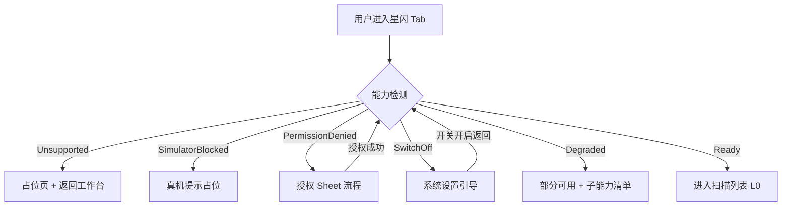

# 星闪模块 · 能力检测与权限引导流程

> **状态**：深研草稿，未定稿  
> **类型**：用户交互流程（逐步）  
> **依据**：`.research/feature-inventory/20-星闪模块-功能清单与逐步流程-v2.md` §2 · `03-UI设计/04-星闪模块/01-能力检测与降级设计.md` · PRD `05-星闪模块PRD.md` §4–§5 · PRD `06-权限后台兼容与降级PRD.md` §7.3  
> **对应功能 ID**：N-NL-01  
> **禁止**：Unsupported / Denied 时进入空白扫描页

---

## 1. 流程总览

**步骤域**：E（进入）· U/S/P/SW/D/R（终态）· I（检测项展示）· B（后台恢复）

---

## 2. 进入模块（NL-01 前置 · E-*）

| 步 | 用户动作 | 系统响应 | 控件名 |
| --- | --- | --- | --- |
| E-01 | 点底部 Tab **星闪** 或 A 栏 **星闪** | 显示 Loading Banner「正在检测星闪能力…」 | `TabItem_nearlink` |
| E-02 | — | 后台依次检查：硬件 NearLink → 模拟器 → ACCESS_NEARLINK → 星闪开关 → API 子能力 | `CapabilityCheckService` |
| E-03 | — | Banner 更新为终态（§3）；写 `capability_check_*` 至模块 SessionLog | `CapabilityBanner_nearlink` |
| E-04 | 宽屏 ≥840vp | A 栏高亮「星闪●」；非 Ready 时 B/C 合并占位 | `SideNavItem_nearlink` |
| E-05 | 从工作台星闪能力卡进入 | 同 E-01；可跳过 Tab 切换动画 | `ModuleCapabilityCard_nearlink` |
| E-06 | deep link `yowire://nearlink/…` | 先检测再路由；Denied 则 Banner | `DeepLinkHandler` |
| E-07 | 检测超时 >5s | Banner「检测超时 · 刷新」 | `CapabilityBanner_nearlink` |
| E-08 | 点 Banner **刷新** | 全量重检 E-02 | `btnCapabilityRefresh` |

---

## 3. Unsupported（本机不支持 · U-*）

| 步 | 用户动作 | 系统响应 | 控件名 |
| --- | --- | --- | --- |
| U-01 | 进入 Tab 后无需操作 | Banner：「本机不支持星闪」；副说明「无法扫描与连接」 | `CapabilityBanner_unsupported` |
| U-02 | 查看页面主体 | 全屏占位 Illustration；**无**设备列表、**无**扫描按钮 | `PlaceholderPage_unsupported` |
| U-03 | 点 **返回工作台** | 切换至工作台 Tab | `btnBackToWorkbench` |
| U-04 | 点 **能力说明** | 居中 Sheet（≥600 480×560）：检测项只读列表 | `btnCapabilityExplain` |
| U-05 | 点 **⚙** | 星闪设置；**隐藏**扫描/连接/收藏专项 | `btnModuleSettings` |
| U-06 | 设置内 | 仅「能力说明」「关于星闪」NavRow | `NavRow_capabilityOnly` |
| U-07 | 尝试系统分享 deep link | Toast「本机不支持」 | `DeepLinkHandler` |
| U-08 | 宽屏 | B/C 合并单栏占位；不展示空扫描列表 | `PlaceholderPage_unsupported` |

---

## 4. SimulatorBlocked（模拟器 · S-*）

| 步 | 用户动作 | 系统响应 | 控件名 |
| --- | --- | --- | --- |
| S-01 | 进入 Tab | Banner：「模拟器不支持星闪」 | `CapabilityBanner_simulator` |
| S-02 | 点 **查看真机要求** | Sheet：最低系统/API 与 NearLink 硬件要求 | `btnSimulatorRequirements` |
| S-03 | Dialog **我知道了** | 关闭 Dialog；占位页保留 | `btnDialogAck` |
| S-04 | 点 **返回工作台** | 切 Tab | `btnBackToWorkbench` |
| S-05 | — | **无**扫描列表；Log 写 `simulator_blocked` | `SessionLogService` |

---

## 5. PermissionDenied（权限未授予 · P-*）

| 步 | 用户动作 | 系统响应 | 控件名 |
| --- | --- | --- | --- |
| P-01 | 进入 Tab | Banner：「需要星闪权限」；扫描/连接入口置灰 | `CapabilityBanner_denied` |
| P-02 | 点 Banner **去授权** | 若可内联 → 系统 `ACCESS_NEARLINK` 请求弹窗 | `btnRequestPermission` |
| P-02a | 首次可选 | 底 Sheet 说明用途 → 用户确认后再 request | `PermissionExplainSheet` |
| P-03 | 系统弹窗点 **允许** | Banner Loading → 重检 → Ready 或 SwitchOff | 系统权限弹窗 |
| P-04 | 点 **拒绝** | Banner 保持 Denied；写 `permission_denied` | 系统权限弹窗 |
| P-05 | 永久拒绝 | 主动作 **打开系统设置**；Sheet 说明路径 | `btnOpenSystemSettings` |
| P-06 | 从系统设置返回 App | `onPageShow` 自动重检；无需再点刷新 | `CapabilityCheckService` |
| P-07 | 点 **了解权限用途** | 居中 Sheet：权限说明 + 不影响其他模块 | `btnPermissionUsage` |
| P-08 | Ready 后权限被撤销 | 点扫描/连接 → 回退 P-01 | `btnScanToggle` |
| P-09 | 与其他模块权限独立 | 蓝牙/WiFi 权限缺失 **不** 阻塞星闪 Banner 显示 | `CapabilityBanner_nearlink` |

---

## 6. SwitchOff（系统星闪开关关闭 · SW-*）

| 步 | 用户动作 | 系统响应 | 控件名 |
| --- | --- | --- | --- |
| SW-01 | 进入 Tab | Banner：「请开启系统星闪」 | `CapabilityBanner_switchOff` |
| SW-02 | 点 **打开系统设置** | deep link 系统星闪开关页（平台允许时） | `btnOpenNearlinkSettings` |
| SW-03 | 开启开关后返回 App | 自动重检 → Ready | `CapabilityCheckService` |
| SW-04 | 未开启即返回 | 列表区「开启后自动刷新」；仍无空白扫描 | `PlaceholderHint_switchOff` |
| SW-05 | 无法 deep link 设置 | Sheet 手动路径图文说明 | `ManualSettingsSheet` |
| SW-06 | 写 Log | `nearlink_switch_off` 事件 | `SessionLogService` |

---

## 7. Degraded（部分可用 · D-*）

| 步 | 用户动作 | 系统响应 | 控件名 |
| --- | --- | --- | --- |
| D-01 | 进入 Tab | Banner：「星闪部分可用」+ 动态副说明（如「dataTransfer 不可用」） | `CapabilityBanner_degraded` |
| D-02 | 点 **查看影响** | Sheet 子能力矩阵：Scan / SSAP / DT / Adv | `btnDegradedImpact` |
| D-03 | 点 Segmented **SSAP** / **dataTransfer** | 不可用项置灰 + Tooltip 原因 | `SegmentedControl_ssapDt` |
| D-04 | 可用子能力 | 正常进入 `02-SSAP` 或 `03-dataTransfer` | `NavPathStack` |
| D-05 | 仅 SSAP 可用 | DT Segmented 灰；SSAP 流程 NL-01 起 | `SegmentedTab_dataTransfer` |
| D-06 | 仅 DT 可用 | SSAP 灰；DT 流程 NL-B1 起 | `SegmentedTab_ssap` |
| D-07 | Scan 不可用 | 两 Segmented 均灰；Banner 说明 | `CapabilityBanner_degraded` |
| D-08 | 专家展开 Banner | JSON 技术摘要可复制 | `btnExpandBanner` |

---

## 8. Ready（可用 · R-*）

| 步 | 用户动作 | 系统响应 | 控件名 |
| --- | --- | --- | --- |
| R-01 | 进入 Tab | Banner 绿点「星闪可用」，可折叠为 32vp 摘要条 | `CapabilityBanner_ready` |
| R-02 | 展开 Banner | Chip 行：设备支持/开关/权限/API/协议支持 | `CapabilityChipRow` |
| R-03 | — | 进入 **NL-01** 扫描流程（`02-SSAP` §2 前置） | `NearlinkScanPage` |
| R-04 | Segmented 默认 | 上次 SSAP 或 dataTransfer | `SegmentedControl_ssapDt` |
| R-05 | 顶栏 | `[扫描/停止] [Filter] [⚙]` 激活 | `NearlinkTitleBar` |
| R-06 | 折叠 Banner | 仅 32vp 绿点条；点击再展开 | `CapabilityBanner_collapsed` |

---

## 9. 检测项展示（I-* · 专家 / 展开 Banner）

| 步 | 用户动作 | 系统响应 | 控件名 |
| --- | --- | --- | --- |
| I-01 | 展开 Ready/Degraded Banner | 检测项表格 | `CapabilityDetailTable` |
| I-02 | 专家模式 | 底部「技术摘要」JSON 可复制 | `btnCopyCapabilityJson` |
| I-03 | ⚙ → 高级 → **API 能力详情** | 与 Banner 检测项一致，只读 | `NavRow_apiCapability` |
| I-04 | 点表格行 | Tooltip 该项检测 API 与原始返回值 | `CapabilityDetailRow` |

| 检查项 | 展示值 | 控件名 |
| --- | --- | --- |
| 设备 NearLink | 支持 / 不支持 / 无法确认 | `capRow_hardware` |
| 星闪开关 | 开 / 关 / 无法获取 | `capRow_switch` |
| 权限 | 已授权 / 未授权 | `capRow_permission` |
| API 版本 | 版本号 + 最低能力提示 | `capRow_apiVersion` |
| Scan | ✓ / ✗ / 预留 | `capRow_scan` |
| SSAP Client | ✓ / ✗ | `capRow_ssap` |
| dataTransfer | ✓ / ✗ | `capRow_dataTransfer` |
| Advertising | ✓ / ✗ / 预留 | `capRow_adv` |

---

## 10. 后台恢复与刷新（B-*）

| 步 | 触发 | 系统响应 | 控件名 |
| --- | --- | --- | --- |
| B-01 | App 从后台恢复 | 静默重检；状态变化则 Banner 动画更新 | `CapabilityCheckService` |
| B-02 | 用户点 Banner **刷新** | 全量重检 + SessionLog 事件 | `btnCapabilityRefresh` |
| B-03 | 折叠屏开合 / 旋转 | Banner 展开/折叠偏好 **接续** | `BreakpointObserver` |
| B-04 | 系统星闪开关外部变化 | 下次 onPageShow 重检 | `CapabilityCheckService` |
| B-05 | Ready → Denied 降级 | 若已连接 SSAP/DT → Dialog 断开 | `KeepConnectionDialog` |

---

## 11. 宽屏非 Ready 占位流程（≥840vp）

| 步 | 终态 | B 栏 | C 栏 |
| --- | --- | --- | --- |
| W-1 | Unsupported | 占位 Illustration | 合并或隐藏 |
| W-2 | Denied | Banner + 去授权 | 说明文案 |
| W-3 | SwitchOff | 打开设置 CTA | — |
| W-4 | Degraded | Segmented（可用项） | 不可用项 Empty |
| W-5 | Ready | 扫描列表 | SSAP 树 / DT 终端 |

**铁律**：非 Ready **不出现**空白扫描列表与无效扫描按钮。

---

## 12. 与后续流程衔接

| 终态 | 下一文档 | 首步 |
| --- | --- | --- |
| Ready | `02-SSAP-Client逐步交互流程.md` | NL-01 |
| Ready | `03-dataTransfer逐步交互流程.md` | NL-01 + Segmented DT |
| Degraded（仅 SSAP） | `02-SSAP-Client…` | NL-01 |
| Degraded（仅 DT） | `03-dataTransfer…` | NL-B1 |
| Unsupported / Denied / SwitchOff / Simulator | **终止** | 不进入扫描 |

---

## 13. 与 SessionLog / 导出衔接

| 步 | 事件 | 导出 |
| --- | --- | --- |
| LG-1 | `capability_check_start/result` | 星闪 ⚙·会话与日志 |
| LG-2 | `permission_denied/granted` | 同上 |
| LG-3 | `nearlink_switch_off/on` | 同上 |
| LG-4 | 用户点 ⚙·会话 | 筛选 capability 类型行 | `SessionLogGroup` |

---

## 14. 验收要点（流程级 P0）

- [ ] E-01～E-03 任一非 Ready 终态 **不出现**空白扫描列表
- [ ] P-06 从设置返回自动重检
- [ ] Degraded 可进入可用子流程，不可用 Segmented 置灰 + Tooltip
- [ ] 宽屏非 Ready 不强行 A/B/C 三分栏空扫描
- [ ] 检测事件可经 ⚙·会话与日志导出
- [ ] U/S/P/SW 均可 **返回工作台**
- [ ] Ready 后 Banner 可折叠且不影响扫描

---

## 15. 相关文档

| 文档 | 路径 |
| --- | --- |
| SSAP 流程 | `02-SSAP-Client逐步交互流程.md` |
| dataTransfer 流程 | `03-dataTransfer逐步交互流程.md` |
| 星闪设置 | `04-星闪模块设置流程.md` |
| UI 设计 | `../../03-UI设计/04-星闪模块/01-能力检测与降级设计.md` |
| 深研证据 | `.research/feature-inventory/20-星闪模块-功能清单与逐步流程-v2.md` §2 |
| 会话导出 | `../06-统一后端/01-会话日志导出逐步交互流程.md` |

---

## 16. 与其他 App 权限冲突场景

| 步 | 场景 | 系统响应 | 控件名 |
| --- | --- | --- | --- |
| XC-1 | 系统蓝牙被其他 App 占用 | Banner「蓝牙资源占用」 | `CapabilityBanner_bleBusy` |
| XC-2 | WiFi 扫描被系统限制 | 环境分析 Banner + 重试 | `CapabilityBanner_wifiScan` |
| XC-3 | 星闪 API 返回 SERVICE_UNAVAILABLE | Degraded 或 Unsupported | `CapabilityBanner_degraded` |
| XC-4 | 用户拒绝位置但进 BLE 扫描 | 扫描钮灰 + 链式说明 | `btnScanToggle` |

---

## 17. QA 逐步走查清单（能力检测专项）

| # | 走查步 | 期望终态 | 文档步 ID |
| --- | --- | --- | --- |
| 1 | 真机首次安装进星闪 | E-01→R-01 或对应 Banner | E/R |
| 2 | 模拟器进星闪 | S-01 占位 | S-* |
| 3 | 拒绝 NEARLINK 永久 | P-05 打开设置 | P-* |
| 4 | 设置内开启后返回 | P-06→R-01 | P-06 |
| 5 | 关闭系统星闪开关 | SW-01→SW-03 | SW-* |
| 6 | Degraded 仅 SSAP | D-05 DT 灰 | D-* |
| 7 | 导出 capability 事件 | ⚙·会话有记录 | LG-* |

---

## 18. 权限引导与首页 / 工作台联动

| 步 | 用户动作 | 系统响应 | 控件名 |
| --- | --- | --- | --- |
| WB-1 | 工作台星闪能力卡显示 Denied | Chip 红；点卡片进 Tab P-01 | `ModuleCapabilityCard_nearlink` |
| WB-2 | 工作台最近会话星闪项 | deep link 先 E-02 检测 | `RecentSessionCard_nearlink` |
| WB-3 | 蓝牙/WiFi 正常但星闪 Unsupported | 仅星闪 Tab 占位；其他 Tab 不受影响 | `TabItem_nearlink` |
| WB-4 | 全局 PermissionSummaryStrip | 星闪 Chip 与 Tab Banner 文案一致 | `PermissionSummaryStrip` |
| WB-5 | 用户完成 P-03 授权 | 工作台 Chip 变绿；可选 Toast | `ModuleCapabilityCard_nearlink` |

---

## 19. 模拟器 / 真机 / 折叠屏检测差异

| 步 | 环境 | 检测分支 | 终态 | 控件名 |
| --- | --- | --- | --- | --- |
| EV-1 | HarmonyOS 模拟器 | 跳过硬件 NearLink | SimulatorBlocked S-* | `CapabilityCheckService` |
| EV-2 | 真机无 NearLink 芯片 | 硬件项不支持 | Unsupported U-* | `capRow_hardware` |
| EV-3 | 折叠屏外屏进星闪 | 同手机 E-01；Banner 可折叠 | R 或占位 | `CapabilityBanner_nearlink` |
| EV-4 | 折叠屏展开 ≥840vp | 非 Ready 不三分栏空扫 | W-* §11 | `BreakpointObserver` |
| EV-5 | API 版本低于最低 SSAP | Degraded 无 SSAP | D-05 | `capRow_ssap` |
| EV-6 | API 版本低于 DT | Degraded 无 DT | D-06 | `capRow_dataTransfer` |

---

## 20. 权限 Sheet 逐步（P-02a 展开）

| 步 | 用户动作 | 系统响应 | 控件名 |
| --- | --- | --- | --- |
| PS-1 | P-02 首次请求前 | PermissionExplainSheet 升起 | `PermissionExplainSheet` |
| PS-2 | 阅读「用于扫描与连接星闪设备」 | — | `permExplainBody` |
| PS-3 | 点 **继续** | 关闭 Sheet → 系统弹窗 P-02 | `btnPermExplainContinue` |
| PS-4 | 点 **暂不** | Sheet 关闭；保持 P-01 | `btnPermExplainLater` |
| PS-5 | 勾选 **不再提示** | 下次直接 P-02 系统弹窗 | `switchPermExplainSkip` |

---

**文档元信息**

| 项 | 内容 |
| --- | --- |
| 目录 | `02-用户交互流程/04-星闪模块/` |
| 版本 | 深研草稿 v1.1 |
| 行数目标 | ≥280 步表 |

