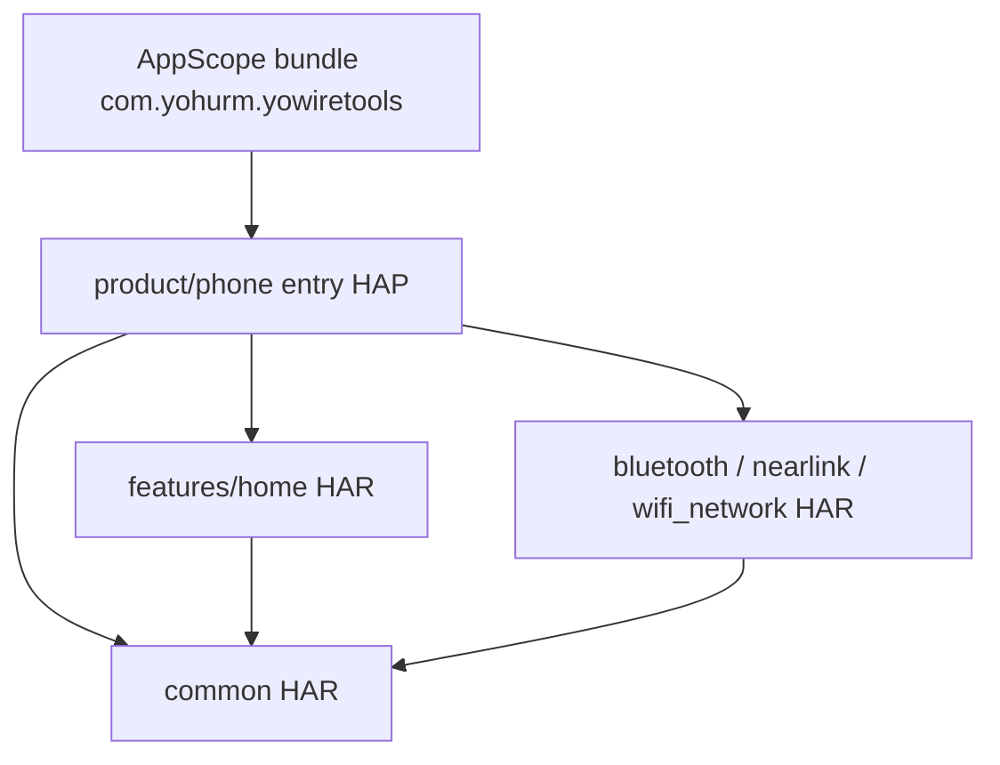
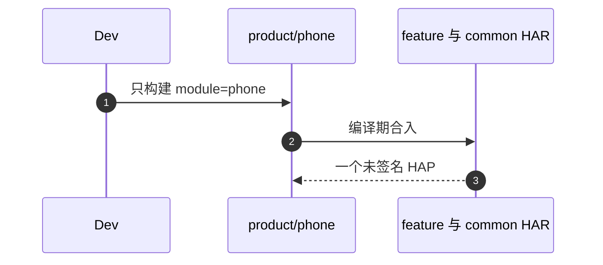
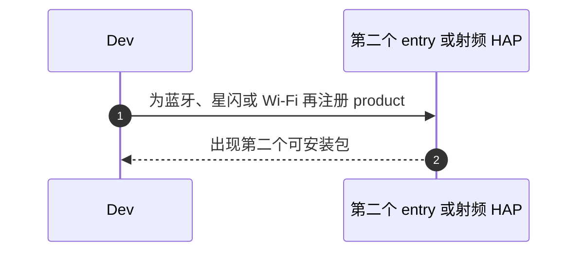

# APP-001 只有一个可安装 HAP

## 1. 条目与非目标

清单 `APP-001`，判定「支持」。没有单独屏幕。产物是 `product/phone`。

- Given：仓库里的 `module.json5`
- When：查找 `type` 为 `entry` 的模块，以及按射频拆开的 product
- Then：`bundleName` 是 `com.yohurm.yowiretools`。唯一 entry 是 `product/phone`。feature 与 common 是 HAR。没有按射频拆开的 product。`product/tablet` 不是 HAP

本条输入是模块类型。输出是一个可安装的 entry HAP。失败是再注册一个 entry，或把蓝牙、星闪、Wi-Fi 做成 Feature HAP。归属是 `AppScope` 与 `product/phone`。

非目标：不启用 `product/tablet`。不把 HAR 单独安装。视觉规格见 [PR #26](https://github.com/yohurm/HarmonyOS-YoWireTools/pull/26)。视觉落地不在本 PR。壳屏幕是否出现仍以 PR #20 的 `139ddc61d1f82e3d8f5c92980d420f19230bffec` 为准。射频真机结果不在本条。

官方：`开发/指南/入门/开发基础知识/应用程序包基础知识/应用程序包开发与使用/HAP.md` 写明单 UIAbility 优先一个 entry HAP。`开发/指南/入门/开发基础知识/应用程序包基础知识/应用程序包开发与使用/HAR.md` 写明 HAR 不能在设备上单独安装。`开发/最佳实践/架构设计/应用架构/分层架构设计.md` 把产品定制层编译成 Entry HAP。

## 2. 模块边界与分层

UI 是 ArkUI 页面。ViewModel/State 在 feature 的 `viewmodel`。UseCase 在 domain。RepositoryContract 是仓库契约。DataSource 与 KitBridge 在 `data`。Kit 只出现在 DataSource 或 KitBridge。

| 步骤 | 归属 |
| --- | --- |
| 可安装入口 | `product/phone`，`type: entry`，`module.name` 为 `phone` |
| 包名 | `AppScope/app.json5` 的 `com.yohurm.yowiretools` |
| 工作台 HAR | `features/home` |
| 射频 HAR | `features/bluetooth`、`features/nearlink`、`features/wifi_network` |
| 公共 HAR | `common/core`、`common/debug_core`、`common/platform`、`common/storage`、`common/yolog`、`common/youi_kit`、`common/yobluetooth` |
| 不存在的产品 | 无 `product/bluetooth`、`product/nearlink`、`product/wifi`。`product/tablet` 无 `module.json5` |

设计前与设计后相同：已经只有这一个 entry。落地壳页面时仍装进这一个 HAP，不新开模块类型。

依赖只向下。页面不调用射频 Kit。

## 3. 架构图

HAR 被打进这一个 HAP。它们不是第二、第三个可安装包。

## 4. 序列图

### 成功路径

未签名产物路径是 `product/phone/build/default/outputs/default/phone-default-unsigned.hap`。本条不把构建说成已经在本环境跑过。

### 失败路径

## 5. 数据模型

本条没有业务字段。模块身份只有这些稳定值：

| 字段 | 含义 | 所在层 |
| --- | --- | --- |
| `bundleName` | `com.yohurm.yowiretools` | AppScope |
| `module.name` | `phone` | entry |
| `type` | entry 或 har | module.json5 |

错误不在本条新增。构建失败不是会话错误码。

## 6. 层间接口

没有新的运行时接口。构建入口只有：

- `ohpm install`
- `hvigorw assembleHap --mode module -p product=default -p module=phone@default -p buildMode=debug`

壳页面以后新增的路由仍注册在这一个 `product/phone` 的 `Index.ets` 上，不进新的 HAP。

## 7. 权限与生命周期

权限声明留在 `product/phone` 的 `module.json5`。HAR 不单独申请一套安装期权限。工作台、日志和设置不在进入时申请射频权限，这是 WB-007 与 SET-003，不在本条改判定。

`EntryAbility` 是唯一 UIAbility。不为三个射频各加一个 Ability。

## 8. 日志

本条不写会话行，也不读 `YoLog`。进程启动可以继续 `YoLog.bootstrapFromFilesDir`。那是进程日志，不是会话列表。

## 9. 反模式

- 不把 `features/*` 改成 `type: feature` 的 HAP。
- 不把 `product/tablet` 登记成第二个 entry。
- 不把三个 phase-d 目录 checkout 进本 HAP 当作集成。
- 不声称 `assembleHap` 已在本环境通过。
- 不把本条支持写成壳屏幕已经补齐。那些屏幕仍按壳清单保持缺口。
