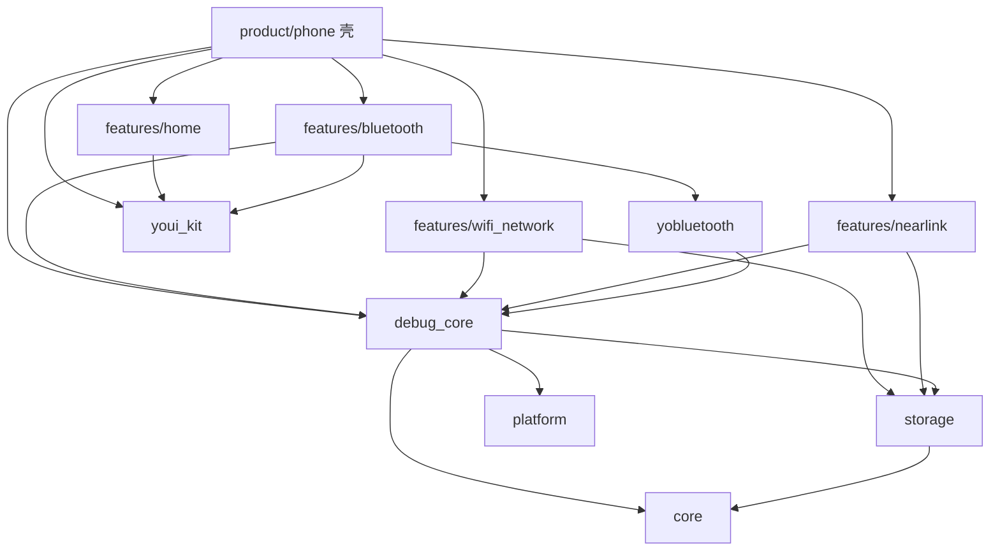
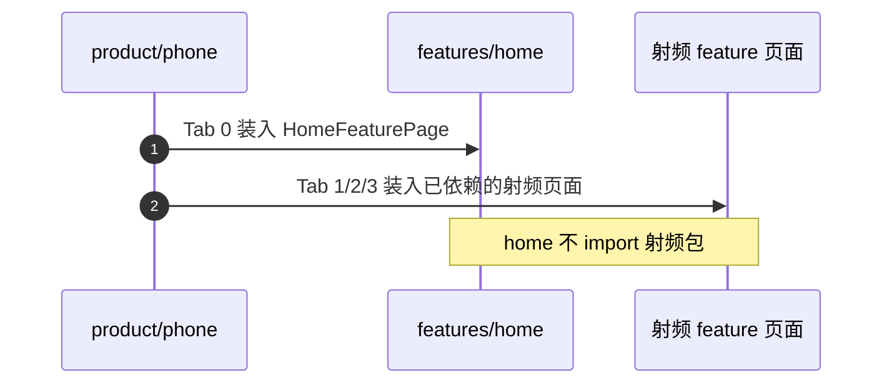
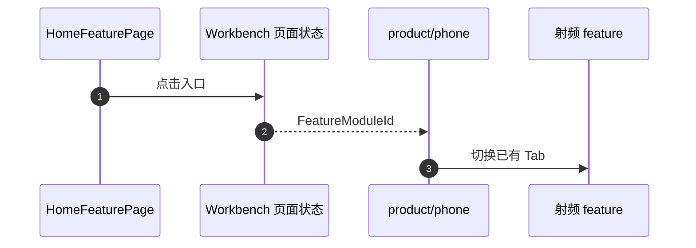
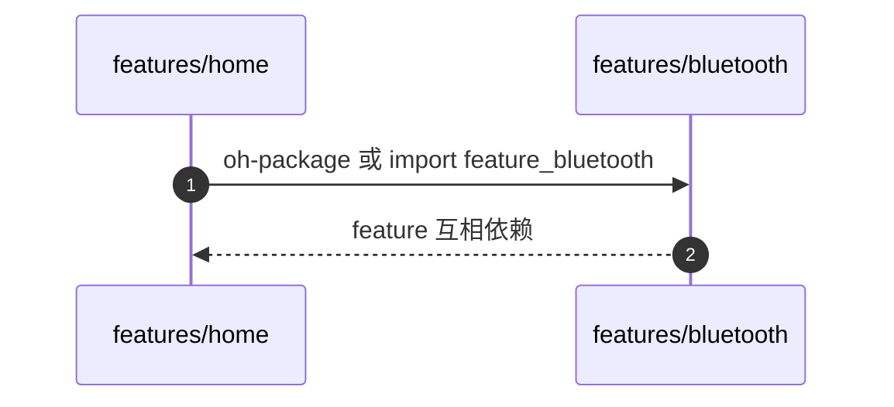

# APP-002 壳依赖 feature，feature 只依赖 common

## 1. 条目与非目标

清单 `APP-002`，判定「支持」。没有单独屏幕。

- Given：`product/phone` 已经依赖四个 feature
- When：查 feature 的依赖和 ets import
- Then：壳依赖四个 feature。feature 只依赖 common。feature 互不依赖。`from 'feature_` 只出现在 `product/phone`

本条输入是 `oh-package.json5`。输出是单向依赖。失败是 `features/home` 依赖三个射频包，或射频包互相 import。归属是包依赖，不是页面视觉。

非目标：不把 `common` 改成依赖 feature。不把 `debug_core` 从 common 搬回 feature。`.projectark` 里若把 `debug_core` 写成 feature，以本文件和现有目录为准：它已经在 `common/debug_core`。

官方 `开发/最佳实践/架构设计/应用架构/分层架构设计.md`：产品定制层依赖基础特性层和公共能力层，公共能力层不允许反向依赖。`开发/指南/入门/开发基础知识/应用程序包基础知识/应用程序包开发与使用/HAR.md`：HAR 不支持依赖传递，所以 phone 必须直接声明自己 import 的 common 包。

壳行为规格引用 `139ddc61d1f82e3d8f5c92980d420f19230bffec`。本条不实现 WB-004 的卡片。

## 2. 模块边界与分层

| 模块 | 依赖谁 | 不依赖谁 |
| --- | --- | --- |
| `product/phone` | `feature_home`、`feature_bluetooth`、`feature_nearlink`、`feature_wifi_network`，以及它直接 import 的 common | 不依赖不存在的 tablet 模块 |
| `features/home` | `youi_kit`。落地壳状态时可以再依赖 `debug_core`、`common_core` | 不依赖三个射频 feature |
| `features/bluetooth` | `common_core`、`common_platform`、`youi_kit`、`debug_core`、`yobluetooth` | 不依赖 home、nearlink、wifi_network |
| `features/nearlink` | `common_core`、`common_platform`、`common_storage`、`youi_kit`、`debug_core` | 不依赖 home、bluetooth、wifi_network |
| `features/wifi_network` | `common_core`、`common_platform`、`common_storage`、`youi_kit`、`debug_core` | 不依赖 home、bluetooth、nearlink |
| `common/*` | 只依赖更底的 common | 不依赖 features，不依赖 product |

设计前与设计后的包方向相同。工作台要点进射频时，`features/home` 仍不 import 射频包。它把 `FeatureModuleId` 交给 `product/phone`。phone 已经依赖射频 feature，由它切换现有 Tab。这就是「壳依赖 feature」。home 与三个射频 feature 互不依赖。

`yobluetooth` 留在 common。蓝牙 feature 依赖它，星闪和 Wi-Fi 不依赖它。

## 3. 架构图

home、bluetooth、nearlink、wifi_network 之间没有边。

## 4. 序列图

### 成功路径

今天壳已经把四个 feature 的页面放进同一个 `Navigation`。这条路径不新开栈，对应 WB-002，判定仍以壳清单为准。

设计后的卡片点击仍走 phone，不走 feature 互依赖：

卡片今天不存在，所以 WB-004 仍是缺口。上图是以后唯一允许的跳转，不是已经可观察的成功。

### 失败路径

## 5. 数据模型

跨模块只传递 common 里的身份，不传递另一个 feature 的页面类型。

| 字段 | 含义 | 所在层 |
| --- | --- | --- |
| `FeatureModuleId` | `bluetooth`、`wifi`、`nearlink` | `common/debug_core` 契约。类型落地前，本条不把它写成已经存在的类 |
| Tab 槽位 | 0 工作台，1 蓝牙，2 网络，3 星闪，4 更多 | `product/phone` 的 `AppRoutes` |

`FeatureModuleId` 的类属于 APP-003 的契约清单。APP-002 只约束谁可以依赖谁。在该类写进 `debug_core` 之前，home 不得改用射频包来表达这三个值。

## 6. 层间接口

壳可以 import 的 feature 符号以 APP-003 的稳定入口为准。在 APP-003 收口前，phone 现有 import 保持为页面装配，不得扩散到 feature 内部目录。

common 的公开面仍是各包 `Index.ets`。feature 不把 common 的内部路径写进自己的包入口。

## 7. 权限与生命周期

权限编排留在进入射频页面之后。切换 Tab 不申请权限。根 `NavPathStack` 只有 `product/phone` 的 `Index.ets` 持有。feature 页面不新建第二棵 `Navigation`。

## 8. 日志

依赖方向不产生会话行。会话列表的读法见 APP-005，不在本条另开。

## 9. 反模式

- 不让 `features/home` 依赖三个射频 HAR 来画入口卡。
- 不让射频 feature 依赖 `feature_home` 来回调壳。
- 不让 `common` 出现 `feature_*` 依赖。
- 不把 phone 直接依赖 common 说成违反单向。HAR 没有依赖传递，直接声明是同一方向。
- 不把本条支持写成工作台卡片、日志中心或命令面板已经存在。
