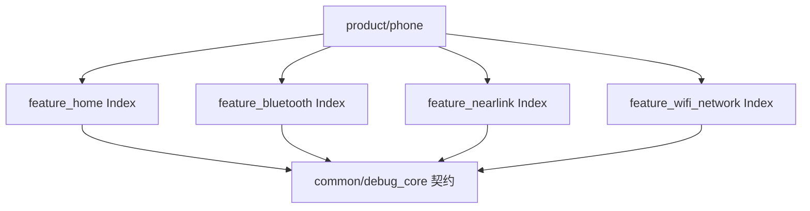
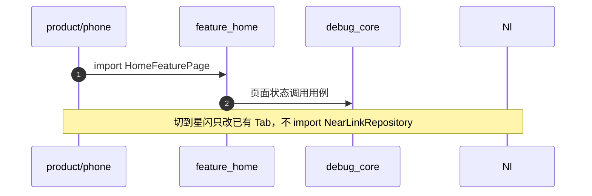

# APP-003 feature 包入口只导出稳定接口

## 1. 条目与非目标

清单 `APP-003`，判定「支持」。

- Given：壳只构造页面，以及蓝牙页已经用到的视图模型
- When：看四个 feature 的 `Index.ets`
- Then：星闪导出 `NearLinkFeaturePage` 与 `ReadNearLinkSwitchUseCase`。Wi-Fi 导出 `WifiFeaturePage` 与 `ReadWifiSwitchUseCase`。home 只导出壳页面和 `LogDetailNavParams`。蓝牙 feature 只导出 `product/phone` 已经 import 的那一组。蓝牙开关用例在 `yobluetooth`

本条输入是壳需要的入口。输出是各 feature 的 `Index.ets` 只导出下表符号。跨模块类型只放在已有的 `common/debug_core`。失败是壳 import `data/`、`domain/usecase`，或 feature 互相 import。

非目标：不新开 `common/contracts`。不改射频页面的布局。视觉不在本 PR。壳行为仍引用 `139ddc61d1f82e3d8f5c92980d420f19230bffec`。状态胶囊见 WB-003。射频仍是待真机。

## 2. 模块边界与分层

依赖方向：`product/phone` → `features/home`、`features/bluetooth`、`features/nearlink`、`features/wifi_network`，以及 phone 源码直接 import 的 common 包。`features/home` 依赖 `debug_core` 与 `youi_kit`，不依赖三个射频 HAR。三个射频 feature 只依赖 common，不依赖 `feature_home`，也不互相依赖。

| 步骤 | 归属 |
| --- | --- |
| 模块身份、会话日志契约、命令契约、设置契约 | `common/debug_core` |
| 表 `debug_log_index`、`command_template`、`app_setting` 与 preferences | `common/storage`。debug_core 用例不 import 这些查询类 |
| 蓝牙引擎 | `common/yobluetooth`。壳不 import 引擎数据源 |
| 壳装配 | `product/phone` 只 import 下表符号 |

下层不引用页面。feature 不互相引用。

## 3. 架构图

没有 home → 射频 feature 的边，也没有射频 feature 之间的边。

## 4. 序列图

失败路径是 phone 从 `feature_nearlink` import `NearLinkRepository`，或从 `feature_wifi_network` import `WifiNetworkRepository`。当前 `Index.ets` 没有这些 export。

## 5. 数据模型

领域模型留在 `common/debug_core`：`FeatureModuleId`、`SessionLogQuery`、`WorkbenchLogLine`、`CommandTemplate.favorite`、`SettingsSnapshot`。feature Index 不导出这些类，也不导出 Kit 结构体。

## 6. 层间接口

这是整机 API 清单。名字以这里为准。

### feature Index 稳定导出

| 包 | 导出 |
| --- | --- |
| `feature_home` | `HomeFeaturePage`、`LogCenterPage`、`LogDetailPage`、`CommandPanelPage`、`SettingsHubPage`、`LogDetailNavParams` |
| `feature_bluetooth` | `BtOverviewViewModel`、`BtStatusCard`、`SppMainViewModel`、`SppMainContentView`、`SppSegmentTab`、`ClassicDeviceListItem`、`openSppTitleMoreMenu`、`SPP_TITLE_MORE_MENU_ID`、`SppTerminalPage`、`SppTerminalNavParams`、`SppConnectDialog`、`PairingGuideDialog` |
| `feature_nearlink` | `NearLinkFeaturePage`、`ReadNearLinkSwitchUseCase` |
| `feature_wifi_network` | `WifiFeaturePage`、`ReadWifiSwitchUseCase` |

### common/debug_core 契约

| 契约 | 方法 | 调用方 |
| --- | --- | --- |
| `FeatureModuleId` | `BLUETOOTH`、`WIFI`、`NEARLINK`，值等于 `ModuleType` | 工作台页面状态交给 phone 切已有 Tab |
| `SessionLogRepositoryContract` | `list(SessionLogQuery)`、`deleteBySession(sessionId)`、`cleanup(retentionDays)`、`exportSession(sessionId, module, keyword)` | 只由日志用例调用 |
| `CommandRepositoryContract` | `listTemplates`、`saveTemplate`、`deleteTemplate` | 只由命令用例调用 |
| `SettingsRepositoryContract` | `load`、`saveTheme`、`saveAppMode`、`saveLogRetentionDays`、`saveRepeatAllowed`、`saveBackgroundConnection`、`saveLineEnding`、`saveLogDisplay`、`saveBluetoothAutoStop`、`saveWifiScanCooldown`、`saveNearLinkRequireFilter`、`saveMaskAddress`、`saveMaskHeaders`、`clearLocalData` | 只由设置用例调用。启动主题走 `LoadSettingsUseCase` |
| `ITransportSession` | 已有 `write` | 命令用例经 `TransportSessionRegistry` 按 sessionId 取得 |

已有用例：`LoadWorkbenchOverviewUseCase`、`LoadSessionLogPreviewUseCase`、`SendCommandUseCase`、`StartRepeatCommandUseCase`、`StopRepeatCommandUseCase`。壳新增且不并列第二套的用例：`ExportSessionLogUseCase`、`ClearSessionLogUseCase`、`LoadSettingsUseCase`、`UpdateSettingUseCase`、`ClearLocalDataUseCase`、`ListCommandTemplatesUseCase`、`SaveCommandTemplateUseCase`、`ExecuteSavedCommandUseCase`、`RepeatSavedCommandUseCase`。

射频仓库契约保持 `WifiNetworkRepositoryContract`、`NearLinkRepositoryContract`，以及 `yobluetooth` 已有用例入口。实现类不进 feature Index。

## 7. 权限与生命周期

收口入口不新增权限。设置 `load` 不调用 `requestPermissionsFromUser`。根 `NavPathStack` 仍只有一个。日志中心、日志详情、命令面板是这棵栈上的 `NavPathStack.pushPath`。工作台首页不靠入口卡切模块。壳底栏切已有 Tab 仍只改 `activeTabIndex`。

## 8. 日志

稳定入口不读取 `YoLog`。会话行只经过 `SessionLogRepositoryContract`，终点表名是 `debug_log_index`。见 APP-005。

## 9. 反模式

- 不新开契约模块。
- 不在 feature Index 里重新导出仓库、传输或探测类。
- 不让 phone 直接 import feature 的 `src/main/ets/data`。
- 不把 `tags` 交给命令页面。收藏只是领域字段 `favorite`。
- 不把仓库、传输或探测类加回 feature 入口。蓝牙开关读取留在 `yobluetooth`。
