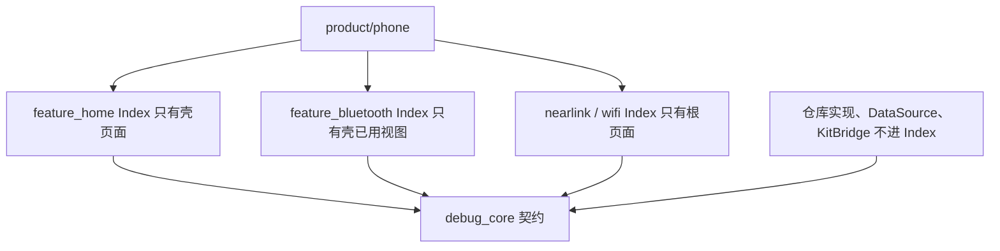
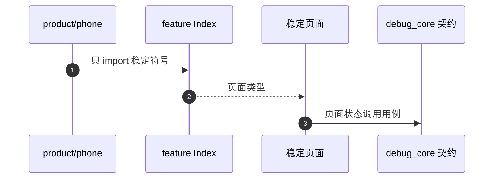
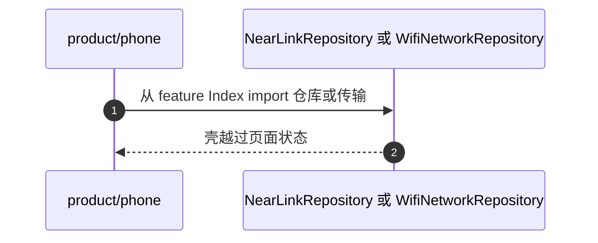

# APP-003 feature 的包入口还导出了内部类型

## 1. 条目与非目标

清单 `APP-003`，判定「缺口」。

- Given：壳今天只构造页面，以及蓝牙页已经用到的视图模型
- When：看星闪和 Wi-Fi 的 `Index.ets`
- Then：入口仍导出仓库实现、传输对象、用例和探测类。稳定接口还没收口

本条输入是壳需要的入口。输出是各 feature 的 `Index.ets` 只导出下表符号，跨模块类型只放在 common。失败是壳 import `data/`、`domain/usecase` 或另一个 feature 的内部文件。

非目标：不改射频页面的视觉。不把契约再放到一个新的 common 模块。目录里已经有 `core`、`debug_core`、`platform`、`storage`、`yolog`、`youi_kit`、`yobluetooth`。新契约放进 `debug_core`（会话、日志、命令、设置、模块身份）或沿用现有仓库契约所在的模块。不复制 `docs/goal/ui/`。

壳屏幕规格仍是 `139ddc61d1f82e3d8f5c92980d420f19230bffec`。本条定义入口和契约，不把缺的屏幕改成支持。

## 2. 模块边界与分层

设计前：`features/nearlink/Index.ets` 导出 `NearLinkRepository`、传输会话和用例。`features/wifi_network/Index.ets` 导出 `WifiNetworkRepository`、用例、`MqttWireCodec`、探测类。`product/phone` 并没有使用这些符号。蓝牙入口导出的是页面和视图模型，其中壳实际用到的只是下面的稳定集，其余视图仍被入口一起导出。

设计后：入口只保留稳定集。用例、仓库实现、DataSource、KitBridge、传输对象留在模块内部，由页面状态在模块内调用。壳跨模块只看见 common 契约和稳定页面。

| 步骤 | 归属 |
| --- | --- |
| 模块身份、会话日志契约、命令契约、设置契约 | `common/debug_core` |
| 表 `debug_log_index`、`command_template`、`app_setting` 与 preferences | `common/storage` 的数据源。debug_core 的用例不 import 这些类的具体查询 |
| 蓝牙引擎 | `common/yobluetooth`。`features/bluetooth` 的页面状态调用它的稳定用例，壳不 import 引擎内部数据源 |
| 壳装配 | `product/phone` 只 import 下表的 feature 符号 |

下层不引用页面。feature 不互相引用。

## 3. 架构图

## 4. 序列图

### 成功路径

本条判定仍是缺口。下面是收口之后的唯一入口用法，今天还没有发生。

### 失败路径

## 5. 数据模型

领域模型与存储行分开。页面不持有 Kit 结构体。

| 模型 | 字段 | 所在层 |
| --- | --- | --- |
| `FeatureModuleId` | `bluetooth`、`wifi`、`nearlink` | `common/debug_core` |
| `DebugSessionSummary` | 已有：id、displayName、module、protocol、state、startAtMs、logCount | 工作台最近会话。来源是 `SessionRuntimeStore`，不是日志行 |
| `SessionLogQuery` | sessionId、offset、limit、direction、recordType、startMs、endMs、module、keyword | 领域查询。`module` 与 `keyword` 今天的 `LogQuery` 还没有，所以 LOG-005 仍是缺口 |
| `WorkbenchLogLine` | 在现有字段上补 module、protocol。不新建第二行类型 | 页面投影。今天缺这两个字段，LOG-006 仍是缺口 |
| `CommandTemplate` | 已有字段。增加领域字段 `favorite`。页面不读 `tags` | 领域。存储行仍是 `command_template`，由 mapper 把收藏与 `tags` 互换 |
| `SettingsSnapshot` | themeMode、appMode、logRetentionDays、logMaxSizeMb、logDefaultDisplay、allowBackgroundConnection、allowRepeatCommand、commandLineEnding、bluetoothAutoStopDiscovery、wifiScanCooldownMs、nearlinkRequireFilter、maskAddress、maskHeaders | 领域快照。themeMode 来自表 `app_setting`，其余来自用户首选项 |

错误只带类别和已有错误码，例如 `StoreErrorCodes.RDB_OPEN_FAILED`。用户句子只在页面状态生成。

## 6. 层间接口

这是整机 API 清单。名字以这里为准。APP-004 只描述这些名字怎么往下走，不另起一套。

### feature Index 稳定导出

| 包 | 允许导出 | 禁止再导出 |
| --- | --- | --- |
| `feature_home` | `HomeFeaturePage`。落地壳时再加 `LogCenterPage`、`LogDetailPage`、`CommandPanelPage`、`SettingsHubPage` | 用例、仓库、DataSource |
| `feature_bluetooth` | `BtOverviewViewModel`、`BtStatusCard`、`SppMainViewModel`、`SppMainContentView`、`SppSegmentTab`、`ClassicDeviceListItem`、`openSppTitleMoreMenu`、`SPP_TITLE_MORE_MENU_ID`、`SppTerminalPage`、`SppTerminalNavParams`、`SppConnectDialog`、`PairingGuideDialog` | 仓库、DataSource、传输、Kit |
| `feature_nearlink` | `NearLinkFeaturePage` | `NearLinkRepository`、`SsapTransportSession`、`NearLinkDataTransferSession`、用例、探测 |
| `feature_wifi_network` | `WifiFeaturePage` | `WifiNetworkRepository`、用例、`MqttWireCodec`、探测类、检查清单 |

蓝牙表里的符号是 `product/phone` 今天已经 import 的集合。入口里多出来的视图改为模块内引用，壳不再从包入口看见它们。

### common/debug_core 契约

| 契约 | 方法 | 调用方 |
| --- | --- | --- |
| `FeatureModuleId` | 三个常量 | 工作台页面状态交给 phone |
| `SessionLogRepositoryContract` | `list(SessionLogQuery)`、`deleteBySession(sessionId)`、`cleanup(retentionDays)`、`exportSession(sessionId)` | 只由日志用例调用 |
| `CommandRepositoryContract` | `listTemplates`、`saveTemplate`、`deleteTemplate` | 只由命令用例调用 |
| `SettingsRepositoryContract` | `load`、`saveTheme`、`saveAppMode`、`saveLogRetentionDays`、`saveRepeatAllowed`、`saveLineEnding`、`saveBluetoothAutoStop`、`saveWifiScanCooldown`、`saveNearLinkRequireFilter`、`saveMaskAddress`、`saveMaskHeaders`、`clearLocalData` | 只由设置用例调用。启动主题也走 `load`，不另写查询 |
| `ITransportSession` | 已有 `write` | 命令用例从 `TransportSessionRegistry` 按 sessionId 取得。页面不构造 Kit 传输 |

已有用例保留并改依赖，不并列第二套：`LoadWorkbenchOverviewUseCase`、`LoadSessionLogPreviewUseCase`、`SendCommandUseCase`、`StartRepeatCommandUseCase`、`StopRepeatCommandUseCase`。设置读写真相用 `LoadSettingsUseCase` 与 `UpdateSettingUseCase`、`ClearLocalDataUseCase`。命令收藏列表用 `ListCommandTemplatesUseCase`，保存用 `SaveCommandTemplateUseCase`。这些类今天要么不存在，要么没有页面调用，所以相关壳编号仍是缺口。

射频仓库契约保持现有名字：`WifiNetworkRepositoryContract`、`NearLinkRepositoryContract`，以及 `yobluetooth` 已有的用例入口。它们的实现不进 feature Index。

`Index.ets` 只转发类型和页面，不写查询、不过滤关键字、不拼命令字节。

## 7. 权限与生命周期

收口入口不新增权限。设置契约的 `load` 不调用 `requestPermissionsFromUser`。命令执行若没有已注册的 `ITransportSession`，返回失败类别，不在面板里打开射频授权。

页面状态在离开导航目的地时取消订阅。根 `NavPathStack` 仍只有一个。

## 8. 日志

稳定入口不读取 `YoLog`。会话行只经过 `SessionLogRepositoryContract`，终点表名是 `debug_log_index`。见 APP-005。

## 9. 反模式

- 不新开 `common/contracts` 之类目录。契约放进已有的 `debug_core`。
- 不在 feature Index 里保留仓库「方便调试」。
- 不让 phone 直接 import feature 的 `src/main/ets/data`。
- 不把 `tags` 交给命令页面当收藏。收藏只是领域字段 `favorite`。
- 不把本条的目标 API 写成壳页面已经出现。WB-004 至 WB-006、WB-008 至 WB-012、LOG-001 至 LOG-003、LOG-005 至 LOG-007、SET-001、SET-002、SET-004 至 SET-006 保持缺口。
