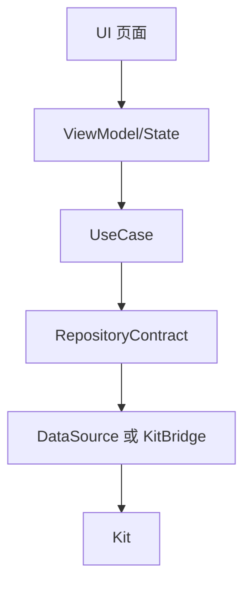
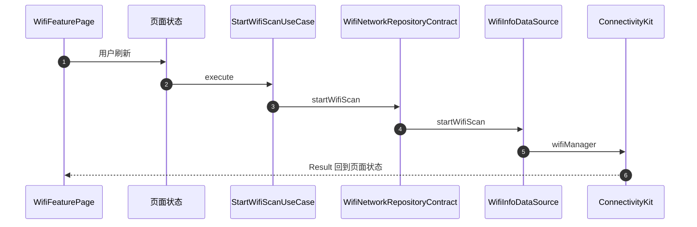

# APP-004 一条数据路径

## 1. 条目与非目标

清单 `APP-004`，判定「支持」。

- Given：射频 Kit 在 `data/datasource` 与 `data/kit`
- When：查 `domain/usecase` 与 `domain/service` 的 import
- Then：这些目录不再 import `data/datasource`、`data/transport` 或 `@kit.NearLinkKit` / `@kit.NetworkKit` / `@kit.ConnectivityKit`。契约不再引用数据源文件里的类型。日志用例不再调用 `LogRepository`

本条输入是一次用户动作。输出是一条路径：UI → ViewModel/State → UseCase → RepositoryContract → DataSource/KitBridge → Kit。失败是页面、用例或契约再碰到 Kit、DataSource 或 transport。

非目标：不保留旧直连再加一条契约调用。不新增第二张表。不把 ArkUI 或 `EntryAbility` 的 AbilityKit 当成射频数据路径。用例文件为了默认实参可以引用仓库实现类的 `getInstance()`，字段类型是契约，方法体只调用契约方法。

官方状态见 `开发/指南/开发/应用框架/ArkUI（方舟UI框架）/UI开发 (ArkTS声明式开发范式)/学习UI范式状态管理/MVVM模式（V2）.md`。本仓库页面状态目录名是 `viewmodel`。

WB-003 仍是缺口。射频仍是待真机。

## 2. 模块边界与分层

设计前越过契约的文件，设计后改成只调用契约：

| 原越界 | 现在的入口 |
| --- | --- |
| Wi-Fi 会话 / 扩展用例、`LanDiscoveryFacade` | `WifiNetworkRepositoryContract`。实现在 `WifiNetworkRepository`，套接字与发现落到 `WifiSessionGateway` |
| `WifiNetworkRepositoryContract` 引用 `NetworkConnectionDataSource` | `NetworkStateSnapshot` 在 `features/wifi_network` 的领域模型 |
| `WifiNetworkRepository` import `@kit.NetworkKit` 的 socket | 该 import 已删除。socket 留在 DataSource 与 transport |
| `NearLinkExtendedUseCases`、`NearLinkCapabilityService` | `NearLinkRepository` 的契约方法：`connectPreparedSsap`、`bindSsapEndpoints`、读写通知、`pairRemoteDevice`、`getAdapterState`、`openDataTransferSession` |
| `NearLinkRepository` import `@kit.NearLinkKit` | `buildTree` 在 `SsapPlatformMapper`。仓库不再 import `ssap` |
| `SppUuidFavoriteUseCases`、`GattConnectionUseCases`、`UartConnectionUseCases` | `BluetoothRepository` 的收藏方法与 `connectGattTransport`。`GattTransportSession` 在 data |
| `DeviceRegistry` | 文件在 `common/yobluetooth/src/main/ets/data/registry/`。domain 不再保留这份类 |
| `WorkbenchUseCases` 直连 `LogRepository` | `SessionLogRepositoryContract`。见 APP-005 |

| 步骤 | 归属 |
| --- | --- |
| UI | feature 页面与 `product/phone` 薄壳 |
| ViewModel/State | feature `viewmodel` |
| UseCase | feature 或 `debug_core` 的 domain |
| RepositoryContract | 已有契约；壳用 APP-003 的三个契约 |
| DataSource / KitBridge | `data/datasource`、`data/kit`、`data/gateway` |
| Kit | ConnectivityKit、NetworkKit、NearLinkKit，只在上一行 |

## 3. 架构图

没有从 UI 到 Ds 或 Kit 的边，也没有从 UseCase 到 Ds 的边。

## 4. 序列图

### Wi-Fi 扫描

### 壳日志读

与 APP-005 同一条分层。`LoadSessionLogPreviewUseCase` 只调用 `SessionLogRepositoryContract.list`。

### 失败路径

页面或用例直接 import Kit，或 domain 再 import `data/datasource`。当前 domain 目录没有这些 import。

## 5. 数据模型

Kit 结构体停在 DataSource 与 `data/mapper`。契约返回领域快照。`NetworkStateSnapshot` 的字段仍是 `hasDefaultNet`、`netType`、`bearerTypes`。`SessionLogQuery` 与存储 `LogQuery` 分开，仓库实现做唯一转换。

## 6. 层间接口

方法名以 APP-003 为准。本条的方向：

- 页面只调用本模块页面状态。
- 页面状态只调用用例，返回 `common/core` 的 `Result` 或领域投影。
- 用例构造参数的类型是契约。Wi-Fi 会话打开、组播、mDNS、SSDP、WebSocket 服务、MQTT、TCP 都走 `WifiNetworkRepositoryContract` 上的同名方法。
- `SendCommandUseCase` 继续接收 `ITransportSession`。sessionId 到传输对象的查找在用例内通过 `TransportSessionRegistry` 完成。
- `ExecuteSavedCommandUseCase` 自己向注册表取第一个会话。页面不传入 socket 或 GATT 对象。
- 同一动作不留两套公开函数。`getWebSocketDataSource`、`getDataSource`、`registerTransport` 已从用例侧去掉。

## 7. 权限与生命周期

权限请求留在现有权限编排。设置页和命令面板不调用 `requestPermissionsFromUser`。DataSource 仍由仓库实现持有。用例不缓存 Kit 对象。

## 8. 日志

射频写入继续走已有的 `LogCaptureService`，终点仍是 `debug_log_index`。读取不调用 `YoLog` 或 hilog。

## 9. 反模式

- 不在 domain 里用动态 import 绕过本条。
- 不把 Kit 调用包一层仍放在 usecase 目录。
- 不让 `WifiNetworkRepository` 或 `NearLinkRepository` 重新 import Kit。
- 不把 WB-003 写成已经有状态胶囊。
