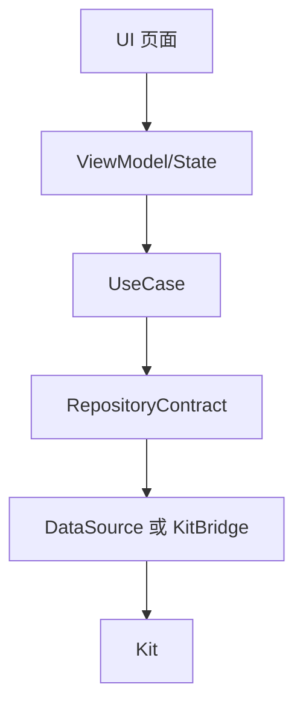
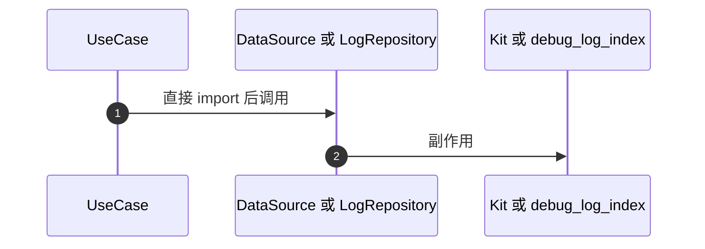
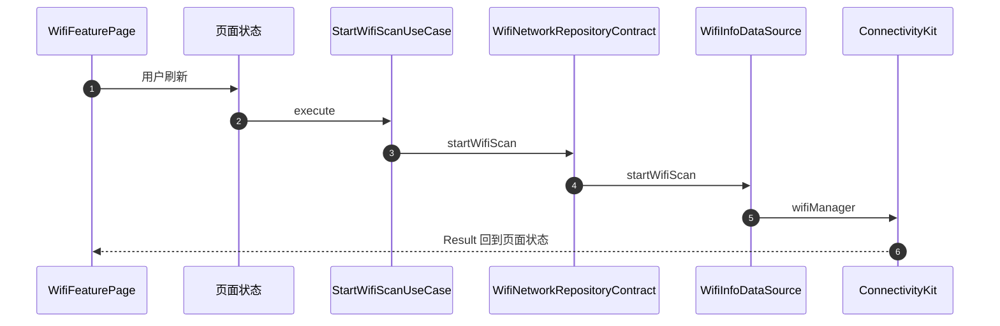
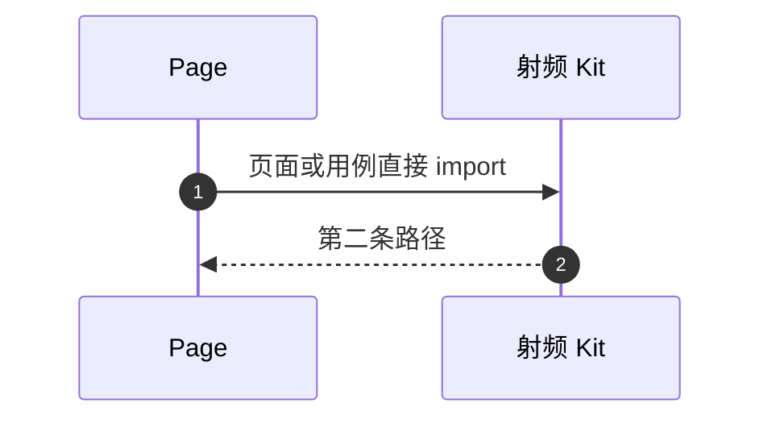

# APP-004 领域用例仍直接引用数据源或传输

## 1. 条目与非目标

清单 `APP-004`，判定「缺口」。

- Given：射频 Kit 已经在 `data/datasource` 与 `data/kit`
- When：查 domain 的 import
- Then：用例或领域服务仍引用数据源、传输，或契约引用数据源类型。日志用例直连 `LogRepository`

本条输入是一次用户动作。输出是一条路径：UI → ViewModel/State → UseCase → RepositoryContract → DataSource/KitBridge → Kit。失败是页面、用例或契约再碰到 Kit、DataSource 或 transport。

非目标：不保留旧直连再加一条契约调用。不新增第二张表、第二套仓库、第二套用例。不把 ArkUI 或 `EntryAbility` 使用的 AbilityKit 当成射频数据路径。射频 Kit 只许出现在 DataSource 或已有的 KitBridge。

官方状态见 `开发/指南/开发/应用框架/ArkUI（方舟UI框架）/UI开发 (ArkTS声明式开发范式)/学习UI范式状态管理/MVVM模式（V2）.md`。本仓库页面状态目录名是 `viewmodel`。

壳清单 `139ddc61d1f82e3d8f5c92980d420f19230bffec` 里的缺口屏幕不因本条改判。

## 2. 模块边界与分层

设计前，这些文件越过契约：

| 文件 | 越过的边界 |
| --- | --- |
| `features/wifi_network/.../WifiNetworkSessionUseCases.ets` | import DataSource 与 transport |
| `features/wifi_network/.../WifiNetworkExtendedUseCases.ets` | import DataSource 与 transport |
| `features/wifi_network/.../LanDiscoveryFacade.ets` | import DataSource |
| `features/wifi_network/.../WifiNetworkRepositoryContract.ets` | import `NetworkStateSnapshot` 自 DataSource |
| `features/wifi_network/.../WifiNetworkRepository.ets` | import `@kit.NetworkKit` 的 socket |
| `features/nearlink/.../NearLinkExtendedUseCases.ets` | import DataSource 与 transport |
| `features/nearlink/.../NearLinkCapabilityService.ets` | import DataSource |
| `features/nearlink/.../NearLinkRepository.ets` | import `@kit.NearLinkKit` |
| `common/yobluetooth/.../SppUuidFavoriteUseCases.ets` | import DataSource |
| `common/yobluetooth/.../GattConnectionUseCases.ets` | import transport |
| `common/yobluetooth/.../UartConnectionUseCases.ets` | import transport |
| `common/yobluetooth/.../DeviceRegistry.ets` | import DataSource |
| `common/debug_core/.../WorkbenchUseCases.ets` | `LogRepository.getInstance().list` |

设计后：上述 domain 文件只依赖本模块或 `debug_core` 的契约和领域模型。Kit 调用留在已经存在的 DataSource / KitBridge。仓库实现改为调用 DataSource，不再自己 import Kit。`NetworkStateSnapshot` 移到 Wi-Fi 领域模型，契约不再引用数据源文件。

日志读的替换见 APP-005，与本条是同一条路径，不另做一套。

| 步骤 | 归属 |
| --- | --- |
| UI | 各 feature 页面与 `product/phone` 薄壳 |
| ViewModel/State | feature `viewmodel` |
| UseCase | feature 或 `debug_core` 的 domain |
| RepositoryContract | 该能力已有的契约；壳日志、命令、设置用 APP-003 的三个契约 |
| DataSource / KitBridge | `data/datasource`、`data/kit` |
| Kit | ConnectivityKit、NetworkKit、NearLinkKit，只在上一行 |

## 3. 架构图

没有从 UI 到 Ds 或 Kit 的边，也没有从 UseCase 到 Ds 的边。

## 4. 序列图

### 设计前

### 设计后

以一次 Wi-Fi 扫描为例。页面和视觉保持现状。变的是用例不再握住数据源。

日志读的设计后序列在 APP-005。两条图用的是同一分层，不是两条产品路径。

### 失败路径

## 5. 数据模型

Kit 结构体停在 DataSource 与 `data/mapper`。契约方法返回领域快照：`WifiAccessPointSnapshot`、`WifiLinkedInfoSnapshot`、`NearLinkDevice`、蓝牙引擎已有的领域设备。`NetworkStateSnapshot` 改到领域模型文件，字段保持现在数据源里的含义，不另起一套名字。

`SessionLogQuery` 与存储用的 `LogQuery` 分开。仓库实现里的 mapper 做唯一转换。页面不看见 `relationalStore.ResultSet`。

## 6. 层间接口

方法名以 APP-003 为准。本条只加上下列方向：

- 页面只调用本模块页面状态。
- 页面状态只调用用例，返回 `common/core` 的 `Result` 或领域投影。
- 用例的构造参数是契约，不是 DataSource，不是 `LogRepository`，不是 Kit 对象。
- `SendCommandUseCase` 继续接收 `ITransportSession`。会话 id 到传输对象的查找在用例内通过 `TransportSessionRegistry` 完成。页面不把 socket 或 GATT 对象传进来。
- 仓库实现是契约的唯一实现类，内部只调用 DataSource / KitBridge。
- 同一动作不留两个公开函数。旧的直连调用在接上契约的同一改动里删掉。

## 7. 权限与生命周期

权限请求留在现有权限编排，不移进用例对 Kit 的直接 import。DataSource 在页面退出时由仓库实现释放扫描和 socket。用例不缓存 Kit 对象。

## 8. 日志

射频用例若要记会话，继续调用已有的 `LogCaptureService`。那是写入。读取不在用例里调用 `YoLog` 或 hilog。`LogCaptureService` 写入 `debug_log_index` 的路径保持 LOG-004，不改成第二张表。

## 9. 反模式

- 不在 domain 里用动态 import 绕过本条。
- 不把 Kit 调用包一层仍放在 usecase 目录。
- 不让 `WifiNetworkRepository` 或 `NearLinkRepository` 继续 import Kit。
- 不把缺口屏幕写成已经沿这条路径可观察。路径规则先写在这里；屏幕仍按壳清单是缺口。
