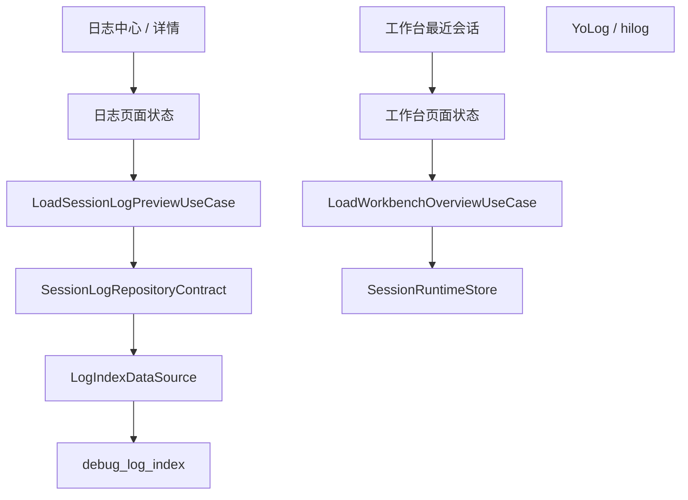
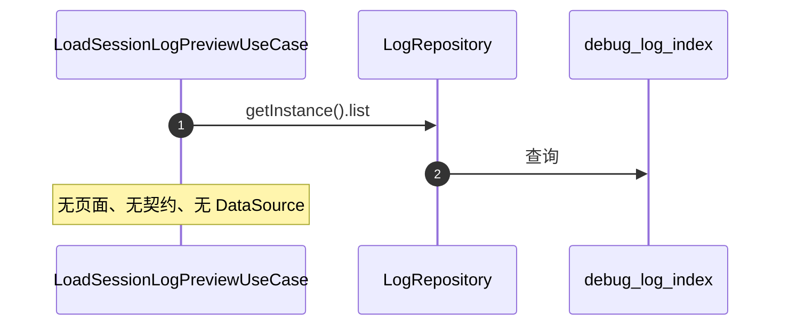
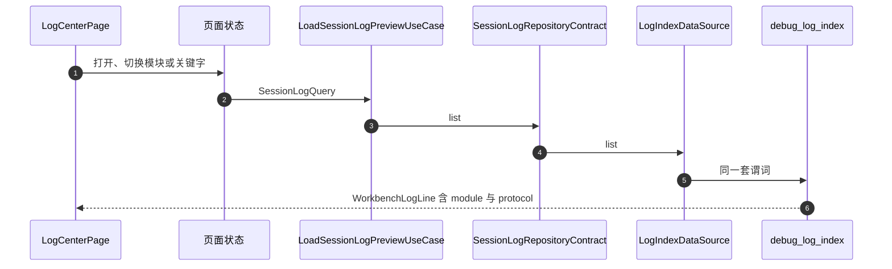
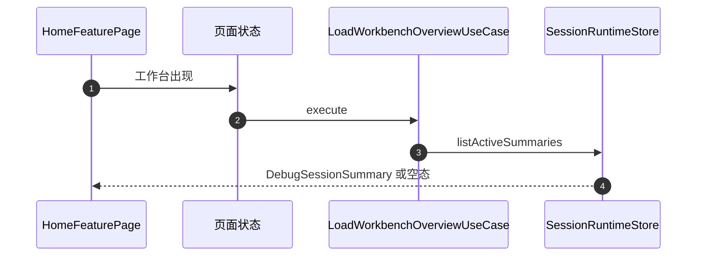
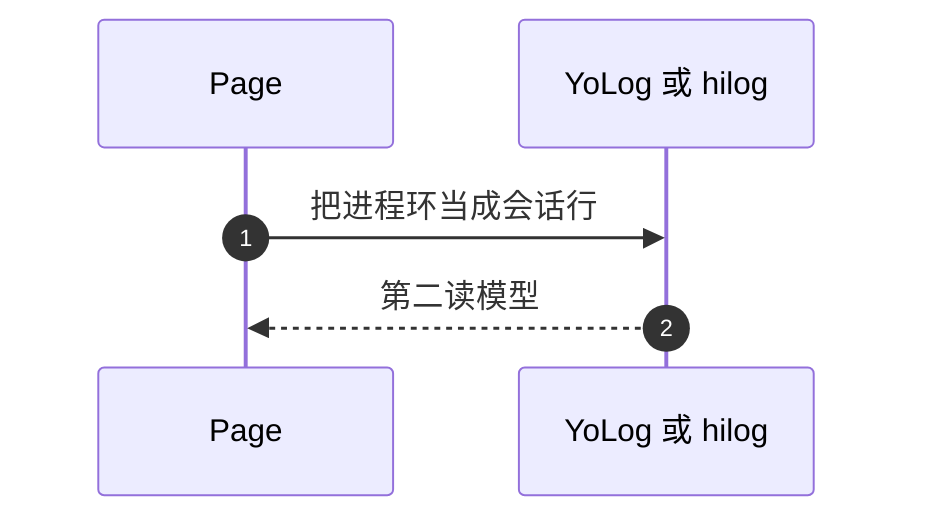

# APP-005 壳的会话列表还没有接到唯一读模型

## 1. 条目与非目标

清单 `APP-005`，判定「缺口」。屏幕是日志中心。工作台最近会话仍以 WB-005 为准，也是缺口。

- Given：写入侧已经进入 `debug_log_index`
- When：追踪壳上的一次会话行读取
- Then：没有页面。`LoadSessionLogPreviewUseCase` 直连 `LogRepository`。工作台也没有调用 `LoadWorkbenchOverviewUseCase`

本条输入是壳上的列表。输出分两种，不许混用：

1. 会话行（日志中心、日志详情）：UI → ViewModel/State → `LoadSessionLogPreviewUseCase` → `SessionLogRepositoryContract` → `LogIndexDataSource` → 表 `debug_log_index`。
2. 最近会话（工作台）：UI → ViewModel/State → `LoadWorkbenchOverviewUseCase` → `SessionRuntimeStore` 的 `DebugSessionSummary`。不读表，也不读 `YoLog`。

失败是列表改读 `FileAppender`、`MemoryRingAppender`、hilog，或每个射频模块再存一份会话行。

非目标：不新增 logger。不把 `DebugLogRecord` 再持久化到另一张表。不把最近会话改成查 `debug_log_index` 来冒充 WB-005。WB-005 的数据源就是现有的 `LoadWorkbenchOverviewUseCase`。

壳规格引用 `139ddc61d1f82e3d8f5c92980d420f19230bffec`。LOG-001、LOG-002、LOG-003、LOG-005、LOG-006、LOG-007、WB-005 保持缺口。LOG-004 与 LOG-008 保持支持，本条不改写它们。

关系库见 `开发/指南/开发/应用框架/ArkData（方舟数据管理）/应用数据持久化/通过关系型数据库实现数据持久化 (ArkTS).md`。hilog 见 `开发/API参考/系统/调测调优/Performance Analysis Kit（性能分析服务）/ArkTS API/ohos.hilog HiLog日志打印.md`。

## 2. 模块边界与分层

设计前：读链路停在 `WorkbenchUseCases.ets` 对 `LogRepository.getInstance().list` 的调用。没有契约，没有 `LogIndexDataSource` 这个名字，没有页面。

设计后：`LogRepository.list` 的查询体移到 `common/storage` 的 `LogIndexDataSource`，仍只查表 `debug_log_index`。`LogRepository.list` 改为调用这一处，不留下第二份谓词。`debug_core` 的 `SessionLogRepository` 实现 APP-003 的契约，是用例唯一的存储入口。用例不再出现 `LogRepository` 这几个字。

`module` 与 `keyword` 加在存储 `LogQuery` 和领域 `SessionLogQuery` 上，由 mapper 转换。关键字只匹配 `summary`。这是 LOG-005 要补的字段，在页面出现之前，LOG-005 仍是缺口。

`WorkbenchLogLine` 增加 `module` 与 `protocol`。不新建 `SessionLogLine`。这是 LOG-006。

| 步骤 | 归属 |
| --- | --- |
| 日志中心 / 详情 UI | `features/home` 的页面，由 `product/phone` 推进同一棵 `NavPathStack` |
| 页面状态 | `features/home` 的 viewmodel |
| 用例 | 现有 `LoadSessionLogPreviewUseCase`，改为依赖契约 |
| 契约 | `SessionLogRepositoryContract` |
| 数据源 | `LogIndexDataSource` |
| 终点 | 表 `debug_log_index` |
| 最近会话 | `LoadWorkbenchOverviewUseCase` 与 `SessionRuntimeStore`。无表 |
| 进程日志 | `common/yolog`。不是读模型 |

## 3. 架构图

`YoLog` 不在任何一条读边上。今天日志中心和工作台列表都还没接上，所以上图是目标，不是已观察结果。

## 4. 序列图

### 设计前

### 设计后：会话行

导出和清空走同一契约的 `exportSession`、`deleteBySession`、`cleanup`。页面不 import `LogExportService`。

### 设计后：最近会话

空列表显示空态。不显示编造的会话。没有摘要时就是空态，这才是 WB-005 的成功。今天页面没调用，所以 WB-005 仍是缺口。

### 失败路径

## 5. 数据模型

| 字段 | 含义 | 所在层 |
| --- | --- | --- |
| `SessionLogQuery.module` | 空表示全部，否则 `bluetooth`、`wifi`、`nearlink` | 领域查询 |
| `SessionLogQuery.keyword` | 匹配 `summary` | 领域查询 |
| `LogQuery.module` / `keyword` | 存储查询，只在 mapper 与数据源使用 | `common/storage` |
| `WorkbenchLogLine.module` / `protocol` | 列表主行要显示的模块和协议 | 页面投影 |
| `DebugSessionSummary` | 最近会话。已有类型 | 运行时，不落日志表 |

存储行仍是 `LogIndexRecord`。不把领域 `DebugLogRecord` 再写进第二张表。

## 6. 层间接口

与 APP-003 的 `SessionLogRepositoryContract` 相同，不另增方法。

- `list` 是唯一查询。
- `deleteBySession` 对应已有 `LogRepository.deleteBySession`，经数据源执行。
- `cleanup` 对应已有 `LogRepository.cleanup`。
- `exportSession` 对应已有 `LogExportService.exportLogs`，经契约转一次。页面和用例都不 import 导出服务。
- 工作台不调用 `list` 来画最近会话。

过滤在数据源的谓词里完成。用例不在内存里再滤一遍又保留未过滤的第二列表。

## 7. 权限与生命周期

读日志和读最近会话都不申请射频权限。库未打开时 `list` 返回 `StoreErrorCodes.RDB_OPEN_FAILED`。页面显示失败，不显示空成功。

订阅若在页面状态里加上，离开目的地时成对取消。本条的文档提交不添加订阅。

## 8. 日志

写入保持 LOG-004：`LogCaptureService` → `LogRepository.append` → `debug_log_index`。

读取只有本节的一条。下列都是第二日志库：日志中心、日志详情或最近会话改读 `YoLog`；三个射频模块各存一份会话行再并列查询；把会话行写进 `PreferencesStore` 或 `app_setting`；直连 `LogRepository.list` 与契约查询并存；页面 import `@kit.ArkData` 或 `yolog` 来列会话。

进程日志继续给启动和故障使用，不进入列表。

## 9. 反模式

- 不把 `SessionRuntimeStore` 的摘要写进 `debug_log_index` 再读出来，当作最近会话。
- 不把 `debug_log_index` 的行当作最近会话去满足 WB-005。
- 不新增 `LoadSessionLogUseCase` 与预览用例并列。
- 不把 hilog 缓冲绑到列表。
- 不把本条目标序列写成日志中心已经打开。
